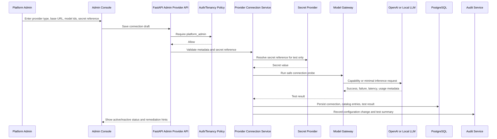
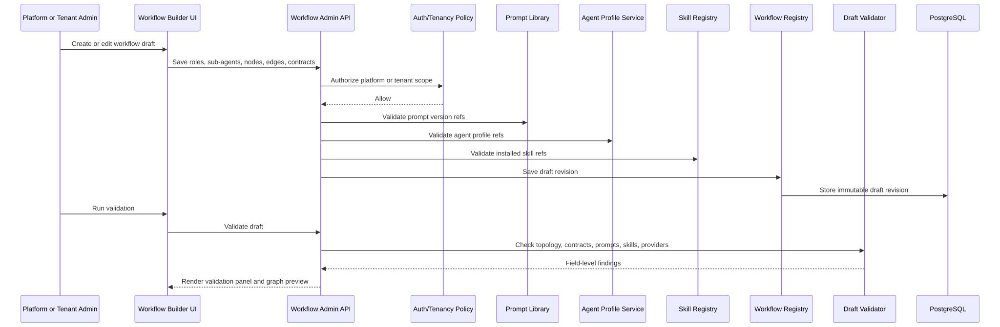
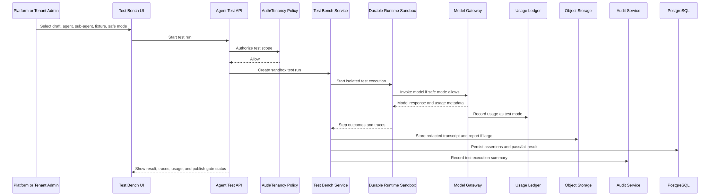
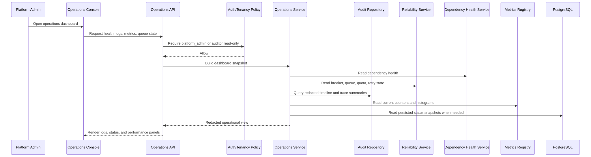
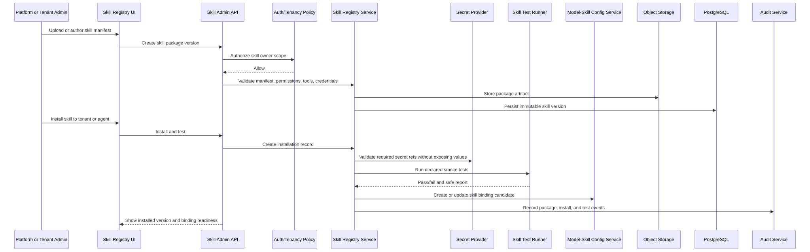
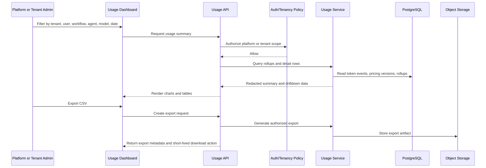
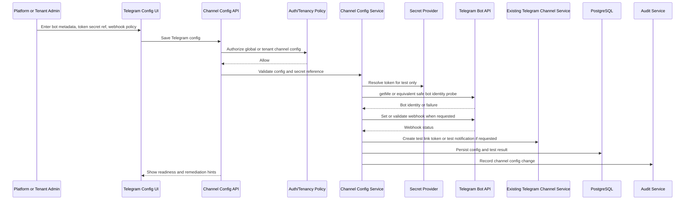
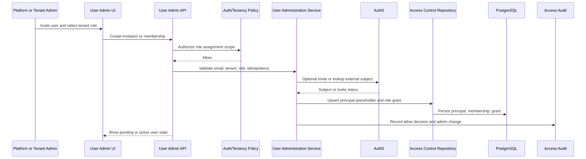

# Multi-Agent Platform Expansion Architecture

## 1. Purpose

This document extends the current architecture in
`docs/architecture.md` and the implemented specs `001` through `009`. It
focuses on the admin-facing scenarios needed to operate the platform as a
usable product:

1. Platform admins configure OpenAI and local open-source LLM connections.
2. Platform and tenant admins create agents, sub-agents, and workflows through
   a web UI.
3. Platform and tenant admins test agents, sub-agents, and complete workflows.
4. Platform admins inspect logs, health, and performance status.
5. Platform and tenant admins create, install, and bind agent skills.
6. Platform and tenant admins view token usage by user, agent, sub-agent,
   workflow, and tenant.
7. Platform and tenant admins configure and test Telegram connections.
8. Platform and tenant admins add users and manage role grants.

The current platform already provides strong foundations: authentication,
tenant context, workflow registry, durable runtime records, immutable memory,
channel adapters, model-skill configuration, audit/debugging, and reliability
controls. The missing work is mostly productization and runtime integration:
provider connection testing, model invocation adapters, prompt and skill
lifecycle management, admin UX, usage metering, channel configuration, user
administration, and operational dashboards.

## 2. Current Architecture Review

The repository is a modular Python/FastAPI backend with PostgreSQL as the
production system of record. Current implemented areas include:

| Current spec | Existing capability | Useful code areas |
| --- | --- | --- |
| `001-platform-foundation` | FastAPI app, worker bootstrap, settings, DB/session, tenancy, storage, secrets, health | `api/`, `bootstrap/`, `config/settings.py`, `db/`, `runtime/health/`, `storage/`, `secrets/`, `workers/` |
| `002-platform-auth-access` | Auth0/local auth, platform/tenant roles, role grants, support overrides, access audit | `auth/`, `api/routers/admin_access.py`, `db/models/access_control.py`, `db/repositories/access_control.py` |
| `003-workflow-studio-registry` | Workflow drafts, agent/sub-agent role schema, validation, publish bundles, sharing, minimal web UI | `admin/workflow_registry/`, `api/routers/admin_workflows.py`, `web_admin/templates/workflows/` |
| `004-durable-orchestration-runtime` | Run records, execution bundle pinning, checkpoints, handoffs, approvals, lineage, worker lease model | `runtime/orchestration/`, `workers/orchestration.py`, `db/models/runtime_orchestration.py` |
| `005-immutable-memory` | Append-only memory scopes, versions, heads, replay/diff, audit | `memory/`, `api/routers/memory.py`, `db/models/memory.py` |
| `006-user-interaction-channels` | Web/API/Telegram run channels, status, results, notifications, callbacks, artifact grants | `channels/`, `api/routers/channel_runs.py`, `api/routers/telegram_webhook.py` |
| `007-model-skill-routing` | Versioned model routing, prompt references, skill bindings, tool/outbound/credential policy, provenance | `config/`, `api/routers/admin_model_skill_config.py`, `db/models/model_skill_config.py` |
| `008-production-audit-debugging` | Timeline, traces, replay, lineage, redacted exports, secret access records | `audit/`, `api/routers/admin_run_inspection.py`, `observability/` |
| `009-reliability-scale-hardening` | Backpressure, quotas, fairness, retries, breakers, compensation, dead letters, reliability UI | `reliability/`, `api/routers/reliability_controls.py`, `web_admin/templates/reliability/` |

Important gaps for the requested scenarios:

- `ModelProviderCatalogEntry` exists, but there is no first-class connection
  registry for OpenAI/local providers, no connection test workflow, and no
  runtime inference gateway.
- Prompt references exist, but there is no prompt library or prompt-version
  authoring surface.
- Workflow drafts support agent and sub-agent structures, but the web UI is a
  minimal server-rendered editor rather than a guided builder for admins.
- Skill bindings exist, but there is no skill package registry, install flow,
  manifest validation, or tenant installation approval lifecycle.
- Audit traces can record model selection and tool usage, but there is no token
  usage ledger or cost/usage analytics by user, agent, or sub-agent.
- Telegram webhook/link behavior exists, but bot token, webhook setup, tenant
  enablement, and test-send flows are settings-driven rather than admin UI
  driven.
- Principal identities and role grants exist, but there is no user invite,
  user listing, suspension, or tenant membership admin console.
- Reliability and audit data exist, but platform admins need a unified
  operations console for logs, metrics, health, dependency status, and
  performance trends.

## 3. Target Architecture

The expansion keeps the modular-monolith shape: one FastAPI control plane, one
worker package, PostgreSQL for transactional state, object storage for large
artifacts, and secret providers for credential material. New functionality is
added as bounded subsystems that reuse existing auth, tenancy, audit,
observability, and reliability rules.

## 4. New Bounded Contexts

### 4.1 Admin Console Shell

The current admin UI consists of separate server-rendered pages. The expansion
adds a shared admin shell with navigation, tenant scope switcher, platform vs
tenant affordances, flash/error components, audit-safe forms, and common table
patterns. This remains Jinja plus small JavaScript files under `web_admin/` so
the frontend stays aligned with existing architecture.

Expected additions:

- `api/routers/admin_console.py`
- `api/ui/admin_console.py`
- `web_admin/templates/layouts/admin.html`
- `web_admin/templates/admin/index.html`
- `web_admin/static/admin_console.js`
- docs tests for page links and authorization-sensitive navigation

### 4.2 Model Provider Connections And Model Gateway

The provider connection subsystem makes model access explicit, testable, and
auditable before model routing can use a provider.

Responsibilities:

- Store provider connection records with tenant visibility, provider type,
  base URL, default headers metadata, secret reference ids, supported
  capability metadata, status, and last test result.
- Support platform-admin setup for OpenAI and local open-source LLM endpoints.
- Allow tenant admins to select only platform-authorized providers/models for
  routing, unless a later policy allows tenant-owned provider connections.
- Resolve provider credentials through existing secret providers.
- Run safe test probes: list/capability probe where supported, minimal
  completion/chat probe where allowed, latency capture, and failure
  categorization.
- Provide a runtime `ModelGateway` interface that workers call instead of
  calling providers directly.
- Capture usage metadata returned by provider calls and pass it to the token
  usage ledger.
- Route dependency failures through existing reliability breaker and retry
  controls.

Proposed code areas:

- `model_providers/` for adapter and connection domain logic
- `api/routers/admin_model_providers.py`
- `api/schemas/model_providers.py`
- `db/models/model_provider_connections.py`
- `db/repositories/model_provider_connections.py`
- `web_admin/templates/model_providers/`
- `tests/unit/model_providers/`, `tests/integration/model_providers/`

Connection records should complement, not replace,
`model_provider_catalog_entries`. The connection is operational access to a
provider; the catalog entry is the model/provider option that routing can
select.

### 4.3 Prompt Library And Agent Runtime Profiles

Spec `007` requires prompt references but does not create prompt versions. The
expansion adds prompt authoring and agent profiles so admins can define the
instructions that agents and sub-agents use.

Responsibilities:

- Create prompt lineages and immutable prompt versions.
- Support prompt templates with variable declarations, safe examples, output
  expectations, and redaction classification hints.
- Let admins preview prompt rendering with fixture values without storing raw
  secret or credential material.
- Define agent runtime profiles that bind role purpose, prompt version, model
  route scope, memory scope policy, skill installation refs, and evaluation
  expectations.
- Validate workflow drafts against active prompt versions and agent profiles.

Proposed code areas:

- `prompts/`
- `agents/`
- `api/routers/admin_prompts.py`
- `api/routers/admin_agent_profiles.py`
- `db/models/prompts.py`
- `db/models/agent_profiles.py`
- `web_admin/templates/prompts/`
- `web_admin/templates/agent_profiles/`

### 4.4 Workflow Builder Web UI

The current workflow registry supports the correct data shape. The expansion
turns it into a guided builder for platform and tenant admins.

Responsibilities:

- Provide role, sub-agent, node, edge, contract, join, approval, skill, prompt,
  and subworkflow forms.
- Show validation findings inline by field path.
- Render a graph preview using existing draft schema; no separate frontend
  application is required.
- Support platform-scoped templates and tenant-scoped workflow authoring.
- Enforce publish readiness by checking workflow validation, prompt versions,
  provider routing, skill installation, and test bench results.

This extends `admin/workflow_registry/` and
`web_admin/templates/workflows/` instead of introducing a separate workflow
storage model.

### 4.5 Skill Registry, Installation, And Runtime Loading

Skill bindings currently assume a named skill and version already exist. The
new skill subsystem creates that source of truth.

Responsibilities:

- Store skill packages with a manifest, semantic version, entrypoint type,
  tool declarations, credential requirements, runtime permissions, tests,
  owner, lifecycle status, and installability rules.
- Support platform-global skills and tenant-installed skills.
- Validate package manifests before installation.
- Run skill smoke tests in a sandbox with network and credential policy gates.
- Bind installed skills to agent profiles and workflow roles through existing
  skill binding policies.
- Keep installed versions immutable; upgrades create new versions and require
  explicit rebinding or publish.

Proposed code areas:

- `skills/`
- `api/routers/admin_skills.py`
- `api/schemas/skills.py`
- `db/models/skills.py`
- `db/repositories/skills.py`
- `web_admin/templates/skills/`
- object storage for package artifacts and test reports

### 4.6 Agent And Workflow Test Bench

Admins need to test before publishing and after configuration changes. The test
bench should run draft or published definitions in a sandbox without mutating
production runtime state.

Responsibilities:

- Define reusable test cases with fixture inputs, expected contract shape,
  expected tool/skill behavior, evaluator prompts or deterministic assertions,
  and pass/fail thresholds.
- Run single-agent, sub-agent, subworkflow, or full-workflow tests.
- Support safe modes: mock model, mock tools, real model with tool side effects
  disabled, and approved real dependency probes.
- Store test run results, trace ids, prompt/model versions, skill versions,
  token usage, latency, errors, and artifacts.
- Gate publication when required test suites have not passed.

Proposed code areas:

- `testing/agent_bench/`
- `api/routers/admin_agent_tests.py`
- `api/schemas/agent_tests.py`
- `db/models/agent_tests.py`
- `web_admin/templates/agent_tests/`
- object storage for larger transcripts, diffs, and reports

### 4.7 Token Usage And Cost Analytics

Usage analytics must be recorded at model invocation time, not reconstructed
from logs. The usage ledger receives provider usage metadata through
`ModelGateway` and aggregates it for admin views.

Responsibilities:

- Record per-call usage by tenant, workflow run, run step, user/principal,
  workflow lineage/version, agent key, sub-agent key, provider, model, prompt
  version, and test vs production mode.
- Normalize provider usage fields into input tokens, output tokens, cached
  tokens, reasoning tokens, total tokens, provider billable units, duration,
  and cost estimate when pricing metadata is available.
- Keep raw prompts and model responses out of usage records.
- Provide platform-wide and tenant-scoped dashboards with CSV export.
- Reconcile late provider usage updates and flag estimates vs confirmed usage.

Proposed code areas:

- `usage/`
- `api/routers/admin_usage.py`
- `api/schemas/usage.py`
- `db/models/usage.py`
- `db/repositories/usage.py`
- `web_admin/templates/usage/`

### 4.8 Telegram Configuration

Telegram runtime commands exist today, but connection setup is environment
driven. The expansion adds tenant-aware web configuration.

Responsibilities:

- Store Telegram bot connection metadata with token secret reference,
  webhook URL/status, allowed tenants, enabled commands, notification defaults,
  rate limits, and last test result.
- Allow platform admins to configure global bot connections.
- Allow tenant admins to enable or configure tenant-scoped Telegram access when
  platform policy permits it.
- Test bot identity, webhook registration, webhook secret validation, link
  token creation, and optional test-send to a linked chat.
- Reuse existing Telegram link-token and channel service behavior for runtime
  identity linking.

Proposed code areas:

- `channels/configuration.py`
- `api/routers/admin_channel_config.py`
- `api/schemas/channel_config.py`
- `db/models/channel_config.py`
- `web_admin/templates/channels/telegram_config.html`

### 4.9 User And Tenant Membership Administration

The existing access-control model supports principal identities and role
grants. The expansion adds admin workflows for adding and managing users.

Responsibilities:

- List tenant users, pending invites, role grants, last login, and status.
- Invite users by email, link to Auth0 subject when available, and create
  placeholder principal identities until first sign-in or IDP sync.
- Assign tenant roles and platform roles according to actor permission.
- Suspend, reactivate, revoke grants, and audit changes.
- Keep Auth0 as the identity provider in production; the platform stores
  principal metadata and grants, not passwords.
- Preserve local-principal support for development and tests.

Proposed code areas:

- `users/`
- `api/routers/admin_users.py`
- `api/schemas/users.py`
- `db/models/user_management.py`
- `db/repositories/user_management.py`
- `web_admin/templates/users/`

### 4.10 Operations Console

The current audit and reliability subsystems have the necessary evidence, but
platform admins need one operational view.

Responsibilities:

- Show system health, dependency status, worker capacity, queue pressure,
  model-provider health, Telegram health, DB pool pressure, object-storage
  status, and breaker state.
- Query structured logs by trace id, tenant id, run id, component, severity,
  and time range.
- Show performance charts for request latency, run acceptance, worker claim
  latency, model latency, token throughput, error rate, retries, dead letters,
  and channel delivery latency.
- Provide redacted log export and trace links into run inspection.
- Enforce platform-admin-only write actions and auditor read-only views.

Proposed code areas:

- `operations/`
- `api/routers/admin_operations.py`
- `api/schemas/operations.py`
- `db/models/operations.py` if log snapshots or dashboard preferences are
  persisted
- `web_admin/templates/operations/`

## 5. Authorization Model

| Capability | Platform admin | Tenant admin | Tenant user | Auditor |
| --- | --- | --- | --- | --- |
| Configure OpenAI/local model provider connections | Yes, global and tenant-visible | No by default; may select authorized models through routing | No | Read-only metadata if authorized |
| Configure tenant model routing | Yes | Yes, own tenant | No | Read-only |
| Author platform workflow templates | Yes | No | No | Read-only |
| Author tenant workflows | Yes with tenant scope or support override | Yes, own tenant | No | Read-only |
| Test agents/workflows | Yes | Yes, own tenant | Optional future user-run tests only | Read-only results |
| Create platform skills | Yes | No | No | Read-only |
| Install tenant skills | Yes | Yes, own tenant if policy allows | No | Read-only |
| View token usage | All tenants | Own tenant | Own usage only if exposed later | Read-only authorized scopes |
| Configure Telegram | Global and tenant-visible | Own tenant when allowed | Link own identity only | Read-only metadata |
| Add users and grant roles | Platform roles and all tenants | Own tenant roles only | No | Read-only |
| View ops logs and performance | Yes | Limited tenant run/channel status, not platform logs | No | Read-only authorized scopes |

All new endpoints must be registered in `auth/policy.py` and must create access
decision records through the existing auth/audit machinery. Cross-tenant data
must fail closed.

## 6. Persistence Additions

New migrations should follow the existing sequential Alembic pattern after
`0009_reliability_scale_hardening.py`.

| Area | Tables |
| --- | --- |
| Admin console | `admin_console_preferences`, optional `admin_saved_filters` |
| Provider connections | `model_provider_connections`, `model_provider_connection_tests`, `model_provider_health_snapshots` |
| Prompt library | `prompt_lineages`, `prompt_versions`, `prompt_render_tests`, `prompt_audit_records` |
| Agent profiles | `agent_runtime_profiles`, `agent_profile_versions`, `agent_profile_audit_records` |
| Skill registry | `skill_packages`, `skill_package_versions`, `skill_installations`, `skill_installation_tests`, `skill_audit_records` |
| Test bench | `agent_test_suites`, `agent_test_cases`, `agent_test_runs`, `agent_test_run_steps`, `agent_test_assertions` |
| Usage | `llm_usage_events`, `llm_usage_rollups`, `llm_pricing_versions`, `usage_export_requests` |
| Channel config | `channel_connection_configs`, `telegram_connection_tests`, `telegram_webhook_status_records` |
| User admin | `user_invitations`, `tenant_memberships`, `user_admin_audit_records` |
| Operations | `operational_log_indexes`, `operational_status_snapshots`, optional dashboard preferences |

Large test reports, transcripts, redacted exports, and package artifacts should
use object storage with PostgreSQL metadata. Secret material remains outside
PostgreSQL and is represented by secret references.

## 7. Scenario Sequence Diagrams

### 7.1 Configure OpenAI Or Local LLM Connection

### 7.2 Build Agent And Sub-Agent Workflow

### 7.3 Test Agent, Sub-Agent, Or Workflow

### 7.4 View Logs And System Performance

### 7.5 Create And Install Agent Skill

### 7.6 View Token Usage By User And Agent

### 7.7 Configure And Test Telegram

### 7.8 Add User And Grant Role

## 8. Scenario-To-Spec Mapping

| Requested scenario | Existing foundation | New specs required |
| --- | --- | --- |
| Configure OpenAI and local LLM | `001`, `007`, `008`, `009`, secrets | `010-admin-console-shell`, `011-model-provider-connections` |
| Set up agents and sub-agents through web UI | `002`, `003`, `004`, `007` | `010-admin-console-shell`, `012-prompt-agent-profiles`, `013-workflow-builder-ux` |
| Test agents and sub-agents | `003`, `004`, `007`, `008`, `009` | `014-skill-registry-installation`, `015-agent-workflow-test-bench` |
| View logs and system performance | `001`, `008`, `009` | `019-operations-console` |
| Create and install skills | `003`, `007`, secrets, storage | `014-skill-registry-installation` |
| View token usage | `007`, `008` | `016-token-usage-analytics` |
| Configure and test Telegram | `006`, settings, secrets | `017-telegram-configuration` |
| Add users | `002` | `018-user-administration` |

## 9. Runtime And Data Safety Rules

- Provider API keys, Telegram bot tokens, skill credentials, and delegated
  credentials must always be secret references. Test results store safe status,
  latency, reason codes, model ids, and digests only.
- Usage records must not store raw prompts, completions, memory content, secret
  values, Telegram chat text beyond safe summaries, or uploaded artifact bytes.
- Test bench transcripts are artifacts with redaction and retention metadata.
- Local LLM endpoints are operational dependencies and must have explicit
  outbound policy, health checks, timeouts, circuit breakers, and tenant
  visibility rules.
- Admin UI pages must fail closed when authorization is missing or when tenant
  scope is ambiguous.
- Publication should require green validation for workflow topology, prompt
  references, model routing, provider availability, skill installation, and
  required test suites.
- Production runtime calls should go through `ModelGateway`; workers should not
  call provider SDKs directly.

## 10. Developer Implementation Notes

Recommended ordering:

1. Build admin console shell and navigation so new pages have a common home.
2. Build provider connections and `ModelGateway`; this unlocks real model
   probes and test runs.
3. Add prompt library and agent profiles; this fills the prompt-reference gap
   in spec `007`.
4. Upgrade workflow builder UX using existing draft/publish storage.
5. Add skill registry and installation before test bench, because tests need
   installed skills to validate policy paths.
6. Add test bench, then use it as a publish-readiness signal.
7. Add token usage ledger once provider calls are centralized in
   `ModelGateway`.
8. Add Telegram configuration and user administration surfaces.
9. Add operations console aggregation once provider, usage, channel, and user
   events are available.

Junior developers should start with schema, repository, and unit-test tasks in
isolated subsystems. Senior developers should own cross-cutting boundaries:
authorization policy, migration shape, provider adapter contracts, runtime
integration, publish gates, observability, and failure behavior.

## 11. Accuracy Review Checklist

Before implementation starts on each new spec, reviewers should confirm:

- The spec says which existing subsystem it extends and which new tables it
  owns.
- Every admin action has a platform/tenant authorization rule.
- Every secret field is a secret reference, never a raw value.
- Every runtime provider or channel call has a test path, timeout, retry rule,
  breaker behavior, audit record, and safe failure category.
- Every workflow publish gate says whether it blocks publication or only warns.
- Every usage, log, transcript, or export view has redaction and retention
  behavior.
- Every new UI surface has API coverage, server-rendered page tests, and
  clear empty/error/unauthorized states.
- Every spec includes unit, integration, contract, docs, and reviewer testing
  tasks where appropriate.
