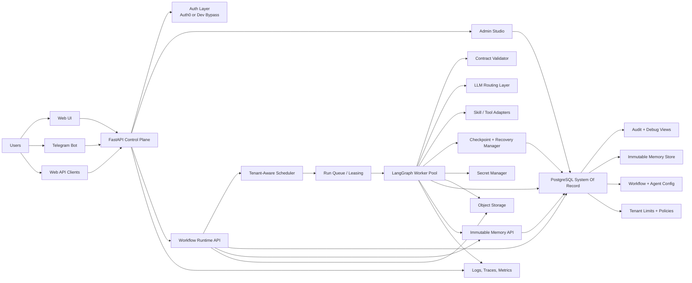
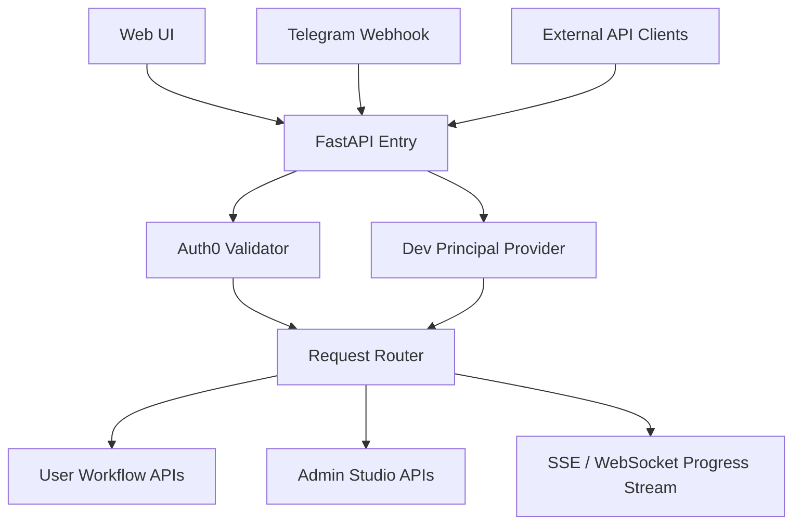
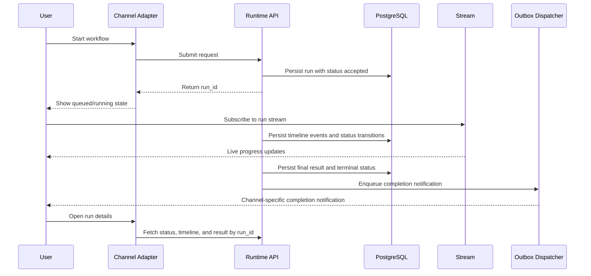
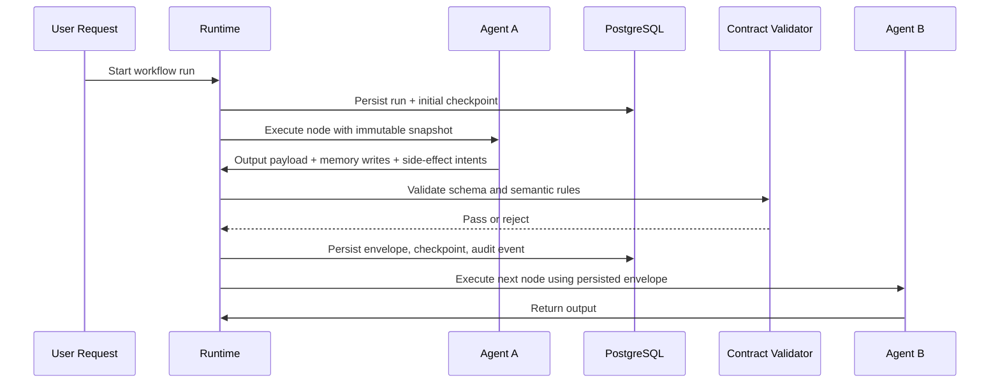
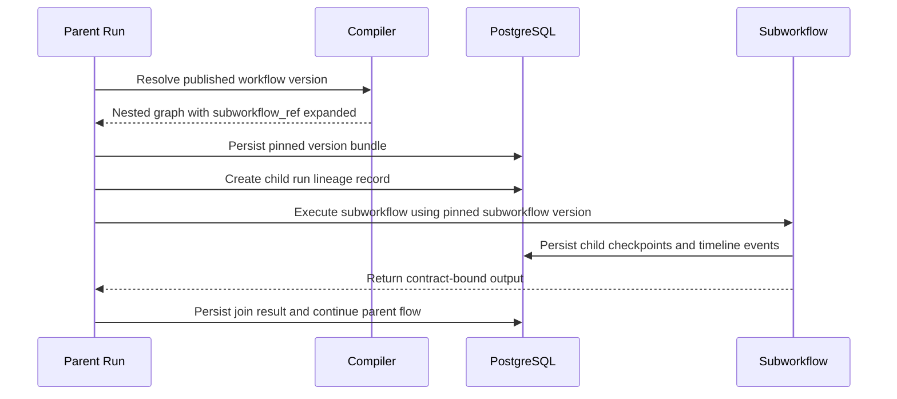
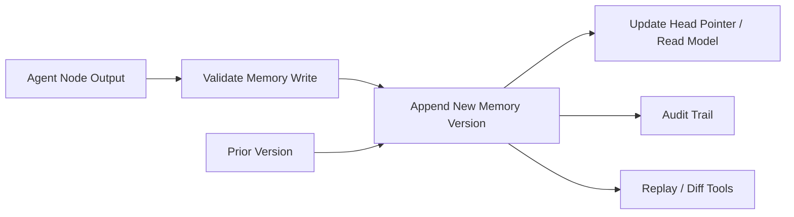
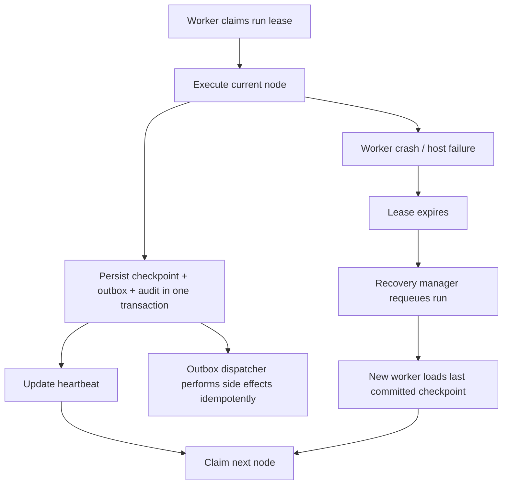
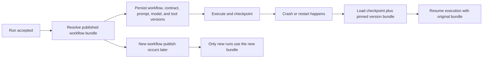
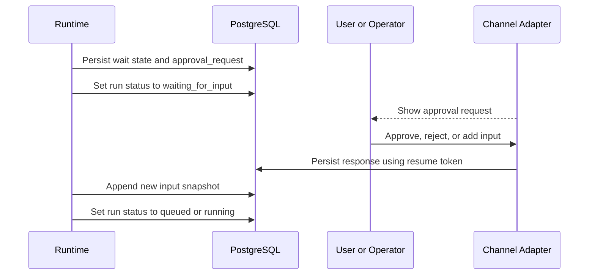
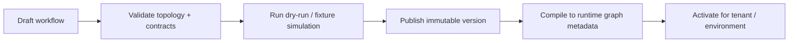

# Multi-Agent AI Platform Architecture

## 1. Purpose

This document defines a production-ready architecture for a multi-agent AI
platform that:

- scales to thousands of active users,
- survives worker or node failure without losing workflow state,
- stores agent memory as immutable, versioned records,
- uses Python, LangChain, LangGraph, FastAPI, Auth0, and PostgreSQL,
- supports Web UI, Telegram, and Web API interaction channels,
- provides production auditing and debugging,
- allows administrators to design workflows, roles, skills, and contracts.

It is also designed to support Spec-Driven Development with spec-kit as the
governing delivery workflow.

## 2. Guidance Synthesized From The PDF

The attached PDF consistently pushes the design toward distributed-systems
discipline rather than demo-style agent wiring. The main architectural guidance
used here is:

- Prefer orchestration for complex, business-critical workflows.
- Avoid shared mutable state.
- Pass immutable state snapshots between workflow steps.
- Treat agent handoffs as contract-bound messages.
- Use explicit failure-recovery patterns such as circuit breakers and
  compensation.
- Build for observability, lineage, and production debugging from day one.

Those principles map directly to this design.

## 3. Recommended Architecture Style

### 3.1 Primary Style

Use a centrally orchestrated workflow runtime with controlled, persisted
handoffs between agents.

Why this is the best fit:

- The system needs strong observability and auditing.
- Admin users must design and publish workflows centrally.
- The system cannot lose workflow progress during failures.
- Memory must be immutable and versioned.
- Authentication, authorization, and external channel governance must be
  enforced consistently.

### 3.2 Coordination Model

Use a hybrid model:

- Core business workflows use LangGraph orchestration.
- Non-critical notifications and telemetry can use event-style fan-out.

Do not let domain decisions depend on uncontrolled peer-to-peer agent calls.
All meaningful agent handoffs should be persisted and validated through the
runtime.

## 4. High-Level Design



## 5. Key Subsystems

### 5.1 Channel And Experience Layer

Responsibilities:

- Serve the Web UI for end users and administrators.
- Accept Telegram webhook traffic.
- Expose Web APIs for programmatic access.
- Normalize all incoming requests into the same workflow invocation model.

Recommended design:

- FastAPI hosts:
  - user-facing web routes,
  - admin routes,
  - REST APIs,
  - Telegram webhook endpoints,
  - SSE or WebSocket endpoints for live workflow progress.
- Use a single internal request envelope with:
  - `channel`,
  - `tenant_id`,
  - `user_id`,
  - `session_id`,
  - `message_id`,
  - `trace_id`,
  - `requested_workflow`.

Why this matters:

- Keeps the orchestration layer channel-agnostic.
- Makes auditing and replay consistent across UI, Telegram, and API traffic.

#### User-Visible Run Lifecycle

Every workflow invocation must create a persisted run record that the user can
query and subscribe to from any supported channel.

Recommended run statuses:

- `accepted` - request received and persisted
- `queued` - waiting for worker lease
- `running` - active execution in progress
- `waiting_for_input` - paused until user or operator input is supplied
- `completing` - final result is being assembled or outbound notifications are
  being dispatched
- `completed` - run finished successfully and result payload is available
- `failed` - run stopped with an unrecoverable error and failure details are
  available
- `cancelled` - user or operator cancelled the run

Each status transition should persist:

- `run_id`
- `status`
- `status_message`
- `current_step`
- `current_agent`
- `progress_percent` when the workflow can estimate it
- `updated_at`
- `trace_id`

#### How Users Are Notified When A Flow Completes

Web UI:

- The client subscribes to an SSE or WebSocket stream for the `run_id`.
- When the run enters `completed`, `failed`, or `cancelled`, the UI receives a
  terminal event and shows an in-app toast, badge, or completion panel.
- If the user is not actively watching, the next page load should still show
  the terminal state from persisted run storage.

Telegram:

- The runtime writes a completion side-effect intent to the transactional
  outbox.
- The outbox dispatcher sends a Telegram message summarizing the final state and
  includes a deep link to the Web UI run details page when richer results exist.
- Delivery attempts and final delivery state must be auditable.

Web APIs:

- The API returns `202 Accepted` with a `run_id` for asynchronous execution.
- Clients can either poll a status endpoint or subscribe through a callback or
  streaming API when supported by the integration.

#### How Users See Results

The platform should expose a consistent result retrieval model regardless of
channel.

Recommended interfaces:

- `GET /runs/{run_id}` for summary status and metadata
- `GET /runs/{run_id}/timeline` for step-by-step progress events
- `GET /runs/{run_id}/result` for final output, generated artifacts, and
  structured result payloads

Web UI behavior:

- Show a dedicated run details page with summary, current status, final output,
  artifacts, and links to related workflow history.

Telegram behavior:

- Show a concise completion summary in chat and link to the Web UI for large or
  structured outputs.

API behavior:

- Return machine-readable result payloads plus status and correlation metadata.

#### How Users View The Ongoing Process

Users should be able to watch a run while it is still executing.

Recommended live-progress behavior:

- The runtime emits timeline events whenever a step starts, completes, retries,
  pauses, resumes, or fails validation.
- The channel layer streams those events to the user in near real time.
- The same timeline must be queryable after the fact from PostgreSQL so users
  can refresh the page and continue where they left off.

Recommended timeline event fields:

- `event_id`
- `run_id`
- `event_type`
- `step_name`
- `agent_name`
- `status`
- `summary`
- `created_at`
- `trace_id`

User-facing visibility levels:

- End-user view: simplified progress, current step, ETA if available, and final
  result
- Admin or operator view: detailed timeline, retries, contract failures, model
  choices, tool activity, and replay links

### 5.2 Identity, Authentication, And Authorization

Responsibilities:

- Authenticate end users and admins through Auth0 in production.
- Allow authentication and authorization to be disabled in development and test.
- Enforce role-based access for workflow execution and workflow design.

Recommended design:

- Production mode:
  - Auth0 JWT validation in FastAPI middleware.
  - Role mapping from Auth0 claims to application roles such as `user`,
    `admin`, and `platform_admin`.
- Development and test mode:
  - `AUTH_ENABLED=false` switches to a local stub principal provider.
  - Authorization checks still execute against synthetic roles so access logic
    is exercised even when external auth is bypassed.

Avoid:

- Scattering auth conditionals across handlers.
- Bypassing role checks entirely in development.

### 5.3 Admin Studio And Workflow Registry

Responsibilities:

- Let admins create and version multi-agent workflows.
- Let admins define agent purpose, role, prompts, and skills.
- Let admins design contracts between agents.
- Publish immutable workflow versions.

Recommended design:

- Store workflow definitions as versioned documents in PostgreSQL.
- Keep a draft-publish model:
  - drafts are mutable,
  - published versions are immutable.
- Workflow definition includes:
  - graph topology,
  - node metadata,
  - role and purpose,
  - skill bindings,
  - allowed tool scopes,
  - contract schemas,
  - compensation rules,
  - model-selection overrides.

Compiler model:

- The Admin Studio saves a declarative workflow definition.
- A compiler translates that definition into LangGraph node wiring and runtime
  metadata.
- The compiled graph version is cached but always traceable back to the
  published definition version.

#### Workflow Composition And Subagent Model

The platform should support reusable subagent workflows as first-class workflow
building blocks.

Recommended design:

- Published workflow versions may contain node types such as:
  - `agent_step`
  - `parallel_group`
  - `condition`
  - `approval_gate`
  - `subworkflow_ref`
- A `subworkflow_ref` points to a published subworkflow version, not to a mutable
  draft.
- The compiler expands each subworkflow reference into a nested LangGraph
  subgraph and records a child-run lineage entry for observability.
- Parent and child execution should persist:
  - `root_run_id`
  - `parent_run_id`
  - `parent_node_id`
  - `subworkflow_version_id`
- Supported join policies should be explicit and versioned:
  - `all_success`
  - `quorum`
  - `first_success`
  - `manual_resolution`
- Every subworkflow boundary must declare input and output contracts.

Why this is the chosen approach:

- It preserves centralized orchestration.
- It keeps replay and debugging tractable.
- It allows admins to compose complex workflows without switching to uncontrolled
  choreography.

### 5.4 Orchestration Runtime

Responsibilities:

- Accept workflow invocations.
- Materialize run state.
- Execute agent nodes in order.
- Persist checkpoints after meaningful transitions.
- Validate all handoffs.

Recommended design:

- One workflow run equals one durable LangGraph execution.
- Each agent node receives:
  - immutable input snapshot,
  - run metadata,
  - contract definitions,
  - resolved model configuration,
  - permitted skill bindings.
- Each node emits:
  - an output contract payload,
  - new memory writes,
  - audit events,
  - optional side-effect intents.

Important rule:

- Agent-to-agent communication should happen through persisted envelopes managed
  by the runtime, not by direct in-memory object mutation.

#### Version Bundle Pinning For In-Flight Runs

Every workflow run must resolve and persist an immutable execution bundle at run
start.

Recommended version bundle contents:

- `workflow_definition_version_id`
- `compiled_graph_version_id`
- contract version identifiers
- prompt template version identifiers
- model configuration version identifiers
- skill-binding version identifiers
- tool-policy version identifiers

Execution rule:

- New publishes affect only new runs.
- A resumed run must continue against its pinned version bundle.
- Version migrations are optional operator actions and must be explicit,
  compatibility-checked, and auditable.

Why this matters:

- Recovery remains deterministic.
- Replays remain faithful to the original run.
- Admin publishes cannot silently change in-flight behavior.

### 5.5 Contract Validation And Handoff Control

Responsibilities:

- Enforce message schema correctness.
- Enforce semantic handoff rules.
- Reject invalid or low-confidence outputs before they contaminate downstream
  state.

Recommended design:

- Use Pydantic models plus JSON Schema export for formal contracts.
- Add rule-based validation for semantic gates such as:
  - minimum confidence,
  - required sources,
  - policy-safe content,
  - allowed next-step routing.

This mirrors the PDF's recommendation that agent handoffs be governed by data
contracts rather than trust alone.

### 5.6 Memory And State Management

Responsibilities:

- Store short-term workflow state durably.
- Store long-term agent memory immutably.
- Support versioning, replay, audit, and rollback reasoning.

Recommended design:

- Separate three kinds of persisted data:
  - workflow checkpoint state,
  - immutable memory entries,
  - audit and event logs.

Memory model:

- Never update a memory record in place.
- Every change is a new version row with:
  - `memory_id`,
  - `version_no`,
  - `scope_type`,
  - `scope_id`,
  - `content`,
  - `embedding_ref` or vector metadata,
  - `created_by_agent`,
  - `workflow_run_id`,
  - `parent_version_id`,
  - `supersedes_version_id`,
  - `created_at`.
- Maintain a head pointer or read model for fast lookup, but treat the append
  log as the source of truth.

Why this matters:

- Makes memory auditable.
- Supports replay and debugging.
- Prevents race-condition corruption caused by shared mutable state.

### 5.7 Transaction Persistence And Side Effects

Responsibilities:

- Persist every workflow transition and external side-effect intent.
- Ensure external actions are idempotent.
- Support safe retries after process failure.

Recommended design:

- Use PostgreSQL transactions for:
  - checkpoint writes,
  - agent message writes,
  - memory version writes,
  - outbox event writes.
- Use the transactional outbox pattern for outbound work such as:
  - Telegram replies,
  - email or notification sending,
  - external system calls,
  - webhook callbacks.

Key rule:

- External effects are never considered complete until the outbox dispatcher
  records delivery state with an idempotency key.

### 5.8 Recovery And Durability

Responsibilities:

- Recover from worker crashes and partial failures.
- Resume from the last committed checkpoint.
- Keep failed runs inspectable and replayable.

Recommended patterns:

- LangGraph durable checkpoints in PostgreSQL.
- Worker leasing with heartbeat timestamps.
- Requeue on lease expiration.
- Circuit breakers around unstable downstream systems.
- Compensation actions for partially completed workflows.
- Dead-letter runs for operator review after retry exhaustion.

Recovery requirement for user experience:

- User-visible status and timeline data must survive worker crashes, browser
  refreshes, and temporary network disconnects because they are read from
  persisted run records and checkpoint-linked timeline events.

### 5.9 Model Routing And Agent Configuration

Responsibilities:

- Let the platform define global model defaults.
- Let each workflow or agent override the model.
- Keep model resolution transparent for audit and debugging.

Recommended precedence:

1. Workflow-step override
2. Agent override
3. Workflow default
4. Global default

Recommended metadata:

- provider,
- model name,
- temperature,
- max tokens,
- timeout policy,
- retry policy,
- prompt template version,
- allowed tools.

### 5.10 Observability, Audit, And Production Debugging

Responsibilities:

- Make every run traceable from user request to final outcome.
- Provide operators enough signal to debug without reproducing locally.
- Support compliance and post-incident review.

Recommended telemetry:

- structured application logs,
- distributed traces,
- workflow timeline events,
- prompt and response lineage metadata,
- model selection logs,
- tool invocation logs,
- contract validation results,
- retry and circuit-breaker state changes.

Recommended implementation:

- OpenTelemetry for traces and metrics,
- correlation IDs on every request and workflow run,
- immutable audit tables in PostgreSQL,
- admin timeline UI for replay and inspection.

User and operator run inspection requirements:

- Every run must have a user-readable timeline view.
- Every terminal run must expose a retrievable result payload.
- Every notification attempt must be traceable to the originating run.
- The operator timeline must be able to reconstruct what the user saw and when.

### 5.11 Multi-Tenancy, Isolation, And Fairness

Responsibilities:

- Isolate tenant data and runtime activity.
- Prevent noisy-neighbor behavior.
- Enforce tenant-specific limits and budgets.

Recommended design:

- Use a shared PostgreSQL deployment with mandatory `tenant_id` on every
  tenant-scoped table.
- Enforce PostgreSQL row-level security for tenant-scoped reads and writes.
- Propagate tenant context through every request, workflow run, child run,
  memory write, artifact, and audit event.
- Use a tenant-aware scheduler with weighted fair queueing or fair round-robin.
- Enforce per-tenant controls for:
  - concurrent active runs
  - background worker slots
  - API rate limits
  - token or model-spend budgets
  - artifact storage quotas

Why this is the chosen approach:

- It gives stronger isolation than app-only filtering.
- It protects platform stability while keeping the cost model simpler than
  schema-per-tenant or database-per-tenant designs.

### 5.12 Secrets, Tool Governance, And Outbound Access

Responsibilities:

- Keep secrets out of workflow definitions and runtime logs.
- Limit what tools each agent can use.
- Control where outbound requests may go.

Recommended design:

- Store secret material in a dedicated secret manager, not in PostgreSQL or in
  workflow definitions.
- Persist only secret references and policy metadata in the application
  database.
- Resolve secrets at runtime using least-privilege credentials.
- Prefer short-lived scoped credentials for platform integrations.
- Treat user-delegated OAuth tokens separately from platform-managed secrets.
- Define tool policies per agent or workflow version:
  - allowed tools
  - allowed secret references
  - allowed outbound domains or service identifiers
  - maximum request classes or cost envelopes
- Audit all secret resolutions and tool invocations without logging secret
  values.

Why this is the chosen approach:

- It minimizes secret sprawl.
- It keeps runtime behavior reviewable and enforceable.
- It reduces blast radius if one agent or tool path is compromised.

### 5.13 Artifact Storage And Payload Tiering

Responsibilities:

- Store generated artifacts and large payloads efficiently.
- Keep PostgreSQL focused on transactional metadata.
- Support secure user retrieval of generated outputs.

Recommended design:

- Store large artifacts in object storage.
- Store metadata, ownership, retention policy, and integrity hashes in
  PostgreSQL.
- Offload large prompts, transcripts, attachments, exports, and rendered
  outputs to object storage once they exceed a configurable threshold.
- Return artifact metadata and signed access links through result APIs.
- Apply retention, archival, and legal-hold rules by artifact class.

Why this is the chosen approach:

- It avoids turning PostgreSQL into a blob store.
- It supports large result payloads without degrading transactional
  performance.

### 5.14 Human Approval, Pause, And Resume

Responsibilities:

- Allow workflows to pause for user or operator decisions.
- Resume safely with new input after approval or rejection.
- Keep approval history auditable.

Recommended design:

- Support explicit `approval_gate` nodes in published workflows.
- When an approval gate is reached, persist a wait-state record and transition
  the run to `waiting_for_input`.
- Create an `approval_request` record containing:
  - `run_id`
  - `step_name`
  - `requested_by_agent`
  - `requested_action`
  - `prompt_text`
  - `resume_token`
  - `expires_at`
- Allow approval, rejection, or supplemental-input submission through Web UI,
  Telegram, and API channels.
- Resume execution by appending a new immutable input snapshot tied to the
  existing run and version bundle.
- Support timeout and escalation policies for unanswered approvals.

Why this is the chosen approach:

- It treats human intervention as a durable workflow state, not an ad hoc
  exception path.
- It fits naturally with the existing run lifecycle and replay model.

## 6. Subsystem Diagrams

### 6.1 Channel, Auth, And Control Plane



### 6.1.1 User Run Tracking Experience



### 6.2 Agent-To-Agent Communication



### 6.2.1 Parent And Subagent Execution



### 6.3 Memory Persistence And Versioning



### 6.4 Failure Survival And Resume



### 6.4.1 Version Pinning And Resume Safety



### 6.4.2 Human Approval And Resume



### 6.5 Admin Workflow Design Lifecycle



## 7. Data Model Overview

Core PostgreSQL tables:

- `users`
- `tenants`
- `tenant_limits`
- `tenant_usage_windows`
- `workflow_definitions`
- `workflow_definition_versions`
- `agent_definitions`
- `agent_definition_versions`
- `skill_bindings`
- `contract_definitions`
- `workflow_runs`
- `workflow_run_version_bundles`
- `workflow_run_checkpoints`
- `workflow_timeline_events`
- `workflow_wait_states`
- `approval_requests`
- `agent_messages`
- `memory_entries`
- `memory_heads`
- `artifact_records`
- `secret_references`
- `tool_policy_bindings`
- `side_effect_outbox`
- `side_effect_dispatch_attempts`
- `audit_events`
- `trace_links`

Important columns and relationships:

- `workflow_runs.parent_run_id` and `workflow_runs.root_run_id` preserve
  parent-child lineage for nested subworkflows.
- `workflow_runs.version_bundle_id` pins in-flight runs to immutable published
  versions.
- `artifact_records.storage_uri` points to object storage while PostgreSQL
  retains ownership and retention metadata.
- `approval_requests.resume_token` enables channel-safe pause and resume.

Recommended partitioning:

- Partition `workflow_runs`, `workflow_run_checkpoints`, `agent_messages`,
  `workflow_timeline_events`, `memory_entries`, and `audit_events` by time and
  optionally tenant.

## 8. How The Design Meets The Stated Requirements

### 8.1 Scale To Thousands Of Active Users

- Stateless FastAPI instances scale horizontally behind a load balancer.
- Worker pool scales independently of API nodes.
- PostgreSQL is protected by connection pooling and partitioned high-volume
  tables.
- Tenant-aware queueing, quotas, and budgets keep one tenant from consuming
  disproportionate capacity.
- Hot-path reads such as memory heads and workflow catalog lookups use read
  models and cache layers where appropriate.
- Channel traffic is normalized so new delivery channels do not change the core
  runtime.

### 8.2 Workflow Persistence During Failure

- Workflow state is checkpointed after each meaningful step.
- External effects are protected by outbox records and idempotency keys.
- Lease-based recovery allows runs to resume on new workers.
- Pinned version bundles guarantee that resumed runs continue with the same
  workflow, prompt, contract, and model definitions they started with.
- Compensation handlers support rollback when partial workflows fail.
- Child subworkflow lineage lets parent and subagent progress recover together.

### 8.3 Immutable, Versioned Memory

- All memory writes are append-only.
- Current memory is a projection, not a mutable row.
- Version history remains available for replay, diffing, and audits.

### 8.4 LangChain, LangGraph, Python, FastAPI, PostgreSQL

- LangGraph is the orchestration engine.
- LangChain is used for model and tool abstractions where helpful.
- FastAPI is the control-plane and interaction entrypoint.
- PostgreSQL is the durable system of record.

### 8.5 Web UI, Telegram, And API Support

- FastAPI serves all three through channel adapters that map to the same
  request envelope and runtime API.
- Users can monitor in-progress runs, retrieve final results, and receive
  terminal-state notifications through each channel using the same persisted
  run and timeline model.
- Users and operators can also satisfy approval gates and resume paused runs
  through each supported channel.

### 8.6 Auth0 With Development Bypass

- Auth0 is enabled in production and stage.
- Local dev and automated tests can switch to deterministic principal injection
  with a single config flag.

### 8.7 Auditing And Debugging In Production

- Every state transition, handoff, tool call, memory write, and model decision
  is tied to a traceable run ID and correlation ID.
- The admin console can reconstruct run timelines and replay from checkpoints.

### 8.8 Admin Workflow Design

- Admin Studio provides draft, validate, simulate, publish, and activate
  lifecycle management for workflows, agents, skills, and contracts.
- Admins can publish reusable subworkflows, define join policies, and insert
  approval gates as explicit workflow steps.

### 8.9 Tenant Isolation And Tool Security

- Tenant-scoped data is protected by mandatory tenant context and row-level
  security.
- Tool access is governed by versioned policies, secret references, and outbound
  allowlists.
- Large artifacts are stored outside PostgreSQL while remaining traceable to the
  originating workflow run.

## 9. Recommended Repository Shape

```text
app/
  api/
  approvals/
  auth/
  channels/
  config/
  db/
  models/
  runtime/
  memory/
  contracts/
  admin/
  audit/
  secrets/
  storage/
  tenancy/
  workers/
tests/
  unit/
  integration/
docs/
examples/
```

## 10. Implementation Guidance

### 10.1 First Build The Platform Spine

Start with:

- config,
- database schema,
- durable runtime shell,
- auth abstraction,
- audit plumbing,
- workflow registry.

Only then add richer agent behaviors and channel UX.

### 10.2 Keep The Runtime Deterministic

- Persist inputs before execution.
- Resolve model configuration before node execution.
- Record prompt template versions.
- Keep contract validation results explicit and queryable.

### 10.3 Treat Production Debugging As A Feature

- Build an operator timeline view early.
- Make replay and diff part of the runtime.
- Require trace IDs in every request and every background task.

### 10.4 Add Cross-Cutting Control Primitives Early

- Propagate tenant context through every API, worker, memory, and artifact path.
- Persist version bundles at run creation before any agent execution starts.
- Build secret-provider and tool-policy abstractions before adding live
  integrations.
- Introduce object-storage and artifact-metadata abstractions before large
  outputs appear in production.
- Add approval-gate primitives before designing workflows that rely on human
  decisions.

## 11. Architecture Risks And Mitigations

### Risk: PostgreSQL Becomes The Only Bottleneck

Mitigation:

- use PgBouncer,
- partition large tables,
- keep payload blobs out of hot transactional reads when possible,
- archive old audit payloads,
- add read replicas for analytics views.

### Risk: Workflow Definitions Become Too Dynamic

Mitigation:

- publish immutable versions only,
- validate drafts with simulation fixtures,
- require explicit contract compatibility checks before activation.

### Risk: Tenant Hot Spots Degrade Shared Capacity

Mitigation:

- enforce per-tenant concurrency quotas,
- use fair queueing instead of simple FIFO dispatch,
- monitor tenant-level spend and latency,
- reserve operator controls for throttling abusive or misconfigured tenants.

### Risk: Secret Sprawl Or Unsafe Tool Egress

Mitigation:

- store only secret references in platform data,
- resolve secrets through a secret manager with short-lived credentials,
- audit all tool use and secret fetches,
- restrict outbound access through explicit tool policies and allowlists.

### Risk: Agent Output Quality Varies By Model

Mitigation:

- keep model selection explicit and auditable,
- add contract checks and evaluation datasets,
- allow per-agent override with environment-specific policy.

## 12. Final Recommendation

Build the system as a centrally orchestrated, contract-first, event-sourced
workflow platform with PostgreSQL as the durable source of truth and LangGraph
as the execution engine. That approach best satisfies the PDF guidance and the
stated business requirements for scale, recovery, immutable memory, admin
designability, and production operability.
