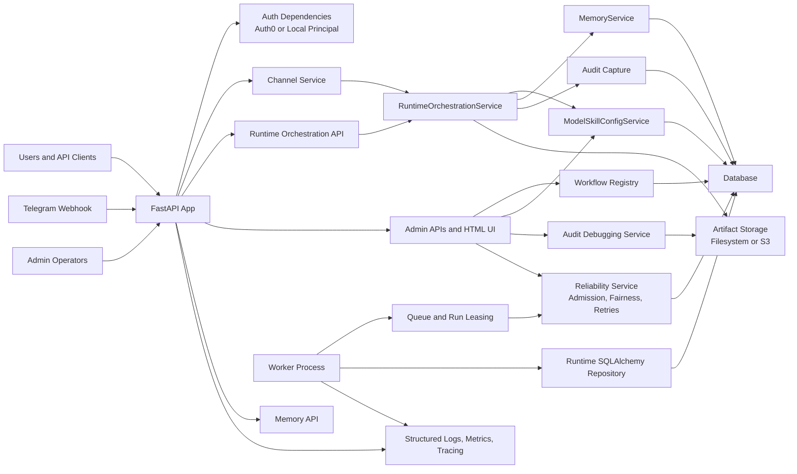

# Multi-Agent AI Platform Architecture

## 1. Purpose

This document describes the current architecture and code structure of the
`multi-agent-platform` repository. It is aligned with specs `001` through `009`
and with the implemented Python package under `src/multi_agent_platform`.

The platform is a single Python 3.12 distribution with:

- a FastAPI control plane,
- a background worker entrypoint,
- async SQLAlchemy/Alembic persistence,
- Auth0 and deterministic local-principal authentication modes,
- tenant-aware workflow, memory, channel, audit, configuration, and reliability
  subsystems,
- React admin and run-inspection browser UI backed by JSON contracts,
- filesystem or S3-compatible artifact storage providers,
- static, environment, or secret-manager-backed secret providers.

The production target is PostgreSQL 16+ with durable platform state in
PostgreSQL and large artifacts in object storage. Local and test settings
default to `sqlite+aiosqlite:///./.data/multi_agent_platform.db`, which keeps
development fast while preserving the same repository and service boundaries.

## 2. Architecture Style

The implementation follows a centrally orchestrated workflow-runtime model.
FastAPI accepts operational, admin, channel, and runtime requests; runtime and
channel services normalize work into persisted runs; workers claim durable work
through leases; and PostgreSQL-backed records provide the source of truth for
run state, memory versions, configuration pins, audit evidence, and reliability
controls.

The design intentionally avoids peer-to-peer agent mutation. Meaningful
handoffs, approvals, side effects, memory writes, and model or tool policy
decisions are represented as typed domain objects and persisted records.

Core principles carried through specs `001` through `009`:

- workflow progress must survive process and worker failure,
- published workflow bundles and runtime configuration are pinned for runs,
- memory writes are append-only immutable versions,
- external side effects are recorded as intents before delivery,
- tenant context is propagated through API, runtime, memory, channel, artifact,
  audit, and reliability paths,
- operators get searchable timelines, replay evidence, and reliability control
  surfaces instead of raw database access.

## 3. High-Level Runtime Shape



## 4. Implemented Repository Shape

The implemented source tree is:

```text
src/multi_agent_platform/
  admin/
    service.py
    support_overrides.py
    workflow_registry/
      compiler.py
      field_help.py
      service.py
      sharing.py
      validation.py
  api/
    main.py
    lifespan.py
    deps.py
    routers/
      admin_access.py
      admin_model_skill_config.py
      admin_run_inspection.py
      admin_workflow_ui.py
      admin_workflows.py
      auth.py
      channel_runs.py
      memory.py
      ops.py
      reliability_controls.py
      runtime_runs.py
      telegram_webhook.py
      web_run_ui.py
    schemas/
      audit_debugging.py
      auth.py
      channel_runs.py
      memory.py
      model_skill_config.py
      ops.py
      reliability.py
      runtime_runs.py
      workflow_editor.py
      workflow_registry.py
    ui/
      admin_workflows.py
      model_skill_config.py
      reliability_controls.py
      run_details.py
  audit/
    access.py
    capture.py
    classification.py
    export.py
    inspection.py
    models.py
    service.py
  auth/
    claims.py
    config.py
    dependencies.py
    jwt_validator.py
    local_principals.py
    policy.py
    principal.py
    service.py
  bootstrap/
    container.py
    worker.py
  channels/
    adapters.py
    artifacts.py
    callbacks.py
    errors.py
    idempotency.py
    models.py
    normalization.py
    notifications.py
    service.py
    state_mapping.py
    streaming.py
    telegram.py
  config/
    model_skill.py
    policy.py
    provenance.py
    resolver.py
    rollback.py
    service.py
    settings.py
    validation.py
  db/
    base.py
    session.py
    models/
    repositories/
  memory/
    canonical.py
    diff.py
    models.py
    policy.py
    replay.py
    repository.py
    service.py
  observability/
    logging.py
    metrics.py
    tracing.py
  reliability/
    admission.py
    authorization.py
    autoscaling.py
    breakers.py
    compensation.py
    dead_letters.py
    fairness.py
    leases.py
    load_profiles.py
    models.py
    partitioning.py
    policies.py
    pooling.py
    quotas.py
    retries.py
    service.py
  runtime/
    health/
      checks.py
      models.py
      service.py
    orchestration/
      approvals.py
      checkpointing.py
      compiler.py
      contracts.py
      events.py
      handoffs.py
      leasing.py
      lineage.py
      models.py
      repository.py
      service.py
      side_effects.py
      state.py
    queue/
      models.py
      service.py
    versioning.py
    workflow_bundle.py
  secrets/
    base.py
    providers/
      env.py
      secret_manager.py
      static.py
  storage/
    base.py
    providers/
      filesystem.py
      s3.py
    throughput.py
  tenancy/
    context.py
    guards.py
    middleware.py
  web_admin/
    static/
    templates/
  workers/
    loops.py
    main.py
    orchestration.py
```

Other top-level project paths:

```text
alembic/
  env.py
  versions/
    0001_platform_foundation.py
    0002_auth_access_control.py
    0003_workflow_registry.py
    0004_durable_orchestration_runtime.py
    0005_immutable_memory.py
    0006_user_interaction_channels.py
    0007_model_skill_routing.py
    0008_production_audit_debugging.py
    0009_reliability_scale_hardening.py
docs/
specs/
tests/
  contract/
  docs/
  fixtures/
  integration/
  performance/
  unit/
```

## 5. Spec-To-Code Mapping

| Spec | Feature | Implemented code areas |
| --- | --- | --- |
| `001-platform-foundation` | API and worker spine, settings, database, queue, artifacts, secrets, tenancy, health checks | `api/main.py`, `api/lifespan.py`, `api/routers/ops.py`, `bootstrap/`, `config/settings.py`, `db/base.py`, `db/session.py`, `runtime/health/`, `runtime/queue/`, `secrets/`, `storage/`, `tenancy/`, `workers/loops.py`, `workers/main.py`, `alembic/versions/0001_platform_foundation.py` |
| `002-platform-auth-access` | Auth0/local auth, role grants, support overrides, delegated credentials, access audit | `auth/`, `api/routers/auth.py`, `api/routers/admin_access.py`, `api/schemas/auth.py`, `admin/support_overrides.py`, `audit/access.py`, `db/models/access_control.py`, `db/models/delegated_credential.py`, `db/repositories/access_control.py`, `db/repositories/delegated_credential.py`, `alembic/versions/0002_auth_access_control.py` |
| `003-workflow-studio-registry` | Admin workflow registry, drafts, validation, publish bundles, workflow UI | `admin/workflow_registry/`, `api/routers/admin_workflows.py`, `api/routers/admin_workflow_ui.py`, `api/schemas/workflow_registry.py`, `api/schemas/workflow_editor.py`, `api/ui/admin_workflows.py`, `runtime/workflow_bundle.py`, `frontend/admin/src/components/workflows/`, `web_admin/static/react/`, `db/models/workflow_registry.py`, `db/repositories/workflow_registry.py`, `alembic/versions/0003_workflow_registry.py` |
| `004-durable-orchestration-runtime` | Durable run model, execution bundle pinning, handoffs, checkpoints, leases, approvals, lineage, side-effect intents, worker polling | `runtime/orchestration/`, `api/routers/runtime_runs.py`, `api/schemas/runtime_runs.py`, `workers/orchestration.py`, `bootstrap/worker.py`, `db/models/runtime_orchestration.py`, `db/repositories/runtime_orchestration.py`, `alembic/versions/0004_durable_orchestration_runtime.py` |
| `005-immutable-memory` | Append-only memory scopes, versions, heads, replay/diff, read/write audit | `memory/`, `api/routers/memory.py`, `api/schemas/memory.py`, `db/models/memory.py`, `db/repositories/memory.py`, `alembic/versions/0005_immutable_memory.py` |
| `006-user-interaction-channels` | Web/API/Telegram channel normalization, run status/result APIs, artifact grants, notifications, callbacks, SSE formatting | `channels/`, `api/routers/channel_runs.py`, `api/routers/web_run_ui.py`, `api/routers/telegram_webhook.py`, `api/schemas/channel_runs.py`, `api/ui/run_details.py`, `frontend/admin/src/components/userRuns/`, `db/models/channels.py`, `db/repositories/channels.py`, `alembic/versions/0006_user_interaction_channels.py` |
| `007-model-skill-routing` | Versioned model, prompt, skill, tool, outbound, secret-reference, credential policy configuration and runtime pinning | `config/`, `api/routers/admin_model_skill_config.py`, `api/schemas/model_skill_config.py`, `api/ui/model_skill_config.py`, `frontend/admin/src/components/governance/`, `db/models/model_skill_config.py`, `db/repositories/model_skill_config.py`, `alembic/versions/0007_model_skill_routing.py` |
| `008-production-audit-debugging` | Timeline capture, runtime traces, capture gaps, lineage projections, version-bundle snapshots, redacted export, run inspection UI | `audit/`, `api/routers/admin_run_inspection.py`, `api/schemas/audit_debugging.py`, `frontend/admin/src/components/operations/`, `db/models/audit_debugging.py`, `db/repositories/audit_debugging.py`, `alembic/versions/0008_production_audit_debugging.py` |
| `009-reliability-scale-hardening` | Admission/backpressure, quotas, fairness, retries, circuit breakers, compensation, dead letters, autoscaling signals, partitions, artifact throughput, reliability UI | `reliability/`, `api/routers/reliability_controls.py`, `api/schemas/reliability.py`, `api/ui/reliability_controls.py`, `runtime/queue/service.py`, `storage/throughput.py`, `frontend/admin/src/components/operations/`, `db/models/reliability.py`, `db/repositories/reliability.py`, `alembic/versions/0009_reliability_scale_hardening.py` |

## 6. FastAPI Application And Router Map

`multi_agent_platform.api.main:create_app()` creates the FastAPI application,
adds `TenancyMiddleware`, mounts admin static assets at `/admin/static`, and
includes all routers in one process.

Implemented routers:

- `ops.py`: `/health/live`, `/health/ready`, `/version`, `/dependencies`
- `auth.py`: `/auth/me`, `/auth/tenant-context/{tenant_id}`,
  `/auth/local-login`, `/auth/local-logout`
- `admin_access.py`: administrative access/session/support-override routes
  under `/admin`
- `admin_workflows.py`: workflow registry JSON APIs under `/admin/workflows`
- `admin_workflow_ui.py`: workflow registry HTML pages under
  `/admin/workflows/ui`
- `admin_model_skill_config.py`: configuration CRUD, preview, history,
  rollback, and provenance APIs under `/admin/config`
- `admin_run_inspection.py`: run search, timeline, replay, lineage, bundle, and
  export APIs plus admin run HTML pages under `/admin/runs`
- `reliability_controls.py`: reliability dashboard, policy, admission,
  breaker, retry, compensation, dead-letter, and load-test-report APIs under
  `/admin/reliability`
- `runtime_runs.py`: runtime run start, inspect, cancel, timeline, lineage,
  approvals, handoffs, and side-effect inspection under `/runtime/runs`
- `memory.py`: memory write, head, version, history, replay, diff, archive, and
  audit routes under `/memory`
- `channel_runs.py`: user-facing run submission, status, timeline stream,
  result, prompts, artifacts, notification, callback, and cancellation routes
- `web_run_ui.py`: run list, run creation, and run detail HTML pages under
  `/runs`
- `telegram_webhook.py`: Telegram webhook route under `/channels/telegram`

The API layer stays thin. It resolves dependencies, validates request/response
schemas, enforces principal and tenant context, and delegates business behavior
to subsystem services and repositories.

## 7. Bootstrap, Settings, And Providers

`bootstrap/container.py` builds the process container:

- `Settings` from environment and `.env`,
- SQLAlchemy async engine and session factory,
- secret provider,
- storage provider,
- Jinja2 admin template renderer,
- Auth0 JWT validator when `auth_mode == "auth0"`,
- local principal catalog for non-production local-principal mode,
- model-skill and audit-debugging service factories,
- structured logger.

`Settings` defines the operational configuration surface:

- app environment and process role,
- API host and port,
- Auth0 issuer/audience/domain settings,
- local principal header and cookie names,
- database URL and migration URL,
- secret provider kind: `static`, `env`, or `secret_manager`,
- storage provider kind: `filesystem` or `s3`,
- runtime and worker lease/poll intervals,
- reliability admission, retry, breaker, pool, and artifact-throughput limits,
- Telegram and channel callback settings,
- metrics and tracing toggles,
- build metadata.

Production disallows local-principal auth mode. Production Telegram tokens and
callback signing secrets must be secret references rather than raw values.

## 8. Authentication, Authorization, And Tenancy

Authentication and authorization are implemented in `auth/` and wired through
FastAPI dependencies:

- `jwt_validator.py` validates Auth0 JWTs.
- `local_principals.py` resolves deterministic local principals from configured
  catalog entries.
- `principal.py` defines principal context and auth mode domain objects.
- `policy.py` evaluates role and permission checks.
- `dependencies.py` exposes FastAPI dependency helpers.
- `service.py` coordinates principal and tenant-context behavior.

Durable authorization records live in:

- `principal_identities`
- `role_grants`
- `support_override_requests`
- `access_decision_records`
- `delegated_credential_links`

Tenant context is carried by `tenancy/context.py`, enforced by
`tenancy/guards.py`, and attached to requests through `TenancyMiddleware`.
Tenant-scoped database models include `tenant_id` columns and repository/service
methods accept tenant filters. The current migrations do not define PostgreSQL
row-level security policies; tenant isolation is represented in application
guards, table schemas, tests, and query paths.

## 9. Workflow Registry And Admin Studio

The workflow registry is implemented under `admin/workflow_registry/` and
exposed through JSON APIs plus React browser pages.

Responsibilities:

- maintain workflow lineages,
- keep one active mutable draft per workflow lineage,
- persist immutable draft revisions,
- validate workflow topology, contracts, fields, and publish readiness,
- compile published workflow bundles into artifact-backed runtime metadata,
- support registry sharing grants,
- render admin workflow pages with field-help modals and validation panels.

Primary modules:

- `service.py`: draft, revision, validation, publish, sharing, and list flows
- `validation.py`: topology and publish validation
- `compiler.py`: published bundle compilation
- `sharing.py`: sharing grant behavior
- `field_help.py`: field-level UI help metadata

Durable workflow registry tables:

- `workflow_lineages`
- `workflow_drafts`
- `workflow_draft_revisions`
- `validation_results`
- `workflow_version_bundles`
- `registry_sharing_grants`

Admin UI assets live under `frontend/admin/src/components/workflows/` and are
served from built React assets under `web_admin/static/react/`.

## 10. Durable Runtime And Workers

Runtime orchestration is implemented in `runtime/orchestration/`.

Responsibilities:

- start runs against published workflow bundle IDs,
- clone and pin a per-run execution bundle,
- create run records and timeline events,
- validate handoff payloads against pinned contracts,
- represent approvals, handoffs, side-effect intents, checkpoints, lineage, and
  leases as typed domain objects,
- support cancellation and inspection,
- integrate model-skill configuration pinning at run acceptance,
- integrate memory writes and runtime timeline events,
- support worker lease claiming and recovery.

Important runtime modules:

- `service.py`: run start, inspect, cancel, memory integration, audit capture
- `compiler.py`: published-bundle cloning and graph config helpers
- `contracts.py`: handoff contract validation and digesting
- `handoffs.py`: persisted handoff envelope domain behavior
- `side_effects.py`: side-effect intents, idempotency keys, compensation marks
- `approvals.py`: approval gate and decision rules
- `checkpointing.py`: checkpoint references and checkpointer factory
- `leasing.py`: run lease and fencing-token policy
- `lineage.py`: parent-child run lineage domain model
- `events.py`: runtime timeline event mapping
- `state.py`: graph runtime state schema

Worker entrypoints:

- `workers/main.py`: default worker process and orchestration worker process
  entrypoints
- `workers/loops.py`: polling loops
- `workers/orchestration.py`: claims runnable orchestration work and records
  claim timeline events
- `bootstrap/worker.py`: worker bootstrap assembly

Runtime tables:

- `runtime_execution_bundles`
- `runtime_workflow_runs`
- `runtime_run_steps`
- `runtime_worker_leases`
- `runtime_checkpoint_refs`
- `runtime_handoff_envelopes`
- `runtime_side_effect_intents`
- `runtime_approval_gates`
- `runtime_approval_decisions`
- `runtime_run_lineage`
- `runtime_timeline_events`
- `runtime_retention_policies`

The service layer includes an in-memory runtime repository for focused unit
flows and a SQLAlchemy-backed runtime repository for persistent worker/API
flows.

## 11. Channel Layer And User Run Experience

User interaction channels are implemented in `channels/` with thin routers for
Web UI, REST/API, and Telegram.

Responsibilities:

- normalize channel-specific actions into a shared request envelope,
- submit runs through runtime orchestration,
- expose status, timeline, result, artifact, prompt-decision, cancellation, and
  callback flows,
- format SSE timeline events,
- manage Telegram link tokens and webhook behavior,
- create short-lived artifact grants,
- record idempotency and delivery attempts,
- map runtime states into user-visible lifecycle states.

Primary modules:

- `models.py`: channel domain models such as `ChannelRun`, `RunStatusView`,
  `TimelineEvent`, `RunResult`, `WaitingPrompt`, and callback/subscription
  models
- `normalization.py`: channel request normalization
- `service.py`: channel facade over runtime orchestration
- `state_mapping.py`: runtime-to-user-visible state mapping
- `streaming.py`: SSE formatting
- `telegram.py`: Telegram command handling
- `notifications.py`: terminal notification payloads and audit summaries
- `callbacks.py`: callback URL validation and payload signing
- `idempotency.py`: duplicate request fingerprinting
- `artifacts.py`: default artifact metadata and grant creation

Channel tables:

- `channel_sessions`
- `telegram_identity_links`
- `normalized_channel_requests`
- `channel_idempotency_records`
- `channel_timeline_events`
- `run_notification_subscriptions`
- `notification_delivery_attempts`
- `api_callback_registrations`
- `api_callback_delivery_attempts`
- `artifact_access_grants`
- `interaction_audit_records`

Run browser UI lives in React components under
`frontend/admin/src/components/userRuns/` and React operations views; legacy
`/runs` browser links redirect to React while JSON APIs remain under
`api/routers/channel_runs.py`.

## 12. Immutable Memory

The memory subsystem is implemented in `memory/`.

Responsibilities:

- model memory scopes by tenant, workflow lineage, agent, key, and source,
- create append-only memory versions,
- maintain head projections for fast current reads,
- enforce optimistic concurrency through expected-current-version checks,
- validate canonical JSON and compute content hashes,
- support replay and JSON diff inspection,
- write content-free audit records for reads, writes, conflicts, archives, and
  denials,
- link versions to workflow runs, runtime steps, execution bundles, and
  parent-child lineage context.

Primary modules:

- `canonical.py`: JSON validation, canonical dumps, content hash and size
- `models.py`: memory scope, version, head, audit, conflict, and runtime context
  domain objects
- `policy.py`: runtime context and access policy checks
- `service.py`: read/write/head/replay/diff/archive/audit flows
- `replay.py`: target-version replay
- `diff.py`: JSON diff
- `repository.py`: repository protocol

Memory tables:

- `memory_scopes`
- `memory_versions`
- `memory_heads`
- `memory_audit_events`
- `memory_archive_events`

## 13. Model, Prompt, Skill, Tool, Secret, And Outbound Configuration

Versioned runtime configuration is implemented in `config/` and exposed through
admin configuration APIs and pages.

Responsibilities:

- store tenant-scoped default model providers and model routing versions,
- resolve strict model and prompt precedence,
- store prompt references, skill bindings, allowed-tool policies, outbound
  domain policies, safe secret references, and credential requirements,
- preview model/tool decisions before activation,
- pin run-level configuration at acceptance,
- pin first-use decisions for step/tool behavior,
- audit allow and deny decisions without leaking secrets,
- support rollback and migration records.

Resolution precedence:

1. workflow-step override
2. agent override
3. workflow default
4. tenant/global default

Primary modules:

- `model_skill.py`: domain models, scope selectors, versioned records, safe
  errors, stable digests
- `resolver.py`: deterministic model and prompt resolution
- `policy.py`: skill, tool, outbound domain, credential, and secret-reference
  authorization
- `service.py`: admin/runtime facade
- `validation.py`: publish/start validation and raw-secret checks
- `rollback.py`: rollback planning
- `provenance.py`: resolved configuration snapshots and safe runtime decisions

Configuration tables:

- `model_provider_catalog_entries`
- `model_routing_versions`
- `prompt_reference_versions`
- `skill_binding_versions`
- `allowed_tool_policy_versions`
- `outbound_domain_policy_versions`
- `model_skill_secret_reference_versions`
- `tool_credential_requirement_versions`
- `active_configuration_pointers`
- `resolved_execution_configurations`
- `runtime_policy_decisions`
- `configuration_audit_records`
- `configuration_rollback_records`
- `run_configuration_migration_records`

Admin UI assets live in React governance components under
`frontend/admin/src/components/governance/`.

## 14. Audit, Observability, Replay, And Debugging

The audit subsystem is implemented in `audit/`, with cross-cutting helpers in
`observability/`.

Responsibilities:

- capture lifecycle and runtime evidence,
- record append-only audit events and timeline events,
- store trace records for handoffs, contract validation, memory writes, tool
  usage, model selection, notification delivery, and secret access,
- represent capture gaps explicitly,
- assemble run timelines, replay views, lineage graphs, bundle snapshots, and
  redacted exports,
- classify and redact sensitive fields before debug evidence leaves the system,
- record inspection access audits.

Primary modules:

- `capture.py`: capture facade and event builders
- `models.py`: audit event, timeline, trace, capture, export, lineage,
  notification, and redaction domain models
- `inspection.py`: timeline/replay/lineage/export assemblers
- `classification.py`: sensitivity labels, redaction decisions, safe summaries
- `export.py`: debug evidence export service
- `service.py`: audit write/query and admin debugging authorization
- `access.py`: access-decision audit recorder

Audit and debugging tables:

- `audit_events`
- `audit_timeline_events`
- `audit_runtime_trace_records`
- `audit_agent_handoff_traces`
- `audit_contract_validation_traces`
- `audit_memory_write_traces`
- `audit_tool_usage_traces`
- `audit_model_selection_traces`
- `audit_notification_delivery_traces`
- `audit_secret_access_records`
- `audit_version_bundle_snapshots`
- `audit_run_lineage_links`
- `audit_capture_gaps`
- `audit_inspection_access_events`
- `audit_debug_exports`
- `audit_redaction_classification_records`

Observability helper modules:

- `observability/logging.py`
- `observability/metrics.py`
- `observability/tracing.py`

## 15. Reliability And Scale Hardening

Reliability controls are implemented in `reliability/`, integrated into runtime
queueing, storage throughput controls, admin APIs, and admin UI pages.

Responsibilities:

- tenant-aware admission and backpressure,
- tenant quota counters and fairness windows,
- worker autoscaling recommendations and capacity snapshots,
- retry classification and bounded retry budgets,
- circuit breaker state transitions,
- compensation requests for partially completed work,
- dead-letter records and operator actions,
- lease tuning and fencing-token validation,
- partition planning and retention windows,
- database pool pressure decisions,
- artifact throughput limits,
- deterministic load profiles for performance tests,
- reliability dashboard, breaker, and dead-letter admin surfaces.

Primary modules:

- `admission.py`: admit/queue/delay/reject decisions
- `fairness.py`: fair-share token allocation and tenant selection
- `quotas.py`: quota reservation and release
- `retries.py`: failure classification and jittered retry decisions
- `breakers.py`: circuit breaker state machine
- `compensation.py`: compensation lifecycle
- `dead_letters.py`: terminal inspection and recommended actions
- `autoscaling.py`: worker scale recommendations
- `leases.py`: lease policy and fencing-token checks
- `partitioning.py`: table partition and retention helpers
- `pooling.py`: connection reserve and pool-pressure helpers
- `policies.py`: reliability policy validation
- `load_profiles.py`: deterministic load/failure scenarios
- `service.py`: persistence-backed reliability facade
- `authorization.py`: reliability admin action authorization

Reliability tables:

- `reliability_policies`
- `reliability_admission_decisions`
- `reliability_tenant_quota_counters`
- `reliability_fairness_windows`
- `reliability_capacity_snapshots`
- `reliability_worker_pool_scaling_decisions`
- `reliability_retry_schedules`
- `reliability_circuit_breakers`
- `reliability_circuit_breaker_events`
- `reliability_compensation_requests`
- `reliability_dead_letters`
- `reliability_operational_control_changes`
- `reliability_artifact_throughput_windows`
- `reliability_failure_injection_records`

Admin UI assets live in the React operations workspace under
`frontend/admin/src/components/operations/`.

## 16. Persistence Overview

Database model registration is centralized in
`db/models/__init__.py#import_models()`. Alembic migrations `0001` through
`0009` map directly to the feature sequence.

Implemented model files and ownership:

- `access_control.py`: principal identities, role grants, support overrides,
  access decision records
- `artifact.py`: artifact metadata
- `audit.py`: base audit events
- `audit_debugging.py`: production debugging timelines, traces, snapshots,
  gaps, exports, and classifications
- `channels.py`: channel sessions, requests, idempotency, delivery attempts,
  artifact grants, interaction audits
- `delegated_credential.py`: user-delegated credential metadata
- `memory.py`: memory scopes, versions, heads, audit, archive events
- `model_skill_config.py`: versioned model/prompt/skill/tool/outbound/secret
  configuration, active pointers, runtime decisions, audits, rollbacks
- `queue.py`: queue jobs and job leases
- `reliability.py`: reliability policies, decisions, quotas, breakers,
  compensation, dead letters, capacity, artifact throughput, failure injection
- `runtime_orchestration.py`: runtime execution bundles, workflow runs, steps,
  leases, checkpoints, handoffs, side effects, approvals, lineage, timeline,
  retention
- `secret_reference.py`: generic secret-reference metadata
- `tenant.py`: tenants and tenant limit policies
- `workflow_registry.py`: lineages, drafts, revisions, validation results,
  published bundles, sharing grants

Repository implementations live in `db/repositories/` and keep SQLAlchemy query
logic out of API routers and domain modules.

## 17. Storage, Secrets, And Artifacts

Secret provider abstraction:

- `secrets/base.py`: provider interface and value objects
- `secrets/providers/static.py`: static settings-backed provider
- `secrets/providers/env.py`: environment variable provider
- `secrets/providers/secret_manager.py`: secret-manager reference provider

Storage provider abstraction:

- `storage/base.py`: artifact storage interface
- `storage/providers/filesystem.py`: local filesystem storage
- `storage/providers/s3.py`: S3-compatible storage facade
- `storage/throughput.py`: tenant/global artifact throughput controls

Database rows store artifact and secret metadata. Secret material is resolved
through providers, and generated artifacts or large exports are referenced by
metadata records and storage URIs rather than embedded as hot database payloads.

## 18. Testing And Quality Gates

The test structure mirrors the architecture:

- `tests/unit/`: domain, service, schema, policy, and repository unit tests
- `tests/integration/`: API, database, runtime, worker, channel, storage, and
  auth integration tests
- `tests/contract/`: OpenAPI and protocol contract tests
- `tests/performance/`: runtime, memory, audit, channel, model-skill, and
  reliability performance tests
- `tests/docs/`: documentation behavior and runbook coverage checks
- `tests/fixtures/`: shared test fixtures and deterministic test data

Project quality commands from `AGENTS.md` and `pyproject.toml`:

```bash
uv sync
uv run alembic upgrade head
uv run uvicorn multi_agent_platform.api.main:app --reload
uv run python -m multi_agent_platform.workers.main
uv run ruff check .
uv run ruff format --check .
uv run mypy src
uv run pytest --cov=src/multi_agent_platform --cov-report=term-missing --cov-fail-under=90
```

## 19. Current Architectural Notes

- The implementation is a modular monolith: one Python package, one FastAPI app,
  and one worker package. Subsystems are separated by package boundaries rather
  than by independently deployed services.
- PostgreSQL is the production system of record, but local/test defaults use
  SQLite through the same SQLAlchemy model layer.
- The browser UI is React-only, built from `frontend/admin` and served through
  FastAPI static assets under `web_admin/static/react/`.
- Tenant isolation is explicit in domain models, table columns, middleware,
  dependencies, and repository methods. PostgreSQL RLS is not currently encoded
  in migrations.
- Runtime orchestration has both domain/in-memory paths for focused behavior and
  SQLAlchemy-backed persistent repositories for API and worker flows.
- LangChain and LangGraph are project dependencies and the runtime structure is
  organized around published bundles, graph state, checkpoint references, and
  worker leases.
- Reliability, audit, channel, memory, and model-skill features are implemented
  as first-class subsystems, each with API schemas, database models,
  repositories, tests, and operator documentation.

## 20. Final Architecture Summary

The current codebase implements a production-oriented, tenant-aware multi-agent
platform as a single Python backend. FastAPI provides the control plane and
interaction entrypoints; runtime workers process durable runs; PostgreSQL
models and Alembic migrations hold the durable state; immutable memory,
versioned workflow bundles, model-skill configuration pins, channel
normalization, audit/debugging, and reliability controls are separate but
integrated subsystems.

This document now reflects the implemented code structure rather than an older
generic target layout.
