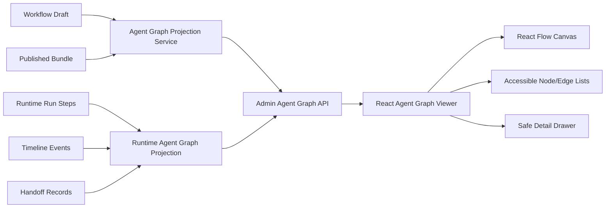
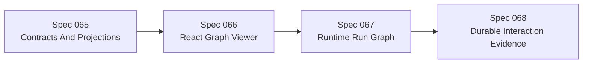

# Graphical Agent Workflow UI Specs

Review date: 2026-05-08

This document breaks the graphical agent/sub-agent workflow UI into Spec Kit-ready
specs. The goal is to let authorized users visually inspect how a workflow is
intended to route work between an agent and sub-agents, and how a real run
actually communicated through those agents.

The current repository already has a React workflow builder with a React Flow
graph preview, backend-owned graph contracts, run timeline records, run steps,
and operations workbench debug panels. These specs should extend those surfaces
rather than introduce a second visualization framework.

Numbering note: the current implemented spec sequence reaches 059, and
`scenario_enhancement.md` reserves 060 through 064 for the Design Reviewer
scenario. Use 065 through 068 below if the repository numbering has not advanced
before implementation begins.

## Target Experience

The UI should support a simple mental model:

```text
Agent1 ==> Sub-Agent1 ==> Sub-Agent2
```

The production version should show:

- the lead/coordinator agent
- sub-agents and specialist roles
- tool, join, approval, handoff, and terminal nodes
- directional communication or delegation edges
- safe edge labels such as delegates, sends context, returns result, joins, and
  hands off
- status badges for draft readiness and runtime execution state
- click-through panels for safe summaries, role/profile references, timeline
  links, artifact references, and validation findings
- a keyboard-readable node and edge list equivalent to the canvas
- truthful empty, denied, partial, loading, stale, and error states

The first usable version should be read-only. Graph editing can remain in the
existing workflow builder and should not be expanded unless a later spec
explicitly asks for editable communication edges.

## Architecture Overview

The feature should be implemented as a backend-owned projection consumed by the
React Admin UI.



The durable source of truth should remain existing workflow registry, published
bundle, runtime orchestration, timeline, handoff, artifact, audit, prompt/profile,
provider, and test-bench records. The UI should not invent graph records or
sample agents on production routes.

## Spec 065 - Agent Communication Graph Contracts And Projections

### Overview Detail

Create backend-owned contracts and projection services for design-time and
published workflow agent communication graphs. This spec turns workflow draft and
published bundle structures into a graph that explicitly names agents,
sub-agents, tools, joins, approvals, handoffs, and terminal nodes.

This spec should reuse existing workflow registry documents, graph preview
helpers, validation findings, published bundle metadata, prompt/profile/provider
references, and tenant authorization. It should not add a frontend canvas yet and
should not require a database migration unless implementation discovers a missing
durable identifier.

The projection should be safe for Admin UI rendering and should expose stable
node IDs, edge IDs, graph revision metadata, layout hints, node categories, edge
categories, status, labels, role summaries, safe reference summaries, validation
badges, and accessible text summaries.

### Dependencies

None beyond the existing workflow registry, graph preview, published bundle, and
Admin React API foundations.

### Deliverables

- Pydantic API contracts for `AgentCommunicationGraph`, graph nodes, graph
  edges, node metadata, edge metadata, graph badges, and graph provenance
- projection service for workflow draft graphs
- projection service for published workflow version graphs
- tenant-scoped Admin routes for graph JSON
- OpenAPI/generated TypeScript contract updates
- unit and route tests for authorization, empty states, denied states, safe text,
  and graph shape
- docs or QA notes explaining how the graph differs from the existing generic
  workflow preview

### Specify Prompt

```text
/speckit.specify Add backend-owned Agent Communication Graph contracts for the multi-agent platform. The feature must let authorized platform and tenant admins retrieve a safe JSON graph projection for workflow drafts and published workflow bundles. The graph must explicitly represent coordinator agents, sub-agents, tools, joins, approval gates, handoffs, and terminal nodes, plus directional communication edges such as delegates_to, sends_context_to, returns_result_to, joins_at, and hands_off_to. The projection must be derived from durable workflow registry and published bundle records, include stable node and edge identifiers, graph revision metadata, safe labels, node/edge categories, readiness/status badges, prompt/profile/provider/skill reference summaries, validation findings, and an accessibility summary. Cross-tenant access must fail closed. Empty and denied states must be truthful. Do not add a React graph canvas in this spec. Do not persist raw prompts, completions, provider responses, private channel messages, memory contents, credentials, authorization headers, or raw tool payloads.
```

### Plan Prompt

```text
/speckit.plan Implement Agent Communication Graph contracts as an additive backend feature using Python 3.12, FastAPI, Pydantic v2, existing workflow registry repositories, published bundle metadata, graph preview helpers, validation findings, tenant guards, safe-text/redaction helpers, OpenAPI generation, and React Admin contract conventions. Add schemas under src/multi_agent_platform/api/schemas/admin_agent_graph.py or the existing workflow builder schema module if that better matches local patterns. Add projection logic under src/multi_agent_platform/admin/workflow_registry/agent_graph.py. Add Admin routes under the existing workflow router namespace for draft and published version graph JSON. Include contract docs, quickstart notes, focused unit tests, route tests, generated TypeScript updates, and no migration unless a required durable field is missing.
```

### Tasks Prompt

```text
/speckit.tasks Generate dependency-ordered tasks for Agent Communication Graph backend contracts and projections. Include tasks for schema definitions, safe text validation, projection service design, mapping workflow node types to agent graph node categories, mapping workflow edges to communication edge categories, published bundle projection, validation badge projection, accessibility summary generation, Admin route wiring, OpenAPI/generated TypeScript updates, tenant authorization tests, denied/empty/not-found tests, safe-text/redaction tests, docs, and QA notes. Organize by user stories: inspect draft graph, inspect published graph, handle denied/empty graph states, and verify safe rendering contracts.
```

### Implement Prompt

```text
/speckit.implement Implement only the Agent Communication Graph backend contracts and projection tasks. Keep changes additive and preserve the existing workflow builder graph preview behavior. Do not add the React graph viewer in this spec. Do not add runtime run graph support yet. Run focused schema, projection, route, authorization, redaction, OpenAPI/type generation, ruff, mypy for touched backend modules, and relevant docs/QA validation.
```

## Spec 066 - React Agent Graph Viewer For Workflow Drafts And Versions

### Overview Detail

Add a reusable React Admin graph viewer that renders the Agent Communication
Graph contracts from Spec 065. The viewer should build on the existing
`@xyflow/react` dependency and existing workflow graph panel patterns, while
presenting a user-facing agent communication model.

The first integration points should be workflow draft detail and published
workflow version detail. A user should be able to open a workflow and see the
agent/sub-agent communication structure without reading JSON. The same graph
must have an accessible node and edge list for keyboard and screen-reader users.

### Dependencies

Spec 065.

### Deliverables

- reusable `AgentGraphPanel` React component
- custom node rendering for agent, sub-agent, tool, join, approval, handoff, and
  terminal categories
- edge labels and visual styles for communication categories
- safe detail drawer or side panel for selected nodes/edges
- integration into workflow draft and published version Admin pages
- loading, empty, denied, stale, partial, and error states
- Vitest/Testing Library coverage
- Playwright coverage for graph visibility and accessible lists
- no production mock graph records

### Specify Prompt

```text
/speckit.specify Add a React Admin Agent Graph Viewer for workflow drafts and published versions. Authorized users must be able to open a workflow draft or published workflow version and visually inspect agent/sub-agent communication as a graph. The viewer must render coordinator agents, sub-agents, tools, joins, approval gates, handoffs, and terminal nodes from backend-owned Agent Communication Graph JSON. It must show directional edge labels such as delegates, sends context, returns result, joins, and hands off. Selecting a node or edge must show safe backend-provided details, validation badges, reference summaries, and related links without exposing raw prompts, completions, credentials, private payloads, memory content, provider responses, or raw tool outputs. The graph must include a keyboard-readable node and edge list with equivalent information. Empty, denied, loading, stale, partial, and error states must be truthful. Do not create fake production graph records.
```

### Plan Prompt

```text
/speckit.plan Implement the React Agent Graph Viewer using React 19, TypeScript strict mode, existing Admin Shell conventions, generated React Admin API types, existing client helpers, @xyflow/react, existing workflow graph CSS patterns, and reusable state/error components. Add a reusable AgentGraphPanel under frontend/admin/src/components/workflows or a shared graph directory. Add API client helpers for draft and version graph JSON. Integrate the panel into workflow draft and version detail pages without replacing the existing JSON inspector or validation panels. Include accessible lists, selected node/edge detail panels, responsive layout, no overlapping text, no cards nested inside cards, and Playwright validation across desktop and mobile widths.
```

### Tasks Prompt

```text
/speckit.tasks Generate dependency-ordered tasks for the React Agent Graph Viewer. Include tasks for generated TypeScript contract refresh, API client helpers, reusable AgentGraphPanel component, custom node rendering, edge label rendering, selected detail panel, accessible node and edge lists, workflow draft page integration, published version page integration, loading/empty/denied/error states, CSS updates, Vitest tests, Testing Library accessibility assertions, Playwright screenshots and interactions, visible-copy redaction scans, docs, and QA validation. Organize by user stories: inspect workflow draft communication, inspect published version communication, select graph details, and use the accessible list alternative.
```

### Implement Prompt

```text
/speckit.implement Implement the React Agent Graph Viewer tasks. Preserve existing workflow builder behavior and styling conventions. Use backend-owned graph data only. Do not add runtime run graph support in this spec. Do not introduce production mock graph data or visible implementation-framework labels. Run frontend typecheck, Vitest, build, Playwright graph validation, backend route smoke tests for the graph endpoints, visible-copy/redaction scans, and docs/QA validation.
```

## Spec 067 - Runtime Agent Communication Graph For Runs

### Overview Detail

Add a runtime graph projection that shows what actually happened during a
workflow run. This should combine the design graph from the published bundle
with runtime run steps, timeline events, handoffs, gateway attempts, tool calls,
delivery evidence, and lineage.

The UI should make failures easier to understand. Users should be able to see
which agent or sub-agent ran, which branch is waiting or failed, where a join is
blocked, whether manual resolution is required, and which safe evidence records
are available. This should integrate with the operations workbench run-debug
view and may also be reused by user-facing run detail pages where authorization
allows it.

This spec should not require message-level persistence. It can infer the runtime
communication graph from existing durable run steps and timeline evidence.

### Dependencies

Spec 065 and Spec 066.

### Deliverables

- runtime graph projection for a workflow run
- status overlays on graph nodes and edges
- safe links from nodes/edges to timeline events, run steps, artifacts, handoffs,
  gateway attempts, and tool-call summaries
- operations workbench graph integration
- optional user-run detail integration if existing contracts support it safely
- tests for tenant isolation, partial data, failed runs, paused runs, and empty
  runtime evidence
- Playwright validation for an actual seeded runtime graph

### Specify Prompt

```text
/speckit.specify Add a Runtime Agent Communication Graph for workflow runs. Authorized users must be able to inspect how a real run moved through coordinator agents, sub-agents, tools, joins, approvals, handoffs, and terminal nodes. The runtime graph must combine the published workflow graph with durable run steps, timeline events, handoff records, lineage, gateway attempt summaries, tool-call summaries, delivery summaries, and safe artifact references. Nodes and edges must show runtime status such as queued, running, succeeded, failed, skipped, waiting, paused, retry scheduled, manual resolution required, and completed. Selecting a node or edge must show safe evidence links and summaries. Cross-tenant access must fail closed. Partial runtime data must render honestly. Do not persist message-level interaction records in this spec. Do not expose raw prompts, completions, provider payloads, credentials, private channel messages, memory contents, stack traces, or raw tool outputs.
```

### Plan Prompt

```text
/speckit.plan Implement runtime agent graph projection using existing RuntimeOrchestrationRepository, run steps, runtime timeline events, execution bundle metadata, handoff records, operations workbench services, gateway/tool/delivery summaries, tenant guards, safe-text helpers, and the Agent Communication Graph contracts from Spec 065. Extend the graph contracts only where runtime status and evidence links require additive fields. Add route support under admin run inspection or operations workbench namespaces. Reuse the React AgentGraphPanel from Spec 066 with runtime overlays. Include tests for completed, failed, paused, partial, and denied runs. Avoid new migrations unless existing run records cannot identify the necessary graph node linkage.
```

### Tasks Prompt

```text
/speckit.tasks Generate dependency-ordered tasks for Runtime Agent Communication Graph support. Include tasks for runtime graph schema extensions, run-step-to-node mapping, timeline-event evidence mapping, handoff mapping, gateway/tool/delivery evidence mapping, partial-data handling, tenant authorization, Admin route wiring, generated TypeScript updates, operations workbench integration, optional user-run detail integration, status overlay UI, selected runtime detail panel, Vitest tests, backend projection and route tests, Playwright runtime graph validation, redaction scans, docs, and QA environment updates. Organize by user stories: inspect completed run graph, diagnose failed branch, inspect paused/manual-resolution run, and handle partial or denied runtime evidence.
```

### Implement Prompt

```text
/speckit.implement Implement the Runtime Agent Communication Graph tasks. Reuse existing run steps, timeline events, handoffs, gateway summaries, and tool summaries. Do not add message-level persistence in this spec. Preserve existing operations workbench timeline and branch panels while adding the graph as an additional live-data view. Run ruff, mypy for touched backend modules, focused backend projection/route tests, frontend typecheck, Vitest, build, Playwright runtime graph validation, redaction scans, and docs/QA validation.
```

## Spec 068 - Durable Agent Interaction Evidence And Replay Graph

### Overview Detail

Add optional durable interaction evidence when the platform needs more fidelity
than run steps and timeline events can provide. This spec records safe
agent-to-agent interaction summaries as first-class evidence, enabling deeper
debugging, replay, evaluation, and communication-path analysis.

This is the most invasive spec in the sequence. It should happen only after the
read-only graph views prove useful and after implementation confirms existing
run steps and timeline events are not enough.

The design must store safe summaries, classifications, references, digests,
status, timing, and provenance. It must not store raw prompts, completions,
memory contents, raw tool payloads, provider authorization headers, credentials,
or private channel payloads. If richer evidence is required for elevated
debugging, that should be handled by a separately governed evidence vault, not
by ordinary Admin UI graph records.

### Dependencies

Spec 067. This spec is optional unless runtime graph fidelity is insufficient.

### Deliverables

- durable interaction evidence model and migration if needed
- repository/service support for recording agent interaction summaries
- runtime instrumentation at safe handoff/delegation/result boundaries
- idempotent recording on worker retry/resume
- graph projection support for interaction evidence
- replay-path UI mode that highlights the observed communication sequence
- retention, redaction, audit, export, and tenant-isolation tests
- QA evidence proving no raw sensitive payloads are stored or rendered

### Specify Prompt

```text
/speckit.specify Add durable Agent Interaction Evidence for high-fidelity runtime communication graphs. The feature must record safe summaries of agent-to-agent delegation, context transfer, result return, join contribution, approval pause/resume, and handoff interactions during workflow runs. Each interaction record must be tenant-scoped, linked to workflow run, source node, target node, runtime step, timeline event, optional artifact references, status, timestamps, idempotency key, provenance, safe summary, classification, and digest metadata. The graph UI must be able to render a replay path from these records. The system must not store or render raw prompts, completions, memory contents, provider responses, credentials, authorization headers, private channel payloads, raw tool outputs, or stack traces. Worker retry/resume must not duplicate interaction evidence. Cross-tenant access must fail closed.
```

### Plan Prompt

```text
/speckit.plan Implement durable Agent Interaction Evidence as an additive runtime/audit feature using Python 3.12, SQLAlchemy 2 async ORM, Alembic, PostgreSQL, RuntimeOrchestrationRepository, GraphExecutionService, worker retry/resume paths, timeline event helpers, artifact storage references, audit/redaction helpers, and existing Admin graph contracts. Define a minimal migration only if durable interaction records are required. Add repository methods, service methods, idempotency keys, safe classification, retention/export considerations, and projection updates for runtime graph replay mode. Include backend tests for persistence, idempotency, tenant isolation, redaction, replay projection, and worker resume behavior.
```

### Tasks Prompt

```text
/speckit.tasks Generate dependency-ordered tasks for durable Agent Interaction Evidence and replay graph support. Include tasks for data model design, Alembic migration, SQLAlchemy model, repository methods, service contracts, runtime instrumentation points, idempotency behavior, retry/resume behavior, redaction/classification helpers, graph projection updates, Admin route updates, generated TypeScript updates, replay-mode UI, selected interaction detail panel, export/retention documentation, tenant isolation tests, persistence tests, redaction tests, worker resume tests, frontend tests, Playwright replay validation, docs, and QA environment updates. Organize by user stories: record safe interactions, inspect replay path, survive worker retry/resume, and prove sensitive payloads are excluded.
```

### Implement Prompt

```text
/speckit.implement Implement durable Agent Interaction Evidence and replay graph tasks only after Specs 065 through 067 are complete. Keep interaction records safe-summary based and tenant-scoped. Do not store raw prompts, completions, memory contents, credentials, private payloads, provider responses, stack traces, or raw tool outputs. Preserve existing runtime execution semantics and make instrumentation idempotent across worker retries and resumes. Run Alembic migration validation, ruff, mypy, focused persistence/repository/service/runtime tests, redaction scans, frontend typecheck, Vitest, build, Playwright replay validation, and docs/QA validation.
```

## Cross-Spec Dependency Order



Recommended implementation order:

1. Spec 065 creates the backend graph contract and projections.
2. Spec 066 makes the design-time and published-version graph visible.
3. Spec 067 overlays runtime execution state and evidence.
4. Spec 068 adds durable interaction evidence only if run steps and timeline
   records do not provide enough fidelity.

## Accuracy Review

This plan is implementable against the current platform shape because:

- the frontend already depends on `@xyflow/react`
- the workflow builder already renders a React Flow graph from backend-owned
  workflow graph contracts
- backend workflow registry code already builds graph previews and validation
  findings from workflow documents
- runtime orchestration already persists run steps and timeline events
- the operations workbench already aggregates run debug evidence, branches,
  gateway attempts, tool calls, delivery summaries, and bundle summaries
- the platform already has safe-text, redaction, tenant guard, generated
  TypeScript contract, QA, and Playwright validation patterns

The main unknown is whether existing run steps and timeline events preserve
enough source/target node linkage to render a precise runtime communication
graph. If they do, Specs 065 through 067 can avoid migrations. If not, Spec 068
should add durable interaction evidence rather than overloading generic timeline
events.
