# Design Reviewer Scenario Enhancement

Review date: 2026-05-08

This document describes the architecture needed to turn the current deterministic
Design Reviewer Council setup into a first-class production feature. It is
written for Spec Kit implementation planning. The current platform can already
model and run one deterministic acyclic review round through workflow registry,
graph execution, and test-bench evidence. The missing production features are:

- durable design-review sessions, revisions, rounds, reviewer assignments,
  verdicts, quorum decisions, and development handoffs
- model-backed role-node execution through `ModelGateway`
- a review coordinator that launches successive acyclic workflow runs until
  quorum passes or manual resolution is required
- a live-data Admin workspace for session history, reviewer feedback, revision
  diffs, quorum decisions, and handoff state
- reusable templates and QA evidence that prove the scenario without mock UI
  records or hidden fixture behavior

The design below preserves the platform's existing constraints: tenant isolation,
local-principal/Auth0 authorization, redaction-safe records, immutable evidence,
no raw secrets, no raw provider payloads in UI or QA artifacts, deterministic
local QA, and acyclic graph execution.

## Architecture Overview

### Current Supported Surface

The current implementation supports these pieces today:

- Workflow drafts and published bundles can represent a lead role, reviewer
  sub-agent roles, quorum joins, synthesis, and terminal handoff nodes.
- `GraphExecutionService` schedules acyclic role nodes in parallel waves and can
  evaluate `quorum` joins with `failure_behavior=manual_resolution`.
- The worker can claim DB-backed runtime workflow runs and execute the graph.
- Test Bench can create required deterministic evidence for workflow publish
  gates.
- Prompt/profile/provider governance can publish prompts and activate runtime
  profiles, but graph role nodes currently execute through the deterministic
  role executor.

### Required Additions

The production Design Reviewer Council should be built as an additive domain on
top of workflow registry, runtime orchestration, governance, storage, audit, and
test bench:

1. `DesignReviewService` owns first-class session records and immutable design
   revisions.
2. `DesignReviewCoordinator` launches one runtime workflow run per review round.
   It never creates cycles in one graph. If quorum fails, it records the
   decision and creates the next revision before launching another run.
3. `ModelBackedRoleNodeExecutor` plugs into `GraphExecutionService` and calls
   `ModelGateway` only when the workflow/session execution mode permits it.
4. Contract validation converts lead, reviewer, synthesis, and handoff outputs
   into safe structured records, artifact references, digests, and usage
   provenance.
5. Admin routes under `/admin/app/design-reviews` expose live session state,
   round history, quorum decisions, revision diffs, manual-resolution actions,
   and final handoff references.
6. A reusable workflow template and deterministic QA suite make the scenario
   easy to install, test, and publish.

### Non-Goals

- Do not add a cyclic workflow graph executor.
- Do not store raw prompts, completions, secrets, authorization headers, private
  channel payloads, memory contents, or raw external tool payloads in design
  review tables, route responses, screenshots, or QA artifacts.
- Do not replace prompt/profile/provider governance. Design review assignments
  should reference existing published prompt versions, active profile versions,
  and provider routing provenance.
- Do not make the Admin UI invent sample sessions, reviewer rows, or successful
  handoffs. Empty states must be truthful.

## Architecture Diagrams

### Component Architecture

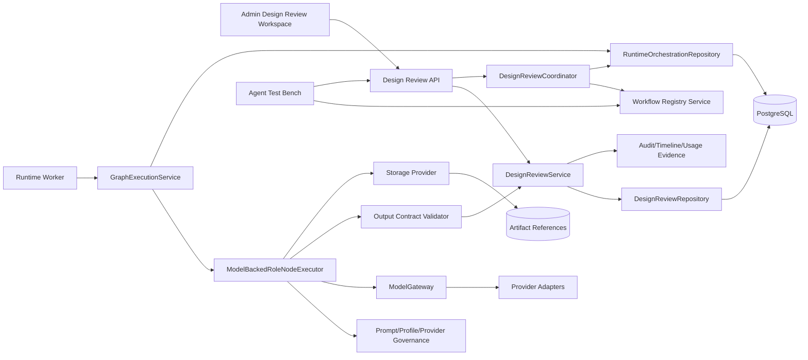

### Data Model

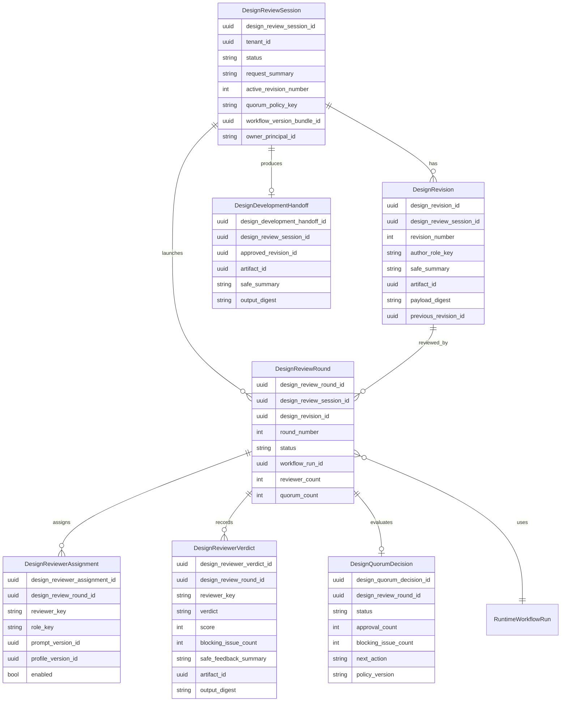

### Review Round Runtime Shape

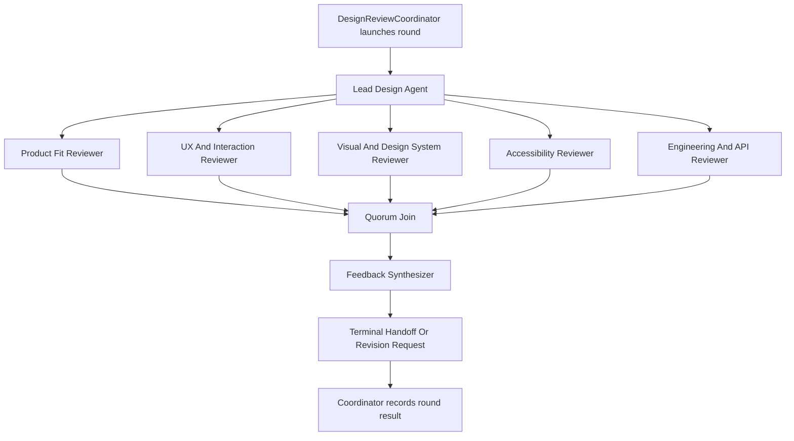

### Cross-Round Coordinator Loop

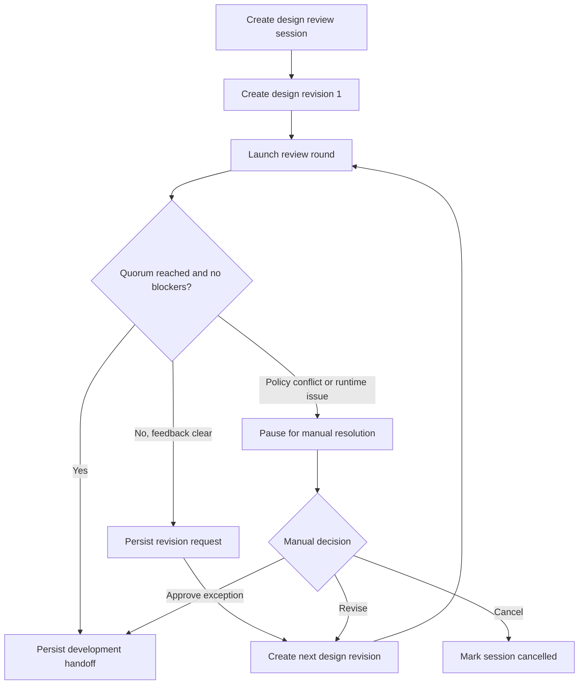

### Runtime Integration

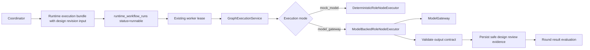

## Sequence Diagrams

### Start Session And Launch First Round

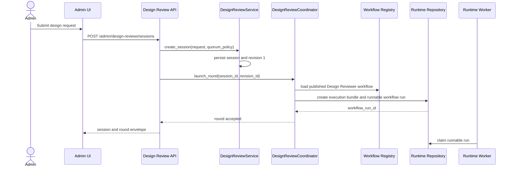

### Model-Backed Reviewer Execution

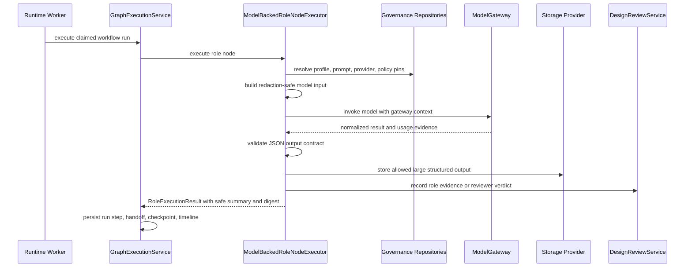

### Quorum Fails And Next Revision Starts

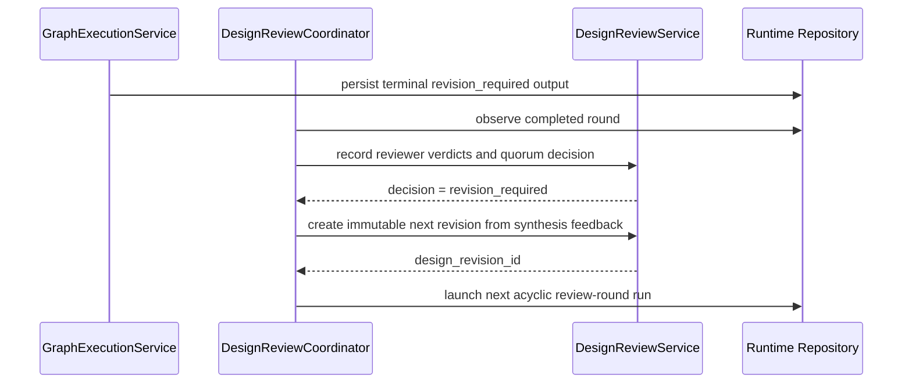

### Quorum Passes And Handoff Is Published

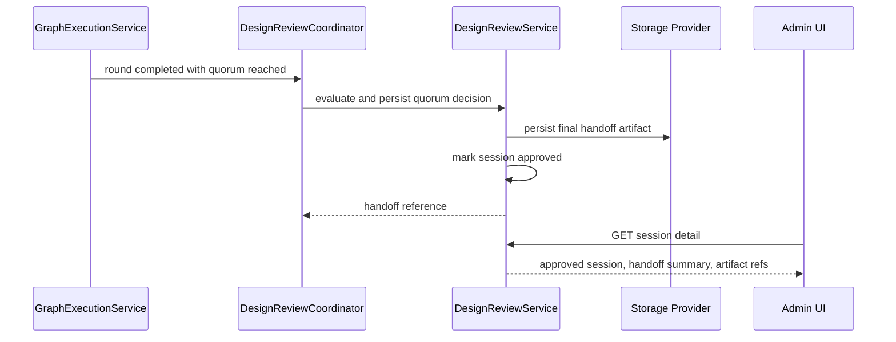

### Manual Resolution

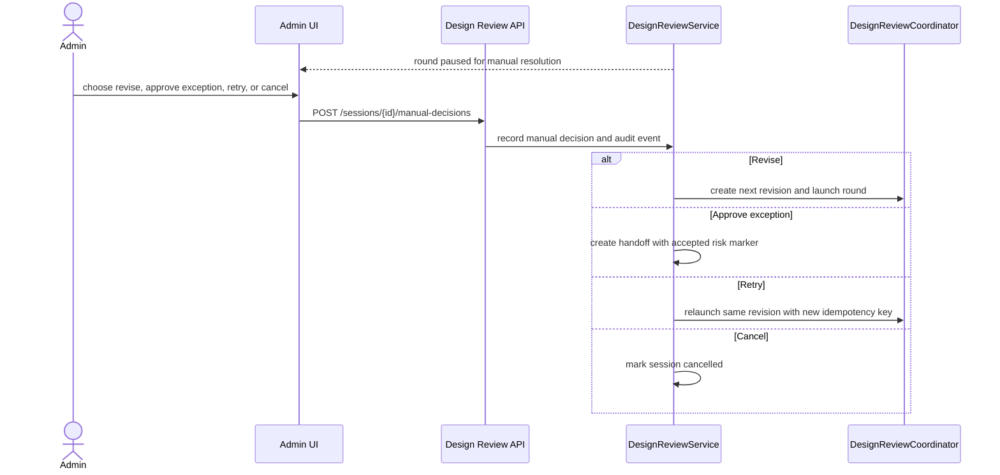

## Implementation Notes

### Durable Domain

Add a new `admin/design_review` domain with Pydantic schemas, SQLAlchemy models,
repositories, and services. These records should be tenant-scoped and immutable
where they represent evidence:

- sessions: mutable status and active revision pointer
- revisions: immutable design packet artifacts and safe summaries
- rounds: one runtime workflow run against one revision
- assignments: reviewer role/profile/prompt pins used in one round
- verdicts: immutable structured reviewer outputs
- quorum decisions: immutable aggregate policy results
- handoffs: immutable final development handoff references

Recommended source locations:

- `src/multi_agent_platform/admin/design_review/`
- `src/multi_agent_platform/api/schemas/design_review.py`
- `src/multi_agent_platform/api/routers/admin_design_review.py`
- `src/multi_agent_platform/db/models/design_review.py`
- `src/multi_agent_platform/db/repositories/design_review.py`
- `frontend/admin/src/components/designReview/`

### Coordinator

The coordinator should be the only component that implements the repeated
review loop. It should:

- create sessions and initial revisions
- load a published Design Reviewer Council workflow bundle
- create DB-backed runtime execution bundles and runnable workflow runs
- record round completion from runtime output, timeline, and role evidence
- evaluate quorum using design-review policy, not only raw graph branch success
- launch the next round when revision is required
- pause for manual resolution when policy cannot decide
- enforce a max-round limit and explicit cancellation

The coordinator should not call the existing in-memory runtime facade for
production design reviews. It should write through
`RuntimeOrchestrationRepository` so the existing worker can claim and execute
the run.

### Model-Backed Role Executor

`GraphExecutionService` already accepts a `RoleNodeExecutor`; the worker
currently uses the deterministic default. Add a model-backed executor and a
factory/selection layer so each run chooses the correct executor from persisted
execution mode and policy pins.

The model-backed executor must:

- load prompt/profile/provider pins for the role
- build a safe model input from upstream summaries and artifact references
- call `ModelGateway` with a complete gateway invocation context
- validate the model output against the role output contract
- persist large outputs as governed artifacts when allowed
- return only safe summaries, digests, structured safe output, and usage
  provenance to graph execution
- fail closed when prompt/profile/provider pins, credentials, policy, or output
  validation are not ready

### Admin Workspace

Add a live-data Admin workspace after backend contracts stabilize. It should
support:

- session creation and safe request summary capture
- prompt/profile/provider readiness and workflow template readiness
- round timeline with reviewer assignments, verdict summaries, quorum decision,
  revision request, and handoff status
- revision diffs based on safe summaries and artifact metadata
- manual resolution actions with audit-safe decisions
- handoff export/download only through artifact references and allowed policies

The UI must not render mock sessions. Empty, denied, loading, stale, and error
states must be backend-owned.

## Accuracy Review

This design is implementable against the current repository because it builds
on existing extension points and deliberately avoids unsupported runtime cycles:

- `GraphExecutionService` already supports role executor injection, parallel
  waves, quorum joins, terminal nodes, and manual-resolution pauses.
- The DB-backed worker already claims `runtime_workflow_runs` through
  `RuntimeOrchestrationRepository`; the coordinator should create DB-backed runs
  for production instead of using the in-memory runtime facade.
- Workflow registry already stores document contracts, roles, nodes, joins,
  prompt/profile references, test requirements, validation results, publish
  gates, and compiled bundle summaries.
- Prompt/profile/provider governance and `ModelGateway` already exist, so the
  missing executor can resolve pins and call the gateway without inventing a new
  provider layer.
- Test Bench already supports deterministic required evidence and publish-gate
  summaries; the template spec can extend this with scenario-specific fixtures.
- React Admin live-data patterns already exist for workflows, governance,
  operations, test bench, usage, memberships, and channels; the design-review
  workspace should follow those patterns.

Known implementation risks:

- The executor must be strict about redaction and artifact boundaries because
  design packets and reviewer feedback may contain product-sensitive content.
- Coordinator idempotency must prevent duplicate rounds when the same session
  action is retried.
- Manual-resolution behavior must be auditable and must not silently override
  blocking reviewer issues.
- Contract validation must distinguish model formatting failures from reviewer
  verdicts that legitimately request changes.
- Admin route envelopes must not synthesize sessions or handoffs when no durable
  records exist.

Definition of done for the full scenario:

- A tenant admin can create a design review session from Admin.
- The coordinator launches round 1 as a DB-backed runtime run.
- Lead and reviewer role nodes can run in deterministic mode for QA and
  model-backed mode when configured policy permits it.
- Four-of-five and three-of-four quorum rules produce correct decisions with no
  blocking issues.
- Failed quorum creates a new design revision and launches a new acyclic round,
  subject to max-round and manual-resolution policy.
- Approved quorum creates a development handoff with safe artifact references.
- Admin shows live session, round, revision, verdict, decision, and handoff
  data with truthful empty/denied/error states.
- Required test-bench evidence and Playwright QA cover success, revision,
  manual-resolution, redaction, and cross-tenant denial paths.

## Spec Kit Implementation Roadmap

Use the next available spec number if the repository advances before work
starts. The numbering below assumes the current latest spec is 059.

### Spec 060 - Design Review Domain Foundation

Goal: Add the tenant-scoped durable design review domain, API schemas, database
models, repositories, and service methods for sessions, revisions, rounds,
assignments, verdicts, quorum decisions, and handoffs.

Dependencies: none.

Deliverables:

- Alembic migration for design-review tables
- domain service and repository
- Pydantic request/response contracts
- API routes for create/list/detail session, revision metadata, round metadata,
  manual decision records, and handoff summary
- audit-safe summaries and artifact-reference fields
- unit, repository, contract, and integration tests

#### Specify Prompt

```text
/speckit.specify Add a first-class Design Review domain for the multi-agent platform. The feature must let tenant admins create and inspect durable design review sessions for the Design Reviewer Council scenario. A session starts from a safe design request summary, tracks immutable design revisions, review rounds, reviewer assignments, reviewer verdicts, quorum decisions, manual decisions, and final development handoff references. Records must be tenant-scoped, authorization-aware, redaction-safe, and auditable. Do not execute live model calls in this spec. Do not add the Admin React workspace yet. The API must expose backend-owned JSON contracts for session creation, session detail, round detail, revision metadata, quorum decision metadata, and handoff metadata. Empty and denied states must be truthful.
```

#### Plan Prompt

```text
/speckit.plan Implement the Design Review domain as an additive backend feature using Python 3.12, FastAPI, Pydantic v2, SQLAlchemy 2 async ORM, Alembic, PostgreSQL, existing tenant guards, artifact references, audit helpers, and redaction conventions. Add models under src/multi_agent_platform/db/models/design_review.py, repository under src/multi_agent_platform/db/repositories/design_review.py, service under src/multi_agent_platform/admin/design_review/, schemas under src/multi_agent_platform/api/schemas/design_review.py, and router under src/multi_agent_platform/api/routers/admin_design_review.py. Include OpenAPI contracts, data-model docs, quickstart, migration notes, and tests. Preserve current workflow registry, runtime, prompt/profile, and test-bench behavior.
```

#### Tasks Prompt

```text
/speckit.tasks Generate executable tasks for the Design Review domain foundation. Include migration tasks, model/repository/service/schema/router tasks, tenant authorization tests, redaction tests, artifact-reference tests, audit tests, contract tests, integration API tests, and docs/QA tasks. Organize by independently testable user stories: create session, inspect session/round evidence, record immutable verdict/quorum/handoff evidence, and enforce tenant isolation.
```

#### Implement Prompt

```text
/speckit.implement Implement only the Design Review domain foundation tasks. Keep changes additive. Do not implement live model role execution, round auto-launching, or the Admin design review workspace in this spec. Run focused backend validation, Alembic migration validation, contract tests, integration route tests, ruff, mypy for touched modules, and spec QA docs validation.
```

### Spec 061 - Model-Backed Graph Role Executor

Goal: Add a governed model-backed `RoleNodeExecutor` that can execute lead,
reviewer, and synthesizer role nodes through `ModelGateway` with contract
validation, safe artifacts, usage provenance, and fail-closed policy behavior.

Dependencies: Spec 060 for design-review evidence sinks. Existing governance
and provider gateway features.

Deliverables:

- `ModelBackedRoleNodeExecutor`
- role executor factory/selection in worker graph execution
- output contract validation helper
- safe artifact persistence for model outputs
- gateway provenance and usage capture
- deterministic and mocked gateway tests

#### Specify Prompt

```text
/speckit.specify Add governed model-backed role-node execution for workflow graph role nodes. The feature must allow a published workflow role node to execute through ModelGateway when the run's execution mode and policy pins permit it. The executor must resolve active prompt/profile/provider pins, build redaction-safe model inputs from upstream summaries and artifact references, call ModelGateway, validate structured output against the role output contract, persist large allowed outputs as artifact references, capture usage/provenance, and return safe RoleExecutionResult data to graph execution. It must fail closed when pins, credentials, provider policy, contract validation, redaction, or tenant scope is invalid. Existing deterministic execution must remain available for local QA and test bench.
```

#### Plan Prompt

```text
/speckit.plan Design a model-backed graph role executor using existing RuntimeOrchestrationRepository, GraphExecutionService RoleNodeExecutor protocol, ModelGateway, ProviderSecretResolver, prompt/profile governance repositories, storage provider, usage capture, audit helpers, and graph redaction helpers. Add contract validation under runtime/orchestration, executor factory wiring for the worker, and tests with mocked ModelGateway responses. Ensure no raw prompts, completions, credentials, private payloads, memory content, or raw provider responses are rendered, logged, exported, or stored outside governed artifacts.
```

#### Tasks Prompt

```text
/speckit.tasks Generate tasks for model-backed role-node execution. Include contract tests for executor input/output behavior, unit tests for fail-closed cases, mocked gateway integration tests, worker factory selection tests, artifact persistence tests, usage/provenance tests, redaction tests, and documentation updates. Keep deterministic executor behavior unchanged and independently testable.
```

#### Implement Prompt

```text
/speckit.implement Implement the model-backed role executor tasks. Do not add the review-round coordinator or Admin workspace in this spec. Preserve deterministic role execution as the default unless a run explicitly selects model-backed mode. Run ruff, mypy, focused runtime/model-provider tests, integration graph execution tests with mocked gateway calls, and QA doc validation.
```

### Spec 062 - Design Review Coordinator And Iteration Loop

Goal: Add the coordinator that launches one acyclic runtime run per design review
round, evaluates reviewer verdicts and quorum decisions, records revision
requests, starts successive rounds, and pauses for manual resolution when
policy cannot decide.

Dependencies: Specs 060 and 061.

Deliverables:

- `DesignReviewCoordinator`
- DB-backed runtime launch path for design-review rounds
- round completion evaluator
- max-round and idempotency policy
- manual-resolution decision handling
- run timeline and design-review evidence synchronization

#### Specify Prompt

```text
/speckit.specify Add a Design Review Coordinator that turns a design review session into successive acyclic workflow runs until the Design Reviewer Council reaches quorum or requires manual resolution. A coordinator-created round must review exactly one immutable design revision, launch a DB-backed runtime workflow run using the published Design Reviewer Council workflow, collect lead/reviewer/synthesizer outputs, evaluate four-of-five or three-of-four quorum with zero blocking issues, create a development handoff when approved, create the next design revision when revision is required, and pause for manual resolution when policy conflicts or runtime evidence is incomplete. The workflow graph must remain acyclic; iteration happens by launching another round run.
```

#### Plan Prompt

```text
/speckit.plan Implement the coordinator on top of the Design Review domain, Workflow Registry published bundles, RuntimeOrchestrationRepository, runtime worker leases, GraphExecutionService, artifact storage, and audit/timeline records. Define idempotency keys, max round policy, retry and cancellation behavior, manual decision actions, and safe status projections. Include contracts for starting a session with workflow/template selection, launching/retrying a round, recording round completion, manual decisions, and querying coordinator state.
```

#### Tasks Prompt

```text
/speckit.tasks Generate tasks for the Design Review Coordinator and iteration loop. Include unit tests for quorum policy, revision-required behavior, approval behavior, manual resolution behavior, max-round limits, idempotency, and fail-closed evidence handling. Include integration tests that create DB-backed runtime runs, let the worker execute deterministic and mocked model-backed rounds, and verify design-review tables update correctly. Include contract docs and QA docs.
```

#### Implement Prompt

```text
/speckit.implement Implement the coordinator tasks. Do not build the Admin React workspace in this spec. Verify that each review round is a separate acyclic runtime run and that no cyclic graph support is introduced. Run focused domain, runtime, worker, integration, contract, redaction, and QA validation.
```

### Spec 063 - Admin Design Review Workspace

Goal: Add a live-data Admin workspace for creating sessions, monitoring rounds,
inspecting reviewer evidence, comparing revisions, resolving manual decisions,
and viewing final handoffs.

Dependencies: Specs 060 and 062. Spec 061 for live model evidence display when
available.

Deliverables:

- `/admin/app/design-reviews` route and bootstrap contracts
- session create/list/detail views
- round timeline and reviewer verdict panels
- revision diff and handoff panels
- manual resolution actions
- accessibility and Playwright QA

#### Specify Prompt

```text
/speckit.specify Add a live-data Admin workspace for Design Review sessions. Tenant admins must be able to create a Design Reviewer Council session from a safe request summary, select an authorized published workflow/template and quorum policy, monitor each review round, inspect reviewer verdict summaries, view quorum decisions, compare safe design revision summaries, perform manual-resolution actions when allowed, and view the final development handoff reference. The workspace must use backend-owned data only, show truthful empty/denied/loading/stale/error states, and avoid all implementation-framework labels in visible product copy.
```

#### Plan Prompt

```text
/speckit.plan Implement the Design Review Admin workspace with React 19, TypeScript strict mode, existing Admin shell patterns, backend-owned JSON envelopes, FastAPI routes, generated TypeScript contracts if needed, Testing Library, Vitest, and Playwright. Reuse existing Admin layout, tables, forms, mutation result patterns, safe problem details, scope handling, and route guards. Add no mock sessions or fake reviewer evidence in production routes. Include WCAG-oriented keyboard/focus behavior, icon buttons with accessible names, and redaction checks.
```

#### Tasks Prompt

```text
/speckit.tasks Generate tasks for the Admin Design Review workspace. Include backend envelope tasks, frontend route/component tasks, form/mutation tasks, session detail/timeline/revision/handoff panels, manual-resolution action controls, generated type updates, Vitest tests, route integration tests, Playwright browser QA, visible-copy/redaction scans, docs, and QA environment updates. Organize by user stories: create session, monitor round evidence, resolve paused sessions, and inspect approved handoff.
```

#### Implement Prompt

```text
/speckit.implement Implement the Admin Design Review workspace tasks. Do not introduce production mock records or implementation-framework visible labels. Run frontend typecheck, Vitest, build, backend route tests, Playwright route validation, visible-copy/redaction scans, ruff, mypy for touched backend modules, and spec QA docs validation.
```

### Spec 064 - Design Reviewer Template, Test Bench, And Publish Gates

Goal: Provide a reusable Design Reviewer Council workflow template and
repository-backed QA evidence that validates deterministic, model-backed,
revision-required, manual-resolution, and cross-tenant paths.

Dependencies: Specs 060 through 063.

Deliverables:

- reusable template/install action for Design Reviewer Council workflow
- deterministic test-bench suites and cases
- model-backed safe-mode test cases with mocked provider responses
- publish-gate integration for required design-review scenario evidence
- QA docs and Playwright walkthroughs

#### Specify Prompt

```text
/speckit.specify Add reusable Design Reviewer Council template and QA evidence support. Platform or tenant admins must be able to install or create a workflow template with lead, reviewer, quorum, synthesis, and handoff roles; attach required test-bench evidence; validate deterministic and model-backed safe-mode behavior; and publish only when current evidence passes. QA must cover four-of-five quorum success, three-of-four quorum success, revision-required outcomes, blocking issue handling, manual-resolution pause, retry/cancel behavior, approved handoff, cross-tenant denial, redaction, and Admin live-data states.
```

#### Plan Prompt

```text
/speckit.plan Implement template and QA support using existing workflow registry, workflow builder contracts, prompt/profile governance, test bench, publish gates, design-review coordinator APIs, Admin workspace routes, Playwright, pytest, Vitest, and QA document conventions. Decide whether the template is stored as a backend builder helper, seed script, or install action, but ensure production Admin routes remain live-data only. Include deterministic fixtures, mocked model gateway fixtures, required evidence freshness, and documentation for local-principal Acme setup.
```

#### Tasks Prompt

```text
/speckit.tasks Generate tasks for the Design Reviewer Council template and QA evidence. Include template builder/service tasks, template install/create API tasks, workflow validation tests, test-bench suite/case generation tasks, publish-gate freshness tests, model-backed mocked evidence tests, Playwright Admin walkthrough, redaction scans, cross-tenant denial tests, operations/usage evidence checks, QA docs, and multi-agent curl regression updates if applicable.
```

#### Implement Prompt

```text
/speckit.implement Implement the Design Reviewer Council template and QA evidence tasks. Keep template creation explicit and durable; do not render fake production setup success. Run workflow registry tests, test-bench tests, design-review coordinator tests, Admin Playwright QA, frontend validation, backend validation, redaction/visible-copy scans, and multi-agent curl regression if the public route surface changes.
```

### Cross-Spec Dependency Order

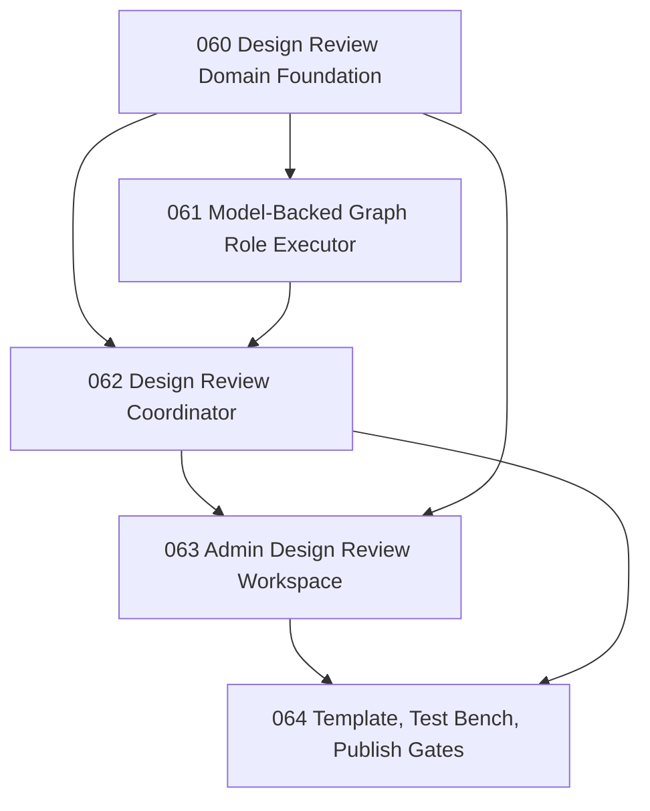

Recommended implementation order:

1. Spec 060 creates the durable domain and route contracts.
2. Spec 061 adds model-backed role execution while preserving deterministic QA.
3. Spec 062 connects sessions to repeated acyclic runtime rounds.
4. Spec 063 adds the live-data Admin workspace.
5. Spec 064 packages the scenario as a reusable template with end-to-end QA and
   publish-gate evidence.
