# QA013 UI: Guided Admin Workflow Builder

## Goal

Validate Spec 013 through the server-rendered HTML admin UI. This guide is
designed so a reviewer can start here, prepare the local QA environment, create
the required blocked and ready workflows in the browser, and complete the same
feature checks covered by `qa013.md` without running through that file first.

The only terminal work in this guide is environment setup and automated
evidence. Workflow creation, draft review, validation, publish gate review,
save conflict testing, revision history, copy, restore, authorization checks,
publish, and version review are performed through browser pages.

Screenshot note: the images in this guide were captured from a clean local
QA013 UI run. Your UUIDs, digests, timestamps, and slug suffixes may differ,
but the page structure and controls should match.

## How To Use This Guide

Use two terminal windows:

- Terminal A runs the API server and should stay open.
- Terminal B runs setup and automated evidence commands.

Use one browser window for most checks. The stale-save check requires two
browser tabs open to the same draft editor.

Record these values as you create them in the browser:

- `QA013_BLOCKED_DRAFT_ID`: copy this from the blocked draft editor URL.
- `QA013_READY_DRAFT_ID`: copy this from the ready draft editor URL.
- `QA013_VERSION_ID`: copy this from the published version detail URL.

When a URL contains `<blocked-draft-id>`, `<ready-draft-id>`, or
`<version-id>`, replace it with the matching value from your run.

## Environment Setup

Run these commands from the repository root:

```bash
cd /Users/scottcornell/src/my-projects/multi-agent
```

### Environment Step 1 - Copy The QA Environment

Run this in Terminal B:

```bash
cp specs/013-admin-workflow-builder/.env.qa013 .env
```

Expected: no output. The app now uses local-principal auth and the PostgreSQL
QA database `multi_agent_platform_qa013` on `127.0.0.1:5432`.

What is happening: the app is pointed at an isolated QA database and local-only
authentication settings.

Why this matters: the UI pass should not touch the default developer database
or any production-like credentials.

### Environment Step 2 - Confirm `curl` And `jq`

Run this in Terminal B:

```bash
curl --version | head -1
jq --version
```

Expected: each command prints a version.

What is happening: Terminal B is confirming that the reviewer machine has the
basic command-line tools used by the broader QA evidence flow.

Why this matters: even though this guide is UI-first, these tools are useful
for troubleshooting saved ids and automated evidence.

### Environment Step 3 - Remove Old QA013 Evidence Files

Run this in Terminal B:

```bash
find /tmp -type f \( -name 'qa013-*.json' -o -name 'qa013-*.html' -o -name 'qa013-*.txt' \) -exec rm -f {} +
```

Expected: no output.

What is happening: old response files from previous QA013 runs are removed.

Why this matters: later evidence should come from the current UI pass.

### Environment Step 4 - Install Dependencies

Run this in Terminal B:

```bash
uv sync
```

Expected: command completes without an error.

What is happening: the Python dependencies used by the app and tests are
installed.

Why this matters: the server, migrations, and reviewer checks need the same
dependency set used by automated validation.

### Environment Step 5 - Start PostgreSQL

Run this in Terminal B:

```bash
docker compose up -d postgres
```

Expected: Docker reports the PostgreSQL service is running.

What is happening: the local PostgreSQL service is started.

Why this matters: workflow drafts, revisions, validation results, publish
gates, and published bundles are stored in PostgreSQL.

### Environment Step 6 - Reset The QA013 Database

Run this in Terminal B:

```bash
docker compose exec -T postgres sh -c \
  'dropdb -U postgres --if-exists multi_agent_platform_qa013 && createdb -U postgres multi_agent_platform_qa013'
```

Expected: no output.

What is happening: PostgreSQL recreates only the isolated QA013 database.
Existing default development databases are not touched.

Why this matters: the UI pass starts clean, so the workflow registry does not
show drafts created earlier by `qa013.md` or another local run.

### Environment Step 7 - Apply Database Migrations

Run this in Terminal B:

```bash
uv run alembic upgrade head
```

Expected: command completes without an error.

What is happening: Alembic creates or updates the schema for workflow registry,
audit, prompt/profile, provider, reliability, and builder-related tables.

Why this matters: the UI pages need the registry, draft, revision, validation,
publish gate, and published bundle tables before browser checks can work.

### Environment Step 8 - Seed Deterministic Tenants

Run this in Terminal B:

```bash
docker compose exec -T postgres psql -U postgres -d multi_agent_platform_qa013 -v ON_ERROR_STOP=1 <<'SQL'
INSERT INTO tenants (
  tenant_id, slug, display_name, status, created_at, updated_at
) VALUES
  ('11111111-1111-1111-1111-111111111111', 'acme', 'Acme', 'active', CURRENT_TIMESTAMP, CURRENT_TIMESTAMP),
  ('22222222-2222-2222-2222-222222222222', 'globex', 'Globex', 'active', CURRENT_TIMESTAMP, CURRENT_TIMESTAMP)
ON CONFLICT (tenant_id) DO UPDATE SET
  slug = EXCLUDED.slug,
  display_name = EXCLUDED.display_name,
  status = EXCLUDED.status,
  updated_at = CURRENT_TIMESTAMP;
SQL
```

Expected: PostgreSQL prints `INSERT 0 2` or an equivalent upsert result.

What is happening: the Acme and Globex tenants used by local-principal QA are
created or refreshed.

Why this matters: the browser walkthrough checks same-tenant access,
cross-tenant denial, and platform-vs-tenant behavior.

### Environment Step 9 - Start The API

Run this in Terminal A and keep it open:

```bash
uv run uvicorn multi_agent_platform.api.main:app --reload
```

Expected: the server listens on `http://127.0.0.1:8000`.

What is happening: the FastAPI admin application is serving the workflow
registry API and server-rendered HTML pages.

Why this matters: the browser walkthrough uses this app process and the QA013
database you prepared above.

## Browser Walkthrough

### Step 1 - Log In As Acme Tenant Admin

Screenshot:

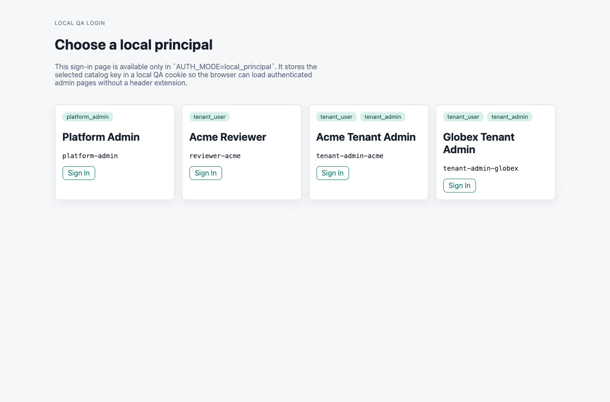

Open:

```text
http://127.0.0.1:8000/auth/local-login?redirect_to=/admin/workflows/ui
```

Navigation path:

1. Find the `Acme Tenant Admin` card.
2. Confirm the card shows `tenant-admin-acme`.
3. Click `Sign In`.
4. Confirm the browser redirects to `Workflow Registry`.

The browser URL should be:

```text
http://127.0.0.1:8000/admin/workflows/ui
```

Expected: you are signed in as an Acme tenant admin.

What is happening: local-principal mode stores a local QA cookie for
`tenant-admin-acme`.

Why this matters: the blocked workflow is tenant-scoped, and the Acme tenant
admin is the expected actor for creating and editing it.

### Step 2 - Review The Initial Registry

Screenshot:

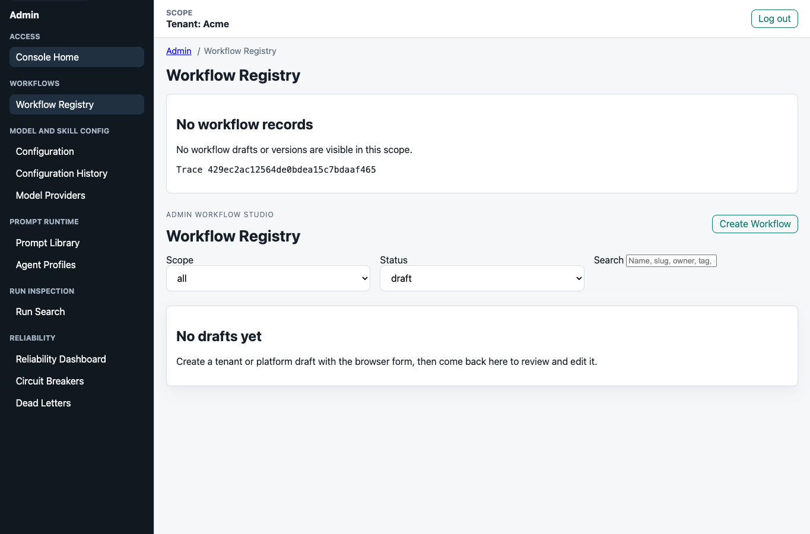

Navigation path:

1. Start from the page reached after login.
2. Confirm the page title is `Workflow Registry`.

The browser URL should be:

```text
http://127.0.0.1:8000/admin/workflows/ui
```

Expected: after the reset in Environment Step 6, the registry shows no QA013
drafts yet.

What is happening: the registry page is reading workflow drafts and versions
visible to the Acme principal.

Why this matters: this proves the UI starts from the existing registry model,
not a separate builder-only store.

### Step 3 - Check Registry Filters

Screenshot:

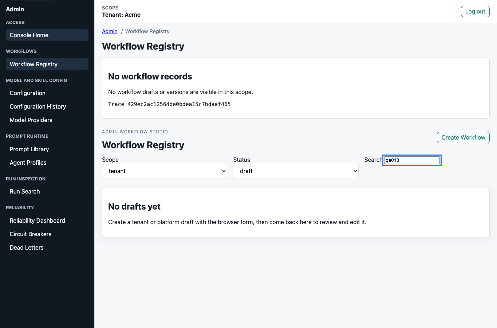

Navigation path:

1. Stay on `Workflow Registry`.
2. Use the filter strip near the top of the page.

Actions to complete:

1. Set `Scope` to `tenant`.
2. Set `Status` to `draft`.
3. Type `qa013` in `Search`.

Expected: the filter controls remain usable. If no QA013 drafts exist yet,
the list may still be empty.

What is happening: the UI exposes the search, scope, and status controls
required by the builder contract.

Why this matters: non-technical admins need to find workflows without database
queries or direct API calls.

### Step 4 - Create The Blocked Tenant Draft

Screenshot:

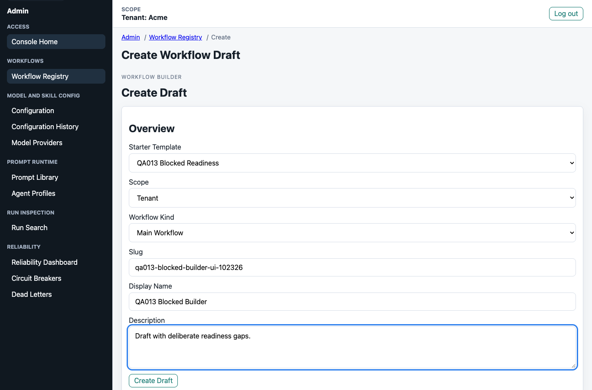

Navigation path:

1. Start on `Workflow Registry`.
2. Click `Create Workflow`.

The browser URL should be:

```text
http://127.0.0.1:8000/admin/workflows/new
```

Do this:

1. Set `Starter Template` to `QA013 Blocked Readiness`.
2. Set `Scope` to `tenant`.
3. Set `Workflow Kind` to `main_workflow`.
4. Enter a unique slug, for example `qa013-blocked-builder-ui-<your-initials>`.
5. Enter `QA013 Blocked Builder` as `Display Name`.
6. Leave or enter `Draft with deliberate readiness gaps.` as the description.
7. Click `Create Draft`.
8. Record the draft id from the editor URL as `QA013_BLOCKED_DRAFT_ID`.

Expected: the browser opens the draft editor for `QA013 Blocked Builder`.

What is happening: the UI creates a tenant-scoped workflow draft using the same
deliberately incomplete authoring document described in `qa013.md`.

Why this matters: this is the browser equivalent of the blocked-draft creation
step. It gives the reviewer a known draft with graph, prompt/profile, skill,
subworkflow, and required-test readiness failures.

### Step 5 - Confirm The Blocked Draft Appears In The Registry

Screenshot:

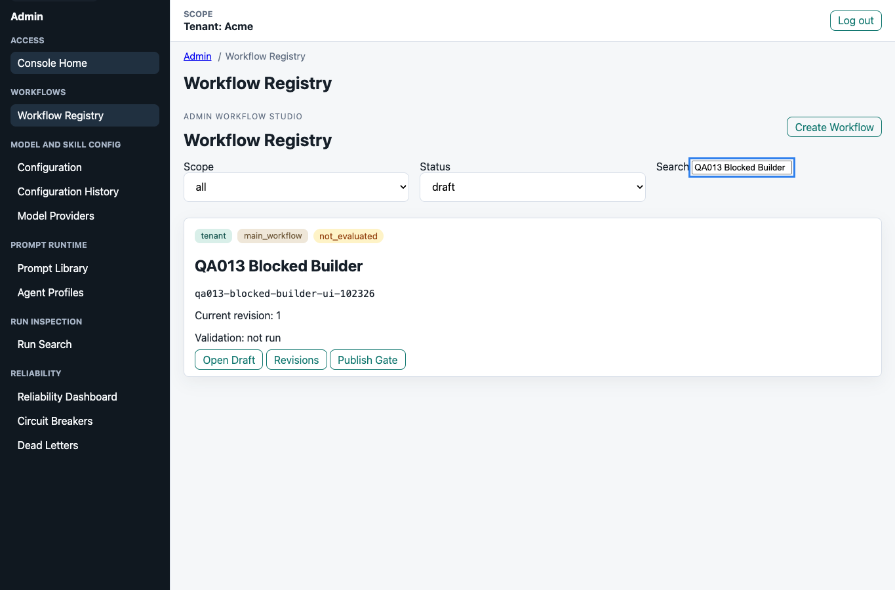

Navigation path:

1. From the editor, click the `Workflow Registry` breadcrumb.
2. Search for `QA013 Blocked Builder`.

The browser URL should be:

```text
http://127.0.0.1:8000/admin/workflows/ui
```

Expected: the `QA013 Blocked Builder` draft card appears with `Open Draft`,
`Revisions`, and `Publish Gate` links.

What is happening: the new draft is visible through the normal registry list.

Why this matters: Spec 013 extends the workflow registry instead of creating a
separate workflow store.

### Step 6 - Open The Blocked Draft Editor

Screenshot:


Navigation path:

1. Start on `Workflow Registry`.
2. Find `QA013 Blocked Builder`.
3. Click `Open Draft`.

The browser URL should be:

```text
http://127.0.0.1:8000/admin/workflows/drafts/<blocked-draft-id>/editor
```

Expected: the editor shows `Revision 1` for tenant scope.

What is happening: the editor loads the latest draft revision, editor
metadata, lookup summaries, and graph preview.

Why this matters: User Story 1 requires a guided UI that does not make raw JSON
the primary authoring workflow.

### Step 7 - Review Overview And Save A New Revision

Screenshot:

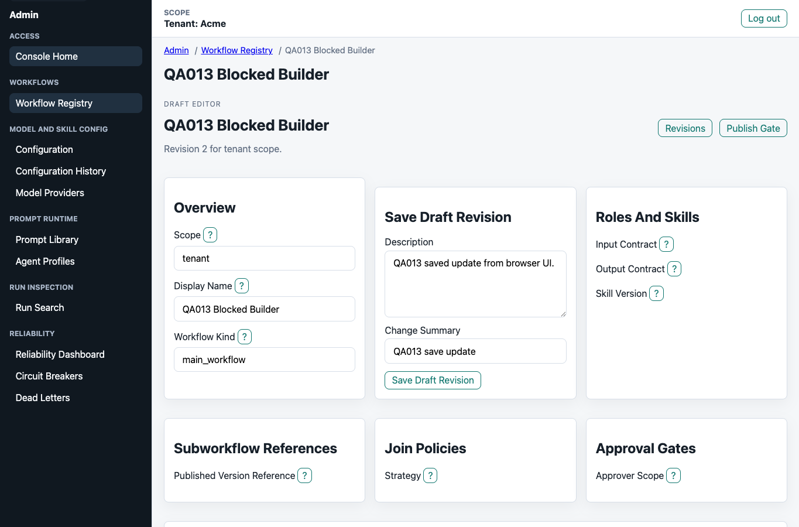

Navigation path:

1. Stay on the blocked draft editor.
2. Review `Overview`.
3. Scroll to `Save Draft Revision`.

Do this:

1. Confirm `Scope` is `tenant`.
2. Confirm `Display Name` is `QA013 Blocked Builder`.
3. Update `Description` to `QA013 saved update from browser UI.`.
4. Leave `Change Summary` as `QA013 save update`.
5. Click `Save Draft Revision`.

Expected: the editor reloads and the subtitle now shows `Revision 2`.

What is happening: the UI submits the current draft with
`base_revision_number: 1`, creating a new immutable revision.

Why this matters: this proves save creates a revisioned snapshot instead of
mutating the previous revision.

### Step 8 - Review Roles, Skills, Contracts, Joins, And Approvals

Screenshot:


Navigation path:

1. Stay on the blocked draft editor.
2. Scroll below `Save Draft Revision`.

Do this:

1. Review `Roles And Skills`.
2. Review `Subworkflow References`.
3. Review `Join Policies`.
4. Review `Approval Gates`.
5. Click at least one `?` help button, confirm a field-help dialog opens, and
   close the dialog before continuing.

Expected: the editor exposes the required guided builder sections, and each
available `?` button opens a short explanation for that field.

What is happening: these panels represent workflow roles, skill references,
contracts, subworkflows, joins, and approval concepts from Spec 013. The help
buttons read server-owned field metadata and show it in a browser dialog.

Why this matters: admins should be able to understand workflow structure
without editing raw JSON.

### Step 9 - Review Reference Readiness

Screenshot:


Navigation path:

1. Stay on the blocked draft editor.
2. Scroll to `Reference Readiness`.

Expected: lookup groups display safe labels and status badges, or state that
no eligible references exist in this scope.

What is happening: the page renders the browser equivalent of
`GET /admin/workflows/editor-lookups`.

Why this matters: tenant admins must only see resources available to their
scope, and the UI must not expose raw prompts, secrets, credentials, provider
payloads, or cross-tenant content.

### Step 10 - Review The Graph Builder

Screenshot:


Navigation path:

1. Stay on the blocked draft editor.
2. Scroll to `Graph Builder`.

Expected: the graph preview shows two nodes and one edge, including the
intentional unbounded loop.

What is happening: the page renders the browser equivalent of
`GET /admin/workflows/drafts/{id}/graph-preview`.

Why this matters: validation findings need stable graph ids so reviewers can
locate the exact node or edge blocking publication.

### Step 11 - Confirm The Advanced JSON Inspector Is Read-Only

Screenshot:

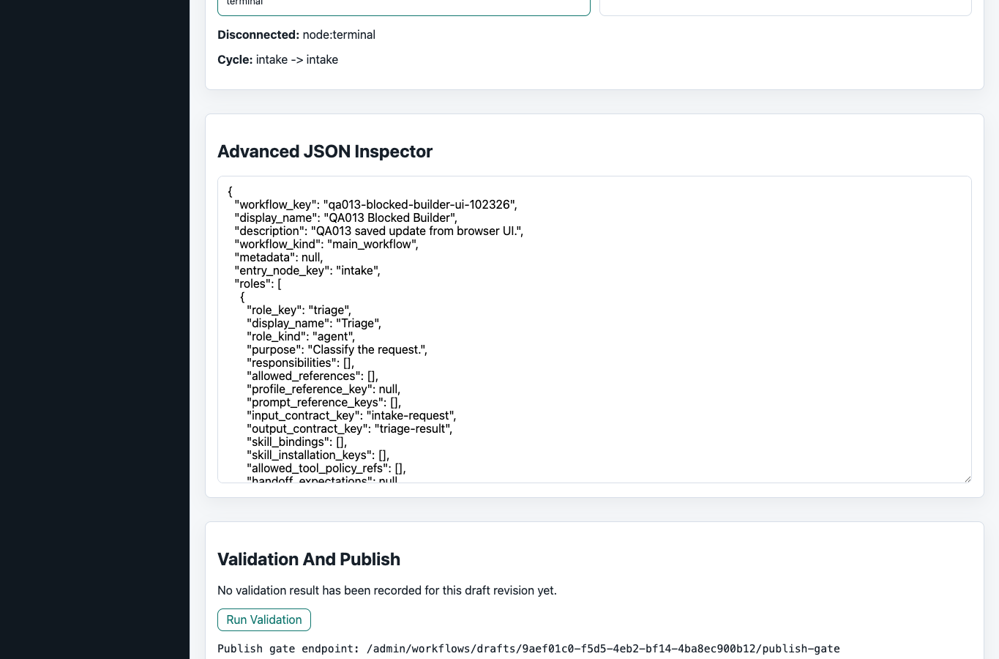

Navigation path:

1. Stay on the blocked draft editor.
2. Scroll to `Advanced JSON Inspector`.

Expected: the JSON inspector is visible but read-only.

What is happening: reviewers can inspect the saved document without using raw
JSON as the authoring workflow.

Why this matters: Spec 013 requires guided authoring while still preserving
safe inspection for debugging and review.

### Step 12 - Run Blocked Validation

Screenshot:

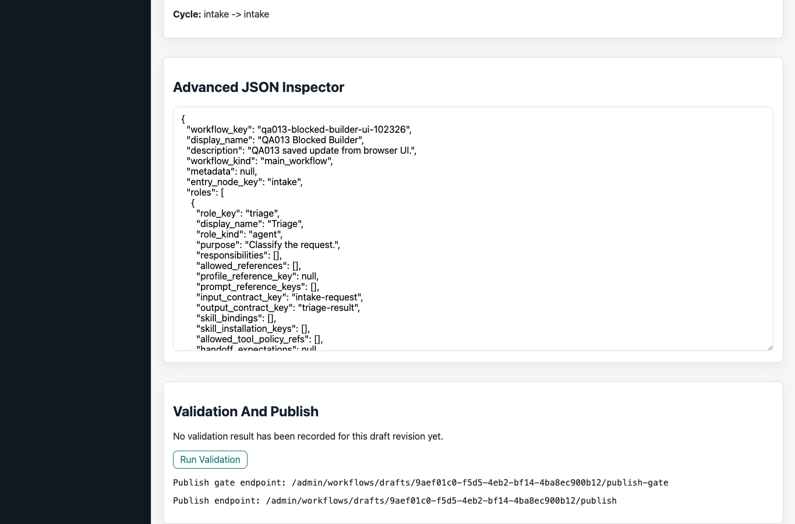

Navigation path:

1. Stay on the blocked draft editor.
2. Scroll to `Validation And Publish`.
3. Click `Run Validation`.

Expected: the editor reloads with validation status `failed` and a blocking
issue count greater than zero.

What is happening: the UI runs structural, graph, reference, subworkflow, skill,
prompt/profile, and required-test validation for the current revision.

Why this matters: User Story 2 requires actionable findings before an admin can
publish.

### Step 13 - Review Blocked Findings

Screenshot:

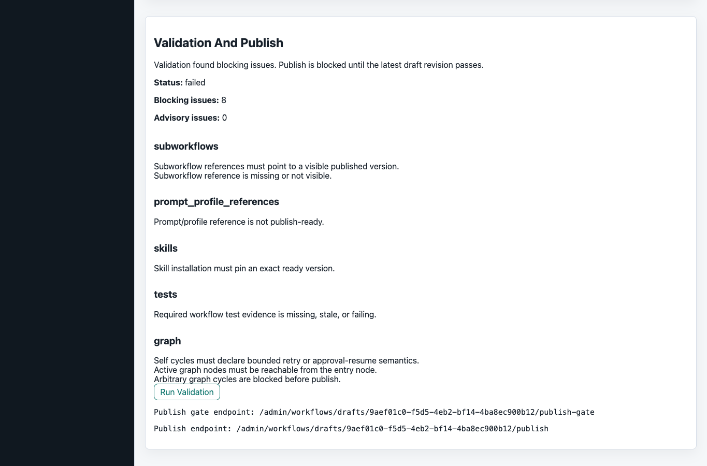

Navigation path:

1. Stay on the blocked draft editor after validation.
2. Review `Validation And Publish`.

Expected: findings identify graph, prompt/profile, skill, subworkflow, and
test readiness failures.

What is happening: validation findings are grouped by builder section and safe
message text.

Why this matters: reviewers should be able to identify the reason for a blocked
publish without reading bundle internals.

### Step 14 - Review The Blocked Publish Gate

Screenshot:

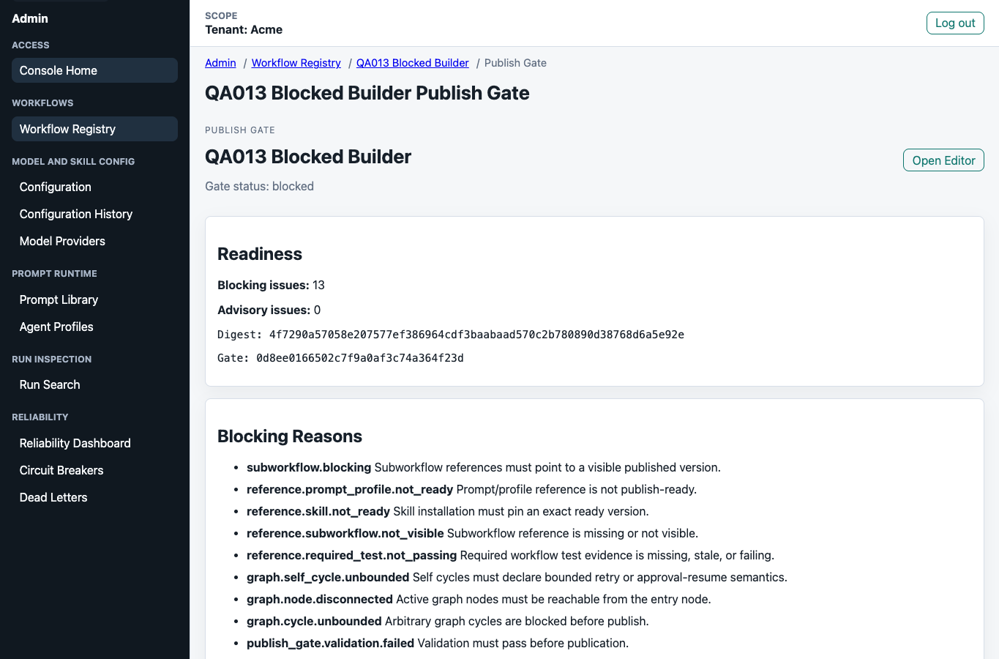

Navigation path:

1. From the editor header, click `Publish Gate`.
2. Alternatively, return to `Workflow Registry` and click `Publish Gate` on the
   blocked draft card.

The browser URL should be:

```text
http://127.0.0.1:8000/admin/workflows/drafts/<blocked-draft-id>/publish-gate/ui
```

Expected: `Gate status` is `blocked`, blocking issues are listed, a digest is
shown, and `Confirm Publish` is disabled.

What is happening: the publish gate re-checks current validation and readiness
without changing active published state.

Why this matters: blocked publication attempts must explain why they are
blocked and leave any active version unchanged.

### Step 15 - Check Safe Summaries

Screenshot:

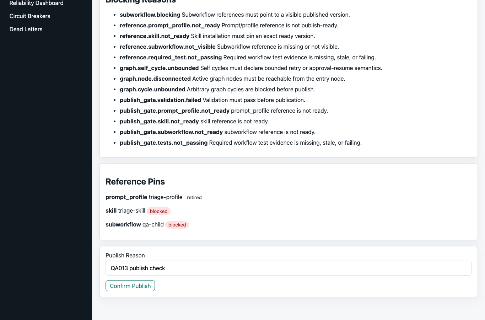

Navigation path:

1. Stay on the blocked `Publish Gate` page.
2. Read `Blocking Reasons`.
3. Continue to `Reference Pins`.

Expected: no raw prompts, raw secrets, credential values, provider payloads, or
unauthorized tenant details are visible.

What is happening: the UI renders safe summaries and readiness statuses only.

Why this matters: Spec 013 requires audit and review evidence without leaking
sensitive data.

### Step 16 - Verify Stale Save Conflict

Screenshot:

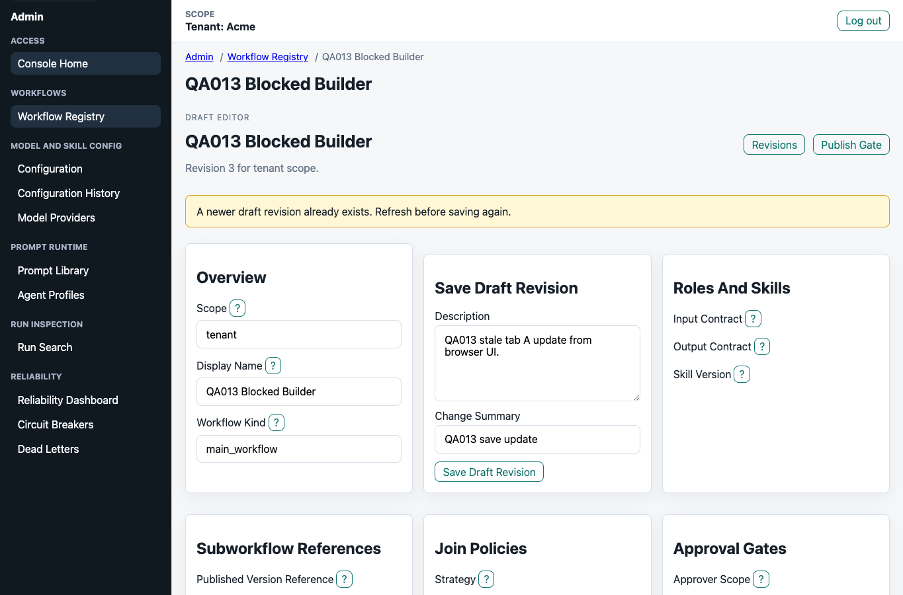

Navigation path:

1. Open the blocked draft editor in two tabs while it is on the same revision.
2. In Tab A, change `Description` and click `Save Draft Revision`.
3. In Tab B, without refreshing, change `Description` and click
   `Save Draft Revision`.

Expected: Tab B shows a conflict banner saying a newer draft revision exists.

What is happening: the stale tab submits an old `base_revision_number`, so the
server rejects the save and creates no extra revision.

Why this matters: two admins can work on the same draft. The builder must not
let older browser state overwrite newer edits.

### Step 17 - Review Revision History

Screenshot:

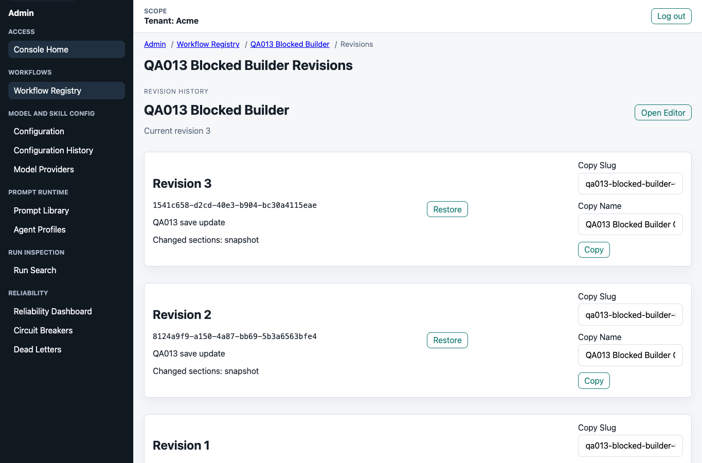

Navigation path:

1. Return to the blocked draft editor.
2. Click `Revisions` in the editor header.

The browser URL should be:

```text
http://127.0.0.1:8000/admin/workflows/drafts/<blocked-draft-id>/revisions/ui
```

Expected: revisions include the original draft and later saved revisions.

What is happening: the page lists immutable draft revisions and safe changed
section summaries.

Why this matters: User Story 4 requires admins to review how a workflow
changed over time.

### Step 18 - Copy A Draft Revision

Screenshot:

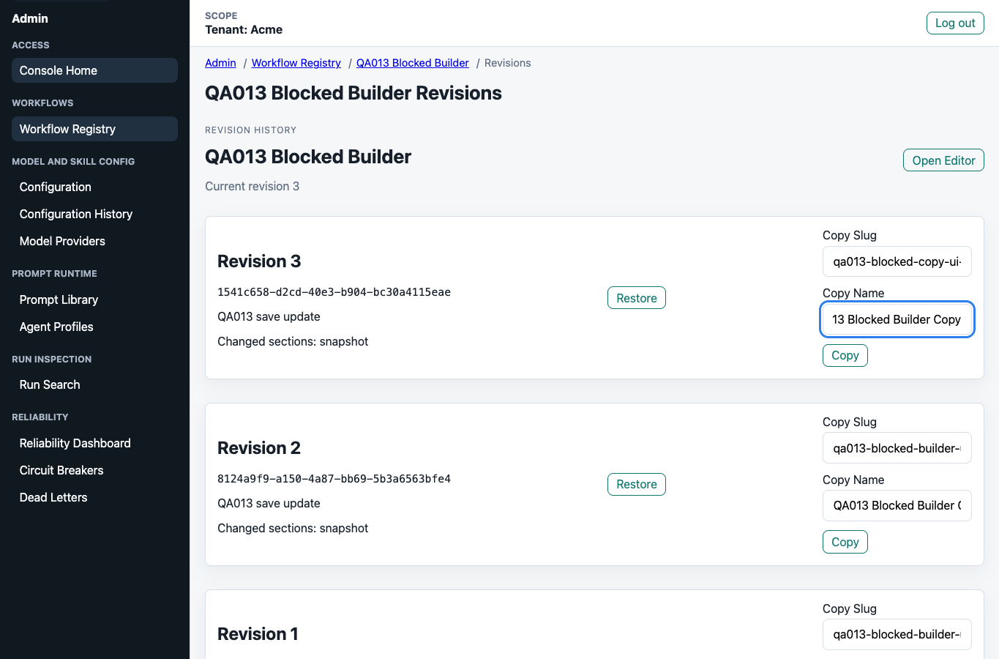

Navigation path:

1. Stay on `Revision History`.
2. Choose a revision row.
3. Enter a unique `Copy Slug`, for example
   `qa013-blocked-copy-ui-<your-initials>`.
4. Confirm `Copy Name` is `QA013 Blocked Builder Copy`.
5. Click `Copy`.

Expected: the browser opens an editor for the copied draft.

What is happening: the UI creates a new authorized draft lineage from the
selected revision.

Why this matters: copying must preserve tenant isolation and avoid leaking
another tenant's content.

### Step 19 - Restore An Older Revision

Screenshot:

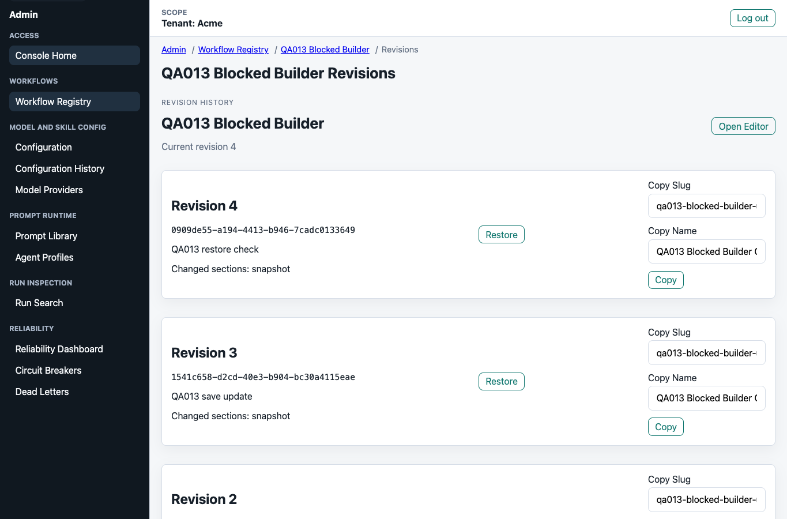

Navigation path:

1. Return to the original blocked draft `Revision History` page.
2. Find an older revision row.
3. Click `Restore`.

Expected: the page reloads with a higher current revision number.

What is happening: restore creates a new revision from historical content
instead of rewriting the old revision.

Why this matters: restore must be explicit, revisioned, and auditable.

### Step 20 - Confirm Cross-Tenant Denial

Screenshot:


Navigation path:

1. Open:

   ```text
   http://127.0.0.1:8000/auth/local-logout?redirect_to=/auth/local-login
   ```

2. On the login page, click `Sign In` on the `Globex Tenant Admin` card.
3. Open the blocked Acme draft editor URL directly.

Expected: the browser shows forbidden or not found behavior. Acme draft content
is not visible to Globex.

What is happening: tenant scope checks reject a Globex principal trying to view
an Acme draft.

Why this matters: FR-001 requires tenant admins to access only authorized
resources.

### Step 21 - Confirm Read-Only Reviewer Restrictions

Screenshot:

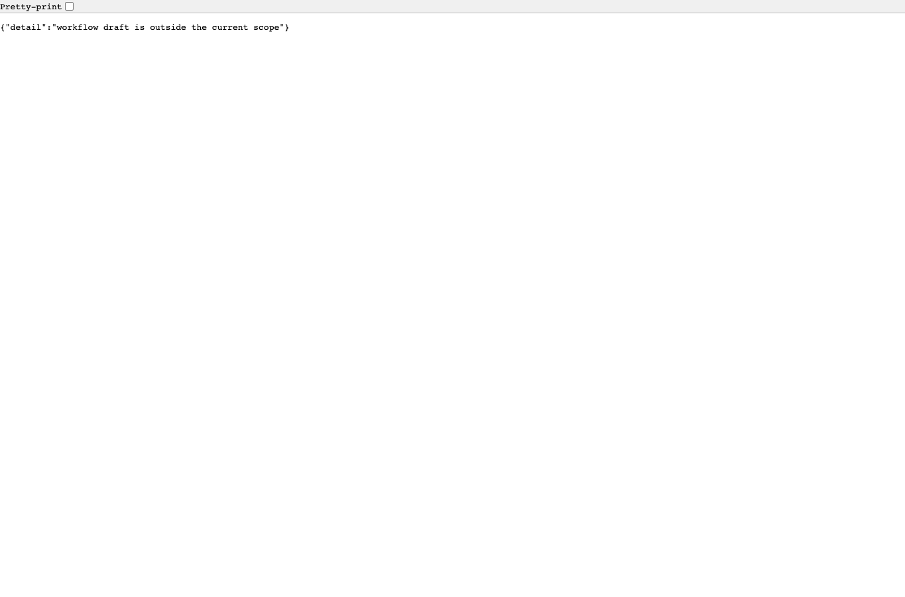

Navigation path:

1. Log out.
2. Sign in as `Acme Reviewer`.
3. Open the blocked draft `Publish Gate` URL.

Expected: the browser shows forbidden or not visible behavior, and publish
controls are not visible.

What is happening: the same-tenant read-only principal lacks the tenant admin
role needed to evaluate or publish the draft, so the page fails closed instead
of showing publish controls.

Why this matters: publishing affects runtime behavior and must require an
authorized admin.

### Step 22 - Create The Ready Platform Draft

Screenshot:

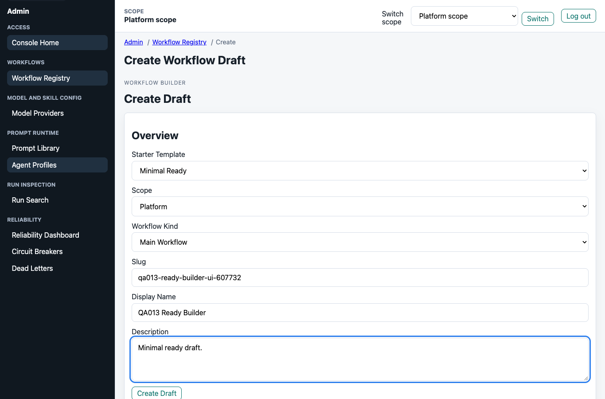

Navigation path:

1. Log out.
2. Sign in as `Platform Admin`.
3. Open `Workflow Registry`.
4. Click `Create Workflow`.

Do this:

1. Set `Starter Template` to `Minimal Ready`.
2. Set `Scope` to `platform`.
3. Set `Workflow Kind` to `main_workflow`.
4. Enter a unique slug, for example `qa013-ready-builder-ui-<your-initials>`.
5. Enter `QA013 Ready Builder` as `Display Name`.
6. Click `Create Draft`.
7. Record the draft id from the editor URL as `QA013_READY_DRAFT_ID`.

Expected: the browser opens the ready draft editor.

What is happening: the UI creates a minimal platform-scoped workflow with one
terminal node and no failing external dependencies.

Why this matters: the QA pass needs a positive path proving valid drafts can be
published.

### Step 23 - Run Ready Validation

Screenshot:

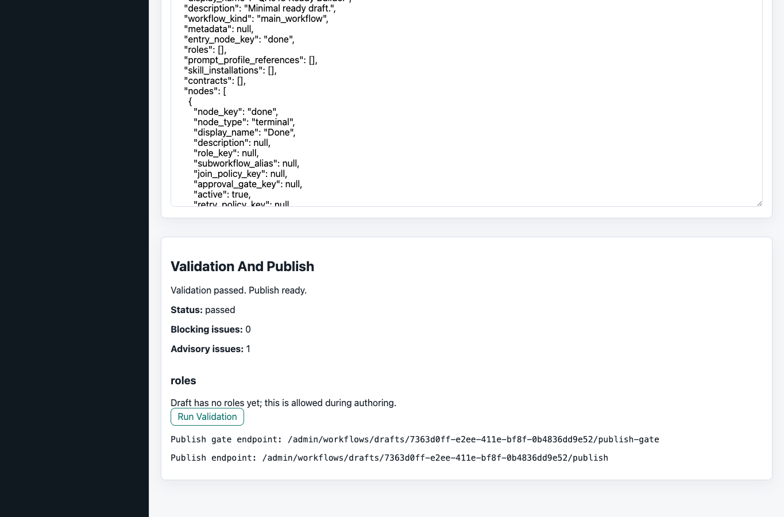

Navigation path:

1. Stay on the ready draft editor.
2. Scroll to `Validation And Publish`.
3. Click `Run Validation`.

Expected: validation status is `passed` and blocking issue count is `0`.

What is happening: the current ready revision is validated and persisted.

Why this matters: publication must be based on current passing validation.

### Step 24 - Review The Ready Publish Gate

Screenshot:

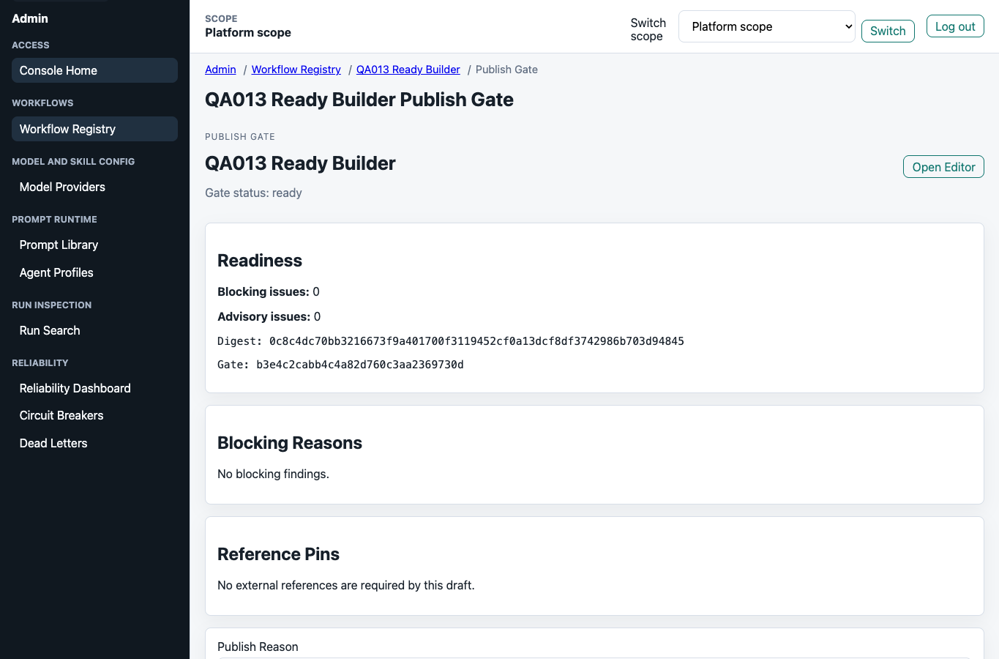

Navigation path:

1. From the ready draft editor, click `Publish Gate`.

Expected: `Gate status` is `ready`, blocking issues are `0`, and
`Confirm Publish` is enabled.

What is happening: the publish gate binds the current revision, validation
result, gate id, and digest.

Why this matters: publish must refuse stale, failed, or missing gate evidence.

### Step 25 - Confirm Publish

Screenshot:

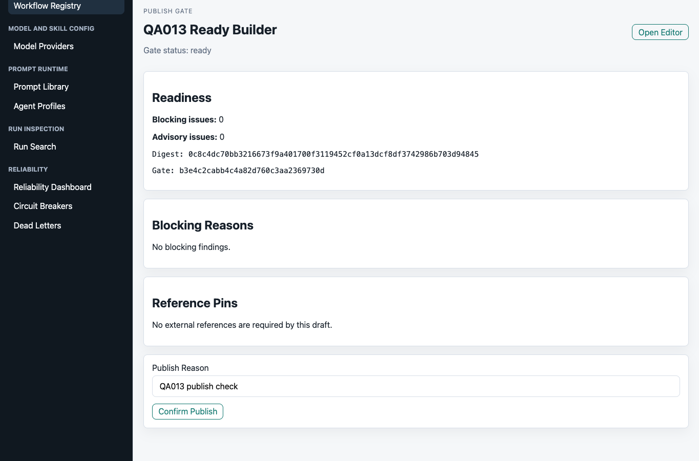

Navigation path:

1. Stay on the ready `Publish Gate` page.
2. Confirm the gate status is `ready`.
3. Click `Confirm Publish`.
4. Record the version id from the redirected URL as `QA013_VERSION_ID`.

Expected: the browser redirects to a published version detail page.

What is happening: the app creates an immutable workflow bundle and activates
it for the platform scope.

Why this matters: User Story 3 requires validated drafts to publish through
the existing immutable workflow bundle model.

### Step 26 - Inspect Published Version Detail

Screenshot:

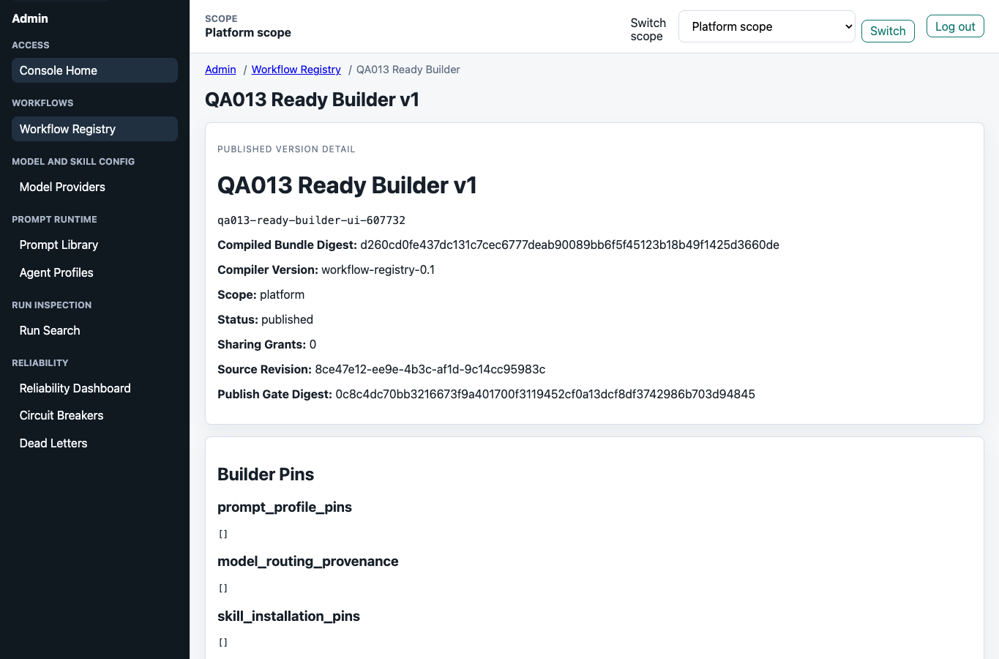

Navigation path:

1. If not already on the page, open:

   ```text
   http://127.0.0.1:8000/admin/workflows/versions/<version-id>/detail
   ```

2. Review `Published Version Detail`.
3. Review `Builder Pins`.

Expected: the page shows source revision, compiled bundle digest, publish gate
digest, scope, status, and safe builder pin summaries.

What is happening: the published version traces runtime-ready output back to
the draft revision and publish gate.

Why this matters: production workflow versions must be auditable without
exposing unsafe payloads.

## Required Automated Evidence

Run the focused Spec 013 suites in Terminal B:

```bash
uv run pytest --no-cov \
  tests/unit/api/test_workflow_builder_schemas.py \
  tests/unit/admin/test_graph_preview.py \
  tests/unit/admin/test_workflow_builder_references.py \
  tests/unit/admin/test_publish_gate.py \
  tests/unit/admin/test_workflow_builder_observability.py \
  tests/unit/api/test_admin_workflow_builder_ui_models.py \
  tests/unit/api/test_admin_workflow_builder_routes.py \
  tests/unit/auth/test_policy.py \
  tests/integration/api/test_admin_workflow_ui.py \
  tests/contract/test_workflow_builder_contract.py \
  tests/docs/test_workflow_builder_docs.py
```

Expected: all focused tests pass.

Run the full quality gate:

```bash
uv run ruff check .
uv run ruff format --check .
uv run mypy src
uv run pytest --cov=src/multi_agent_platform --cov-report=term-missing --cov-fail-under=90
```

Expected: all commands pass, and coverage is at least `90%`.

## UI Evidence Checklist

- Blocked tenant draft was created from the browser UI.
- Blocked draft validation produced blocking findings.
- Blocked publish gate disabled `Confirm Publish`.
- Save created a new draft revision.
- Stale save showed the conflict banner and did not overwrite newer work.
- Revision history showed immutable revisions.
- Copy created a new draft.
- Restore created a later revision from an older one.
- Globex could not view the Acme blocked draft.
- Acme reviewer could not make publish readiness decisions.
- Ready platform draft was created from the browser UI.
- Ready validation passed.
- Ready publish gate enabled `Confirm Publish`.
- Published version detail showed source revision, digest, and safe pins.
- No page showed raw prompts, raw secrets, credential values, provider payloads,
  or unauthorized tenant content.

## Acceptance Notes Template

```text
QA013 UI reviewer:
Date:
Browser:
Blocked draft id:
Blocked validation visible in UI: yes/no
Blocked publish gate disabled: yes/no
Stale save conflict banner visible: yes/no
Copied draft created: yes/no
Restore advanced revision: yes/no
Cross-tenant denial checked as Globex: yes/no
Read-only reviewer restriction checked: yes/no
Ready draft id:
Ready validation visible in UI: yes/no
Ready publish gate enabled: yes/no
Published version id:
Version detail shows source revision and digest: yes/no
No unsafe raw values visible: yes/no
Focused tests:
Ruff:
Format:
Mypy:
Full coverage:
Residual notes:
```

## Troubleshooting

- If the login page is missing, confirm `.env` was copied from
  `specs/013-admin-workflow-builder/.env.qa013` before the server started.
- If local login is unavailable, confirm `AUTH_MODE=local_principal` in `.env`.
- If create draft returns a conflict, choose a new unique slug and retry.
- If tenant draft creation is denied, make sure you are signed in as
  `tenant-admin-acme`.
- If platform draft creation is denied, make sure you are signed in as
  `platform-admin`.
- If validation still says `not run`, click `Run Validation` again and confirm
  the editor reloads.
- If ready publish is disabled, rerun validation and reload the publish gate.
- If any page shows raw prompts, secrets, credentials, tokens, provider
  payloads, or unauthorized tenant content, stop the pass and record a security
  finding.

## Related Files

- `specs/013-admin-workflow-builder/qa013.md`
- `specs/013-admin-workflow-builder/spec.md`
- `specs/013-admin-workflow-builder/plan.md`
- `specs/013-admin-workflow-builder/contracts/admin-workflow-builder-ui.md`
- `src/multi_agent_platform/api/routers/admin_workflow_ui.py`
- `src/multi_agent_platform/auth/policy.py`
- `src/multi_agent_platform/web_admin/templates/workflows/index.html`
- `src/multi_agent_platform/web_admin/templates/workflows/create.html`
- `src/multi_agent_platform/web_admin/templates/workflows/draft_editor.html`
- `src/multi_agent_platform/web_admin/templates/workflows/revision_history.html`
- `src/multi_agent_platform/web_admin/templates/workflows/publish_gate.html`
- `src/multi_agent_platform/web_admin/templates/workflows/version_detail.html`
- `output/playwright/qa013_ui/`
