# QA014 UI: Skill Registry Lifecycle Browser Workflows

## Goal

Validate Spec 014 V2 through the server-rendered admin browser UI. A reviewer
can start from a clean local environment, sign in with local-principal cards,
create a skill package, submit and validate a manifest candidate, publish an
immutable version, grant Acme, discover and install from Acme, configure safe
credential references, refresh readiness and smoke-test state, preview binding
eligibility, recover from stale revisions, and verify Globex isolation and
redaction evidence.

This UI guide is intentionally browser-first. Terminal commands are limited to
setup, server startup, diagnostics, and automated evidence.

## How To Use This Guide

Use two terminal windows:

- Terminal A runs the API server.
- Terminal B runs setup and automated evidence commands.

Use one browser window for the main path. Use a second browser tab for the
stale revision recovery check. Record screenshot notes under `/tmp/qa014-*` if
you recapture evidence locally.

The screenshots referenced by the existing Spec 014 UI guide live in
`output/playwright/qa014_ui`. UUIDs, digests, and revision tokens may differ
when you run the walkthrough, but the page titles, controls, statuses, and
redaction language should match.

## Environment Setup

Run these commands from the repository root.

### Environment Step 1 - Copy The QA Environment

```bash
cp specs/014-skill-registry-lifecycle-v2/.env.qa014 .env
```

Expected: no output.

What is happening: the app is pointed at the QA014 V2 local-principal catalog,
fake `qa014/` secret references, `.data/qa014-artifacts`, and the
`multi_agent_platform_qa014` database.

Why this matters: the browser pass should not touch the default developer
database or any production-like credential.

### Environment Step 2 - Confirm Tools

```bash
curl --version | head -1
jq --version
```

Expected: each command prints a version.

What is happening: Terminal B confirms the basic tools used by setup and
diagnostic evidence.

Why this matters: the UI path is browser-first, but setup and troubleshooting
still use standard local tools.

### Environment Step 3 - Remove Old Evidence

```bash
find /tmp -type f \( -name 'qa014-*.json' -o -name 'qa014-*.html' -o -name 'qa014-*.txt' \) -exec rm -f {} +
```

Expected: no output.

What is happening: stale evidence from earlier attempts is removed.

Why this matters: screenshots and redaction scans should describe this pass.

### Environment Step 4 - Install Dependencies

```bash
uv sync
```

Expected: command completes without an error.

What is happening: project dependencies are installed from the lockfile.

Why this matters: the local server, templates, tests, and migrations need the
same dependency set used by CI.

### Environment Step 5 - Start PostgreSQL

```bash
docker compose up -d postgres
```

Expected: Docker reports PostgreSQL is running.

What is happening: the local database service starts.

Why this matters: the admin app expects PostgreSQL settings even though the
focused browser tests use an isolated test database.

### Environment Step 6 - Reset QA014 Database

```bash
docker compose exec -T postgres sh -c \
  'dropdb -U postgres --if-exists multi_agent_platform_qa014 && createdb -U postgres multi_agent_platform_qa014'
```

Expected: no output, or a harmless notice that the database did not exist.

What is happening: only the dedicated QA014 database is reset.

Why this matters: the browser walkthrough starts from clean state.

### Environment Step 7 - Apply Migrations

```bash
uv run alembic upgrade head
```

Expected: migrations complete without an error.

What is happening: tenant, admin shell, skill registry, audit, and reliability
tables are created or updated.

Why this matters: browser pages depend on the shared application schema.

### Environment Step 8 - Seed Deterministic Tenants

```bash
docker compose exec -T postgres psql -U postgres -d multi_agent_platform_qa014 -v ON_ERROR_STOP=1 <<'SQL'
INSERT INTO tenants (
  tenant_id, slug, display_name, status, created_at, updated_at
) VALUES
  ('11111111-1111-1111-1111-111111111111', 'acme', 'Acme', 'active', CURRENT_TIMESTAMP, CURRENT_TIMESTAMP),
  ('22222222-2222-2222-2222-222222222222', 'globex', 'Globex', 'active', CURRENT_TIMESTAMP, CURRENT_TIMESTAMP)
ON CONFLICT (tenant_id) DO UPDATE SET
  slug = EXCLUDED.slug,
  display_name = EXCLUDED.display_name,
  status = EXCLUDED.status,
  updated_at = CURRENT_TIMESTAMP;
SQL
```

Expected: PostgreSQL reports two inserted or updated tenant rows.

What is happening: Acme and Globex are made available for local-principal QA.

Why this matters: the walkthrough validates authorized Acme access and Globex
absence.

### Environment Step 9 - Start The API

Run this in Terminal A and keep it open:

```bash
uv run uvicorn multi_agent_platform.api.main:app --reload
```

Expected: the server listens on `http://127.0.0.1:8000`.

What is happening: FastAPI serves the admin shell and skill registry UI.

Why this matters: every primary lifecycle action below happens in the browser.

## Browser Walkthrough

### Step 1 - Log In As Platform Admin

Screenshot:

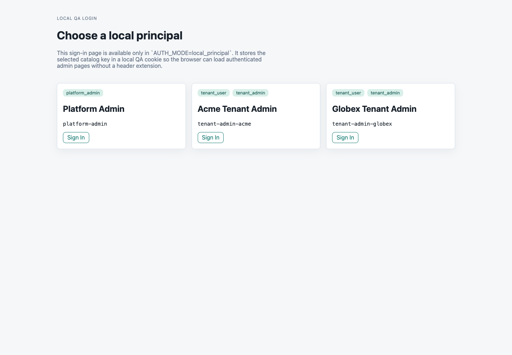

Open:

```text
http://127.0.0.1:8000/auth/local-login?redirect_to=/admin/skill-registry/ui/packages
```

Navigation path:

1. Find the `Platform Admin` card.
2. Confirm the card shows `platform-admin`.
3. Click `Sign In`.
4. Confirm the browser redirects to `Skill Registry`.

Expected: you are signed in as the platform admin and can see the skill
registry package list.

What is happening: the browser stores a local QA cookie for the platform
principal.

Why this matters: package creation, candidate validation, publication, and
tenant grant actions require platform governance.

### Step 2 - Review Empty Package List

Screenshot:

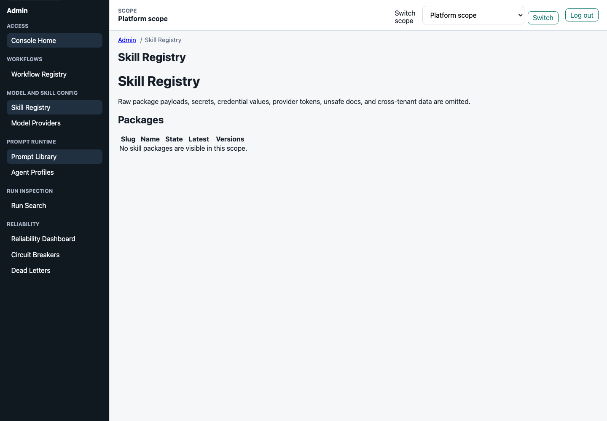

Open:

```text
http://127.0.0.1:8000/admin/skill-registry/ui/packages
```

Navigation path:

1. Confirm the page title is `Skill Registry`.
2. Confirm the table has `Slug`, `Name`, `State`, `Latest`, and `Versions`.
3. Confirm the empty state says no skill packages are visible.
4. Confirm the `Create Package` action is visible.

Expected: the package list renders with a safe empty state.

What is happening: the platform package list is scoped to packages visible to
the signed-in principal.

Why this matters: the page must be useful before any package exists.

### Step 3 - Create Package

Screenshot:


Open:

```text
http://127.0.0.1:8000/admin/skill-registry/ui/packages/new
```

Actions:

1. Enter `calendar-assistant` in `Slug`.
2. Enter `Calendar Assistant` in `Display name`.
3. Enter `Safe calendar skill.` in `Description`.
4. Keep `platform-admin` as owner principal.
5. Enter `publishable` in lifecycle intent.
6. Enter `Safe operator docs only.` in safe docs summary.
7. Click `Create Package`.

Expected: the browser redirects to
`/admin/skill-registry/ui/packages/calendar-assistant`.

Redirect target screenshot:

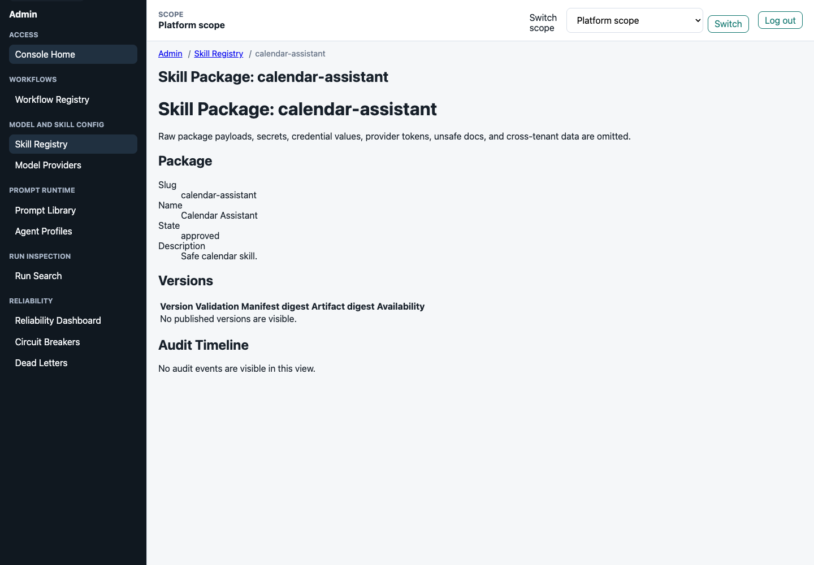

What is happening: the form posts to the browser route and delegates package
creation to the skill registry service.

Why this matters: platform admins can start a package lineage without using a
direct API helper.

### Step 4 - Submit Manifest Candidate

Screenshot:


Open:

```text
http://127.0.0.1:8000/admin/skill-registry/ui/packages/calendar-assistant/candidate
```

Actions:

1. From the package detail page, click `Enter Manifest Candidate`, or open the
   URL above directly.
2. Paste the QA manifest from `specs/014-skill-registry-lifecycle/qa014.md`
   into `Manifest JSON Or YAML`.
3. To verify upload precedence, choose a `.json`, `.yaml`, or `.yml` file in
   `Manifest upload`; uploaded content takes precedence over pasted content.
4. Use `sha256:artifact` for artifact digest.
5. Use `tool:calendar:v1` for approved integration refs.
6. Click `Save Candidate`.
7. Confirm the candidate summary shows a revision token and artifact digest.

Expected: the page shows candidate state without echoing the raw manifest back
into the text area.

What is happening: YAML or JSON input is parsed through structured parsers and
stored as a candidate revision.

Why this matters: reviewers can inspect safe candidate metadata without
capturing raw package payloads in screenshots.

### Step 5 - Validate Candidate

Screenshot:


Open:

```text
http://127.0.0.1:8000/admin/skill-registry/ui/packages/calendar-assistant/candidate
```

Actions:

1. From the saved candidate page, or the URL above, click `Validate Candidate`.
2. Confirm validation status becomes `passed`.
3. Confirm `Validation Findings` shows no blocking findings.
4. Confirm `Publish Version` is visible only after passing validation.

Expected: validation findings render inline and publication is gated by
current passing validation.

What is happening: the browser POST validates the current candidate revision.

Why this matters: platform admins need actionable findings before publication.

### Step 6 - Publish Immutable Version

Screenshot:

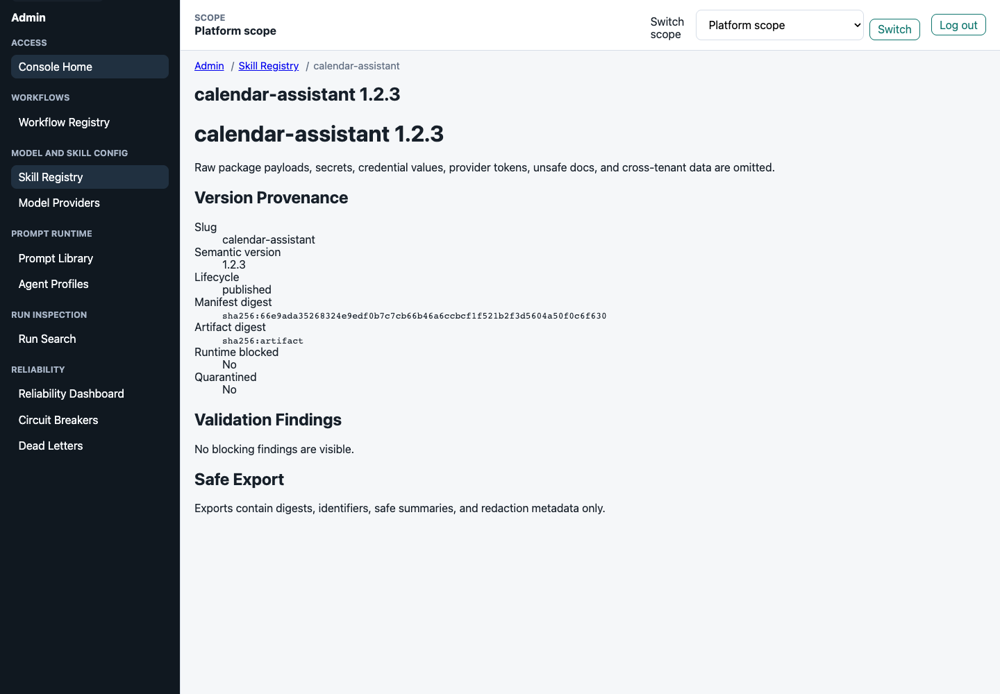

Publish-gate screenshot:

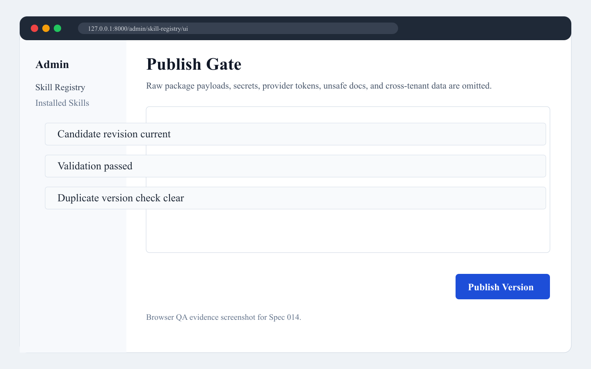

Open:

```text
http://127.0.0.1:8000/admin/skill-registry/ui/packages/calendar-assistant/candidate
```

Actions:

1. From the validated candidate page, or the URL above, confirm `Publish
   Version` is visible.
2. Click `Publish Version`.
3. Confirm the browser redirects to the version detail page.
4. Confirm the semantic version is `1.2.3`.
5. Confirm manifest and artifact digests are shown.
6. Confirm raw manifest, raw credentials, provider tokens, and unsafe docs are
   absent.

Expected: version detail renders immutable provenance for `calendar-assistant`
version `1.2.3`.

What is happening: publication creates an immutable version pinned to the
candidate manifest and artifact digest.

Why this matters: tenant installs must pin exact published versions.

### Step 7 - Grant Acme

Screenshot:

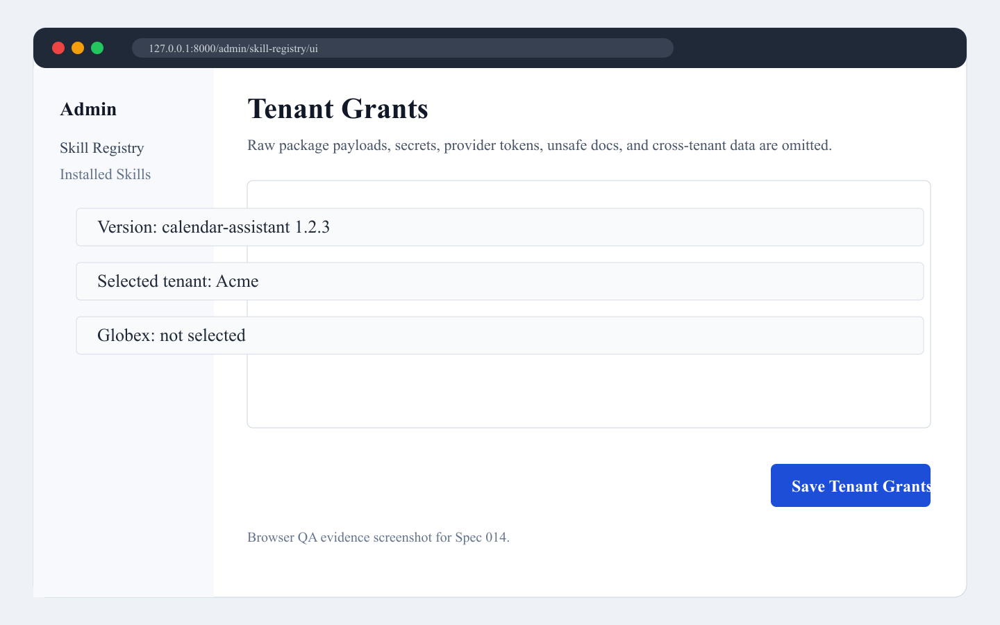

Open:

```text
http://127.0.0.1:8000/admin/skill-registry/ui/packages/calendar-assistant/versions/1.2.3/grants
```

Actions:

1. From the version detail page, click `Manage Tenant Grants`, or open the URL
   above directly.
2. Enter `11111111-1111-1111-1111-111111111111` in tenant ids.
3. Enter `QA014 browser grant` as the grant reason.
4. Click `Save Tenant Grants`.
5. Confirm the package detail grant summary includes Acme's tenant id.

Follow-up screenshot:

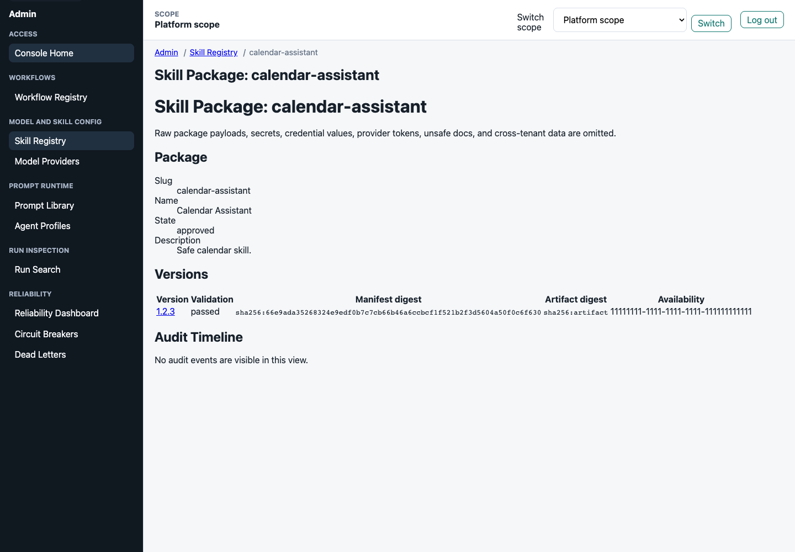

Expected: Acme is granted future discovery and install access.

What is happening: the grant form records tenant availability for the immutable
version.

Why this matters: grants affect future discovery without changing existing
pinned installations.

### Step 8 - Switch To Acme Tenant Admin

Screenshot:

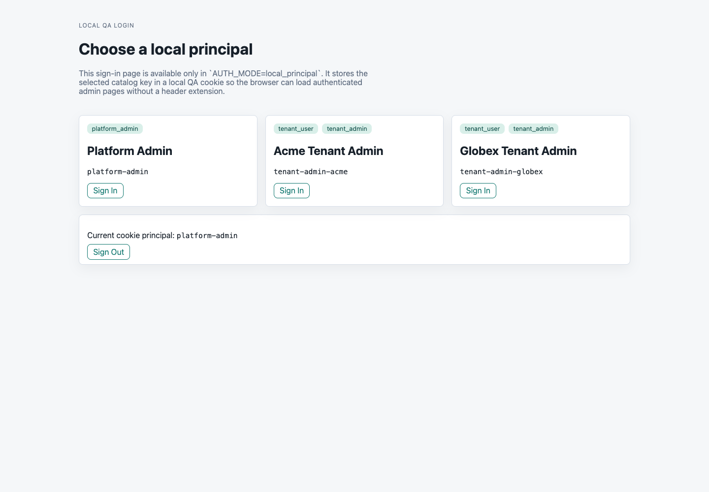

Open:

```text
http://127.0.0.1:8000/auth/local-login?redirect_to=/admin/skill-registry/ui/available-versions?tenant_id=11111111-1111-1111-1111-111111111111
```

Navigation path:

1. Choose `Acme Tenant Admin`.
2. Confirm the principal key is `tenant-admin-acme`.
3. Click `Sign In`.
4. Confirm the available versions page loads.

Expected: Acme sees `calendar-assistant` version `1.2.3`.

What is happening: tenant discovery is scoped to Acme's grants.

Why this matters: tenant admins should discover only versions granted to their
tenant.

### Step 9 - Install Granted Skill

Screenshot:


Install-action screenshot:

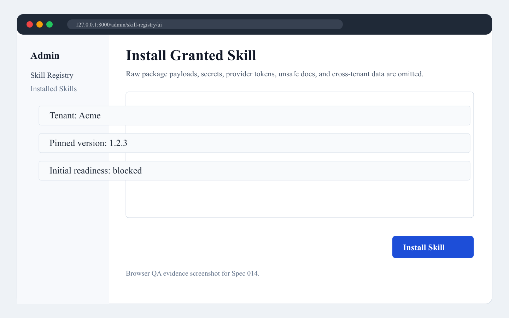

Open:

```text
http://127.0.0.1:8000/admin/skill-registry/ui/available-versions?tenant_id=11111111-1111-1111-1111-111111111111
```

Actions:

1. Start from the Acme login redirect, or open the URL above directly.
2. Confirm `calendar-assistant` version `1.2.3` appears on Available Skills.
3. Click `Install` for `calendar-assistant`.
4. Confirm the browser redirects to an installation detail page.
5. Record the installation id from the URL in `/tmp/qa014-installation-id.txt`.
6. Confirm readiness is initially blocked because credentials are missing.

Blocked-detail screenshot:

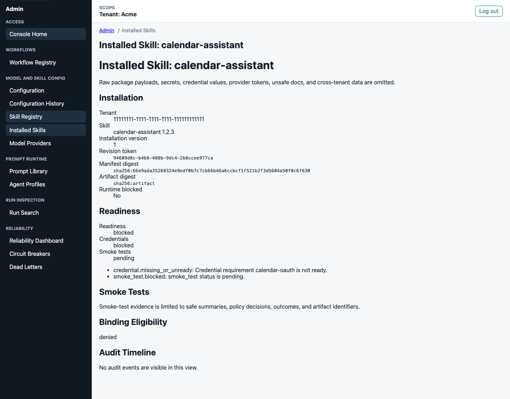

Expected: the detail page shows exact package version, installation version,
revision token, readiness, credential status, smoke-test status, and binding
eligibility status.

What is happening: the tenant installation pins Acme to version `1.2.3`.

Why this matters: installed versions and existing bindings must not float to
newer package versions.

### Step 10 - Configure Credential Reference

Screenshot:

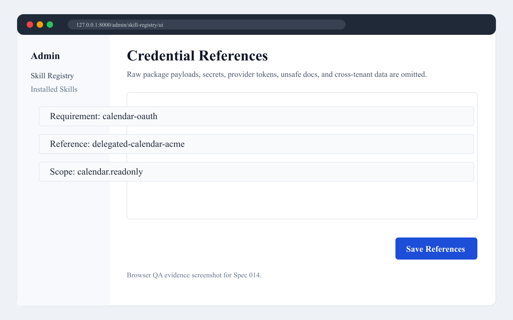

Open:

```text
http://127.0.0.1:8000/admin/skill-registry/ui/installations/QA014_INSTALLATION_ID/credentials
```

Actions:

1. From the installation detail page, click `Configure Credentials`, or replace
   `QA014_INSTALLATION_ID` in the URL above with the id from your run.
2. Confirm there is one row for `calendar-oauth`.
3. Select `delegated-calendar-acme`.
4. Confirm delegated scope is `calendar.readonly`.
5. Click `Save References`.

Ready-detail screenshot:

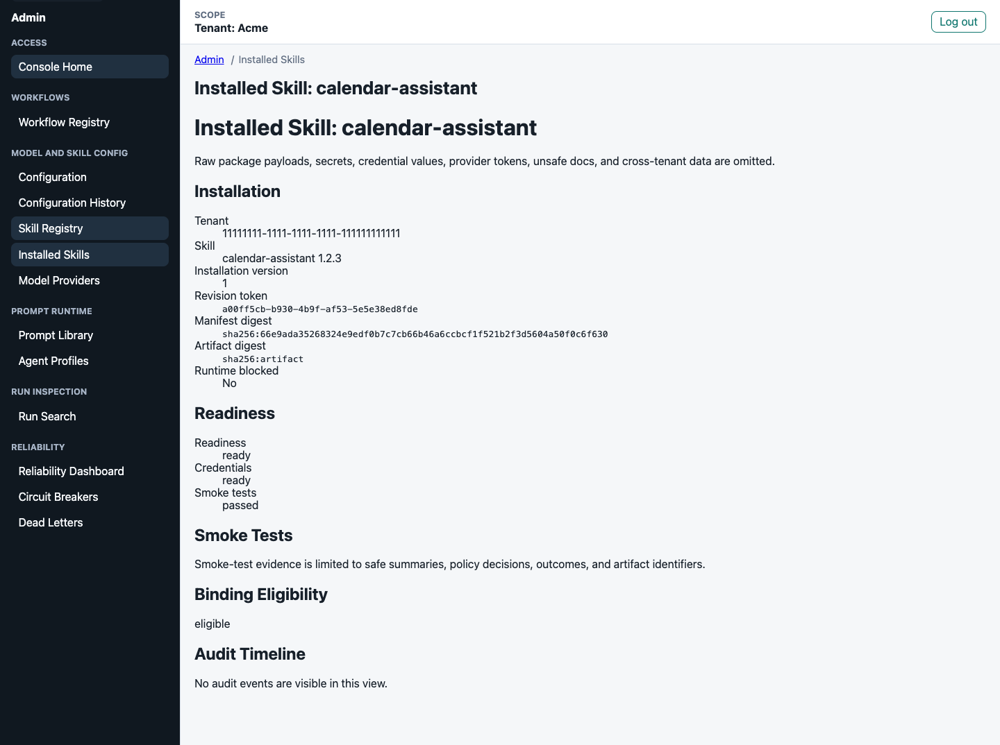

Expected: the installation detail page returns with readiness `ready`.

What is happening: the browser form accepts tenant-authorized references and
safe delegated metadata only.

Why this matters: raw secret values and arbitrary reference id entry must not
appear in the UI.

### Step 11 - Refresh Smoke Tests And Readiness

Screenshot:


Open:

```text
http://127.0.0.1:8000/admin/skill-registry/ui/installations/QA014_INSTALLATION_ID
```

Actions:

1. Replace `QA014_INSTALLATION_ID` with the id from your run, or click the
   skill link from the Acme installation list.
2. From installation detail, click `Run Smoke Tests`.
3. Confirm the page returns quickly.
4. Confirm smoke-test status is `passed` or `not_required` depending on local
   fixture policy.
5. Confirm evidence text says smoke-test evidence is limited to safe summaries.

Installation-list screenshot:

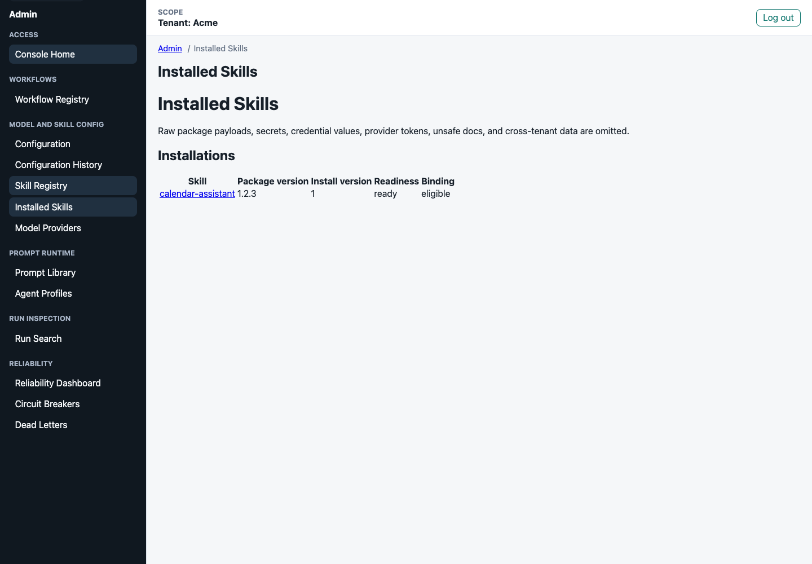

Expected: the browser action does not synchronously expose raw logs or raw
fixtures.

What is happening: the route refreshes readiness and smoke evidence state.

Why this matters: smoke-test evidence can be reviewed without exposing
credential-adjacent payloads.

### Step 12 - Preview Binding Eligibility

Screenshot:


Open:

```text
http://127.0.0.1:8000/admin/skill-registry/ui/installations/QA014_INSTALLATION_ID
```

Actions:

1. Replace `QA014_INSTALLATION_ID` with the id from your run, or navigate from
   `/admin/skill-registry/ui/installations?tenant_id=11111111-1111-1111-1111-111111111111`.
2. On installation detail, find `Binding Eligibility`.
3. Use `qa-profile` as the binding context.
4. Click `Preview Binding`.
5. Confirm the page still shows the exact installation version and package
   version.

Expected: eligibility remains tied to the pinned installation and redacted
policy/readiness reasons.

What is happening: the preview delegates to policy/readiness evaluation.

Why this matters: admins need a safe explanation before binding a skill to a
profile or workflow role.

### Step 13 - Recover From Stale Revision Conflict

Screenshot:


Open:

```text
http://127.0.0.1:8000/admin/skill-registry/ui/installations/QA014_INSTALLATION_ID/credentials
```

Actions:

1. Replace `QA014_INSTALLATION_ID` with the id from your run.
2. Open the credential configuration page in two browser tabs.
3. Submit a valid credential reference from the first tab.
4. Submit the older form from the second tab without refreshing it.
5. Confirm the stale conflict message appears.
6. Confirm the page says no stale change was applied.
7. Click `Reload Latest`.

Expected: stale submission is rejected and the latest state can be reloaded.

What is happening: the hidden revision token from the older tab no longer
matches current installation state.

Why this matters: browser forms must not overwrite newer admin changes.

### Step 14 - Verify Globex Isolation

Login screenshot:

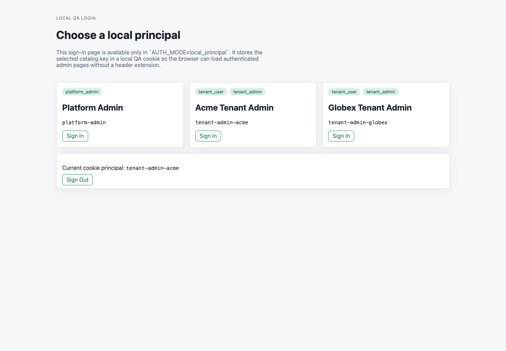

Open:

```text
http://127.0.0.1:8000/auth/local-login?redirect_to=/admin/skill-registry/ui/available-versions?tenant_id=22222222-2222-2222-2222-222222222222
```

Navigation path:

1. Choose `Globex Tenant Admin`.
2. Confirm the principal key is `tenant-admin-globex`.
3. Click `Sign In`.
4. Confirm the browser redirects to Globex available versions.

Available-versions screenshot:

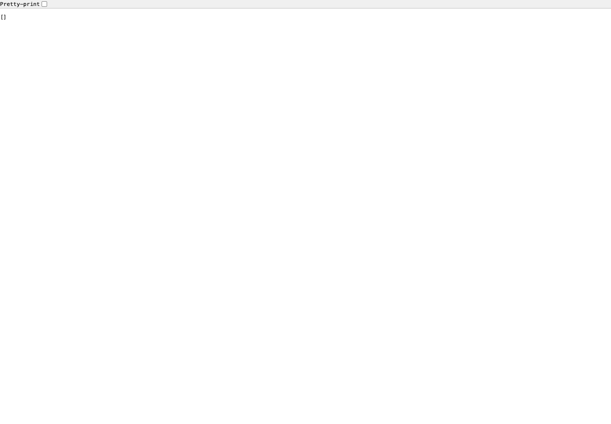

Open:

```text
http://127.0.0.1:8000/admin/skill-registry/ui/available-versions?tenant_id=22222222-2222-2222-2222-222222222222
```

Navigation path:

1. Start from the Globex login redirect, or open the URL above directly.
2. Confirm `calendar-assistant` is absent.
3. Confirm the page says no skill versions are available.

Installation-list screenshot:

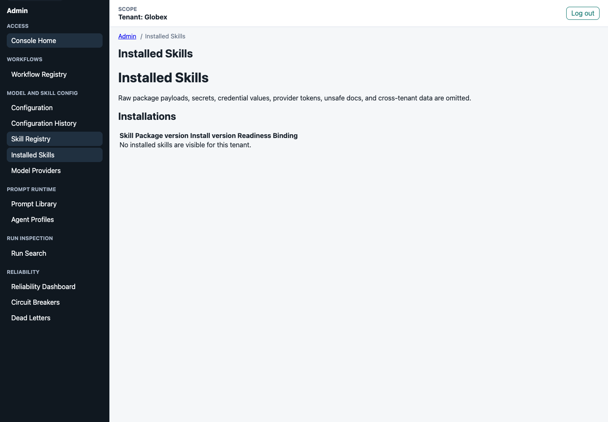

Open:

```text
http://127.0.0.1:8000/admin/skill-registry/ui/installations?tenant_id=22222222-2222-2222-2222-222222222222
```

Navigation path:

1. Open the Globex installation list URL above.
2. Confirm no Acme installation appears.
3. Confirm the page says no installed skills are visible.

Direct-link denial screenshot:

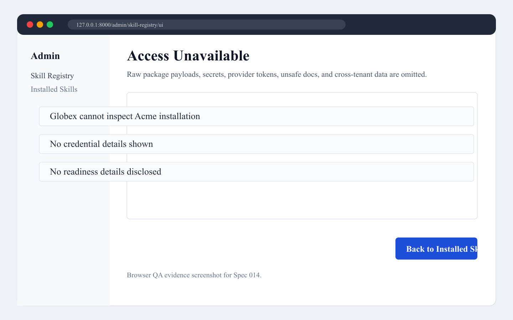

Open:

```text
http://127.0.0.1:8000/admin/skill-registry/ui/installations/QA014_INSTALLATION_ID
```

Navigation path:

1. Stay signed in as Globex.
2. Replace `QA014_INSTALLATION_ID` with the Acme installation id from your run.
3. Confirm the page denies access or renders an absent/not-found state without
   Acme details.

Expected: Globex sees empty states and no Acme-only package or installation
data.

What is happening: tenant-scope checks hide cross-tenant records.

Why this matters: direct-link and discovery paths must fail closed.

### Step 15 - Verify Redaction In The Browser

Screenshot:

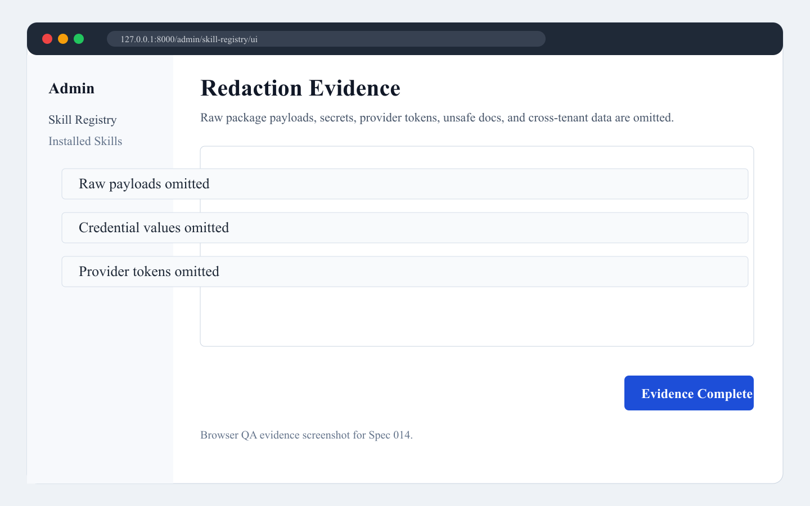

Open:

```text
http://127.0.0.1:8000/admin/skill-registry/ui/packages/calendar-assistant
```

Actions:

1. Sign back in as `Platform Admin` if needed.
2. Open the package detail URL above.
3. Review package detail, candidate, version detail, available versions,
   installation detail, credentials, readiness, smoke-test, eligibility, and
   denied or empty pages.
4. Search the visible page for raw manifest text, raw credential values,
   provider tokens, unsafe docs, raw fixture payloads, raw smoke-test logs, and
   cross-tenant content.
5. Record notes in `/tmp/qa014-redaction-notes.txt`.

Expected: only safe summaries, digests, identifiers, statuses, and redaction
notices are visible.

What is happening: templates render safe view models rather than raw lifecycle
payloads.

Why this matters: reviewer screenshots should be safe to attach to QA evidence.

## Required Automated Evidence

Run focused unit and router tests:

```bash
uv run pytest --no-cov tests/unit/api/test_skill_registry_ui_models.py tests/unit/api/test_admin_skill_registry_router.py tests/unit/auth/test_skill_policy.py
```

Expected: all selected tests pass.

Run focused browser integration tests:

```bash
uv run pytest --no-cov tests/integration/api/test_admin_skill_registry_ui.py tests/integration/api/test_skill_registry_browser_flows.py tests/integration/skill_registry
```

Expected: all selected tests pass.

Run docs tests:

```bash
uv run pytest --no-cov tests/docs/test_skill_registry_docs.py
```

Expected: all selected tests pass.

Run quality checks:

```bash
uv run ruff check .
uv run ruff format --check .
uv run mypy src
uv run pytest --cov=src/multi_agent_platform --cov-report=term-missing --cov-fail-under=90
```

Expected: each command completes without errors.

## UI Evidence Checklist

- Platform login screenshot or reviewer note exists.
- Empty package list screenshot or reviewer note exists.
- Package create form screenshot or reviewer note exists.
- Manifest candidate form screenshot or reviewer note exists.
- Validation findings screenshot or reviewer note exists.
- Publish gate and version detail screenshot or reviewer note exists.
- Tenant grant screenshot or reviewer note exists.
- Acme available versions screenshot or reviewer note exists.
- Acme installation detail blocked and ready screenshots or reviewer notes
  exist.
- Credential picker screenshot or reviewer note exists.
- Binding eligibility screenshot or reviewer note exists.
- Stale revision conflict screenshot or reviewer note exists.
- Globex empty/denied screenshots or reviewer notes exist.
- Redaction evidence screenshot or reviewer note exists.

## Acceptance Notes Template

```text
QA014 UI reviewer:
Date:
Platform package flow: pass or fail
Candidate validation and publish: pass or fail
Tenant grant: pass or fail
Acme discovery and install: pass or fail
Credential configuration: pass or fail
Smoke-test/readiness: pass or fail
Binding eligibility: pass or fail
Stale conflict: pass or fail
Globex isolation: pass or fail
Redaction: pass or fail
Automated evidence: pass or fail
Notes:
```

Expected: every line is filled in with a reviewer result and any concrete
exceptions.

## Troubleshooting

- If the login page does not show local principals, confirm `.env.qa014` was
  copied to `.env` and restart the API.
- If a page returns unauthorized, sign in again through `/auth/local-login`.
- If Acme does not see a version, return to platform admin and confirm the
  grant form saved Acme's tenant id.
- If readiness stays blocked, reopen credential configuration and confirm
  `delegated-calendar-acme` is selected.
- If stale conflict does not appear, make sure the second tab was opened before
  the first tab submitted a successful change.
- If redaction evidence shows raw content, save the page source to
  `/tmp/qa014-redaction-failure.html` and stop the QA pass.
- If automated tests fail only because coverage is applied to a tiny focused
  selection, rerun the focused command with `--no-cov` and run the full
  coverage command separately.

## Related Files

- `specs/014-skill-registry-lifecycle-v2/qa014.md`
- `specs/014-skill-registry-lifecycle-v2/.env.qa014`
- `specs/014-skill-registry-lifecycle/qa014_ui.md`
- `output/playwright/qa014_ui`
- `src/multi_agent_platform/api/routers/admin_skill_registry.py`
- `src/multi_agent_platform/api/ui/skill_registry.py`
- `src/multi_agent_platform/web_admin/templates/skill_registry/`
- `tests/integration/api/test_admin_skill_registry_ui.py`
- `tests/integration/api/test_skill_registry_browser_flows.py`
- `tests/docs/test_skill_registry_docs.py`
