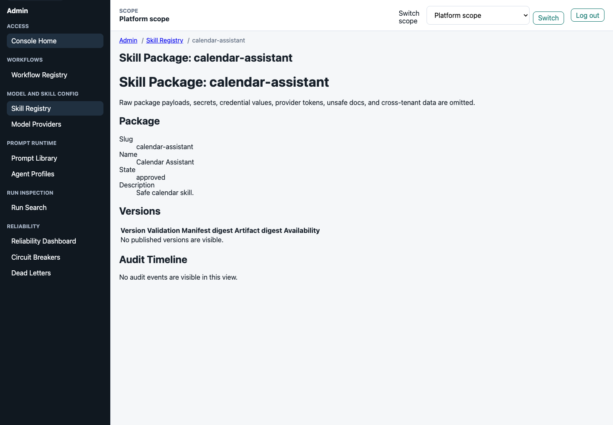
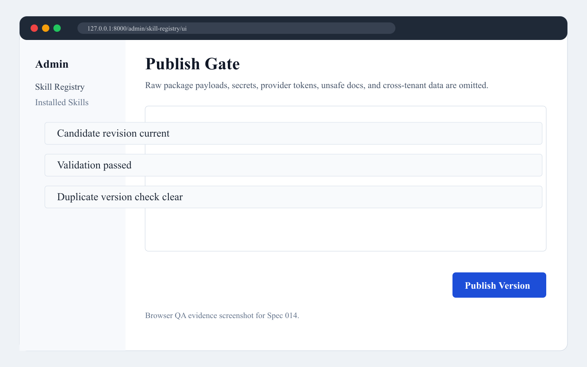
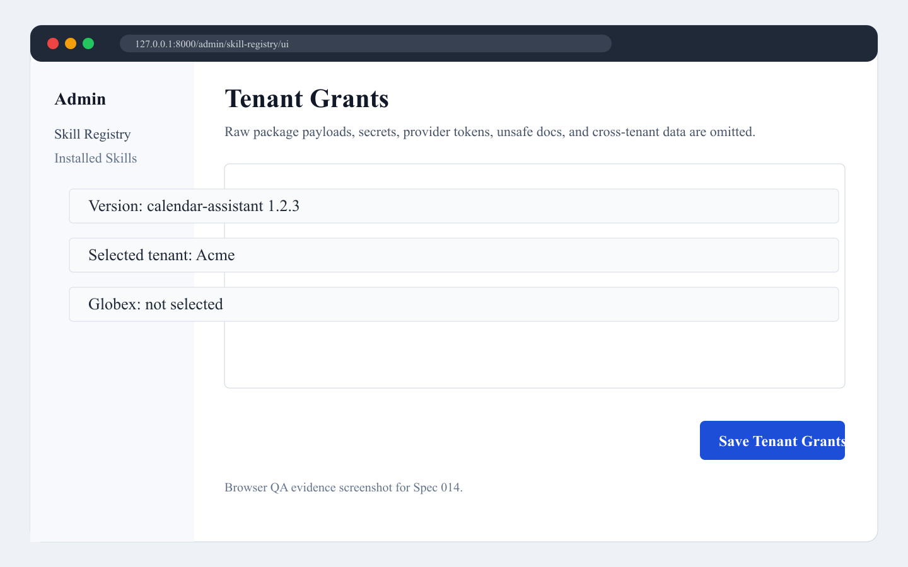
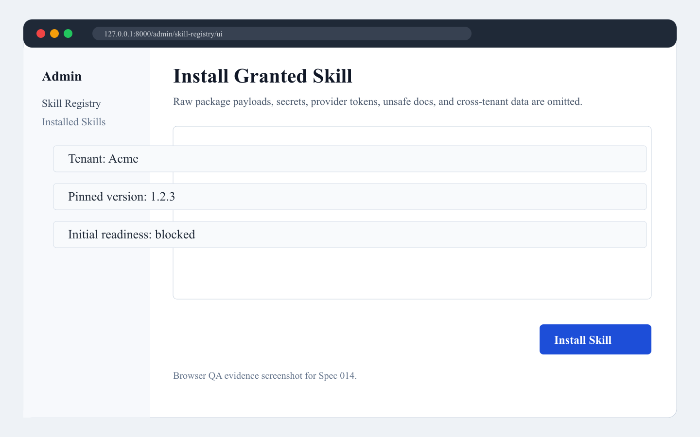
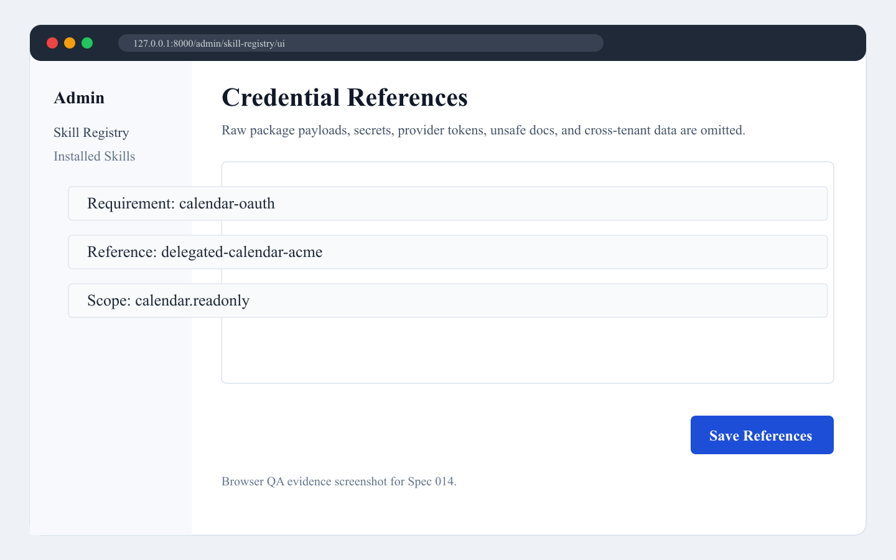
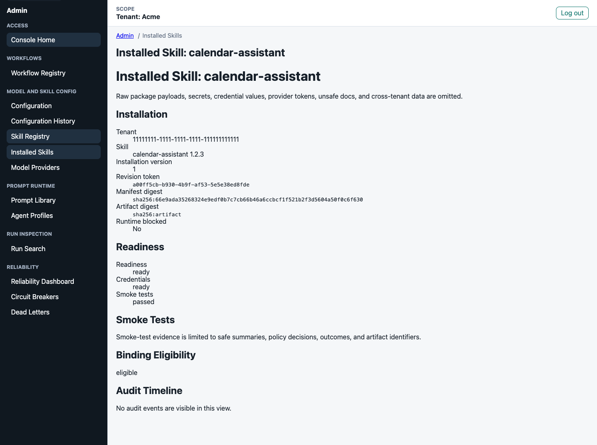
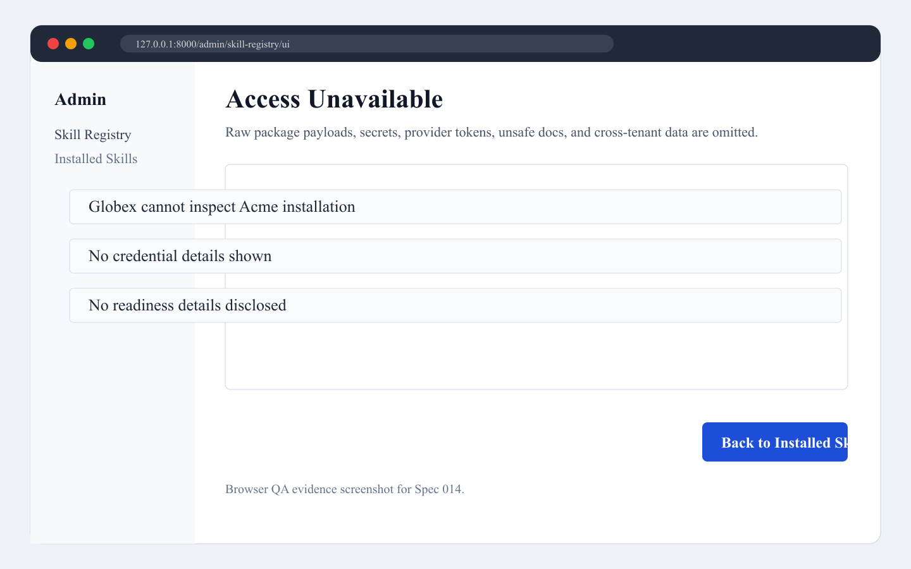
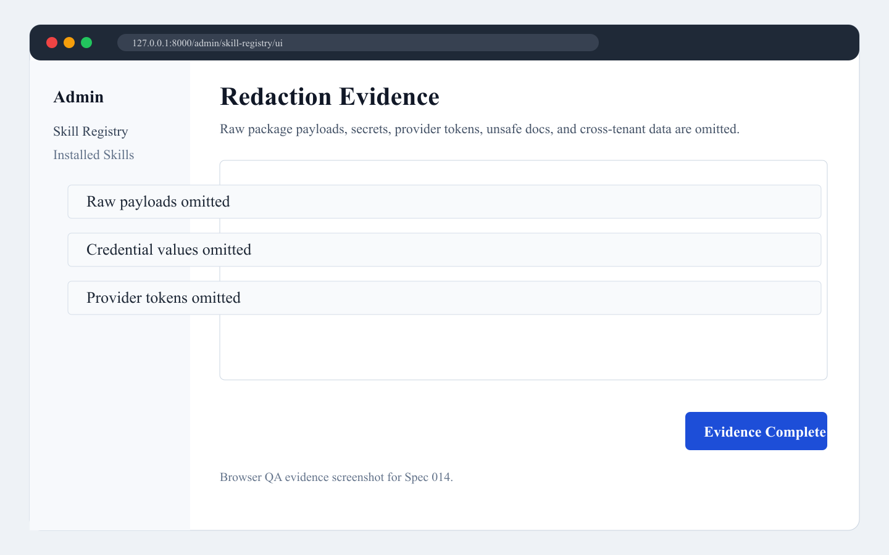

# QA014 UI: Browser-First Skill Registry Lifecycle

## Goal

Validate Spec 014 through the server-rendered admin browser UI. A reviewer can
prepare an isolated local environment, then create, validate, publish, grant,
discover, install, configure, preview, conflict-test, and redaction-check the
skill registry lifecycle from browser pages.

The only terminal work in this guide is environment setup, server startup, and
automated evidence collection. Primary lifecycle actions are browser steps.

## How To Use This Guide

Use one browser window for the main path. Use a second tab only for the stale
revision recovery step. Complete the environment setup first, then perform the
browser walkthrough in order because later tenant actions depend on the package
version and grant created earlier.

What is happening: QA014 is exercised from the same server-rendered admin pages
that platform and tenant admins use for governed skill registry work.

Why this matters: reviewer evidence should prove the browser experience, not a
parallel command-line path.

## Screenshot Evidence

The screenshots referenced below are stored in:

```text
output/playwright/qa014_ui/
```

Your UUIDs, digests, revision tokens, and timestamps may differ. The visible
sections, statuses, isolation behavior, and redaction language should match.

## Values To Record

- `QA014_INSTALLATION_ID`: copy from the Acme installation detail URL after
  installing the skill.
- `QA014_CURRENT_REVISION`: copy from the Acme installation detail page before
  opening the stale-conflict tab.

## Environment Setup

Use two terminals from the repository root.

- Terminal A runs the API server.
- Terminal B runs setup and automated evidence commands.

### Environment Step 1 - Copy The QA Environment

Run this in Terminal B:

```bash
cp specs/014-skill-registry-lifecycle/.env.qa014 .env
```

Expected: no output. The app now uses local-principal auth, the PostgreSQL
database `multi_agent_platform_qa014`, fake `qa014/` secret references, and
`.data/qa014-artifacts` storage.

### Environment Step 2 - Confirm Local Tools

Run this in Terminal B:

```bash
jq --version
```

Expected: the command prints a version. `jq` is only used for optional evidence
inspection outside the main browser path.

### Environment Step 3 - Remove Old QA014 Evidence Files

Run this in Terminal B:

```bash
find /tmp -type f \( -name 'qa014-*.json' -o -name 'qa014-*.html' -o -name 'qa014-*.txt' \) -exec rm -f {} +
```

Expected: no output. Old evidence from previous QA014 runs is removed.

### Environment Step 4 - Install Dependencies

Run this in Terminal B:

```bash
uv sync
```

Expected: command completes without an error.

### Environment Step 5 - Start PostgreSQL

Run this in Terminal B:

```bash
docker compose up -d postgres
```

Expected: Docker reports the PostgreSQL service is running.

### Environment Step 6 - Reset The QA014 Database

Run this in Terminal B:

```bash
docker compose exec -T postgres sh -c \
  'dropdb -U postgres --if-exists multi_agent_platform_qa014 && createdb -U postgres multi_agent_platform_qa014'
```

Expected: no output, or a harmless notice if the database did not exist.

### Environment Step 7 - Apply Migrations

Run this in Terminal B:

```bash
uv run alembic upgrade head
```

Expected: migrations complete without an error.

### Environment Step 8 - Seed Deterministic Tenants

Run this in Terminal B:

```bash
docker compose exec -T postgres psql -U postgres -d multi_agent_platform_qa014 -v ON_ERROR_STOP=1 <<'SQL'
INSERT INTO tenants (
  tenant_id, slug, display_name, status, created_at, updated_at
) VALUES
  ('11111111-1111-1111-1111-111111111111', 'acme', 'Acme', 'active', CURRENT_TIMESTAMP, CURRENT_TIMESTAMP),
  ('22222222-2222-2222-2222-222222222222', 'globex', 'Globex', 'active', CURRENT_TIMESTAMP, CURRENT_TIMESTAMP)
ON CONFLICT (tenant_id) DO UPDATE SET
  slug = EXCLUDED.slug,
  display_name = EXCLUDED.display_name,
  status = EXCLUDED.status,
  updated_at = CURRENT_TIMESTAMP;
SQL
```

Expected: PostgreSQL reports two inserted or updated tenant rows.

### Environment Step 9 - Verify Skill Registry Tables

Run this in Terminal B:

```bash
docker compose exec -T postgres psql -U postgres -d multi_agent_platform_qa014 -c "\dt skill_*"
```

Expected: output includes `skill_packages`, `skill_package_versions`,
`skill_installations`, `skill_installation_tests`, and
`skill_audit_records`.

### Environment Step 10 - Start The API

Run this in Terminal A and keep it open:

```bash
uv run uvicorn multi_agent_platform.api.main:app --reload
```

Expected: the server listens on `http://127.0.0.1:8000`.

## Browser Walkthrough

### Step 1 - Log In As Platform Admin

Screenshot:


Open:

```text
http://127.0.0.1:8000/auth/local-login?redirect_to=/admin/skill-registry/ui/packages
```

Navigation path:

1. Find the `Platform Admin` card.
2. Confirm the card shows `platform-admin`.
3. Click `Sign In`.
4. Confirm the browser redirects to `Skill Registry`.

Expected: you are signed in as the platform admin.

What is happening: the browser stores a local QA cookie for the platform admin.

Why this matters: package, candidate, publication, and grant actions are
platform-governed.

### Step 2 - Review The Empty Package List

Screenshot:


Navigation path:

1. Start from `/admin/skill-registry/ui/packages`.
2. Confirm the page title is `Skill Registry`.
3. Confirm the package table says no skill packages are visible.

Expected: the QA run starts with no visible package lineages.

### Step 3 - Create The Package In The Browser

Screenshot:


Open:

```text
http://127.0.0.1:8000/admin/skill-registry/ui/packages/new
```

Navigation path:

1. Enter `calendar-assistant` in `Slug`.
2. Enter `Calendar Assistant` in `Display name`.
3. Enter `Safe calendar skill.` in `Description`.
4. Enter `platform-admin` in `Owner principal`.
5. Click `Create Package`.

Expected: the browser redirects to the package detail page for
`calendar-assistant`.

### Step 4 - Confirm The Created Package Detail

Screenshot:



Navigation path:

1. Confirm the URL is `/admin/skill-registry/ui/packages/calendar-assistant`.
2. Confirm the package state is `approved`.
3. Confirm the versions table says no published versions are visible.
4. Confirm protected payloads, secrets, provider tokens, and unsafe docs are not
   shown.

Expected: only safe package metadata appears.

### Step 5 - Enter The Manifest Candidate

Screenshot:


Open:

```text
http://127.0.0.1:8000/admin/skill-registry/ui/packages/calendar-assistant/candidate
```

Paste the QA014 manifest from `specs/014-skill-registry-lifecycle/qa014.md`
into `Manifest JSON Or YAML`, enter `sha256:artifact` in `Artifact digest`,
enter `tool:calendar:v1` in `Approved integration refs`, then click
`Save Candidate`.

Expected: the browser shows a safe candidate summary with revision token,
artifact digest, validation status, and no protected credential material.

### Step 6 - Validate The Candidate In The Browser

Screenshot:


Navigation path:

1. From the candidate page, click `Validate Candidate`.
2. Confirm the validation panel updates without leaving the browser.
3. Confirm status is `passed`.
4. Confirm no blocking findings are shown.
5. Confirm the manifest digest starts with `sha256:`.

Expected: the page shows safe validation findings and a passing candidate.

### Step 7 - Publish The Immutable Version

Screenshot:



Navigation path:

1. From the candidate page, confirm validation status is still `passed`.
2. Click `Publish Version`.
3. Confirm the browser redirects to
   `/admin/skill-registry/ui/packages/calendar-assistant/versions/1.2.3`.

Expected: version `1.2.3` is published with immutable manifest and artifact
digests.

### Step 8 - Grant Acme From The Browser

Screenshot:



Open:

```text
http://127.0.0.1:8000/admin/skill-registry/ui/packages/calendar-assistant/versions/1.2.3/grants
```

Navigation path:

1. Enter tenant `11111111-1111-1111-1111-111111111111` for Acme.
2. Enter `QA014 browser grant` as the grant reason.
3. Click `Save Tenant Grants`.
4. Return to the package detail page.

Expected: Acme appears in the version availability summary. Globex does not.

### Step 9 - Review Package Detail After Publish And Grant

Screenshot:


Navigation path:

1. Open `/admin/skill-registry/ui/packages/calendar-assistant`.
2. Confirm version `1.2.3` appears.
3. Confirm validation is `passed`.
4. Confirm the manifest digest and artifact digest are visible.
5. Confirm availability includes only the Acme tenant id.

Expected: the package detail shows one immutable, Acme-granted version.

### Step 10 - Review Version Provenance

Screenshot:


Navigation path:

1. From package detail, click version `1.2.3`.
2. Confirm lifecycle is `published`.
3. Confirm runtime blocked is `No`.
4. Confirm quarantined is `No`.
5. Confirm safe export text is visible.

Expected: reviewers can inspect exactly which manifest and artifact were
published without seeing raw package payloads.

### Step 11 - Log In As Acme Tenant Admin

Screenshot:


Open:

```text
http://127.0.0.1:8000/auth/local-login?redirect_to=/admin/skill-registry/ui/available-versions?tenant_id=11111111-1111-1111-1111-111111111111
```

Navigation path: click `Sign In` on the `Acme Tenant Admin` card.

Expected: the browser session is scoped to Acme tenant administration.

### Step 12 - Discover The Granted Version As Acme

Screenshot:


Navigation path:

1. Open
   `/admin/skill-registry/ui/available-versions?tenant_id=11111111-1111-1111-1111-111111111111`.
2. Confirm `calendar-assistant` version `1.2.3` appears.
3. Confirm there is an `Install` action.

Expected: Acme can discover the version granted by the platform admin.

### Step 13 - Install The Skill From The Browser

Screenshot:



Navigation path:

1. From Acme available versions, click `Install` for `calendar-assistant`.
2. Confirm the browser redirects to the installation detail page.
3. Copy the installation id from the URL as `QA014_INSTALLATION_ID`.

Expected: the installed skill is pinned to version `1.2.3`.

### Step 14 - Review The Blocked Installation

Screenshot:


Navigation path:

1. Confirm readiness is `blocked`.
2. Confirm credentials are `blocked`.
3. Confirm smoke tests are `pending`.
4. Confirm binding eligibility is `denied`.
5. Copy the displayed revision token as `QA014_CURRENT_REVISION`.

Expected: the installation is blocked until the required delegated credential
reference is configured.

### Step 15 - Configure Credential References In The Browser

Screenshot:



Open the credential configuration page for `QA014_INSTALLATION_ID`, select
`delegated-calendar-acme`, confirm the scope is `calendar.readonly`, and click
`Save References`.

Expected: the browser returns to installation detail and readiness recomputes.

### Step 16 - Review Ready Readiness And Smoke Evidence

Screenshot:



Navigation path:

1. Refresh the installation detail page.
2. Confirm readiness is `ready`.
3. Confirm credentials are `ready`.
4. Confirm smoke tests are `passed`.
5. Confirm binding eligibility is `eligible`.

Expected: the installed skill is ready for policy binding.

### Step 17 - Confirm Ready Status In The Installed Skills List

Screenshot:


Open:

```text
http://127.0.0.1:8000/admin/skill-registry/ui/installations?tenant_id=11111111-1111-1111-1111-111111111111
```

Expected: `calendar-assistant` appears with readiness `ready` and binding
`eligible`.

### Step 18 - Preview Binding Eligibility

Screenshot:


Navigation path:

1. Return to the installation detail page.
2. In `Binding eligibility`, choose the QA profile or workflow-role context.
3. Click `Preview Binding`.
4. Confirm the preview result is allowed.

Expected: the browser shows a redaction-safe allowed decision.

### Step 19 - Confirm Stale Revision Recovery

Screenshot:


Navigation path:

1. Open the credential configuration page in two browser tabs.
2. In tab A, save a valid credential reference.
3. In tab B, submit the older page without refreshing.
4. Confirm the page shows a stale revision conflict message.
5. Click `Reload Latest`.

Expected: stale browser submissions are rejected and no stale change is
applied.

### Step 20 - Log In As Globex Tenant Admin

Screenshot:


Open:

```text
http://127.0.0.1:8000/auth/local-login?redirect_to=/admin/skill-registry/ui/available-versions?tenant_id=22222222-2222-2222-2222-222222222222
```

Expected: the browser session is scoped to Globex tenant administration.

### Step 21 - Confirm Globex Discovery Is Empty

Screenshot:


Navigation path:

1. Open
   `/admin/skill-registry/ui/available-versions?tenant_id=22222222-2222-2222-2222-222222222222`.
2. Confirm the page shows an empty available-skills state.
3. Confirm there is no install action for `calendar-assistant`.

Expected: Globex cannot discover the Acme-only grant.

### Step 22 - Confirm Globex Installed Skills Are Empty

Screenshot:


Open:

```text
http://127.0.0.1:8000/admin/skill-registry/ui/installations?tenant_id=22222222-2222-2222-2222-222222222222
```

Expected: no installed skills are visible and Acme's installation id is not
shown.

### Step 23 - Confirm Direct Link Denial Or Absence

Screenshot:



Navigation path:

1. While logged in as Globex, paste the Acme installation detail URL.
2. Confirm the browser shows a denied, unavailable, or not-found state.
3. Confirm the page does not reveal Acme credential, readiness, smoke-test, or
   audit details.

Expected: cross-tenant direct links do not disclose protected data.

### Step 24 - Review Browser Redaction Evidence

Screenshot:



Navigation path:

1. Review package detail, version detail, candidate summary, Acme installation
   detail, credential configuration, eligibility preview, and Globex denial.
2. Confirm pages omit raw package payloads, raw credential values, provider
   tokens, unsafe documentation, unsafe fixtures, and cross-tenant data.
3. Confirm only safe summaries, digests, identifiers, statuses, findings, and
   remediation text are visible.

Expected: every browser page and screenshot remains redaction-safe.

## Quarantine Coverage Note

The browser pages show `Runtime blocked` and `Quarantined` fields on version
and installation detail pages. This walkthrough verifies that the states remain
visible and redaction-safe. Operator quarantine actions are covered by focused
automated tests, especially `tests/unit/admin/test_skill_quarantine.py` and the
runtime eligibility tests.

## Required Automated Evidence

Run Ruff:

```bash
uv run ruff check .
```

Expected: command exits with status `0`.

Run format check:

```bash
uv run ruff format --check .
```

Expected: command exits with status `0`.

Run mypy:

```bash
uv run mypy src
```

Expected: command exits with status `0`.

Run docs checks:

```bash
uv run pytest --no-cov tests/docs/test_skill_registry_docs.py
```

Expected: docs checks pass, including the browser-first QA014 UI guide guard.

Run focused browser workflow tests:

```bash
uv run pytest --no-cov tests/integration/api/test_admin_skill_registry_ui.py
```

Expected: browser workflow tests pass.

Run the full coverage gate before merge:

```bash
uv run pytest --cov=src/multi_agent_platform --cov-report=term-missing --cov-fail-under=90
```

Expected: command exits with status `0`.

## UI Evidence Checklist

- Platform admin login captured.
- Package list starts empty.
- Package creation is performed from the browser.
- Package detail shows safe package metadata before publication.
- Manifest candidate is entered or uploaded from the browser.
- Candidate validation is triggered from the browser.
- Immutable version publication is triggered from the browser.
- Tenant grant is configured from the browser.
- Version detail shows immutable provenance and safe export text.
- Acme tenant admin login captured.
- Acme discovers the granted version from the browser.
- Acme installs the skill from the browser.
- Acme installation starts blocked because credentials are missing.
- Credential reference configuration uses a browser picker and no raw secrets.
- Readiness, smoke-test status, and binding eligibility become ready/eligible.
- Stale revision recovery is visible in the browser.
- Globex discovery is empty.
- Globex installed skills are empty.
- Globex direct link access is denied or absent without protected details.
- Redaction review has no raw credential, token, unsafe fixture, or raw payload
  exposure.
- Automated evidence commands pass.

## Acceptance Notes Template

- Browser and date:
- Platform principal used:
- Tenant principals used:
- Package creation result:
- Candidate validation result:
- Publish result:
- Tenant grant result:
- Acme discovery result:
- Acme installation result:
- Credential reference result:
- Binding eligibility result:
- Stale revision result:
- Globex discovery result:
- Globex denial or absence result:
- Redaction review result:
- Automated evidence:

## Troubleshooting

- If the login page does not show the local QA principals, recopy
  `.env.qa014` to `.env` and restart the API.
- If browser pages show an authorization failure, confirm the current local
  principal matches the action: platform admin for package, candidate,
  publish, and grant actions; Acme tenant admin for Acme discovery,
  installation, credentials, readiness, and binding actions.
- If a browser form returns a duplicate package or duplicate version message,
  reset the QA014 database and repeat the setup.
- If readiness remains blocked after credential configuration, reopen the
  credential form and confirm `calendar-oauth` is mapped to an authorized
  delegated credential reference.
- If stale conflict is not shown, confirm the second browser tab was opened
  before the first tab saved a newer revision.
- If Globex can see Acme data, stop the run and capture the page as a
  cross-tenant isolation defect.
- If a screenshot does not match the current run, recapture it from the
  corresponding page and replace the PNG under `output/playwright/qa014_ui/`.

## Related Files

- `specs/014-skill-registry-lifecycle/spec.md`
- `specs/014-skill-registry-lifecycle/qa014.md`
- `specs/014-skill-registry-lifecycle/.env.qa014`
- `specs/014-skill-registry-lifecycle-v2/spec.md`
- `specs/014-skill-registry-lifecycle-v2/tasks.md`
- `src/multi_agent_platform/api/routers/admin_skill_registry.py`
- `src/multi_agent_platform/api/ui/skill_registry.py`
- `src/multi_agent_platform/web_admin/templates/skill_registry/package_list.html`
- `src/multi_agent_platform/web_admin/templates/skill_registry/package_detail.html`
- `src/multi_agent_platform/web_admin/templates/skill_registry/package_candidate_form.html`
- `src/multi_agent_platform/web_admin/templates/skill_registry/package_version_detail.html`
- `src/multi_agent_platform/web_admin/templates/skill_registry/installation_list.html`
- `src/multi_agent_platform/web_admin/templates/skill_registry/installation_detail.html`
