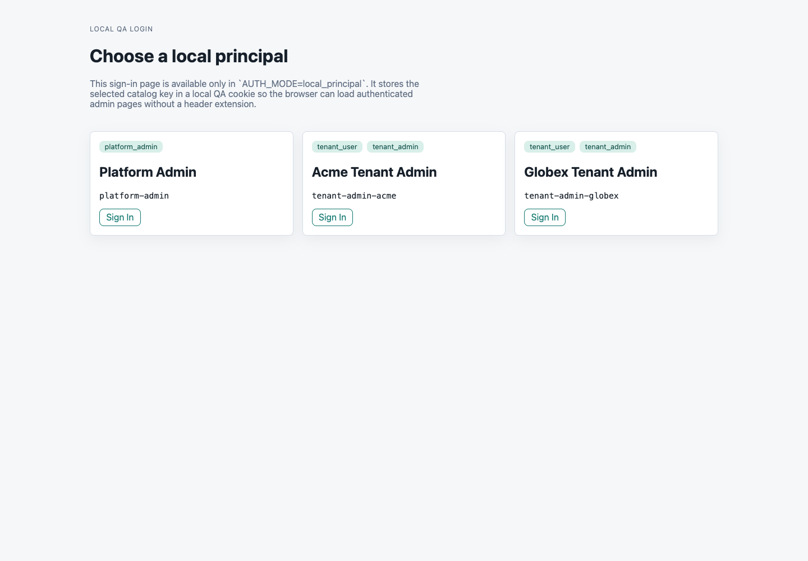
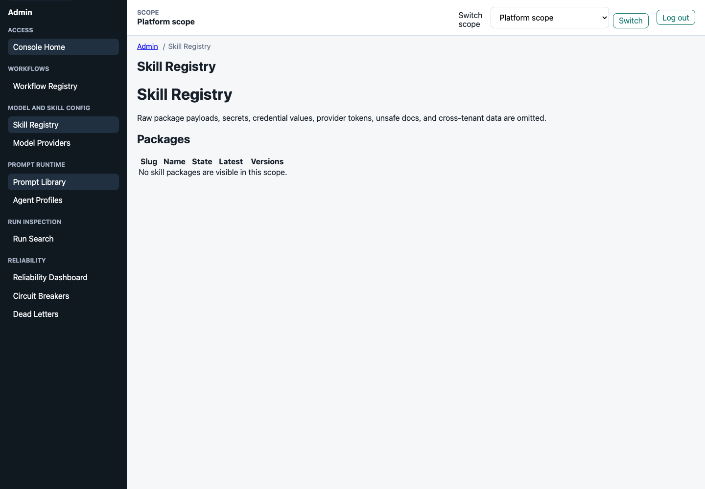
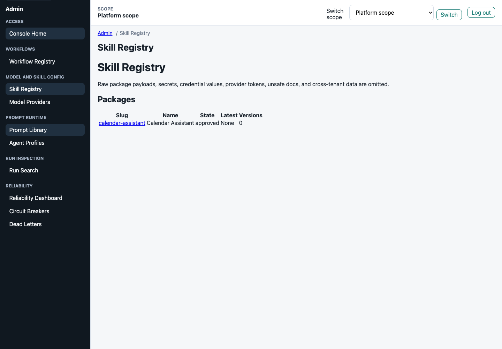
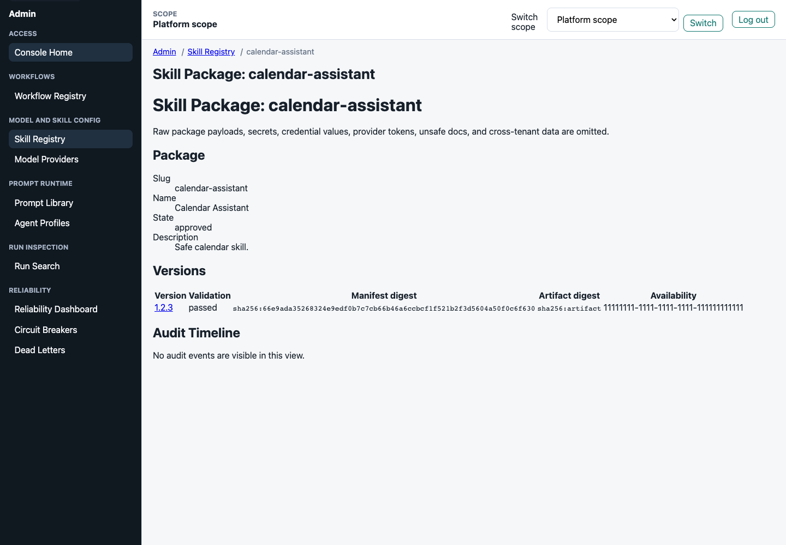
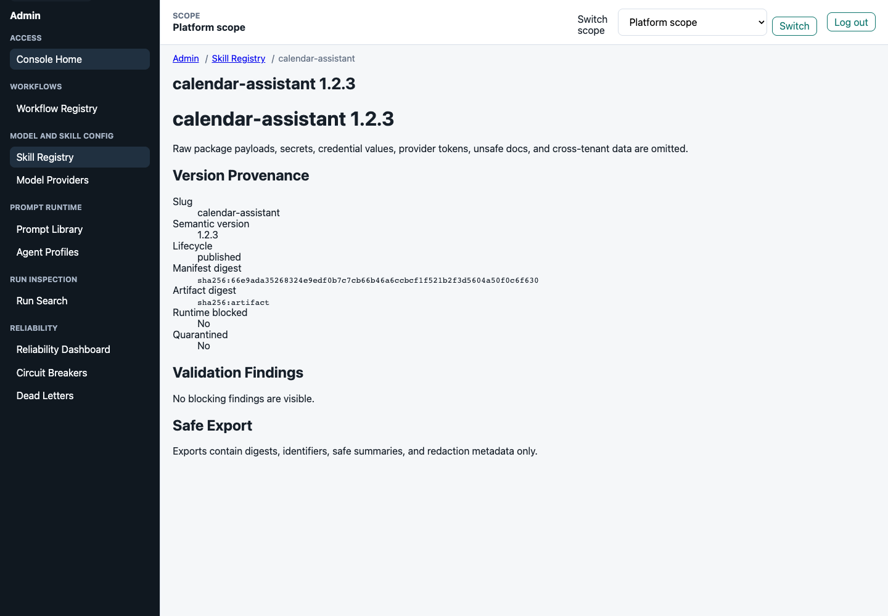
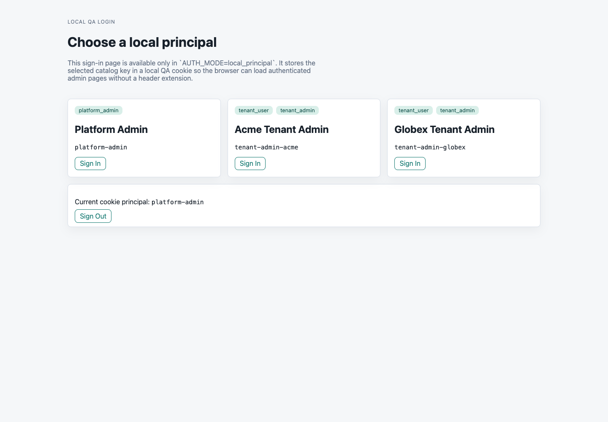
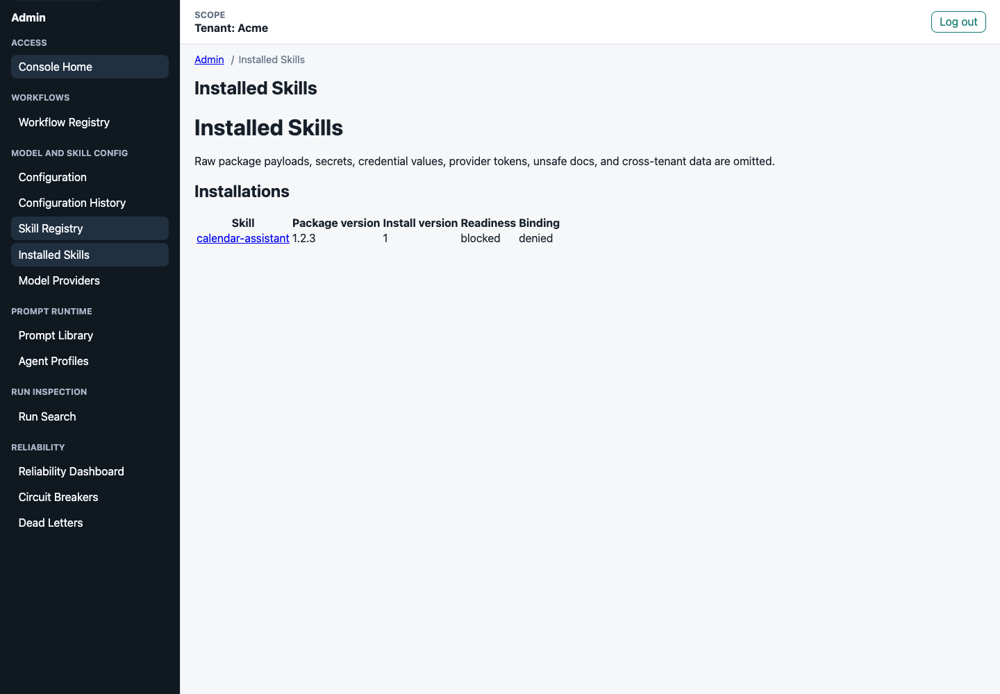
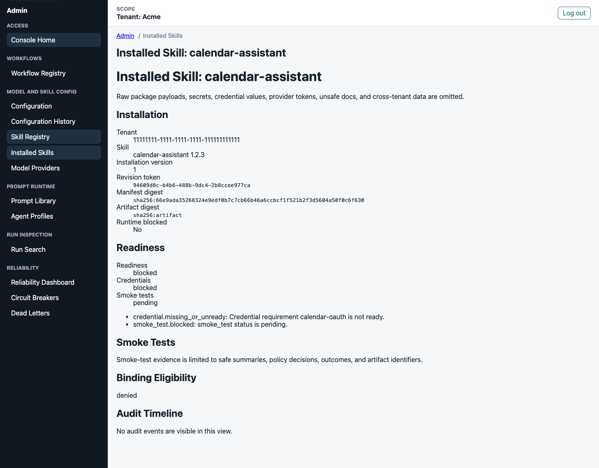
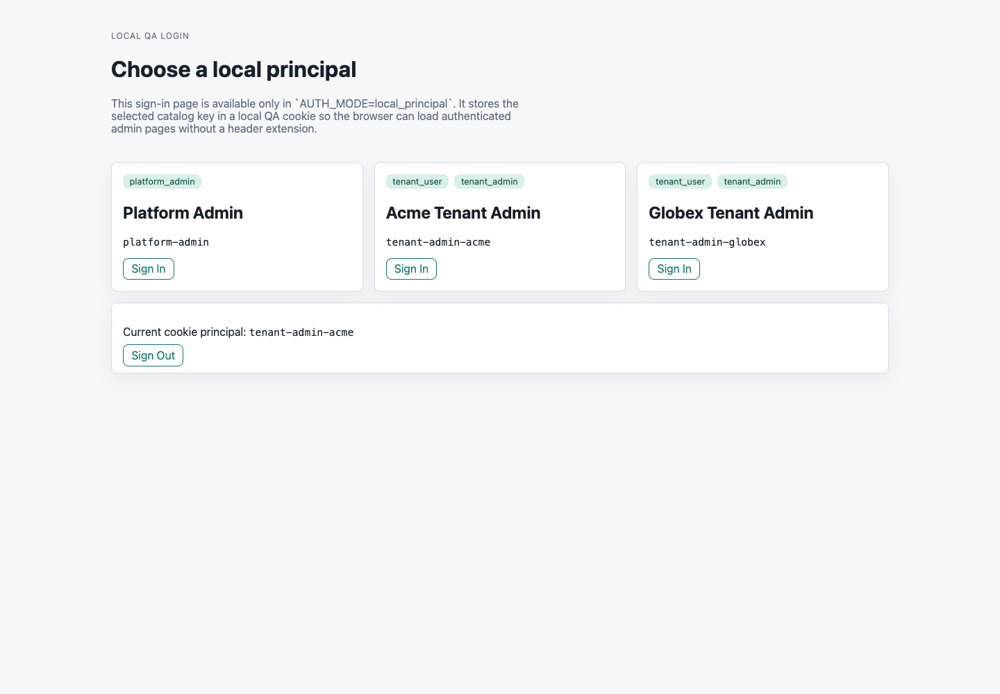
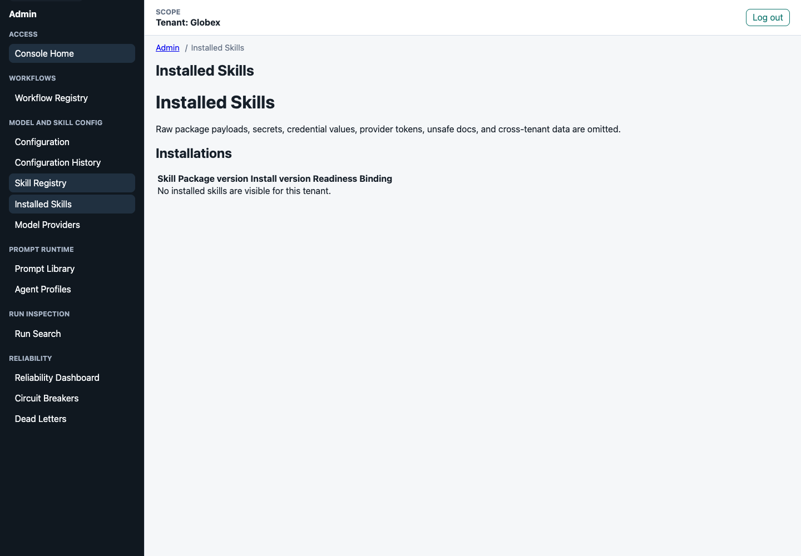

# QA014 UI: Skill Registry And Installation Lifecycle

## Goal

Use the browser UI to verify Spec 014: governed skill package review,
immutable version provenance, tenant-scoped installation review, credential
readiness, smoke-test status, binding eligibility, cross-tenant isolation, and
safe redaction behavior.

This guide is written so a non-technical reviewer can start here without first
running `qa014.md`.

## Important UI Scope Note

The current Spec 014 browser pages are review pages. They show package,
version, installation, readiness, smoke-test, binding, audit, and redaction
evidence. The current UI does not yet provide browser forms for creating a
package, publishing a version, granting tenant availability, installing a
skill, or configuring credential references.

Where the UI does not expose a form, this guide gives a copy/paste API helper
command. After each helper command, the reviewer returns to the browser to
verify the result on the HTML page.

## Screenshot Evidence

The screenshots referenced below were captured from a live local QA014 run and
are stored here:

```text
output/playwright/qa014_ui/
```

The UUIDs and digests in your run may be different. The page titles, visible
sections, status changes, tenant isolation, and redaction language should match.

## Environment Setup

Use two terminals from the repository root.

- Terminal A runs the API server.
- Terminal B runs setup commands, API helpers, and evidence checks.
- Keep Terminal B open so the exported variables stay available.

### Step 1 - Copy the QA014 environment file

Run in Terminal B:

```bash
cp specs/014-skill-registry-lifecycle/.env.qa014 .env
```

Expected result: no output.

What is happening: the app is configured for local-principal browser login,
the dedicated `multi_agent_platform_qa014` PostgreSQL database, fake `qa014/`
secret references, and `.data/qa014-artifacts` filesystem storage.

Why this matters: this keeps the QA run isolated from default local data and
prevents the test from touching real credential material.

### Step 2 - Confirm local tools

Run in Terminal B:

```bash
curl --version | head -1
jq --version
```

Expected result: each command prints a version.

What is happening: `curl` will run the helper actions that are not yet exposed
as browser forms, and `jq` will read generated IDs from the safe JSON evidence.

Why this matters: later steps need these tools so the reviewer can copy/paste
commands without editing JSON by hand.

### Step 3 - Remove old QA014 evidence files

Run in Terminal B:

```bash
find /tmp -type f \( -name 'qa014-*.json' -o -name 'qa014-*.html' -o -name 'qa014-*.txt' \) -exec rm -f {} +
```

Expected result: no output.

What is happening: old evidence files from previous QA014 runs are removed.

Why this matters: the browser walkthrough should use IDs and readiness states
from the current run only.

### Step 4 - Install dependencies

Run in Terminal B:

```bash
uv sync
```

Expected result: the command completes without an error.

What is happening: the local Python environment is prepared with the project
dependency set.

Why this matters: the FastAPI server, migrations, admin templates, and tests
must all run against the same dependency versions.

### Step 5 - Start PostgreSQL

Run in Terminal B:

```bash
docker compose up -d postgres
```

Expected result: Docker reports the PostgreSQL service is running.

What is happening: the local database container is started.

Why this matters: the admin shell, auth audit records, tenant records, and
Spec 014 schema all depend on PostgreSQL.

### Step 6 - Reset the QA database

Run in Terminal B:

```bash
docker compose exec -T postgres sh -c 'dropdb -U postgres --if-exists multi_agent_platform_qa014 && createdb -U postgres multi_agent_platform_qa014'
```

Expected result: no output, or a harmless notice if the database did not exist.

What is happening: the dedicated QA014 database is recreated from scratch.

Why this matters: the reviewer starts from a clean database and can trust that
visible state was created by this guide.

### Step 7 - Apply migrations

Run in Terminal B:

```bash
uv run alembic upgrade head
```

Expected result: migrations complete without an error.

What is happening: the current database schema is applied, including the skill
registry lifecycle tables.

Why this matters: Spec 014 depends on tables such as `skill_packages`,
`skill_package_versions`, `skill_installations`,
`skill_installation_tests`, and `skill_audit_records`.

### Step 8 - Seed deterministic tenants

Run in Terminal B:

```bash
docker compose exec -T postgres psql -U postgres -d multi_agent_platform_qa014 -v ON_ERROR_STOP=1 <<'SQL'
INSERT INTO tenants (
  tenant_id, slug, display_name, status, created_at, updated_at
) VALUES
  ('11111111-1111-1111-1111-111111111111', 'acme', 'Acme', 'active', CURRENT_TIMESTAMP, CURRENT_TIMESTAMP),
  ('22222222-2222-2222-2222-222222222222', 'globex', 'Globex', 'active', CURRENT_TIMESTAMP, CURRENT_TIMESTAMP)
ON CONFLICT (tenant_id) DO UPDATE SET
  slug = EXCLUDED.slug,
  display_name = EXCLUDED.display_name,
  status = EXCLUDED.status,
  updated_at = CURRENT_TIMESTAMP;
SQL
```

Expected result: PostgreSQL reports two inserted or updated tenant rows.

What is happening: Acme and Globex become valid tenant scopes for the admin
shell.

Why this matters: Acme is the tenant that receives the skill grant. Globex is
used later to prove cross-tenant isolation.

### Step 9 - Verify skill registry tables exist

Run in Terminal B:

```bash
docker compose exec -T postgres psql -U postgres -d multi_agent_platform_qa014 -c "\dt skill_*"
```

Expected result: output includes `skill_packages`,
`skill_package_versions`, `skill_installations`,
`skill_installation_tests`, and `skill_audit_records`.

What is happening: the reviewer confirms the schema for Spec 014 is present.

Why this matters: if these tables are missing, the environment is not ready for
the lifecycle review.

### Step 10 - Start the API server

Run in Terminal A:

```bash
uv run uvicorn multi_agent_platform.api.main:app --reload
```

Expected result: Uvicorn listens on:

```text
http://127.0.0.1:8000
```

What is happening: FastAPI serves the local login page, admin shell, skill
registry UI pages, and JSON helper routes.

Why this matters: every browser step below uses the live server-rendered app.

### Step 11 - Set shared QA variables

Run in Terminal B:

```bash
export BASE_URL=http://127.0.0.1:8000
export ACME_TENANT_ID=11111111-1111-1111-1111-111111111111
export GLOBEX_TENANT_ID=22222222-2222-2222-2222-222222222222
export PLATFORM_HEADER='X-Local-Principal: platform-admin'
export ACME_HEADER='X-Local-Principal: tenant-admin-acme'
export GLOBEX_HEADER='X-Local-Principal: tenant-admin-globex'
```

Expected result: no output.

What is happening: later commands reuse stable URLs, tenants, and local
principals.

Why this matters: the API helpers must run as the same roles the browser
review uses: platform admin, Acme tenant admin, and Globex tenant admin.

### Step 12 - Create the safe skill manifest request

Run in Terminal B:

```bash
cat > /tmp/qa014-manifest.json <<'JSON'
{
  "manifest": {
    "schema_version": "1.0",
    "slug": "calendar-assistant",
    "semantic_version": "1.2.3",
    "description": "Calendar assistant for safe scheduling operations.",
    "entrypoint": {"type": "approved_tool_ref", "approved_integration_ref": "tool:calendar:v1"},
    "tools": [{"tool_id": "calendar.list", "approved_integration_ref": "tool:calendar:v1", "display_name": "List calendars", "description": "Lists calendar metadata.", "action_categories": ["read"], "side_effect_profile": "read_only", "safe_usage": "Use for tenant-scoped calendar listing."}],
    "action_categories": ["read"],
    "network_requirements": [{"tool_id": "calendar.list", "action_category": "read", "allowed_schemes": ["https"], "allowed_domain_patterns": ["calendar.example.com"], "allowed_ports": [443], "required": true, "safe_description": "Calendar API endpoint."}],
    "credential_requirements": [{"requirement_key": "calendar-oauth", "credential_kind": "delegated_credential", "tool_id": "calendar.list", "action_category": "read", "required": true, "delegated_credential_scopes": ["calendar.readonly"], "safe_description": "Delegated calendar read access."}],
    "runtime_permissions": [{"permission_key": "calendar-read", "permission_type": "tool_access", "tool_id": "calendar.list", "action_category": "read", "side_effect_level": "read_only", "required": true, "safe_description": "Read calendar metadata."}],
    "test_fixtures": [{"fixture_key": "list-calendars", "tool_id": "calendar.list", "action_category": "read", "fixture_kind": "policy_preview", "safe_input_summary": "Policy-only calendar list probe.", "fixture_digest": "sha256:fixture", "requires_credentials": true, "expected_outcome": "passed", "timeout_seconds": 10}],
    "compatibility": {"platform_min_version": "0.1.0"},
    "safe_documentation": {"summary": "Safe operator documentation.", "documentation_digest": "sha256:docs", "redaction_classification": "safe", "support_contacts": ["ops@example.com"]},
    "artifact_digests": {"package": "sha256:artifact", "documentation": "sha256:docs"}
  },
  "approved_integration_refs": ["tool:calendar:v1"],
  "artifact_digest": "sha256:artifact"
}
JSON
```

Expected result: no output.

What is happening: the package manifest describes an approved calendar tool,
required delegated credential, runtime permission, test fixture, safe
documentation, and artifact digests.

Why this matters: Spec 014 requires declarative manifests and approved
integration references. The request does not contain raw credential values.

## Browser Walkthrough

### Part 1 - Platform Package And Version Review

#### Step 1 - Log in as the platform admin

Open this URL in the browser:

```text
http://127.0.0.1:8000/auth/local-login?redirect_to=/admin/skill-registry/ui/packages
```

Navigation path: open the login URL, then click `Sign In` on the `Platform
Admin` card.

Expected page URL after login:

```text
http://127.0.0.1:8000/admin/skill-registry/ui/packages
```

Expected screen: the local QA login page shows the platform admin option.



What is happening: the browser stores a local QA cookie for the platform admin
principal.

Why this matters: package creation, validation, publication, and tenant
availability grants are platform-governed actions.

#### Step 2 - Review the empty package list

Navigation path: after login, you land on `Skill Registry`. If needed, click
`Skill Registry` in the left navigation under `Model And Skill Config`.

Expected page URL:

```text
http://127.0.0.1:8000/admin/skill-registry/ui/packages
```

Expected screen: the page title is `Skill Registry`, the redaction notice is
visible, and the package table says no packages are visible.



What is happening: the UI is showing the starting state before the package
lineage exists.

Why this matters: the reviewer proves the package shown later was created by
this walkthrough, not by leftover state.

#### Step 3 - Create the package lineage root

Run in Terminal B:

```bash
curl -sS -X POST "$BASE_URL/admin/skill-registry/packages" \
  -H "$PLATFORM_HEADER" -H 'Content-Type: application/json' \
  -d '{"slug":"calendar-assistant","display_name":"Calendar Assistant","description":"Safe calendar skill.","owner_principal_id":"platform-admin"}' \
  | tee /tmp/qa014-ui-package.json
```

Expected result: JSON contains `"slug":"calendar-assistant"` and
`"lifecycle_state":"approved"`.

Return to the browser. Navigation path: click `Skill Registry` in the left
navigation or refresh the current page.

Expected page URL:

```text
http://127.0.0.1:8000/admin/skill-registry/ui/packages
```

Expected screen: the table now includes `calendar-assistant`.



What is happening: the helper creates the package lineage root, and the browser
list reflects that state.

Why this matters: Spec 014 separates the package identity from immutable
published versions.

#### Step 4 - Open package detail before publishing

Navigation path: from `Skill Registry`, click the `calendar-assistant` link in
the package table.

Expected page URL:

```text
http://127.0.0.1:8000/admin/skill-registry/ui/packages/calendar-assistant
```

Expected screen: the package detail shows slug, name, approved state,
description, the redaction notice, and an empty versions table.


What is happening: the browser is showing safe lineage metadata only.

Why this matters: raw package payloads, secrets, provider tokens, unsafe docs,
and cross-tenant data are intentionally omitted from the UI.

#### Step 5 - Validate the candidate manifest

Run in Terminal B:

```bash
curl -sS -X POST "$BASE_URL/admin/skill-registry/packages/calendar-assistant/versions/validate" \
  -H "$PLATFORM_HEADER" -H 'Content-Type: application/json' \
  -d @/tmp/qa014-manifest.json | tee /tmp/qa014-ui-validation.json
```

Expected result: JSON contains `"status":"passed"`, a `sha256:` manifest
digest, no blocking findings, and a safe summary.

What is happening: the registry validates that the manifest is declarative,
uses the approved integration reference, includes safe documentation metadata,
and avoids raw credential material.

Why this matters: Spec 014 requires unsafe or unapproved packages to be blocked
before publication.

#### Step 6 - Publish the immutable version and grant Acme availability

Run in Terminal B:

```bash
curl -sS -X POST "$BASE_URL/admin/skill-registry/packages/calendar-assistant/versions" \
  -H "$PLATFORM_HEADER" -H 'Content-Type: application/json' \
  -d @/tmp/qa014-manifest.json | tee /tmp/qa014-ui-version.json

curl -sS -o /tmp/qa014-ui-grant.txt -w '%{http_code}\n' -X POST \
  "$BASE_URL/admin/skill-registry/packages/calendar-assistant/versions/1.2.3/availability" \
  -H "$PLATFORM_HEADER" -H 'Content-Type: application/json' \
  -d '{"tenant_id":"11111111-1111-1111-1111-111111111111"}'
```

Expected result: the first command returns version `1.2.3` with
`"validation_status":"passed"`. The second command prints `204`.

Return to the browser. Navigation path: click `Skill Registry` in the left
navigation, then click `calendar-assistant`.

Expected page URL:

```text
http://127.0.0.1:8000/admin/skill-registry/ui/packages/calendar-assistant
```

Expected screen: the versions table shows `1.2.3`, validation `passed`, the
manifest digest, the artifact digest, and the Acme tenant grant.



What is happening: the immutable package version is published and made
available only to Acme.

Why this matters: tenant availability is explicit. Other tenants must not see
or install the version unless granted.

#### Step 7 - Open version provenance

Navigation path: from the package detail page, click the `1.2.3` version link.

Expected page URL:

```text
http://127.0.0.1:8000/admin/skill-registry/ui/packages/calendar-assistant/versions/1.2.3
```

Expected screen: the page shows semantic version, lifecycle `published`,
manifest digest, artifact digest, runtime blocked `No`, quarantined `No`,
validation findings, and safe export text.



What is happening: the UI displays immutable provenance and safe review
metadata for the published version.

Why this matters: reviewers can confirm exactly which manifest and artifact are
being installed without seeing raw package contents.

### Part 2 - Tenant Installation And Readiness Review

#### Step 8 - Log in as the Acme tenant admin

Open this URL in the browser:

```text
http://127.0.0.1:8000/auth/local-login?redirect_to=/admin/skill-registry/ui/installations?tenant_id=11111111-1111-1111-1111-111111111111
```

Navigation path: open the login URL, then click `Sign In` on the `Acme Tenant
Admin` card.

Expected page URL after login:

```text
http://127.0.0.1:8000/admin/skill-registry/ui/installations?tenant_id=11111111-1111-1111-1111-111111111111
```

Expected screen: the login page shows `Acme Tenant Admin`.



What is happening: the browser switches from platform scope to Acme tenant
scope.

Why this matters: installation review is tenant-specific, and tenant admins
must only see their tenant's installed skills.

#### Step 9 - Review the empty Acme installed skills list

Navigation path: after login, you land on `Installed Skills`. If needed, click
`Installed Skills` in the left navigation under `Model And Skill Config`.

Expected page URL:

```text
http://127.0.0.1:8000/admin/skill-registry/ui/installations?tenant_id=11111111-1111-1111-1111-111111111111
```

Expected screen: the table says no installed skills are visible for this
tenant, and the redaction notice is visible.


What is happening: Acme has access to the package version, but has not
installed it yet.

Why this matters: tenant availability and tenant installation are separate
lifecycle states.

#### Step 10 - Confirm Acme can discover the version and Globex cannot

Run in Terminal B:

```bash
curl -sS "$BASE_URL/admin/skill-registry/tenants/$ACME_TENANT_ID/available-versions" \
  -H "$ACME_HEADER" | tee /tmp/qa014-ui-acme-available.json

curl -sS "$BASE_URL/admin/skill-registry/tenants/$GLOBEX_TENANT_ID/available-versions" \
  -H "$GLOBEX_HEADER" | tee /tmp/qa014-ui-globex-available.json
```

Expected result: Acme's file includes `calendar-assistant`. Globex's file is
an empty JSON list.

What is happening: the same published package version is visible to the
granted tenant and invisible to the ungranted tenant.

Why this matters: Spec 014 requires tenant isolation for skill discovery.

#### Step 11 - Install the skill for Acme

Run in Terminal B:

```bash
curl -sS -X POST "$BASE_URL/admin/skill-registry/installations" \
  -H "$ACME_HEADER" -H 'Content-Type: application/json' \
  -d '{"tenant_id":"11111111-1111-1111-1111-111111111111","slug":"calendar-assistant","semantic_version":"1.2.3"}' \
  | tee /tmp/qa014-ui-installation.json
```

Expected result: JSON contains `"readiness_state":"blocked"`,
`"credential_status":"blocked"`, `"smoke_test_status":"pending"`, and
`"binding_eligibility_status":"denied"`.

Return to the browser. Navigation path: click `Installed Skills` in the left
navigation or refresh the current Acme installation list.

Expected page URL:

```text
http://127.0.0.1:8000/admin/skill-registry/ui/installations?tenant_id=11111111-1111-1111-1111-111111111111
```

Expected screen: the `calendar-assistant` row appears with version `1.2.3`,
install version `1`, readiness `blocked`, and binding `denied`.



What is happening: Acme has installed a specific immutable skill version, but
the install is not ready because the required delegated credential is missing.

Why this matters: Spec 014 must prevent binding or runtime use until required
readiness checks pass.

#### Step 12 - Open the blocked installation detail

Run in Terminal B:

```bash
export QA014_UI_INSTALLATION_ID=$(jq -r '.installation_id' /tmp/qa014-ui-installation.json)
printf 'http://127.0.0.1:8000/admin/skill-registry/ui/installations/%s\n' "$QA014_UI_INSTALLATION_ID"
```

Navigation path: from the Acme `Installed Skills` list, click the
`calendar-assistant` link. The printed URL is provided in case you want to
paste it directly.

Expected page URL:

```text
http://127.0.0.1:8000/admin/skill-registry/ui/installations/<installation_id>
```

Expected screen: the page shows the tenant id, skill version, installation
version, revision token, manifest digest, artifact digest, blocked readiness,
pending smoke tests, denied binding eligibility, findings, and redaction
notice.



What is happening: the detail page exposes only safe identifiers, lifecycle
status, and findings. It does not display a credential value.

Why this matters: tenant admins need enough detail to fix readiness without
seeing or entering raw secrets in this UI.

#### Step 13 - Configure the delegated credential reference

Run in Terminal B:

```bash
export QA014_UI_REVISION_TOKEN=$(jq -r '.revision_token' /tmp/qa014-ui-installation.json)
curl -sS -X POST "$BASE_URL/admin/skill-registry/installations/$QA014_UI_INSTALLATION_ID/credentials" \
  -H "$ACME_HEADER" -H 'Content-Type: application/json' \
  -d "{\"revision_token\":\"$QA014_UI_REVISION_TOKEN\",\"credentials\":[{\"requirement_key\":\"calendar-oauth\",\"credential_kind\":\"delegated_credential\",\"reference_id\":\"delegated-calendar-acme\",\"status\":\"ready\",\"safe_summary\":{\"scope\":\"calendar.readonly\"}}]}" \
  | tee /tmp/qa014-ui-configured.json
```

Expected result: JSON contains `"readiness_state":"ready"`,
`"credential_status":"ready"`, `"smoke_test_status":"passed"`, and
`"binding_eligibility_status":"eligible"`.

Return to the browser. Navigation path: refresh the installation detail page.

Expected page URL:

```text
http://127.0.0.1:8000/admin/skill-registry/ui/installations/<installation_id>
```

Expected screen: readiness is `ready`, credentials are `ready`, smoke tests
are `passed`, and binding eligibility is `eligible`.


What is happening: the app records a credential reference and safe summary,
then recomputes readiness.

Why this matters: Spec 014 allows references to approved credentials, not raw
credential values. A ready installation can now be considered for policy
binding.

#### Step 14 - Confirm the installed skills list is ready

Navigation path: click `Installed Skills` in the left navigation.

Expected page URL:

```text
http://127.0.0.1:8000/admin/skill-registry/ui/installations?tenant_id=11111111-1111-1111-1111-111111111111
```

Expected screen: the `calendar-assistant` row now shows readiness `ready` and
binding `eligible`.


What is happening: the list view reflects the same readiness state as the
detail page.

Why this matters: tenant admins can scan installed skills and quickly identify
which ones are usable.

#### Step 15 - Preview binding eligibility

Run in Terminal B:

```bash
curl -sS "$BASE_URL/admin/skill-registry/installations/$QA014_UI_INSTALLATION_ID/eligibility" \
  -H "$ACME_HEADER" | tee /tmp/qa014-ui-eligibility.json
```

Expected result: JSON contains `"allowed":true` and evidence with tenant id,
installation id, installation version, package slug, semantic version, manifest
digest, and artifact digest.

What is happening: the binding policy sees a ready installation and returns
eligible evidence.

Why this matters: Spec 014 requires ready installed skill versions to be
bindable through existing workflow/profile policy checks.

#### Step 16 - Confirm stale updates are rejected

Run in Terminal B:

```bash
curl -sS -o /tmp/qa014-ui-stale.json -w '%{http_code}\n' -X POST \
  "$BASE_URL/admin/skill-registry/installations/$QA014_UI_INSTALLATION_ID/credentials" \
  -H "$ACME_HEADER" -H 'Content-Type: application/json' \
  -d "{\"revision_token\":\"$QA014_UI_REVISION_TOKEN\",\"credentials\":[]}"
```

Expected result: the command prints `409`.

What is happening: the command intentionally reuses the old revision token from
before credentials were configured.

Why this matters: Spec 014 requires optimistic concurrency so an outdated
admin page cannot overwrite a newer credential readiness decision.

### Part 3 - Cross-Tenant And Redaction Evidence

#### Step 17 - Log in as the Globex tenant admin

Open this URL in the browser:

```text
http://127.0.0.1:8000/auth/local-login?redirect_to=/admin/skill-registry/ui/installations?tenant_id=22222222-2222-2222-2222-222222222222
```

Navigation path: open the login URL, then click `Sign In` on the `Globex
Tenant Admin` card.

Expected page URL after login:

```text
http://127.0.0.1:8000/admin/skill-registry/ui/installations?tenant_id=22222222-2222-2222-2222-222222222222
```

Expected screen: the login page shows `Globex Tenant Admin`.



What is happening: the browser switches from Acme tenant scope to Globex tenant
scope.

Why this matters: the next screens verify that Acme's granted package and
installation do not leak into Globex.

#### Step 18 - Review Globex installed skills

Navigation path: after login, you land on `Installed Skills`. If needed, click
`Installed Skills` in the left navigation.

Expected page URL:

```text
http://127.0.0.1:8000/admin/skill-registry/ui/installations?tenant_id=22222222-2222-2222-2222-222222222222
```

Expected screen: the table says no installed skills are visible for this
tenant.



What is happening: Globex has no installation records in its tenant scope.

Why this matters: Acme's installed skill must not appear to another tenant.

#### Step 19 - Confirm Globex cannot discover the granted version

Open this URL in the browser while logged in as Globex:

```text
http://127.0.0.1:8000/admin/skill-registry/tenants/22222222-2222-2222-2222-222222222222/available-versions
```

Navigation path: from the Globex `Installed Skills` page, paste the URL above
into the browser address bar.

Expected page URL:

```text
http://127.0.0.1:8000/admin/skill-registry/tenants/22222222-2222-2222-2222-222222222222/available-versions
```

Expected screen: the browser shows an empty JSON list, `[]`.


What is happening: Globex asks for available skill versions and receives no
entries.

Why this matters: the version was granted to Acme only, so Globex discovery
must be empty.

#### Step 20 - Run the redaction scan

Run in Terminal B:

```bash
grep -R -Ei 'password|refresh|bearer|credential_value|raw_payload|sk-' /tmp/qa014-ui-*.json || true
```

Expected result: no credential values, provider tokens, raw payloads, or
secret-like strings are present.

What is happening: the command searches the saved JSON evidence for dangerous
credential or token patterns.

Why this matters: Spec 014 requires API and UI evidence to use safe summaries,
identifiers, and digests instead of protected content.

## Quarantine Coverage Note

The current browser pages show `Runtime blocked` and `Quarantined` fields on
version and installation detail pages, but this UI walkthrough does not expose
a quarantine action. Quarantine behavior is covered by the focused automated
tests listed below, especially `tests/unit/admin/test_skill_quarantine.py` and
the runtime eligibility tests.

What is happening: the browser can review quarantine state when present, while
the local QA helper flow focuses on the package-to-ready-installation path.

Why this matters: this keeps the UI guide accurate to the current
implementation instead of documenting a browser control that does not exist.

## Required Automated Evidence

Run Ruff:

```bash
uv run ruff check .
```

Expected result: command exits with status `0`.

Run format check:

```bash
uv run ruff format --check .
```

Expected result: command exits with status `0`.

Run mypy:

```bash
uv run mypy src
```

Expected result: command exits with status `0`.

Run focused skill registry tests:

```bash
uv run pytest --no-cov tests/unit/admin/test_skill_manifest.py tests/unit/admin/test_skill_package_validation.py tests/unit/admin/test_skill_artifact_store.py tests/unit/admin/test_skill_audit_redaction.py tests/unit/admin/test_skill_readiness.py tests/unit/admin/test_skill_eligibility.py tests/unit/admin/test_skill_registry_jobs.py tests/unit/admin/test_skill_registry_fairness.py tests/unit/admin/test_skill_quarantine.py tests/unit/admin/test_skill_registry_observability.py tests/unit/admin/test_skill_runtime_eligibility.py tests/unit/api/test_skill_registry_ui_models.py tests/unit/api/test_skill_registry_schemas.py tests/unit/auth/test_skill_policy.py tests/integration/skill_registry/test_skill_smoke_runner.py tests/integration/skill_registry/test_skill_installation_lifecycle.py tests/integration/skill_registry/test_skill_workflow_publish_validation.py tests/integration/skill_registry/test_skill_policy_integration.py
```

Expected result: all focused tests pass.

Run the full coverage gate before merge:

```bash
uv run pytest --cov=src/multi_agent_platform --cov-report=term-missing --cov-fail-under=90
```

Expected result: command exits with status `0`.

## Reviewer Evidence Checklist

- Local QA login page captured for platform admin.
- Package list starts empty.
- Package list shows `calendar-assistant` after package creation.
- Package detail shows safe package metadata before publication.
- Version validation passes.
- Package detail shows version `1.2.3`, digests, and Acme availability grant.
- Version detail shows immutable provenance and safe export text.
- Acme login page captured.
- Acme installed skills starts empty.
- Acme discovery includes `calendar-assistant`.
- Globex discovery is empty.
- Acme installation starts blocked because credentials are missing.
- Installation detail shows blocked readiness, pending smoke tests, denied
  binding, and findings.
- Credential reference update changes readiness to ready.
- Installation detail shows passed smoke tests and eligible binding.
- Stale credential update returns `409`.
- Globex installed skills remains empty.
- Redaction scan has no raw credential or token matches.
- Automated evidence commands pass.

## Acceptance Notes Template

- Browser and date:
- Platform principal used:
- Tenant principals used:
- Package list result:
- Version validation result:
- Version detail result:
- Acme discovery result:
- Globex discovery result:
- Acme installation blocked result:
- Credential reference result:
- Binding eligibility result:
- Stale revision result:
- Redaction scan result:
- Automated evidence:

## Troubleshooting

- If the login page does not show the local QA principals, recopy
  `.env.qa014` to `.env` and restart the API.
- If a helper command returns `401`, confirm the matching
  `X-Local-Principal` header variable is set.
- If a helper command returns `403`, confirm the correct principal is being
  used for the action: platform admin for package/version/grant actions, Acme
  tenant admin for Acme installation actions.
- If the package list loses rows after a server reload, rerun the package,
  version, grant, and installation helper commands. The current UI helper state
  is in-process for this QA flow.
- If the Acme installation list denies access, use the tenant-scoped URL with
  `tenant_id=11111111-1111-1111-1111-111111111111`.
- If readiness remains blocked after credential configuration, inspect
  `/tmp/qa014-ui-configured.json` for findings.
- If the redaction scan prints a match, confirm whether it is only a safe field
  name or an actual protected value. Protected values must not appear.
- If a screenshot does not match the current run, recapture it from the
  corresponding page and replace the PNG under `output/playwright/qa014_ui/`.

## Related Files

- `specs/014-skill-registry-lifecycle/spec.md`
- `specs/014-skill-registry-lifecycle/qa014.md`
- `specs/014-skill-registry-lifecycle/.env.qa014`
- `src/multi_agent_platform/api/routers/admin_skill_registry.py`
- `src/multi_agent_platform/api/ui/skill_registry.py`
- `src/multi_agent_platform/web_admin/templates/skill_registry/package_list.html`
- `src/multi_agent_platform/web_admin/templates/skill_registry/package_detail.html`
- `src/multi_agent_platform/web_admin/templates/skill_registry/package_version_detail.html`
- `src/multi_agent_platform/web_admin/templates/skill_registry/installation_list.html`
- `src/multi_agent_platform/web_admin/templates/skill_registry/installation_detail.html`
