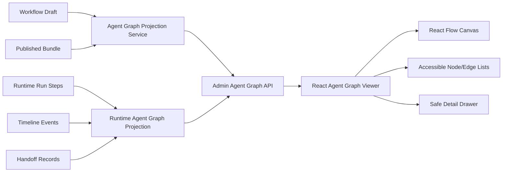
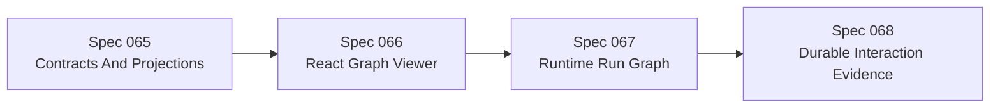

# Spec 066 - React Agent Graph Viewer For Workflow Drafts And Versions: Implement

Roadmap source: `graphical_ui.md`

## Deterministic Targets

- Feature directory: `specs/066-react-agent-graph-viewer-for-workflow-drafts-and-versions`
- Git branch: `codex/066-react-agent-graph-viewer-for-workflow-drafts-and-versions`
- QA id: `qa066`
- QA database: `multi_agent_platform_qa066`
- Post-spec curl-test database: `multi_agent_curl_test`
- Curl regression source: `curl_testing.md`

## Graphical UI Autonomy Rules

- Continue directly to the next spec after validation passes.
- Do not commit, stage, push, or create pull requests.
- Keep all local QA deterministic with local-principal auth and mocked provider/model paths unless a spec explicitly allows otherwise.
- Preserve tenant isolation, redaction, auditability, safe summaries, artifact references, generated TypeScript contract integrity, keyboard-readable graph equivalents, and truthful live-data UI states.
- Use existing workflow builder, React Flow, operations workbench, run-debug, runtime timeline, handoff, gateway, tool-summary, and artifact-reference patterns before adding new abstractions.

## Implement Prompt

/speckit.implement Implement the React Agent Graph Viewer tasks. Preserve existing workflow builder behavior and styling conventions. Use backend-owned graph data only. Do not add runtime run graph support in this spec. Do not introduce production mock graph data or visible implementation-framework labels. Run frontend typecheck, Vitest, build, Playwright graph validation, backend route smoke tests for the graph endpoints, visible-copy/redaction scans, and docs/QA validation.

## Required Post-Spec Validation Contract

After implementation, the active spec must pass QA document validation, `run_spec_qa.py`, Playwright UI validation, curl_testing.md coverage review/update, and the `multi-agent-curl-test` runner before the next spec starts. If the spec adds or changes an API, update `curl_testing.md` in the same spec and fix the implementation or curl commands until the multi-agent curl regression passes. Do not pause between completed specs and do not create git commits. After Spec 068 passes, run the final whole-roadmap stability gate from the `speckit-graphical-ui` skill before reporting completion.
## Graphical Agent Workflow Context

# Graphical Agent Workflow UI Specs

Review date: 2026-05-08

This document breaks the graphical agent/sub-agent workflow UI into Spec Kit-ready
specs. The goal is to let authorized users visually inspect how a workflow is
intended to route work between an agent and sub-agents, and how a real run
actually communicated through those agents.

The current repository already has a React workflow builder with a React Flow
graph preview, backend-owned graph contracts, run timeline records, run steps,
and operations workbench debug panels. These specs should extend those surfaces
rather than introduce a second visualization framework.

Numbering note: the current implemented spec sequence reaches 059, and
`scenario_enhancement.md` reserves 060 through 064 for the Design Reviewer
scenario. Use 065 through 068 below if the repository numbering has not advanced
before implementation begins.

## Target Experience

The UI should support a simple mental model:

```text
Agent1 ==> Sub-Agent1 ==> Sub-Agent2
```

The production version should show:

- the lead/coordinator agent
- sub-agents and specialist roles
- tool, join, approval, handoff, and terminal nodes
- directional communication or delegation edges
- safe edge labels such as delegates, sends context, returns result, joins, and
  hands off
- status badges for draft readiness and runtime execution state
- click-through panels for safe summaries, role/profile references, timeline
  links, artifact references, and validation findings
- a keyboard-readable node and edge list equivalent to the canvas
- truthful empty, denied, partial, loading, stale, and error states

The first usable version should be read-only. Graph editing can remain in the
existing workflow builder and should not be expanded unless a later spec
explicitly asks for editable communication edges.

## Architecture Overview

The feature should be implemented as a backend-owned projection consumed by the
React Admin UI.



The durable source of truth should remain existing workflow registry, published
bundle, runtime orchestration, timeline, handoff, artifact, audit, prompt/profile,
provider, and test-bench records. The UI should not invent graph records or
sample agents on production routes.

## Cross-Spec Rollout Notes



Recommended implementation order:

1. Spec 065 creates the backend graph contract and projections.
2. Spec 066 makes the design-time and published-version graph visible.
3. Spec 067 overlays runtime execution state and evidence.
4. Spec 068 adds durable interaction evidence only if run steps and timeline
   records do not provide enough fidelity.

## Accuracy Review

This plan is implementable against the current platform shape because:

- the frontend already depends on `@xyflow/react`
- the workflow builder already renders a React Flow graph from backend-owned
  workflow graph contracts
- backend workflow registry code already builds graph previews and validation
  findings from workflow documents
- runtime orchestration already persists run steps and timeline events
- the operations workbench already aggregates run debug evidence, branches,
  gateway attempts, tool calls, delivery summaries, and bundle summaries
- the platform already has safe-text, redaction, tenant guard, generated
  TypeScript contract, QA, and Playwright validation patterns

The main unknown is whether existing run steps and timeline events preserve
enough source/target node linkage to render a precise runtime communication
graph. If they do, Specs 065 through 067 can avoid migrations. If not, Spec 068
should add durable interaction evidence rather than overloading generic timeline
events.
