# Spec 060 - Design Review Domain Foundation: Implement

Roadmap source: `scenario_enhancement.md`

## Deterministic Targets

- Feature directory: `specs/060-design-review-domain-foundation`
- Git branch: `codex/060-design-review-domain-foundation`
- QA id: `qa060`
- QA database: `multi_agent_platform_qa060`
- Post-spec curl-test database: `multi_agent_curl_test`
- Curl regression source: `curl_testing.md`

## Scenario Autonomy Rules

- Continue directly to the next spec after validation passes.
- Do not commit, stage, push, or create pull requests.
- Keep all local QA deterministic with local-principal auth and mocked provider/model paths unless a spec explicitly allows otherwise.
- Preserve tenant isolation, redaction, auditability, safe summaries, artifact references, and truthful live-data UI states.

## Implement Prompt

/speckit.implement Implement only the Design Review domain foundation tasks. Keep changes additive. Do not implement live model role execution, round auto-launching, or the Admin design review workspace in this spec. Run focused backend validation, Alembic migration validation, contract tests, integration route tests, ruff, mypy for touched modules, and spec QA docs validation.

## Required Post-Spec Validation Contract

After implementation, the active spec must pass QA document validation, `run_spec_qa.py`, Playwright UI validation, curl_testing.md coverage review/update, and the `multi-agent-curl-test` runner before the next spec starts. If the spec adds or changes an API, update `curl_testing.md` in the same spec and fix the implementation or curl commands until the multi-agent curl regression passes. Do not pause between completed specs and do not create git commits.
## Scenario Architecture Context

# Design Reviewer Scenario Enhancement

Review date: 2026-05-08

This document describes the architecture needed to turn the current deterministic
Design Reviewer Council setup into a first-class production feature. It is
written for Spec Kit implementation planning. The current platform can already
model and run one deterministic acyclic review round through workflow registry,
graph execution, and test-bench evidence. The missing production features are:

- durable design-review sessions, revisions, rounds, reviewer assignments,
  verdicts, quorum decisions, and development handoffs
- model-backed role-node execution through `ModelGateway`
- a review coordinator that launches successive acyclic workflow runs until
  quorum passes or manual resolution is required
- a live-data Admin workspace for session history, reviewer feedback, revision
  diffs, quorum decisions, and handoff state
- reusable templates and QA evidence that prove the scenario without mock UI
  records or hidden fixture behavior

The design below preserves the platform's existing constraints: tenant isolation,
local-principal/Auth0 authorization, redaction-safe records, immutable evidence,
no raw secrets, no raw provider payloads in UI or QA artifacts, deterministic
local QA, and acyclic graph execution.

## Architecture Overview

### Current Supported Surface

The current implementation supports these pieces today:

- Workflow drafts and published bundles can represent a lead role, reviewer
  sub-agent roles, quorum joins, synthesis, and terminal handoff nodes.
- `GraphExecutionService` schedules acyclic role nodes in parallel waves and can
  evaluate `quorum` joins with `failure_behavior=manual_resolution`.
- The worker can claim DB-backed runtime workflow runs and execute the graph.
- Test Bench can create required deterministic evidence for workflow publish
  gates.
- Prompt/profile/provider governance can publish prompts and activate runtime
  profiles, but graph role nodes currently execute through the deterministic
  role executor.

### Required Additions

The production Design Reviewer Council should be built as an additive domain on
top of workflow registry, runtime orchestration, governance, storage, audit, and
test bench:

1. `DesignReviewService` owns first-class session records and immutable design
   revisions.
2. `DesignReviewCoordinator` launches one runtime workflow run per review round.
   It never creates cycles in one graph. If quorum fails, it records the
   decision and creates the next revision before launching another run.
3. `ModelBackedRoleNodeExecutor` plugs into `GraphExecutionService` and calls
   `ModelGateway` only when the workflow/session execution mode permits it.
4. Contract validation converts lead, reviewer, synthesis, and handoff outputs
   into safe structured records, artifact references, digests, and usage
   provenance.
5. Admin routes under `/admin/app/design-reviews` expose live session state,
   round history, quorum decisions, revision diffs, manual-resolution actions,
   and final handoff references.
6. A reusable workflow template and deterministic QA suite make the scenario
   easy to install, test, and publish.

### Non-Goals

- Do not add a cyclic workflow graph executor.
- Do not store raw prompts, completions, secrets, authorization headers, private
  channel payloads, memory contents, or raw external tool payloads in design
  review tables, route responses, screenshots, or QA artifacts.
- Do not replace prompt/profile/provider governance. Design review assignments
  should reference existing published prompt versions, active profile versions,
  and provider routing provenance.
- Do not make the Admin UI invent sample sessions, reviewer rows, or successful
  handoffs. Empty states must be truthful.

## Architecture Diagrams

### Component Architecture

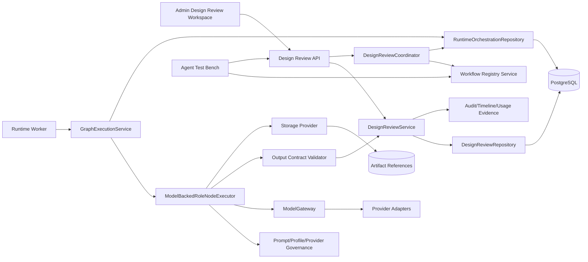

### Data Model

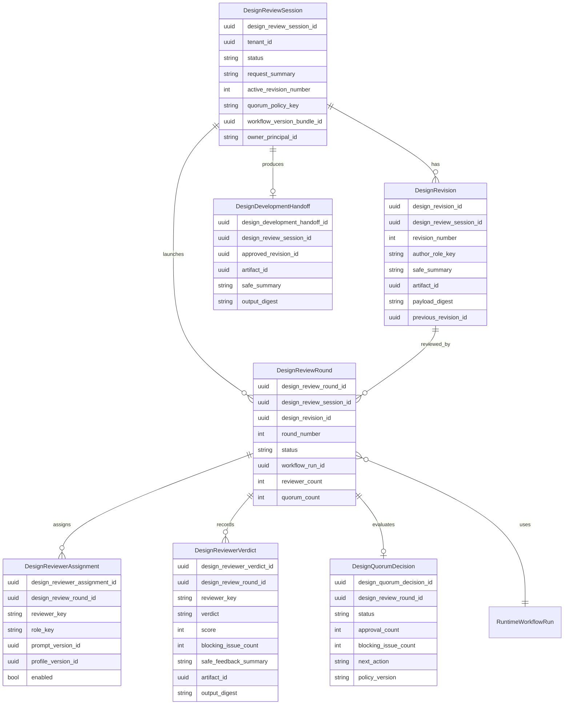

### Review Round Runtime Shape

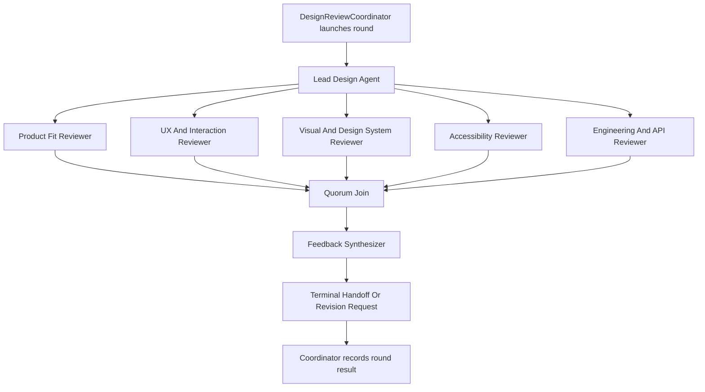

### Cross-Round Coordinator Loop

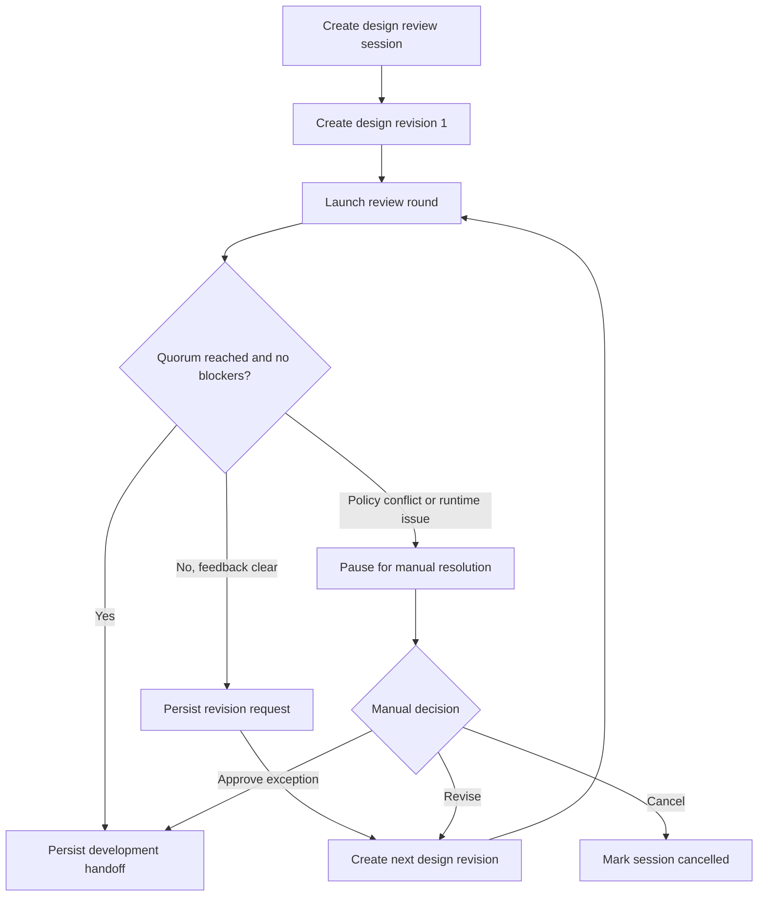

### Runtime Integration

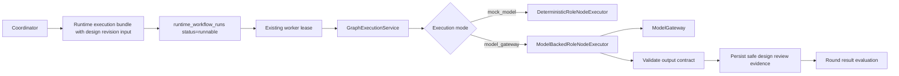

## Sequence Diagrams

### Start Session And Launch First Round

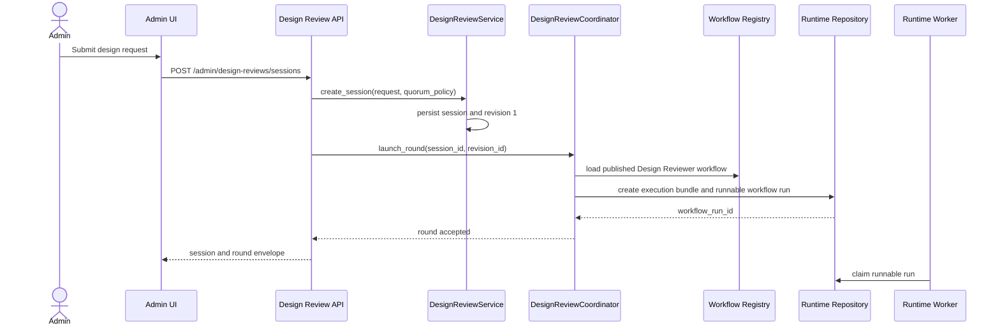

### Model-Backed Reviewer Execution

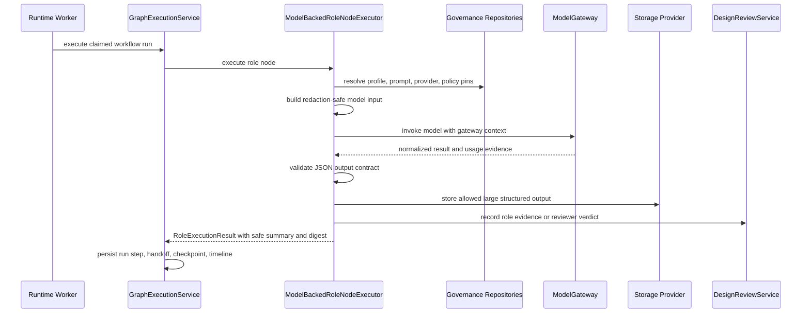

### Quorum Fails And Next Revision Starts

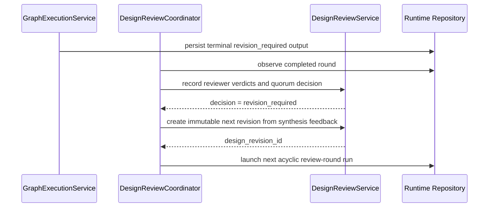

### Quorum Passes And Handoff Is Published

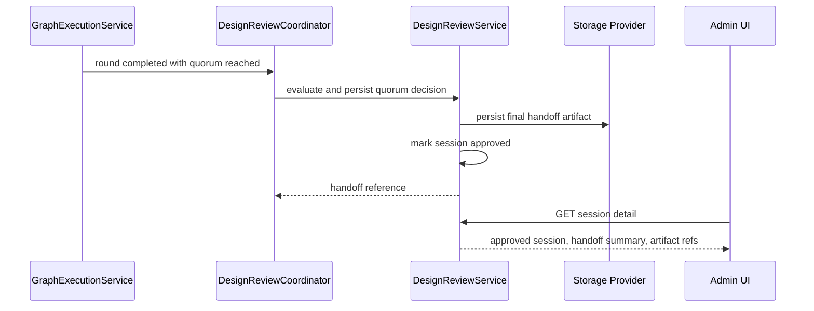

### Manual Resolution

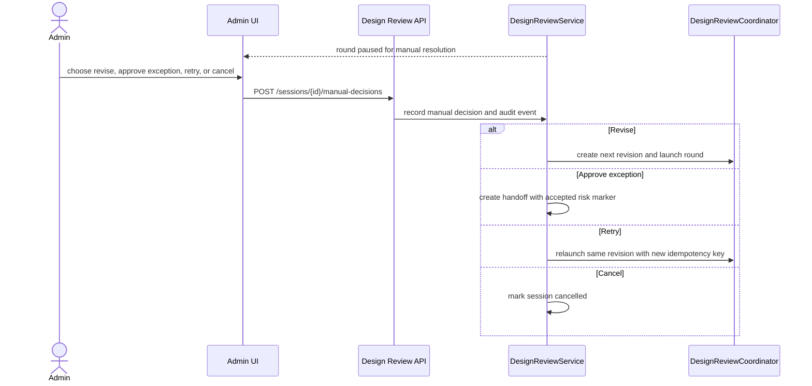

## Implementation Notes

### Durable Domain

Add a new `admin/design_review` domain with Pydantic schemas, SQLAlchemy models,
repositories, and services. These records should be tenant-scoped and immutable
where they represent evidence:

- sessions: mutable status and active revision pointer
- revisions: immutable design packet artifacts and safe summaries
- rounds: one runtime workflow run against one revision
- assignments: reviewer role/profile/prompt pins used in one round
- verdicts: immutable structured reviewer outputs
- quorum decisions: immutable aggregate policy results
- handoffs: immutable final development handoff references

Recommended source locations:

- `src/multi_agent_platform/admin/design_review/`
- `src/multi_agent_platform/api/schemas/design_review.py`
- `src/multi_agent_platform/api/routers/admin_design_review.py`
- `src/multi_agent_platform/db/models/design_review.py`
- `src/multi_agent_platform/db/repositories/design_review.py`
- `frontend/admin/src/components/designReview/`

### Coordinator

The coordinator should be the only component that implements the repeated
review loop. It should:

- create sessions and initial revisions
- load a published Design Reviewer Council workflow bundle
- create DB-backed runtime execution bundles and runnable workflow runs
- record round completion from runtime output, timeline, and role evidence
- evaluate quorum using design-review policy, not only raw graph branch success
- launch the next round when revision is required
- pause for manual resolution when policy cannot decide
- enforce a max-round limit and explicit cancellation

The coordinator should not call the existing in-memory runtime facade for
production design reviews. It should write through
`RuntimeOrchestrationRepository` so the existing worker can claim and execute
the run.

### Model-Backed Role Executor

`GraphExecutionService` already accepts a `RoleNodeExecutor`; the worker
currently uses the deterministic default. Add a model-backed executor and a
factory/selection layer so each run chooses the correct executor from persisted
execution mode and policy pins.

The model-backed executor must:

- load prompt/profile/provider pins for the role
- build a safe model input from upstream summaries and artifact references
- call `ModelGateway` with a complete gateway invocation context
- validate the model output against the role output contract
- persist large outputs as governed artifacts when allowed
- return only safe summaries, digests, structured safe output, and usage
  provenance to graph execution
- fail closed when prompt/profile/provider pins, credentials, policy, or output
  validation are not ready

### Admin Workspace

Add a live-data Admin workspace after backend contracts stabilize. It should
support:

- session creation and safe request summary capture
- prompt/profile/provider readiness and workflow template readiness
- round timeline with reviewer assignments, verdict summaries, quorum decision,
  revision request, and handoff status
- revision diffs based on safe summaries and artifact metadata
- manual resolution actions with audit-safe decisions
- handoff export/download only through artifact references and allowed policies

The UI must not render mock sessions. Empty, denied, loading, stale, and error
states must be backend-owned.

## Accuracy Review

This design is implementable against the current repository because it builds
on existing extension points and deliberately avoids unsupported runtime cycles:

- `GraphExecutionService` already supports role executor injection, parallel
  waves, quorum joins, terminal nodes, and manual-resolution pauses.
- The DB-backed worker already claims `runtime_workflow_runs` through
  `RuntimeOrchestrationRepository`; the coordinator should create DB-backed runs
  for production instead of using the in-memory runtime facade.
- Workflow registry already stores document contracts, roles, nodes, joins,
  prompt/profile references, test requirements, validation results, publish
  gates, and compiled bundle summaries.
- Prompt/profile/provider governance and `ModelGateway` already exist, so the
  missing executor can resolve pins and call the gateway without inventing a new
  provider layer.
- Test Bench already supports deterministic required evidence and publish-gate
  summaries; the template spec can extend this with scenario-specific fixtures.
- React Admin live-data patterns already exist for workflows, governance,
  operations, test bench, usage, memberships, and channels; the design-review
  workspace should follow those patterns.

Known implementation risks:

- The executor must be strict about redaction and artifact boundaries because
  design packets and reviewer feedback may contain product-sensitive content.
- Coordinator idempotency must prevent duplicate rounds when the same session
  action is retried.
- Manual-resolution behavior must be auditable and must not silently override
  blocking reviewer issues.
- Contract validation must distinguish model formatting failures from reviewer
  verdicts that legitimately request changes.
- Admin route envelopes must not synthesize sessions or handoffs when no durable
  records exist.

Definition of done for the full scenario:

- A tenant admin can create a design review session from Admin.
- The coordinator launches round 1 as a DB-backed runtime run.
- Lead and reviewer role nodes can run in deterministic mode for QA and
  model-backed mode when configured policy permits it.
- Four-of-five and three-of-four quorum rules produce correct decisions with no
  blocking issues.
- Failed quorum creates a new design revision and launches a new acyclic round,
  subject to max-round and manual-resolution policy.
- Approved quorum creates a development handoff with safe artifact references.
- Admin shows live session, round, revision, verdict, decision, and handoff
  data with truthful empty/denied/error states.
- Required test-bench evidence and Playwright QA cover success, revision,
  manual-resolution, redaction, and cross-tenant denial paths.

## Cross-Spec Rollout Notes

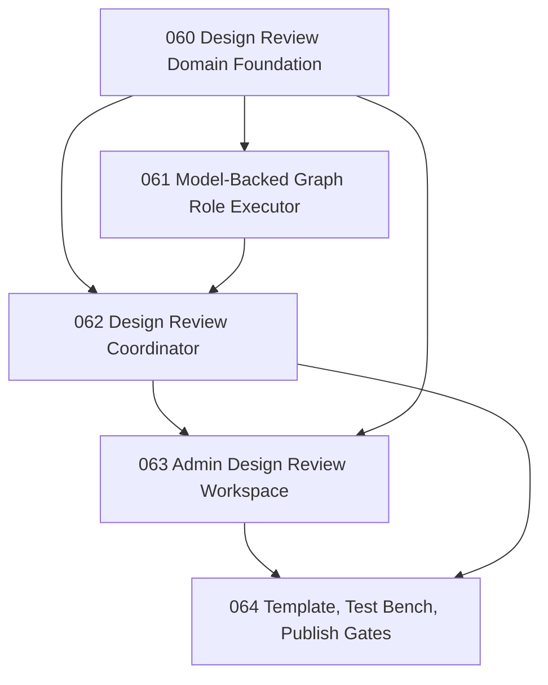

Recommended implementation order:

1. Spec 060 creates the durable domain and route contracts.
2. Spec 061 adds model-backed role execution while preserving deterministic QA.
3. Spec 062 connects sessions to repeated acyclic runtime rounds.
4. Spec 063 adds the live-data Admin workspace.
5. Spec 064 packages the scenario as a reusable template with end-to-end QA and
   publish-gate evidence.
