# Multi-Agent Platform System Architecture

## Purpose

This document explains the current architecture of the `multi-agent-platform`
repository for junior developers, reviewers, operators, and non-developers who
need to understand what the system does.

It was prepared from:

- the original architecture plan in `docs/architecture.md`
- the expansion plan in `docs/Architecture2.md`
- Spec Kit feature directories `001` through `019`
- the implemented Python package under `src/multi_agent_platform`
- Alembic migrations, tests, templates, static assets, and project settings

As of this review, specs `001` through `019` have implementation artifacts in
source code. Spec `018-user-tenant-membership-administration` adds the dedicated
Membership Administration surface for invitations, principal linking,
memberships, role grants, suspension/reactivation, access history, and safe
membership audit records.

## What The System Does

The platform is a multi-tenant backend for building and operating AI workflows
made of agents and sub-agents. A non-technical description is:

1. Administrators configure tenants, users, model providers, prompts, agent
   profiles, skills, workflows, tests, Telegram settings, reliability controls,
   and operations dashboards.
2. Users send requests through Web UI, Web API, or Telegram.
3. The channel layer normalizes those requests into workflow runs.
4. The runtime records durable workflow state, pins the workflow bundle and
   runtime configuration, and exposes state for workers and operators.
5. Workers claim runnable work through leases.
6. Agents and sub-agents execute workflow steps through controlled boundaries:
   model calls go through `ModelGateway`, memory writes go through immutable
   memory, tools and skills go through policy checks, and human approvals are
   explicit gates.
7. Audit, timeline, usage, reliability, and operations subsystems record safe
   evidence so admins can inspect what happened without seeing secrets or raw
   sensitive content.

The implementation is a modular monolith: one Python package, one FastAPI
application, one worker package, and many bounded subsystems separated by
package boundaries rather than separate deployed services.

## System Context

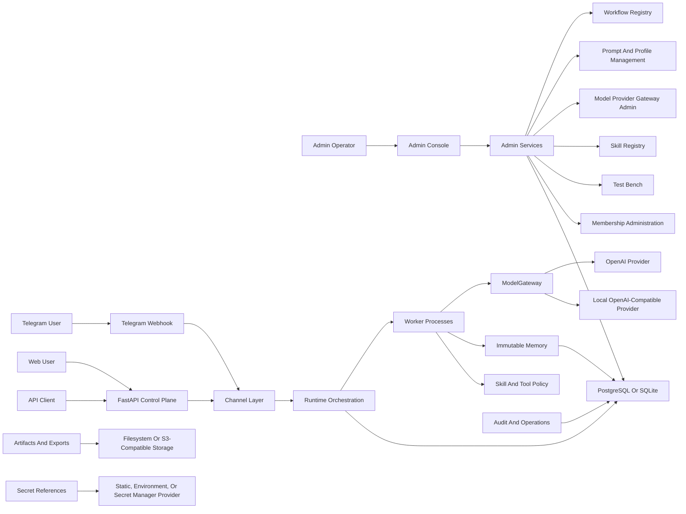

## Core Architectural Style

The platform uses a centrally orchestrated workflow runtime. Agents do not
freely mutate each other or make unmanaged external calls. Important actions
are converted into typed, auditable records:

- workflow drafts and published bundles
- workflow runs, run steps, leases, checkpoints, handoffs, approvals, side
  effects, and lineage links
- prompt versions and agent runtime profile versions
- model routing, prompt reference, skill binding, tool policy, outbound policy,
  secret reference, and credential requirement versions
- provider connection tests, catalog syncs, gateway operations, gateway
  attempts, and usage events
- immutable memory versions and current-head projections
- principal identities, invitations, tenant memberships, role grants, access
  history, and membership audit records
- channel requests, idempotency records, notification attempts, callbacks, and
  artifact grants
- audit timelines, traces, capture gaps, exports, and inspection access events
- reliability policies, admission decisions, retries, circuit breakers,
  compensation requests, dead letters, and capacity snapshots

The design favors durability, explicit policy, tenant isolation, and safe
operator visibility.

## Implemented Technology Stack

| Area | Current implementation |
| --- | --- |
| Language | Python 3.12 |
| Web framework | FastAPI with Starlette/Jinja2 template responses |
| UI style | Server-rendered admin pages plus small JavaScript files under `web_admin/static` |
| Data access | SQLAlchemy 2.x async ORM |
| Migrations | Alembic |
| Production database target | PostgreSQL 16+ |
| Local/test database default | `sqlite+aiosqlite:///./.data/multi_agent_platform.db` |
| Workflow dependencies | LangChain, LangGraph, `langgraph-checkpoint-postgres` |
| Auth | Auth0 JWT validation in production, local-principal mode for non-production |
| Secrets | Static, environment, or secret-manager provider abstraction |
| Artifacts | Filesystem or S3-compatible storage provider abstraction |
| Metrics | `prometheus-client` helpers and subsystem counters |
| Quality gates | Ruff, Ruff format check, mypy strict mode, pytest with 90 percent coverage gate |

## Spec-To-System Map

| Spec | Capability | Main source areas | Persistence |
| --- | --- | --- | --- |
| `001-platform-foundation` | API app, worker bootstrap, settings, DB/session, queue, tenants, storage, secrets, health | `api/`, `bootstrap/`, `config/settings.py`, `db/`, `runtime/health/`, `runtime/queue/`, `storage/`, `secrets/`, `tenancy/`, `workers/` | `0001_platform_foundation.py` |
| `002-platform-auth-access` | Auth0/local principals, role grants, support overrides, access audits, delegated credential metadata | `auth/`, `api/routers/auth.py`, `api/routers/admin_access.py`, `admin/support_overrides.py`, `audit/access.py` | `0002_auth_access_control.py` |
| `003-workflow-studio-registry` | Workflow drafts, revisions, validation, published bundles, sharing | `admin/workflow_registry/`, `api/routers/admin_workflows.py`, `api/routers/admin_workflow_ui.py`, `web_admin/templates/workflows/` | `0003_workflow_registry.py` |
| `004-durable-orchestration-runtime` | Runtime runs, execution bundle pins, steps, checkpoints, handoffs, approvals, side effects, lineage, leases | `runtime/orchestration/`, `api/routers/runtime_runs.py`, `workers/orchestration.py` | `0004_durable_orchestration_runtime.py` |
| `005-immutable-memory` | Append-only memory versions, heads, replay, diff, memory audit | `memory/`, `api/routers/memory.py` | `0005_immutable_memory.py` |
| `006-user-interaction-channels` | Web/API/Telegram run entrypoints, status, SSE, result, prompts, artifacts, callbacks, notifications | `channels/`, `api/routers/channel_runs.py`, `api/routers/web_run_ui.py`, `api/routers/telegram_webhook.py` | `0006_user_interaction_channels.py` |
| `007-model-skill-routing` | Versioned model routing, prompt references, skill bindings, tool/outbound/secret/credential policy, runtime pins | `config/`, `api/routers/admin_model_skill_config.py`, `web_admin/templates/model_skill_config/` | `0007_model_skill_routing.py` |
| `008-production-audit-debugging` | Timeline, traces, replay, lineage, redacted export, inspection UI | `audit/`, `api/routers/admin_run_inspection.py`, `web_admin/templates/runs/` | `0008_production_audit_debugging.py` |
| `009-reliability-scale-hardening` | Admission, quotas, fairness, retries, breakers, compensation, dead letters, capacity, reliability UI | `reliability/`, `api/routers/reliability_controls.py`, `web_admin/templates/reliability/` | `0009_reliability_scale_hardening.py` |
| `010-admin-console-shell` | Shared admin shell, scope selector, navigation, saved filters, common states | `api/routers/admin_console.py`, `api/ui/admin_console.py`, `web_admin/templates/admin_shell/` | `0010_admin_console_shell.py` |
| `011-model-provider-gateway` | Provider connections, provider tests, catalog sync, gateway invocation, adapter boundary | `model_providers/`, `api/routers/admin_model_providers.py`, `web_admin/templates/model_providers/` | `0011_model_provider_gateway.py` |
| `012-prompt-runtime-profiles` | Prompt library, prompt versions, prompt grants, agent runtime profiles, profile resolution, V2 gateway provenance | `prompts/`, `agents/`, `api/routers/admin_prompts.py`, `api/routers/admin_agent_profiles.py` | `0012_prompt_runtime_profiles.py`, `0013_prompt_runtime_profiles_v2_gateway_operations.py` |
| `013-admin-workflow-builder` | Guided workflow builder, graph preview, reference readiness, publish gate | `admin/workflow_registry/`, `api/schemas/workflow_registry.py`, `api/schemas/workflow_editor.py`, `web_admin/static/workflow_studio.js` | Reuses workflow tables |
| `014-skill-registry-lifecycle` and V2 | Skill package manifests, package versions, tenant grants, installations, credential readiness, smoke evidence, browser workflows | `admin/skill_registry/`, `api/routers/admin_skill_registry.py`, `web_admin/templates/skill_registry/` | `0014_skill_registry_lifecycle.py` |
| `015-agent-workflow-test-bench` | Test suites, cases, assertions, safe modes, run results, traces, publication evidence | `testing/agent_bench/`, `api/routers/admin_agent_tests.py`, `web_admin/templates/agent_tests/` | `0015_agent_workflow_test_bench.py` |
| `016-token-usage-cost-analytics` | Usage capture from ModelGateway, rollups, pricing, CSV exports, usage UI | `usage/`, `api/routers/admin_usage.py`, `web_admin/templates/usage/` | `0016_token_usage_cost_analytics.py` |
| `017-telegram-configuration-console` | Tenant Telegram enablement, link token audits, linked identity summaries, safe diagnostics | `admin/telegram_config/`, `api/routers/admin_telegram.py`, `web_admin/templates/telegram/` | `0017_telegram_configuration_console.py` |
| `018-user-tenant-membership-administration` | User and tenant membership administration, invitations, Auth0 principal linking, tenant memberships, role grant changes, principal suspension/reactivation, access history, safe membership audit | `admin/memberships/`, `api/routers/admin_memberships.py`, `api/schemas/memberships.py`, `api/ui/memberships.py`, `db/models/user_management.py`, `db/repositories/memberships.py`, `web_admin/templates/memberships/` | `0018_user_tenant_membership_administration.py` |
| `019-operations-console-logs-performance` | Operations dashboard, dependency status, capacity, providers, usage, redacted operational logs, exports | `operations/`, `api/routers/admin_operations.py`, `web_admin/templates/operations/` | No new tables; reuses existing records and artifact storage |

## Repository Shape

Unless otherwise stated, source paths named in later sections are relative to
`src/multi_agent_platform/`. Alembic migration filenames are relative to
`alembic/versions/`.

```text
src/multi_agent_platform/
  admin/                  Admin-facing domain services
  agents/                 Agent runtime profile domain and resolution
  api/                    FastAPI app, routers, schemas, UI view models
  audit/                  Audit capture, inspection, redaction, exports
  auth/                   Auth0, local principals, authz policy, dependencies
  bootstrap/              Container and worker bootstrap
  channels/               Web/API/Telegram channel facade and command handling
  config/                 Model, prompt, skill, tool, outbound, secret policy
  db/                     SQLAlchemy base, sessions, models, repositories
  memory/                 Immutable versioned memory subsystem
  model_providers/        Provider connections, adapters, probes, gateway
  observability/          Logging, metrics, tracing helpers
  operations/             Operations dashboard and redacted operational logs
  prompts/                Prompt library, validation, preview, audit
  reliability/            Admission, retries, breakers, quotas, dead letters
  runtime/                Health, queue, orchestration, bundles, versioning
  secrets/                Secret provider abstractions and implementations
  storage/                Artifact storage abstractions and implementations
  tenancy/                Scope context, middleware, tenant guards
  testing/agent_bench/    Agent and workflow test bench
  usage/                  Token usage and cost analytics
  web_admin/              Jinja templates and small static JavaScript/CSS
  workers/                Worker polling loops and orchestration worker

alembic/versions/         Sequential database migrations
docs/                     Design docs, runbooks, QA docs
specs/                    Spec Kit feature artifacts
tests/                    Unit, integration, contract, docs, performance tests
```

## FastAPI Control Plane

The FastAPI application is created by `multi_agent_platform.api.main:create_app`.
It mounts admin static files at `/admin/static`, installs `TenancyMiddleware`,
and includes routers for operations, auth, admin pages, runtime runs, memory,
channels, and Telegram.

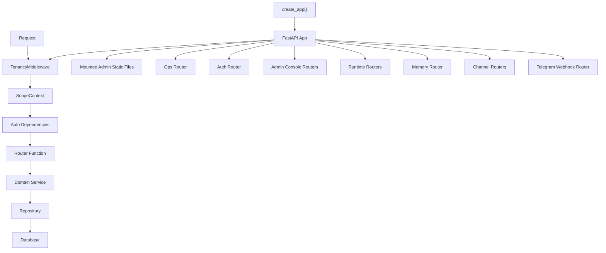

Important router groups:

- `/health/live`, `/health/ready`, `/version`, `/dependencies`
- `/auth/me`, `/auth/tenant-context/{tenant_id}`, local login/logout routes
- `/admin` shared shell, scope, and saved filter routes
- `/admin/workflows`, `/admin/workflows/ui`
- `/admin/config`
- `/admin/model-providers`
- `/admin/prompt-runtime/prompts`, `/admin/prompt-runtime/profiles`
- `/admin/skill-registry`
- `/admin/agent-tests`
- `/admin/usage`
- `/admin/memberships`
- `/admin/telegram`
- `/admin/operations`
- `/admin/runs`
- `/admin/reliability`
- `/runtime/runs`
- `/memory`
- `/runs` user-facing channel routes
- `/channels/telegram/webhook/{secret}`

Routers are intentionally thin. They resolve dependencies, validate schemas,
enforce principal and tenant context, and delegate behavior to domain services.

## Bootstrap, Settings, And Providers

`bootstrap/container.py` assembles the application container. The container is
stored on `app.state.container` during app lifespan and is shared by routes.

```mermaid
flowchart TD
    f3n1["Settings"] --> f3n2["build_container()"]
    f3n2["build_container()"] --> f3n3["Async SQLAlchemy Engine"]
    f3n2["build_container()"] --> f3n4["Session Factory"]
    f3n2["build_container()"] --> f3n5["Secret Provider"]
    f3n2["build_container()"] --> f3n6["Storage Provider"]
    f3n2["build_container()"] --> f3n7["Jinja2 Templates"]
    f3n2["build_container()"] --> f3n8["Auth0 Validator Or Local Principal Catalog"]
    f3n2["build_container()"] --> f3n9["ModelSkillConfigService Factory"]
    f3n2["build_container()"] --> f3n10["ModelProviderService Factory"]
    f3n2["build_container()"] --> f3n11["ModelGateway Factory"]
    f3n2["build_container()"] --> f3n12["PromptService Factory"]
    f3n2["build_container()"] --> f3n13["AgentProfileService Factory"]
    f3n2["build_container()"] --> f3n14["AuditDebuggingService Factory"]

    f3n5["Secret Provider"] --> f3n15["Static Secrets"]
    f3n5["Secret Provider"] --> f3n16["Environment Secrets"]
    f3n5["Secret Provider"] --> f3n17["Secret Manager References"]

    f3n6["Storage Provider"] --> f3n18["Filesystem Artifacts"]
    f3n6["Storage Provider"] --> f3n19["S3-Compatible Artifacts"]
```

`config/settings.py` owns the environment-driven configuration surface:

- app environment and process role
- API host and port
- Auth0 issuer, audience, domain, and JWT settings
- local-principal header and cookie names
- database URL
- secret provider kind and prefixes
- storage provider kind and artifact root
- worker and runtime lease intervals
- reliability limits, retries, breakers, pool pressure, and artifact throughput
- local model provider allowlist settings
- Telegram provider token reference and webhook secret
- channel callback and artifact URL settings
- metrics, tracing, commit SHA, and build time

Production refuses local-principal auth mode and requires production-sensitive
Telegram/callback secrets to be represented by safe secret references.

## Authentication, Authorization, And Tenancy

Authentication and authorization live in `auth/`. Tenancy context lives in
`tenancy/`.

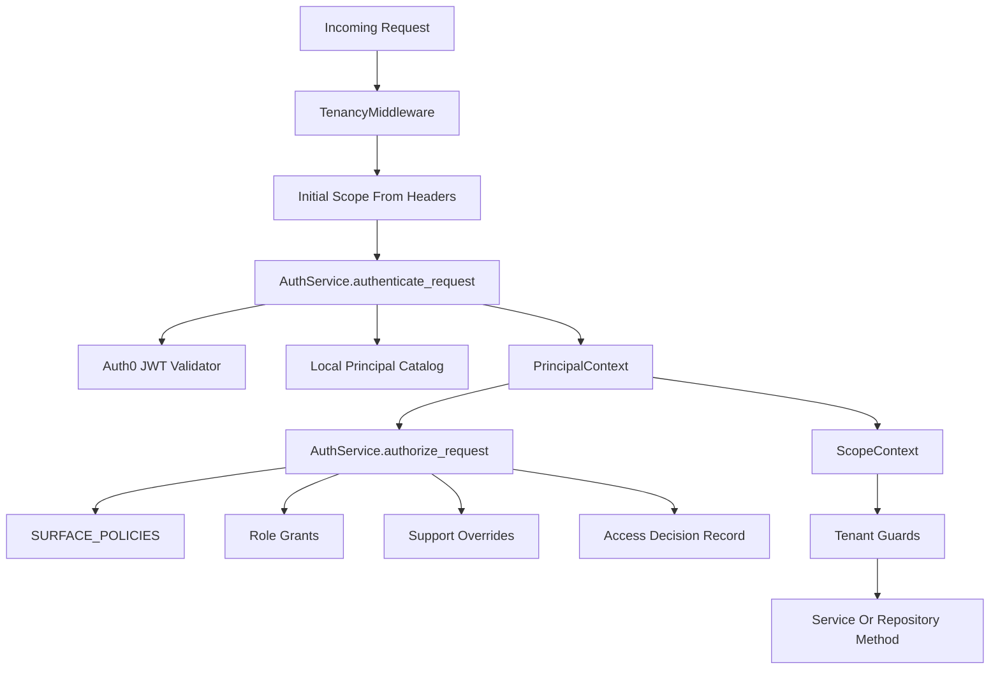

Main concepts:

- `PrincipalContext` describes the actor, auth provider, tenant, roles,
  permissions, scope, trace id, token metadata, and delegated credential link.
- `SURFACE_POLICIES` define route-level classifications and required roles or
  permissions.
- `require_authorized_principal` authenticates, authorizes, writes decision
  evidence, and attaches principal and scope data to request state.
- Auth0 and local-principal authentication merge current persisted active role
  grants and principal status on each protected request, so membership changes
  are visible on the next authorized action.
- `TenancyMiddleware` creates an initial `ScopeContext` from headers and adds
  `x-trace-id` to responses.
- `tenancy/guards.py` contains helper checks for tenant and platform scope.

Current access data tables:

- `principal_identities`
- `role_grants`
- `support_override_requests`
- `access_decision_records`
- `delegated_credential_links`
- `tenants`
- `tenant_limit_policies`

Tenant isolation is enforced by application-level scope guards, tenant columns,
repositories, and tests. The current migrations do not define PostgreSQL row
level security policies.

## Admin Console Shell

The admin shell is the shared UI wrapper for admin pages. It provides common
navigation, tenant scope selection, breadcrumbs, flash/common states, and saved
filters.

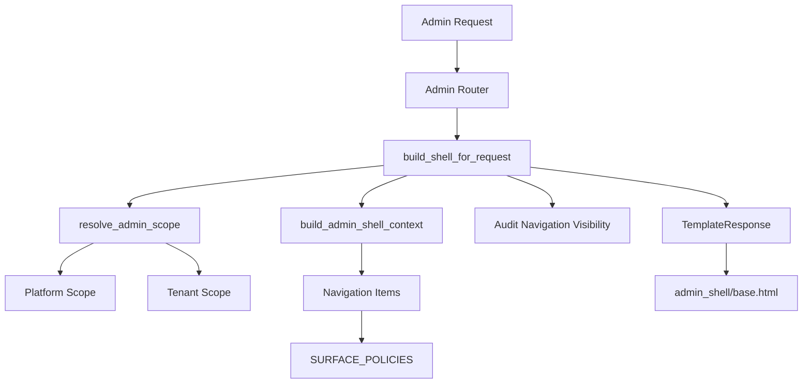

Main code:

- `api/routers/admin_console.py`
- `api/ui/admin_console.py`
- `db/models/admin_console.py`
- `db/repositories/admin_console.py`
- `web_admin/templates/admin_shell/`
- `web_admin/static/admin_shell.js`

The shell fails closed when authorization, tenant scope, or audit persistence is
not available. Saved filters are persisted in `admin_saved_filters`.

## Membership Administration

Membership Administration is the Spec `018` user and tenant administration
surface. It gives platform admins a cross-tenant user administration view and
tenant admins a tenant-scoped self-service view. Production authentication
remains Auth0-backed, local-principal mode remains available for development
and QA, and the platform does not accept or store passwords.

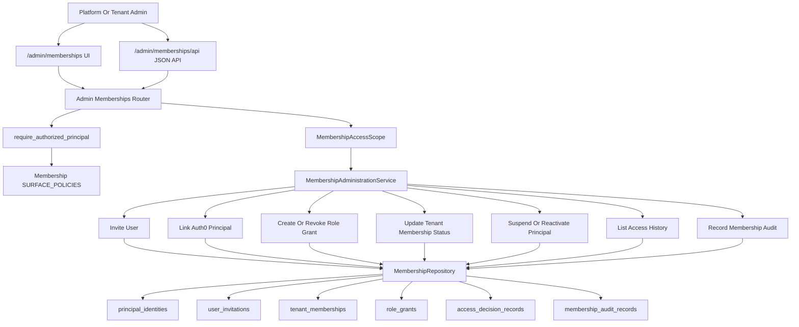

Platform admins can:

- list principal identities, invitations, memberships, role grants, access
  history, and membership audit records across tenants
- create idempotent invitations
- link or provision Auth0-backed principal identities
- create and revoke platform and tenant role grants
- suspend or reactivate principal identities
- inspect safe access history

Tenant admins can:

- invite users only into their own tenant
- create or revoke only tenant-scoped `tenant_user` and `tenant_admin` grants
  for their own tenant
- suspend, restore, or remove memberships in their own tenant
- view tenant-scoped principals, invitations, memberships, role grants, access
  history, and membership audit records

Safety rules:

- Cross-tenant access fails closed without confirming whether unauthorized data
  exists.
- Tenant admins cannot assign platform roles.
- Invitation emails are normalized for idempotency, but UI/API/audit summaries
  use masked email text and hashes.
- Auth0 subjects are displayed as safe masked identifiers.
- Principal suspension denies protected actions before role checks.
- Role grant creation and revocation retain durable records; revoked grants are
  marked revoked rather than deleted.

Main code:

- `admin/memberships/models.py`
- `admin/memberships/redaction.py`
- `admin/memberships/service.py`
- `api/routers/admin_memberships.py`
- `api/schemas/memberships.py`
- `api/ui/memberships.py`
- `db/models/user_management.py`
- `db/repositories/memberships.py`
- `web_admin/templates/memberships/index.html`

Important tables:

- `user_invitations`
- `tenant_memberships`
- `membership_audit_records`
- `principal_identities` from auth/access
- `role_grants` from auth/access
- `access_decision_records` from auth/access

## Workflow Registry And Guided Builder

The workflow registry stores workflow lineages, mutable drafts, immutable draft
revisions, validation results, published bundles, and sharing grants. The guided
builder extends that same model so admins can build workflows through forms and
graph views instead of raw JSON.

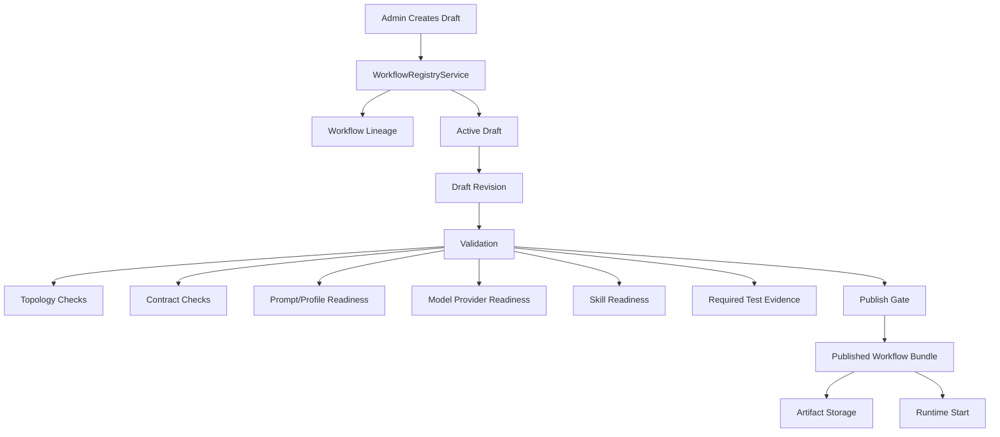

The primary authoring document is `WorkflowDraftDocument` in
`api/schemas/workflow_registry.py`. It includes:

- workflow metadata
- agent and sub-agent roles
- prompt/profile references
- skill installation references
- contracts
- graph nodes and edges
- join policies
- approval gates
- reusable subworkflow references
- test-suite requirements
- editor annotations

Important code:

- `admin/workflow_registry/service.py`
- `admin/workflow_registry/validation.py`
- `admin/workflow_registry/compiler.py`
- `admin/workflow_registry/reference_validation.py`
- `admin/workflow_registry/publish_gate.py`
- `admin/workflow_registry/graph_preview.py`
- `api/routers/admin_workflows.py`
- `api/routers/admin_workflow_ui.py`
- `web_admin/templates/workflows/`
- `web_admin/static/workflow_studio.js`

Important tables:

- `workflow_lineages`
- `workflow_drafts`
- `workflow_draft_revisions`
- `validation_results`
- `workflow_version_bundles`
- `registry_sharing_grants`

## Runtime Orchestration And Workers

The runtime owns workflow run records and the durable execution shape. It starts
runs against published workflow bundle ids, clones a run-specific execution
bundle, records timeline events, exposes inspection/cancel APIs, and provides
service methods for model gateway invocation and memory access.

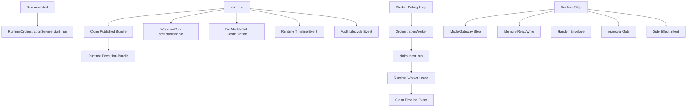

Important code:

- `runtime/orchestration/service.py`
- `runtime/orchestration/models.py`
- `runtime/orchestration/repository.py`
- `runtime/orchestration/contracts.py`
- `runtime/orchestration/handoffs.py`
- `runtime/orchestration/approvals.py`
- `runtime/orchestration/side_effects.py`
- `runtime/orchestration/checkpointing.py`
- `runtime/orchestration/lineage.py`
- `runtime/versioning.py`
- `workers/main.py`
- `workers/loops.py`
- `workers/orchestration.py`
- `bootstrap/worker.py`

Important tables:

- `runtime_execution_bundles`
- `runtime_workflow_runs`
- `runtime_run_steps`
- `runtime_worker_leases`
- `runtime_checkpoint_refs`
- `runtime_handoff_envelopes`
- `runtime_side_effect_intents`
- `runtime_approval_gates`
- `runtime_approval_decisions`
- `runtime_run_lineage`
- `runtime_timeline_events`
- `runtime_retention_policies`

Implementation note: the runtime data model and service seams are built for
durable LangGraph-style execution, checkpoints, handoffs, approvals, and model
gateway calls. The current `workers/orchestration.py` implementation claims
runnable work and records a claim event; full graph node execution is not
implemented in that worker file.

## User Interaction Channels

Channels normalize user interaction from Web UI, Web API, and Telegram into the
same run lifecycle.

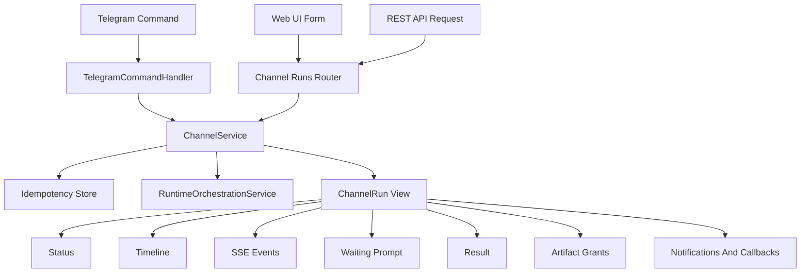

Channel-facing run states are:

- `queued`
- `running`
- `waiting-for-input`
- `completed`
- `failed`
- `canceled`

Main code:

- `channels/service.py`
- `channels/models.py`
- `channels/normalization.py`
- `channels/telegram.py`
- `channels/streaming.py`
- `channels/artifacts.py`
- `channels/callbacks.py`
- `channels/notifications.py`
- `api/routers/channel_runs.py`
- `api/routers/web_run_ui.py`
- `api/routers/telegram_webhook.py`

Important tables:

- `channel_sessions`
- `telegram_identity_links`
- `normalized_channel_requests`
- `channel_idempotency_records`
- `channel_timeline_events`
- `run_notification_subscriptions`
- `notification_delivery_attempts`
- `api_callback_registrations`
- `api_callback_delivery_attempts`
- `artifact_access_grants`
- `interaction_audit_records`

Implementation note: `ChannelService` currently keeps active channel run state
in process memory through the shared container state. The database models and
repositories define the persistent channel shape, but the channel router path in
the current code uses the process-local service facade for run status, results,
prompts, Telegram links, and simulated terminal states.

## Immutable Memory

The memory subsystem makes agent memory append-only. No memory version is
updated in place. Every accepted change creates a new immutable JSON snapshot
and advances a current-head projection.

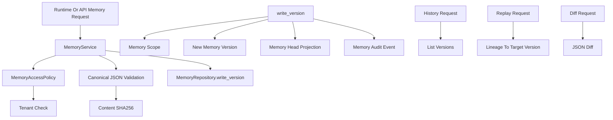

Memory scope identity is tenant plus workflow lineage plus agent key plus memory
key. Runtime memory writes include workflow run, run step, run bundle, bundle
digest, actor principal, trace id, and optional parent-child lineage.

Main code:

- `memory/service.py`
- `memory/models.py`
- `memory/policy.py`
- `memory/canonical.py`
- `memory/replay.py`
- `memory/diff.py`
- `memory/repository.py`
- `api/routers/memory.py`

Important tables:

- `memory_scopes`
- `memory_versions`
- `memory_heads`
- `memory_audit_events`
- `memory_archive_events`

## Model, Prompt, Skill, Tool, Secret, And Outbound Configuration

The `config/` package resolves runtime policy decisions. It is the bridge
between admin configuration and safe execution.

```mermaid
flowchart TD
    f10n1["Admin Config Change"] --> f10n2["ModelSkillConfigService"]
    f10n2["ModelSkillConfigService"] --> f10n3["Versioned Model Routing"]
    f10n2["ModelSkillConfigService"] --> f10n4["Versioned Prompt References"]
    f10n2["ModelSkillConfigService"] --> f10n5["Versioned Skill Bindings"]
    f10n2["ModelSkillConfigService"] --> f10n6["Versioned Tool Policies"]
    f10n2["ModelSkillConfigService"] --> f10n7["Versioned Outbound Policies"]
    f10n2["ModelSkillConfigService"] --> f10n8["Versioned Secret References"]
    f10n2["ModelSkillConfigService"] --> f10n9["Versioned Credential Requirements"]
    f10n10["Activation"] --> f10n11["Active Configuration Pointer"]

    f10n12["Run Acceptance"] --> f10n13["Pin Run Configuration"]
    f10n13["Pin Run Configuration"] --> f10n14["Resolved Execution Configuration"]
    f10n15["Runtime First Use"] --> f10n16["Model Prompt Resolution"]
    f10n15["Runtime First Use"] --> f10n17["Tool Policy Decision"]
    f10n15["Runtime First Use"] --> f10n18["Runtime Policy Decision"]
```

Model and prompt resolution precedence:

1. workflow-step override
2. agent override
3. workflow default
4. tenant/global default

Tool, skill, outbound, credential, and secret policies are fail-closed. For
example, a tool call must match active allowed-tool policy, outbound policy, and
credential requirements before it is considered allowed.

Main code:

- `config/service.py`
- `config/resolver.py`
- `config/policy.py`
- `config/model_skill.py`
- `config/validation.py`
- `config/provenance.py`
- `config/rollback.py`
- `api/routers/admin_model_skill_config.py`

Important tables:

- `model_provider_catalog_entries`
- `model_routing_versions`
- `prompt_reference_versions`
- `skill_binding_versions`
- `allowed_tool_policy_versions`
- `outbound_domain_policy_versions`
- `model_skill_secret_reference_versions`
- `tool_credential_requirement_versions`
- `active_configuration_pointers`
- `resolved_execution_configurations`
- `runtime_policy_decisions`
- `configuration_audit_records`
- `configuration_rollback_records`
- `run_configuration_migration_records`

## Model Provider Gateway

The model provider subsystem makes provider access explicit, testable, and
auditable. Runtime code should call `ModelGateway` instead of direct provider
SDKs or raw HTTP calls.

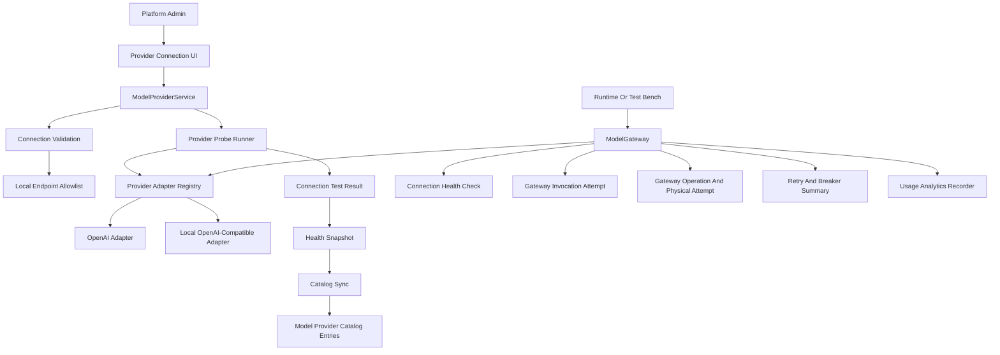

`GatewayInvocationContext` carries safe attribution:

- tenant
- principal
- workflow run and step
- workflow lineage and version
- test bench run or validation id
- idempotency key and operation identity
- agent key, sub-agent key, and agent kind
- agent profile version
- prompt version ids and prompt reference version ids
- execution mode
- model routing and profile provenance
- memory/tool/output contract metadata keys

Main code:

- `model_providers/service.py`
- `model_providers/gateway.py`
- `model_providers/models.py`
- `model_providers/adapters.py`
- `model_providers/openai_adapter.py`
- `model_providers/local_adapter.py`
- `model_providers/probes.py`
- `model_providers/catalog_sync.py`
- `model_providers/allowlist.py`
- `api/routers/admin_model_providers.py`
- `web_admin/templates/model_providers/`

Important tables:

- `model_provider_connections`
- `provider_model_definitions`
- `connection_tenant_visibility`
- `connection_test_results`
- `connection_health_snapshots`
- `catalog_sync_records`
- `gateway_invocation_attempts`
- `gateway_operations`
- `gateway_physical_attempts`
- `provider_probe_operations`
- `catalog_sync_operations`

Implementation note: the code contains the gateway, connection service,
container factories, provider adapters, gateway attempts, operation identities,
and usage capture. The Spec `011` task list still has unchecked items around
additional tests, admin probe throttling evidence, and deeper runtime worker
enforcement.

## Prompt Library And Agent Runtime Profiles

Prompt management and agent runtime profiles are implemented as versioned
admin-governed artifacts.

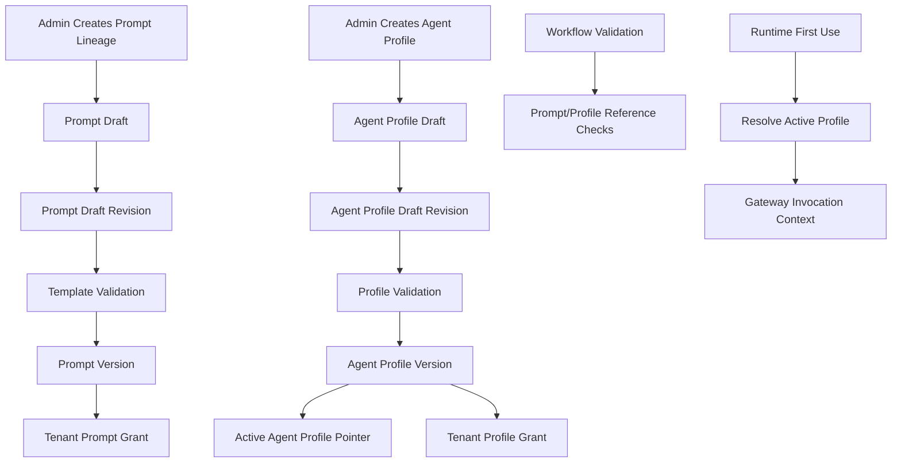

Prompt templates use `{{variable_name}}` placeholders and validation rejects
unsupported expressions, missing variables, unsafe fixture values, and stale
validation. Agent runtime profiles bind prompts, model routing hints, memory
policy, skill requirements, tool expectations, output contracts, and test suite
requirements.

Main code:

- `prompts/service.py`
- `prompts/validation.py`
- `prompts/template.py`
- `prompts/preview.py`
- `prompts/fixture_safety.py`
- `agents/service.py`
- `agents/resolution.py`
- `agents/validation.py`
- `agents/model_skill_integration.py`
- `api/routers/admin_prompts.py`
- `api/routers/admin_agent_profiles.py`

Important tables:

- `prompt_lineages`
- `prompt_drafts`
- `prompt_draft_revisions`
- `prompt_validation_results`
- `prompt_render_tests`
- `prompt_versions`
- `tenant_prompt_version_grants`
- `prompt_audit_records`
- `agent_runtime_profiles`
- `agent_profile_drafts`
- `agent_profile_draft_revisions`
- `agent_profile_validation_results`
- `agent_profile_versions`
- `tenant_profile_version_grants`
- `active_agent_profile_pointers`

## Skill Registry Lifecycle

The skill registry defines which skills are allowed, which tenants can install
them, and whether an installed skill can be bound to workflow runtime use.

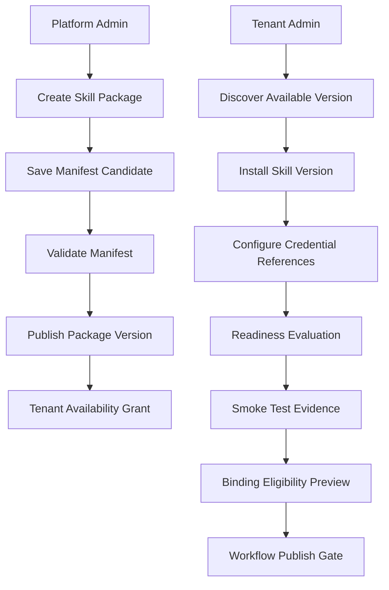

Skill manifests are declarative. They include:

- slug and semantic version
- approved entrypoint reference
- tool declarations
- action categories
- network requirements
- credential requirements
- runtime permissions
- test fixtures
- safe documentation
- artifact digests and compatibility metadata

Manifest validation rejects secret-like material, unsafe domains, unsupported
entrypoint types, invalid semantic versions, unknown tool references, and
malformed side-effect profiles.

Main code:

- `admin/skill_registry/service.py`
- `admin/skill_registry/manifest.py`
- `admin/skill_registry/validation.py`
- `admin/skill_registry/readiness.py`
- `admin/skill_registry/eligibility.py`
- `admin/skill_registry/quarantine.py`
- `admin/skill_registry/smoke_runner.py`
- `api/routers/admin_skill_registry.py`
- `web_admin/templates/skill_registry/`

Important tables:

- `skill_packages`
- `skill_package_versions`
- `skill_package_tenant_grants`
- `skill_installations`
- `skill_installation_credentials`
- `skill_installation_tests`
- `skill_quarantine_decisions`
- `skill_audit_records`

Implementation note: the current admin router uses a process-local
`SkillRegistryService` instance for browser/API lifecycle behavior, while the
SQLAlchemy models, repository, and migration define the persistent storage
shape for the skill registry.

## Agent And Workflow Test Bench

The test bench lets admins create reusable tests and run them in safe execution
modes before using profiles, prompts, subworkflows, or workflows in production.

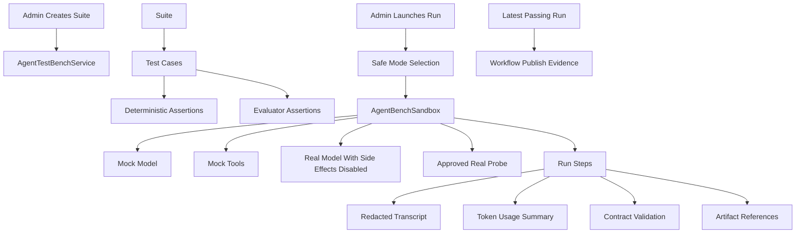

Main code:

- `testing/agent_bench/service.py`
- `testing/agent_bench/models.py`
- `testing/agent_bench/assertions.py`
- `testing/agent_bench/sandbox.py`
- `testing/agent_bench/redaction.py`
- `api/routers/admin_agent_tests.py`
- `web_admin/templates/agent_tests/`

Important tables:

- `agent_test_suites`
- `agent_test_cases`
- `agent_test_assertions`
- `agent_test_runs`
- `agent_test_run_steps`
- `agent_test_artifacts`
- `agent_test_publication_requirements`

Implementation note: Spec `015` has most tasks checked, but the task list still
shows unchecked work for publish requirement/gate routes, additional governance
audit evidence, and some UI/template redaction test coverage.

## Token Usage And Cost Analytics

Usage capture happens at the `ModelGateway` boundary. It stores safe metadata,
counts, latency, pricing estimates, and attribution. It does not store raw
prompts, completions, secrets, memory content, or unauthorized run content.

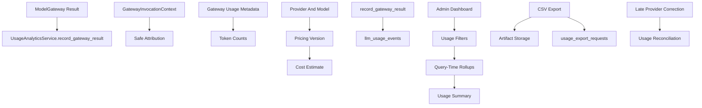

Supported rollup groups include hour, day, tenant, provider, model, workflow,
agent, sub-agent, prompt, execution mode, and principal.

Main code:

- `usage/service.py`
- `usage/models.py`
- `usage/pricing.py`
- `usage/export.py`
- `api/routers/admin_usage.py`
- `web_admin/templates/usage/`

Important tables:

- `llm_usage_events`
- `llm_pricing_versions`
- `llm_usage_rollups`
- `usage_export_requests`
- `usage_reconciliation_records`

## Telegram Configuration And Telegram Runtime Commands

Telegram support has two parts:

- runtime command handling for `/link`, `/run`, `/status`, `/approve`,
  `/reject`, `/resume`, `/cancel`, `/result`, `/artifacts`, and subscriptions
- admin configuration pages for safe readiness, tenant enablement, link token
  audits, identity summaries, and diagnostics

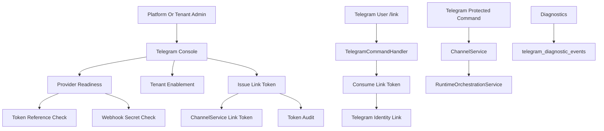

Main code:

- `admin/telegram_config/service.py`
- `admin/telegram_config/models.py`
- `admin/telegram_config/redaction.py`
- `channels/telegram.py`
- `api/routers/admin_telegram.py`
- `api/routers/telegram_webhook.py`
- `web_admin/templates/telegram/`

Important tables:

- `telegram_tenant_configs`
- `telegram_link_token_audits`
- `telegram_linked_identity_summaries`
- `telegram_diagnostic_events`
- `telegram_identity_links` from the channel subsystem

The admin console never stores or displays real bot tokens, webhook secrets,
private messages, raw prompts, run results, or unauthorized tenant data.

## Audit, Debugging, Replay, And Redaction

Audit and debugging turn runtime and admin behavior into safe evidence.

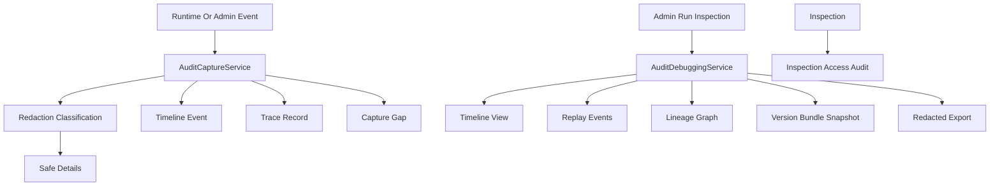

Security/governance audit write failures fail closed. Non-security trace gaps
can be represented as explicit unavailable markers.

Main code:

- `audit/service.py`
- `audit/capture.py`
- `audit/inspection.py`
- `audit/classification.py`
- `audit/export.py`
- `audit/access.py`
- `api/routers/admin_run_inspection.py`
- `web_admin/templates/runs/`

Important tables:

- `audit_events`
- `audit_timeline_events`
- `audit_runtime_trace_records`
- `audit_agent_handoff_traces`
- `audit_contract_validation_traces`
- `audit_memory_write_traces`
- `audit_tool_usage_traces`
- `audit_model_selection_traces`
- `audit_notification_delivery_traces`
- `audit_secret_access_records`
- `audit_version_bundle_snapshots`
- `audit_run_lineage_links`
- `audit_capture_gaps`
- `audit_inspection_access_events`
- `audit_debug_exports`
- `audit_redaction_classification_records`

## Reliability And Scale Controls

Reliability controls help the platform avoid unsafe overload and recover work
without duplicating irreversible side effects.

```mermaid
flowchart TD
    f18n1["New Work"] --> f18n2["Admission Decision"]
    f18n2["Admission Decision"] --> f18n3["Accepted"]
    f18n2["Admission Decision"] --> f18n4["Queued"]
    f18n2["Admission Decision"] --> f18n5["Delayed"]
    f18n2["Admission Decision"] --> f18n6["Throttled"]
    f18n2["Admission Decision"] --> f18n7["Rejected"]

    f18n8["Worker Failure"] --> f18n9["Recovery Classification"]
    f18n9["Recovery Classification"] --> f18n10["Retry Schedule"]
    f18n9["Recovery Classification"] --> f18n11["Compensation Request"]
    f18n9["Recovery Classification"] --> f18n12["Dead Letter"]

    f18n13["Dependency Failure"] --> f18n14["Circuit Breaker"]
    f18n14["Circuit Breaker"] --> f18n15["Closed"]
    f18n14["Circuit Breaker"] --> f18n16["Open"]
    f18n14["Circuit Breaker"] --> f18n17["Half Open"]

    f18n18["Operators"] --> f18n19["Reliability UI"]
    f18n19["Reliability UI"] --> f18n20["Policies"]
    f18n19["Reliability UI"] --> f18n21["Breakers"]
    f18n19["Reliability UI"] --> f18n22["Retries"]
    f18n19["Reliability UI"] --> f18n23["Compensations"]
    f18n19["Reliability UI"] --> f18n24["Dead Letters"]
```

Main code:

- `reliability/service.py`
- `reliability/admission.py`
- `reliability/fairness.py`
- `reliability/quotas.py`
- `reliability/retries.py`
- `reliability/breakers.py`
- `reliability/compensation.py`
- `reliability/dead_letters.py`
- `reliability/autoscaling.py`
- `reliability/leases.py`
- `reliability/partitioning.py`
- `reliability/pooling.py`
- `api/routers/reliability_controls.py`
- `web_admin/templates/reliability/`

Important tables:

- `reliability_policies`
- `reliability_admission_decisions`
- `reliability_tenant_quota_counters`
- `reliability_fairness_windows`
- `reliability_capacity_snapshots`
- `reliability_worker_pool_scaling_decisions`
- `reliability_retry_schedules`
- `reliability_circuit_breakers`
- `reliability_circuit_breaker_events`
- `reliability_compensation_requests`
- `reliability_dead_letters`
- `reliability_operational_control_changes`
- `reliability_artifact_throughput_windows`
- `reliability_failure_injection_records`

## Operations Console

The operations console aggregates existing safe operational records. It does
not read raw application log files and does not introduce new tables in Spec
`019`.

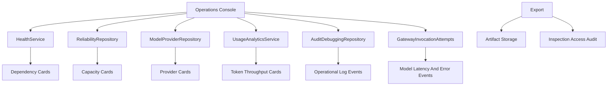

The dashboard shows system health, worker capacity, DB pool pressure, object
storage, model providers, Telegram/channels, reliability state, request
latency, run throughput, token throughput, and error rate. The log view
supports filters for tenant, run, trace id, component, severity, status,
dependency, and time range.

Main code:

- `operations/service.py`
- `operations/models.py`
- `operations/redaction.py`
- `operations/export.py`
- `api/routers/admin_operations.py`
- `api/ui/operations.py`
- `web_admin/templates/operations/index.html`

## Persistence, Storage, And Secrets

Database model registration is centralized in `db/models/__init__.py`. The
source tree separates SQLAlchemy models from repositories so query logic does
not live in routers.

```mermaid
flowchart TD
    f20n1["Domain Service"] --> f20n2["Repository"]
    f20n2["Repository"] --> f20n3["SQLAlchemy Async Session"]
    f20n3["SQLAlchemy Async Session"] --> f20n4["Database"]

    f20n1["Domain Service"] --> f20n5["Storage Provider"]
    f20n5["Storage Provider"] --> f20n6["Filesystem"]
    f20n5["Storage Provider"] --> f20n7["S3-Compatible Object Store"]

    f20n1["Domain Service"] --> f20n8["Secret Provider"]
    f20n8["Secret Provider"] --> f20n9["Static Provider"]
    f20n8["Secret Provider"] --> f20n10["Environment Provider"]
    f20n8["Secret Provider"] --> f20n11["Secret Manager Provider"]

    f20n12["Database Rows"] --> f20n13["Metadata And References"]
    f20n14["Object Storage"] --> f20n15["Large Artifacts And Exports"]
    f20n8["Secret Provider"] --> f20n16["Secret Material"]
```

General rule: PostgreSQL stores durable metadata, identifiers, status, lineage,
safe summaries, and references. Large artifacts and exports go to the storage
provider. Secret material remains behind the secret provider boundary and is
represented inside the database by safe secret references.

Alembic migrations currently present:

- `0001_platform_foundation.py`
- `0002_auth_access_control.py`
- `0003_workflow_registry.py`
- `0004_durable_orchestration_runtime.py`
- `0005_immutable_memory.py`
- `0006_user_interaction_channels.py`
- `0007_model_skill_routing.py`
- `0008_production_audit_debugging.py`
- `0009_reliability_scale_hardening.py`
- `0010_admin_console_shell.py`
- `0011_model_provider_gateway.py`
- `0012_prompt_runtime_profiles.py`
- `0013_prompt_runtime_profiles_v2_gateway_operations.py`
- `0014_skill_registry_lifecycle.py`
- `0015_agent_workflow_test_bench.py`
- `0016_token_usage_cost_analytics.py`
- `0017_telegram_configuration_console.py`
- `0018_user_tenant_membership_administration.py`

## End-To-End Sequence: Membership Administration

```mermaid
sequenceDiagram
    autonumber
    participant Admin as Platform Or Tenant Admin
    participant UI as Membership UI Or API
    participant Auth as Auth And Tenancy
    participant Service as MembershipAdministrationService
    participant Repo as MembershipRepository
    participant DB as Database

    Admin->>UI: Open /admin/memberships or call /admin/memberships/api
    UI->>Auth: Authenticate and authorize membership surface
    Auth->>DB: Merge principal status and active role grants
    Auth->>DB: Write access decision record
    Auth-->>UI: PrincipalContext with platform or tenant scope
    UI->>Service: Build MembershipAccessScope
    alt Invite user
        Service->>Service: Normalize email and check role eligibility
        Service->>Repo: create_or_replay_invitation
        Repo->>DB: Insert or return pending user_invitations row
        Service->>Repo: add_audit_record
        Repo->>DB: Insert membership_audit_records row
    else Link Auth0 principal
        Service->>Service: Require platform admin
        Service->>Repo: upsert_principal
        Repo->>DB: Create or update principal_identities row
        Service->>Repo: add_audit_record
    else Create or revoke role grant
        Service->>Service: Enforce platform/tenant role guardrails
        Service->>Repo: create_role_grant or revoke_role_grant
        Repo->>DB: Update role_grants and tenant_memberships as needed
        Service->>Repo: add_audit_record
    else Suspend, reactivate, or update membership
        Service->>Repo: update principal or tenant membership status
        Repo->>DB: Update principal_identities or tenant_memberships
        Service->>Repo: add_audit_record
    end
    UI-->>Admin: Render masked emails, safe subject display, history, and audit summaries
```

## End-To-End Sequence: Web Or API Run

```mermaid
sequenceDiagram
    autonumber
    participant User as User or API Client
    participant API as FastAPI
    participant Auth as Auth and Tenancy
    participant Channel as ChannelService
    participant Runtime as RuntimeOrchestrationService
    participant Config as ModelSkillConfigService
    participant Audit as AuditCaptureService
    participant DB as Database

    User->>API: POST /runs with workflow id, inputs, idempotency key
    API->>Auth: Authenticate and authorize request
    Auth->>DB: Read role grants and write access decision
    Auth-->>API: PrincipalContext and ScopeContext
    API->>Channel: start_run(actor, workflow_id, inputs)
    Channel->>Channel: Rate-limit and idempotency check
    Channel->>Runtime: start_run(published_workflow_version_id, input)
    Runtime->>Runtime: Clone published bundle for this run
    Runtime->>DB: Create workflow run and execution bundle
    Runtime->>Config: Pin run-level configuration
    Config->>DB: Create resolved execution configuration
    Runtime->>DB: Add runtime timeline start event
    Runtime->>Audit: Record accepted lifecycle event
    Audit->>DB: Create audit timeline event
    Runtime-->>Channel: WorkflowRun
    Channel->>Channel: Create user-visible ChannelRun
    Channel-->>API: Run id and status/timeline/event URLs
    API-->>User: 202 Accepted
```

## End-To-End Sequence: Worker, Agent, And Sub-Agent Flow

This sequence shows the intended controlled execution path from a runnable
workflow through an agent and sub-agent. It matches the runtime service seams
and data model. The current orchestration worker claims work and records claim
events; full graph execution is represented by the service/domain boundaries.

```mermaid
sequenceDiagram
    autonumber
    participant Worker as Worker Polling Loop
    participant Repo as Runtime Repository
    participant Runtime as RuntimeOrchestrationService
    participant Parent as Parent Agent Step
    participant Gateway as ModelGateway
    participant Provider as LLM Provider
    participant Memory as Immutable Memory
    participant Child as Sub-Agent Step
    participant Audit as Audit and Timeline

    Worker->>Repo: claim_next_run(worker_id, lease_seconds)
    Repo-->>Worker: Lease for runnable workflow run
    Worker->>Repo: Create claim timeline event
    Worker->>Runtime: Execute next runnable graph step
    Runtime->>Parent: Build parent agent context from pinned bundle and profile
    Parent->>Memory: Read current memory head if profile allows
    Memory-->>Parent: Current immutable memory version or empty head
    Parent->>Gateway: invoke(connection, model, messages, GatewayInvocationContext)
    Gateway->>Repo: Read provider connection and catalog state
    Gateway->>Provider: Chat completion through approved adapter
    Provider-->>Gateway: Content, latency, usage metadata, provider status
    Gateway->>Repo: Record gateway attempt and operation evidence
    Gateway->>Repo: Record retry and breaker summaries
    Gateway->>Repo: Record usage event through UsageAnalyticsService
    Gateway-->>Parent: GatewayResult
    Parent->>Runtime: Create handoff envelope for sub-agent
    Runtime->>Audit: Record handoff and contract validation trace
    Runtime->>Child: Deliver validated handoff payload
    Child->>Gateway: invoke with sub_agent_key in context
    Gateway-->>Child: GatewayResult
    Child->>Memory: Write new immutable memory version if allowed
    Memory->>Repo: Persist version and advance head
    Runtime->>Audit: Record step completion and safe summaries
    Runtime->>Repo: Update run/step status and checkpoints
```

## End-To-End Sequence: Telegram Message To Workflow

```mermaid
sequenceDiagram
    autonumber
    participant Telegram as Telegram
    participant API as FastAPI Telegram Webhook
    participant Handler as TelegramCommandHandler
    participant Channel as ChannelService
    participant Runtime as RuntimeOrchestrationService
    participant User as Telegram User

    Telegram->>API: POST /channels/telegram/webhook/{secret}
    API->>Handler: handle_update(provided_secret, update)
    Handler->>Handler: Validate webhook secret and suppress duplicate update ids
    alt /link command
        Handler->>Channel: consume_telegram_link_token(token, user_id, chat_id)
        Channel-->>Handler: Linked Telegram identity
        Handler-->>Telegram: Linked confirmation
    else Protected /run command
        Handler->>Channel: telegram_actor(user_id, chat_id)
        Channel-->>Handler: ChannelActor for linked identity
        Handler->>Channel: start_run(actor, workflow_id, text input)
        Channel->>Runtime: start_run(...)
        Runtime-->>Channel: WorkflowRun
        Channel-->>Handler: RunInvocationResult
        Handler-->>Telegram: Run id and queued state
    else /status, /approve, /cancel, /result, /artifacts
        Handler->>Channel: Perform requested run action
        Channel-->>Handler: Status, decision, result, or artifact metadata
        Handler-->>Telegram: Safe response text
    end
```

## End-To-End Sequence: Human Approval And Resume

```mermaid
sequenceDiagram
    autonumber
    participant Runtime as Runtime
    participant Channel as ChannelService
    participant User as User
    participant API as FastAPI
    participant Audit as Audit
    participant DB as Database

    Runtime->>DB: Persist approval gate and paused/waiting state
    Runtime->>Audit: Record waiting lifecycle event
    Channel->>User: Shows waiting prompt in status/timeline
    User->>API: POST /runs/{run_id}/approvals/{prompt_id}/decision
    API->>Channel: decide_prompt(action, prompt_version, payload, idempotency_key)
    Channel->>Channel: Validate prompt id, version, and allowed action
    alt Approve or resume
        Channel->>DB: Runtime resume path updates run state when integrated
        Channel-->>User: Decision accepted, run running
    else Reject
        Channel-->>User: Decision accepted, run failed
    else Cancel
        Channel->>Runtime: cancel_run(...)
        Runtime->>Audit: Record cancelled lifecycle event
        Channel-->>User: Run canceled
    end
```

## End-To-End Sequence: Workflow Authoring And Publication

```mermaid
sequenceDiagram
    autonumber
    participant Admin as Admin
    participant UI as Admin Workflow UI
    participant Service as WorkflowRegistryService
    participant Validator as Validation And Publish Gate
    participant Storage as Artifact Storage
    participant DB as Database

    Admin->>UI: Create or edit workflow draft
    UI->>Service: create_draft or save_draft(base_revision_number)
    Service->>DB: Persist active draft and immutable revision
    Admin->>UI: Validate draft
    UI->>Service: validate_draft
    Service->>Validator: validate_authoring_document
    Validator->>Validator: Check roles, contracts, nodes, edges, joins, approvals
    Validator->>Validator: Check prompt/profile/provider/skill/test readiness
    Service->>DB: Persist validation result and findings
    Admin->>UI: Evaluate publish gate
    UI->>Service: evaluate_publish_gate
    Service->>Validator: Combine validation, references, and required tests
    Validator-->>Service: ready, blocked, stale, or unauthorized
    Admin->>UI: Publish
    UI->>Service: publish_draft(validation_result_id, publish_gate_id)
    Service->>Storage: Store compiled bundle artifact
    Service->>DB: Persist workflow_version_bundle
    Service-->>UI: Published immutable version
```

## End-To-End Sequence: Model Provider Setup And Runtime Use

```mermaid
sequenceDiagram
    autonumber
    participant Admin as Platform Admin
    participant UI as Model Provider UI
    participant Service as ModelProviderService
    participant Probe as ProviderProbeRunner
    participant Adapter as Provider Adapter
    participant Catalog as Catalog Synchronizer
    participant Gateway as ModelGateway
    participant Usage as UsageAnalyticsService
    participant DB as Database

    Admin->>UI: Create provider connection
    UI->>Service: save_connection(provider type, models, visibility, secret refs)
    Service->>DB: Persist connection and model definitions
    Admin->>UI: Test connection
    UI->>Service: test_connection
    Service->>Probe: Run safe provider probe
    Probe->>Adapter: Probe using approved adapter
    Adapter-->>Probe: Safe outcome, latency, reason
    Probe-->>Service: ProviderTestSummary
    Service->>DB: Persist test result and health snapshot
    Admin->>UI: Sync catalog
    UI->>Catalog: Create or update selectable catalog entries
    Catalog->>DB: Persist catalog sync records

    Gateway->>DB: Load healthy active connection
    Gateway->>Adapter: Invoke model
    Adapter-->>Gateway: Content, usage, latency, normalized error
    Gateway->>DB: Persist gateway attempt and operation evidence
    Gateway->>Usage: record_gateway_result
    Usage->>DB: Persist llm_usage_event
```

## End-To-End Sequence: Skill Lifecycle And Binding

```mermaid
sequenceDiagram
    autonumber
    participant Platform as Platform Admin
    participant Tenant as Tenant Admin
    participant Skill as SkillRegistryService
    participant Workflow as Workflow Builder
    participant Gate as Publish Gate

    Platform->>Skill: Create package
    Platform->>Skill: Save manifest candidate
    Platform->>Skill: Validate candidate
    Skill-->>Platform: Passed or findings
    Platform->>Skill: Publish immutable package version
    Platform->>Skill: Grant tenant availability
    Tenant->>Skill: Install granted skill version
    Tenant->>Skill: Configure credential references
    Tenant->>Skill: Refresh smoke/readiness evidence
    Tenant->>Skill: Preview binding eligibility
    Skill-->>Tenant: Allowed or reason codes
    Tenant->>Workflow: Add skill installation reference to workflow role
    Workflow->>Gate: Validate publish readiness
    Gate->>Skill: Check installed skill evidence
    Gate-->>Workflow: Ready or blocked findings
```

## End-To-End Sequence: Test Bench And Publish Evidence

```mermaid
sequenceDiagram
    autonumber
    participant Admin as Admin
    participant Router as Agent Test Router
    participant Bench as AgentTestBenchService
    participant Sandbox as AgentBenchSandbox
    participant DB as Database
    participant Workflow as Workflow Publish Gate

    Admin->>Router: Create suite and cases
    Router->>Bench: create_suite, create_case
    Bench->>DB: Persist suite, cases, assertions
    Admin->>Router: Launch test run
    Router->>Bench: launch_run(safe_mode, target_version)
    Bench->>DB: Create running test run
    Bench->>Sandbox: Execute cases in safe mode
    Sandbox-->>Bench: Steps, assertions, redacted transcript, usage summary
    Bench->>DB: Persist run status and run steps
    Admin->>Router: Inspect results
    Router-->>Admin: Summary, traces, artifacts, pass/fail
    Workflow->>Bench: evidence_summary(target)
    Bench->>DB: Find latest passing required suite runs
    Bench-->>Workflow: Required test evidence summary
```

## End-To-End Sequence: Operations Dashboard

```mermaid
sequenceDiagram
    autonumber
    participant Admin as Platform Admin Or Auditor
    participant Router as Operations Router
    participant Ops as OperationsConsoleService
    participant Health as HealthService
    participant Rel as ReliabilityRepository
    participant Usage as UsageAnalyticsService
    participant Audit as AuditDebuggingRepository
    participant Providers as ModelProviderRepository
    participant Storage as Storage Provider

    Admin->>Router: GET /admin/operations
    Router->>Ops: dashboard(access_scope, filters)
    Ops->>Health: dependency_status
    Ops->>Rel: latest capacity snapshot
    Ops->>Providers: list provider connections
    Ops->>Usage: summarize_usage
    Ops->>Audit: query timeline and trace records
    Ops-->>Router: Redacted dashboard snapshot
    Router-->>Admin: Server-rendered operations page

    Admin->>Router: Export filtered logs
    Router->>Ops: export_logs(access_scope, filters)
    Ops->>Storage: Store CSV export
    Ops->>Audit: Record inspection access audit
    Ops-->>Router: Export result with artifact URI
```

## Data Ownership Summary

| Bounded area | Owns |
| --- | --- |
| Foundation | tenants, tenant limits, queue jobs, job leases, artifacts, secret references, health |
| Auth/access | principals, role grants, support overrides, delegated credentials, access decisions |
| Membership administration | user invitations, tenant memberships, membership audit records, membership UI/API snapshots, masked email and subject display, principal suspension/reactivation workflows |
| Workflow registry | lineages, drafts, revisions, validations, published bundles, sharing grants |
| Runtime orchestration | execution bundles, workflow runs, steps, leases, checkpoints, handoffs, side effects, approvals, lineage, timeline |
| Memory | memory scopes, immutable versions, heads, memory audit, archive markers |
| Channels | channel sessions, normalized requests, idempotency, notifications, callbacks, artifact grants, Telegram identity links |
| Model-skill config | routing, prompt references, skill bindings, tool/outbound/credential/secret policies, active pointers, runtime decisions |
| Provider gateway | provider connections, model definitions, visibility, tests, health snapshots, catalog sync, gateway attempts and operations |
| Prompt/profile | prompt lineages, drafts, versions, grants, profile drafts, profile versions, active profile pointers |
| Skill registry | skill packages, package versions, tenant grants, installations, credentials, smoke tests, quarantine, audit |
| Test bench | suites, cases, assertions, runs, run steps, artifacts, publication requirements |
| Usage | usage events, pricing versions, rollups, exports, reconciliation records |
| Telegram config | tenant configs, token audits, linked identity summaries, diagnostics |
| Audit/debugging | append-only audit events, timelines, traces, gaps, snapshots, lineage links, exports, redaction records |
| Reliability | policies, admission decisions, quotas, fairness, retries, breakers, compensation, dead letters, capacity |
| Operations | no new Spec `019` tables; aggregates health, audit, reliability, provider, gateway, usage, and Telegram records |

## Development And Verification

Common commands from `AGENTS.md` and `pyproject.toml`:

```bash
uv sync
uv run alembic upgrade head
uv run uvicorn multi_agent_platform.api.main:app --reload
uv run python -m multi_agent_platform.workers.main
uv run ruff check .
uv run ruff format --check .
uv run mypy src
uv run pytest --cov=src/multi_agent_platform --cov-report=term-missing --cov-fail-under=90
```

Tests are organized by architectural boundary:

- `tests/unit`: domain, service, schema, policy, model, and repository tests
- `tests/integration`: API, database, runtime, workers, channels, storage,
  auth, provider, usage, Telegram, and operations flows
- `tests/contract`: OpenAPI and protocol contracts
- `tests/performance`: runtime, memory, audit, channel, reliability,
  operations, prompt runtime, and usage performance checks
- `tests/docs`: documentation, runbook, and review evidence checks
- `tests/fixtures`: deterministic test data and subsystem fixtures

## Current Implementation Notes And Gaps

These notes are included so readers do not confuse target architecture with
current behavior:

- The system is a modular monolith, not a set of independently deployed
  microservices.
- The production target is PostgreSQL, but local/test settings default to
  SQLite through the same SQLAlchemy model layer.
- Tenant isolation is application-enforced through scopes, guards, table
  columns, repository filters, and tests. PostgreSQL RLS is not encoded in the
  current migrations.
- The admin frontend is server-rendered Jinja2 plus small static JavaScript. No
  separate frontend build exists.
- Spec `018` is implemented as a dedicated Membership Administration surface.
  It reuses auth/access `principal_identities`, `role_grants`, and
  `access_decision_records`, and adds `user_invitations`,
  `tenant_memberships`, and `membership_audit_records`.
- Spec `011` has substantial implementation in `model_providers/`, the
  container, admin routes, and database models, but the task file still shows
  incomplete test and hardening tasks around provider probes, direct-call
  guardrails, runtime worker gateway enforcement, and performance coverage.
- Spec `015` has substantial test bench implementation, but the task file still
  shows incomplete work around publish requirement/gate routes, additional
  governance audit evidence, and redaction test coverage.
- `ChannelService` and the admin skill registry service are currently
  process-local service facades for active browser/API flows, even though
  persistent database models and repositories exist for their long-term storage
  shapes.
- Runtime orchestration has durable records and service methods for bundles,
  pins, memory, model gateway calls, handoffs, approvals, and side effects.
  The current orchestration worker implementation claims runs and records claim
  evidence, but does not yet execute full graph node logic in the worker file.

## Glossary

| Term | Meaning |
| --- | --- |
| Agent | A role in a workflow that performs work using prompts, model routing, memory, and allowed skills/tools. |
| Sub-agent | A nested or delegated agent role inside a workflow. Handoffs to sub-agents are explicit and contract-validated. |
| Principal identity | Persisted user identity metadata for Auth0, local-principal, or system actors. Passwords are not stored. |
| User invitation | Platform-scoped or tenant-scoped invitation with normalized operational email, masked display, requested roles, status, expiry, and idempotency metadata. |
| Tenant membership | Relationship between a principal identity and a tenant, with active, suspended, or removed status. |
| Role grant | Durable role assignment for platform scope or tenant scope. Revocation marks the grant revoked rather than deleting it. |
| Membership audit record | Safe append-only summary of membership administration allows, denials, invitations, identity links, role changes, and status changes. |
| Workflow lineage | The stable identity for a workflow across drafts and published versions. |
| Workflow draft | A mutable authoring record for a workflow. |
| Draft revision | An immutable snapshot of a workflow draft after a save. |
| Published workflow bundle | An immutable, runtime-ready version of a workflow stored with compiled metadata and artifact references. |
| Runtime execution bundle | A per-run clone of the published workflow bundle, pinned for reproducibility. |
| Handoff envelope | A typed payload transfer from one agent/sub-agent step to another, validated against contracts. |
| Approval gate | A runtime pause that requires human approval, rejection, resume, or cancellation. |
| Side-effect intent | A record created before external side effects so retries and recovery can be safe. |
| Memory scope | Tenant plus workflow lineage plus agent key plus memory key. |
| Memory version | Immutable JSON snapshot for a memory scope. |
| Current head | Fast projection pointing to the latest memory version for a scope. |
| ModelGateway | The only approved runtime boundary for model provider calls. |
| Prompt version | Immutable published prompt content and variable declaration. |
| Agent runtime profile | Versioned runtime policy for an agent key, including prompt references, model hints, memory policy, skills, and tests. |
| Skill package | Platform-approved declarative package describing tools, permissions, credentials, fixtures, and safe docs. |
| Skill installation | Tenant-pinned installation of a skill package version. |
| Publish gate | Validation decision that blocks or allows workflow publication based on validation, reference readiness, skill readiness, and tests. |
| Usage event | Content-safe record of one model invocation's token counts, cost estimate, latency, and attribution. |
| Trace id | Correlation id carried through API, runtime, audit, and operations surfaces. |
