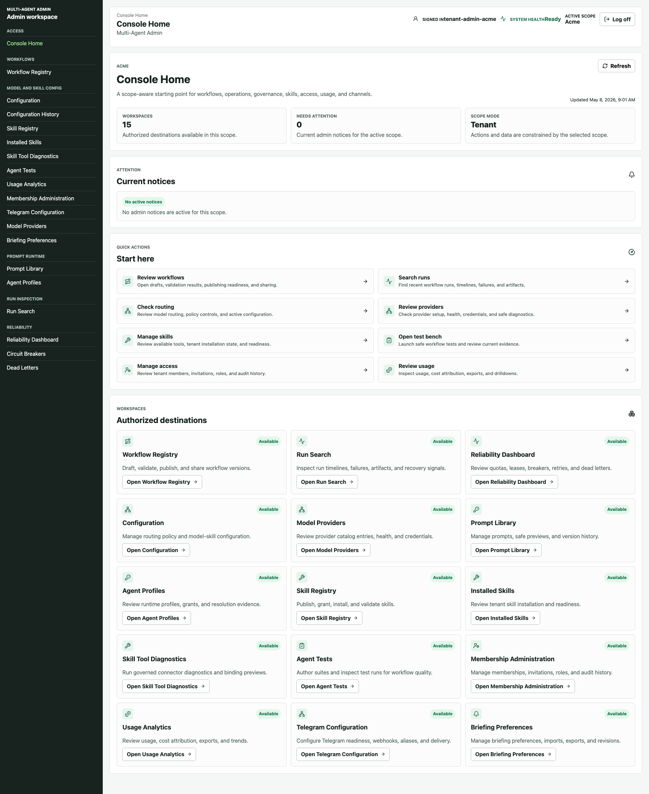
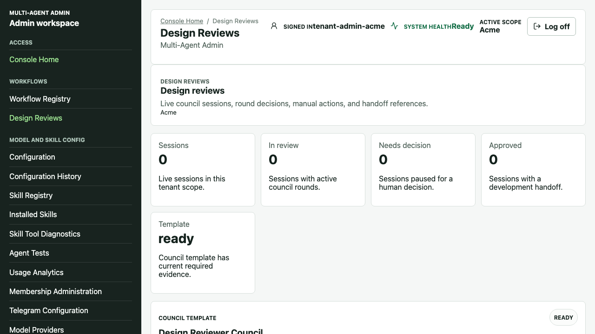
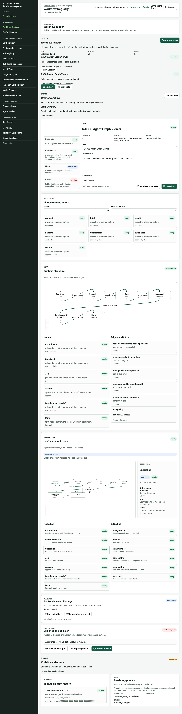
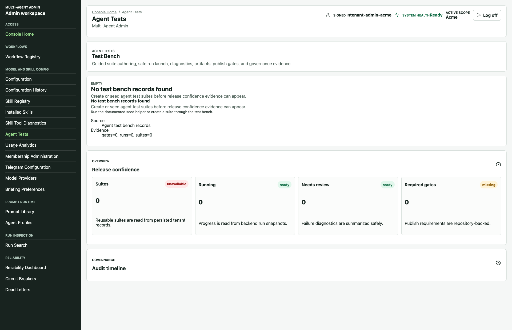
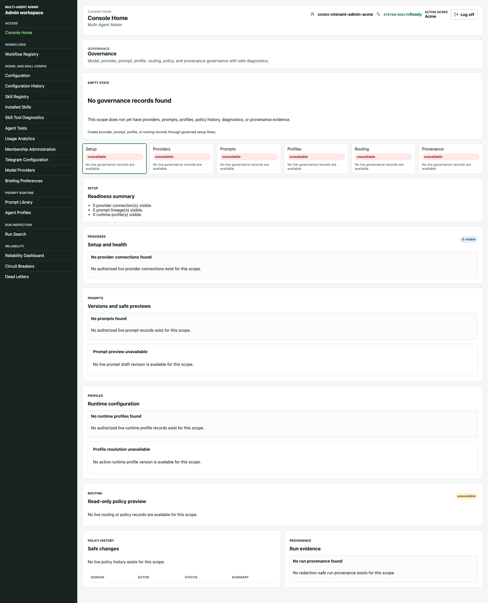
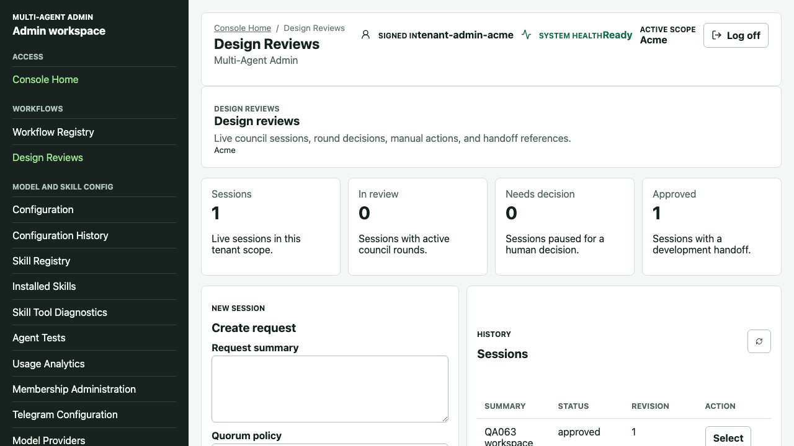
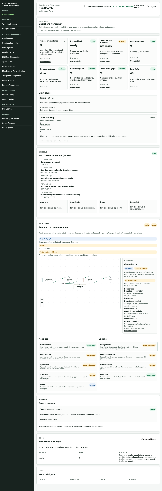

# Design Reviewer Council Browser Setup Guide

Review date: 2026-05-09

This guide shows how to configure and test the Design Reviewer Council scenario
from a clean local install using the Admin browser UI. The scenario is already
available in the system as the reusable `Design Reviewer Council` template, so
the setup path is to install the template, verify the generated workflow and
test evidence, publish the workflow, create a design review session, and launch
a review round.

After opening the local Admin login page, do not navigate by editing the
browser address bar. Use the UI links, left navigation, command search,
buttons, row actions, and in-page links described below. Terminal commands and
API calls at the end of this document include URLs because they are not browser
navigation steps.

## Scenario

Use this design request when the guide asks for a request summary:

```text
Design an admin workspace where tenant admins can create, test, and publish
multi-agent workflows without editing raw JSON.
```

The council reviews the request with five reviewer perspectives:

1. Product Fit Reviewer
2. UX And Interaction Reviewer
3. Visual And Design System Reviewer
4. Accessibility Reviewer
5. Engineering And API Reviewer

The recommended quorum policy is `Four of five, no blockers`. A review passes
when at least four reviewers approve and the aggregate blocker count is zero.
If quorum is not met, the session records a revision path or pauses for a
manual decision. When quorum passes, the session exposes a development handoff
with safe summary, approved revision, digest, and artifact references.

## What This Tutorial Configures

Starting from an empty migrated database, this tutorial creates the durable
records needed for the Design Reviewer Council scenario:

- The Acme tenant used by the local-principal Admin UI.
- A tenant-owned `Design Reviewer Council` workflow draft.
- A required `Design Reviewer Council Required Evidence` Test Bench suite.
- Current publish-gate evidence for the council workflow draft.
- An immutable published workflow version bundle.
- A design review session, one launched review round, runtime graph evidence,
  and an approved handoff after the API completion test.

The template install action performs the scenario-specific configuration in
the application. You should not create workflow JSON by hand, update the
browser URL, or insert council workflow/test records manually. The only manual
database seed below is the clean-install Acme tenant row that the local
principal references.

## Step 0 - Prepare A Clean Local System

Local setup actions:

1. From the repository root, create a local environment file if one does not
   exist:

   ```bash
   test -f .env || cp .env.example .env
   ```

2. For live OpenAI-backed reviewer experiments, use the tutorial environment
   instead and fill `OPENAI_API_KEY` only in your local `.env` file:

   ```bash
   cp tutorials/env.design_reviewer .env
   ```

3. Install Python dependencies, start PostgreSQL, and apply migrations:

   ```bash
   uv sync
   docker compose up -d postgres
   uv run alembic upgrade head
   ```

4. Seed the Acme tenant referenced by `tenant-admin-acme` in
   `LOCAL_PRINCIPAL_CATALOG_JSON`:

   ```bash
   docker compose exec -T postgres psql -U postgres -d multi_agent_platform <<'SQL'
   INSERT INTO tenants (
     tenant_id,
     slug,
     display_name,
     status,
     created_at,
     updated_at
   )
   VALUES (
     '11111111-1111-1111-1111-111111111111',
     'acme',
     'Acme',
     'active',
     CURRENT_TIMESTAMP,
     CURRENT_TIMESTAMP
   )
   ON CONFLICT (slug) DO NOTHING;
   SQL
   ```

5. Build the React Admin assets:

   ```bash
   cd frontend/admin
   npm install
   npm run build
   cd ../..
   ```

6. Start the API in one terminal:

   ```bash
   uv run uvicorn multi_agent_platform.api.main:app --host 127.0.0.1 --port 8000 --reload
   ```

7. Start the worker in a second terminal when you want runtime orchestration to
   process launched workflow runs:

   ```bash
   uv run python -m multi_agent_platform.workers.main
   ```

8. Confirm `jq` is available for the API test at the end of the guide:

   ```bash
   jq --version
   ```

Explanation: This prepares the same clean local system that the browser tutorial
expects. The `.env.example` file already enables `AUTH_MODE=local_principal`
and includes the `tenant-admin-acme` principal, but a fresh database still needs
the matching Acme tenant row. Building the React Admin assets makes the browser
UI available through the FastAPI application instead of a separate frontend
server. The worker is optional for inspecting the UI flow, but it is useful when
you want launched workflow runs to move through runtime processing. The API
test uses `jq` to construct request payloads and read response fields.

Clean-system screen expectation: before Step 3 runs, `Design Reviews` should
show no user-created sessions and the council template should be `not
installed`. `Workflow Registry` may be empty or may show unrelated local drafts,
but it should not require you to edit the browser URL. `Agent Tests` will not
show the council required suite until the template install action creates it.

## Step 1 - Sign In And Confirm Scope


On-page actions:

1. Open the local Admin login page supplied by your running API environment.
2. If you opened the Admin entrypoint first and see an unauthenticated page,
   click `Open local login`.
3. Choose the `Acme Tenant Admin` local principal card.
4. Click `Sign In`.
5. Confirm the browser lands on the Admin console home screen.
6. In the top bar, confirm `Signed in` shows the Acme tenant admin principal.
7. In `Active scope`, confirm the scope is `Acme`; if another scope is
   selected, use the `Switch admin scope` dropdown instead of editing the URL.

Explanation: This step gives the browser a tenant-admin principal with access
to tenant-scoped workflow, test, and design review setup. The Design Reviews
workspace requires tenant scope, so the `Acme` scope must be visible before the
template action will be enabled. The local login card writes the local
principal cookie and returns to Admin automatically. The scope dropdown is the
safe UI control for changing tenant context.

Screen check:

- Principal cards show display names, catalog keys, and role badges.
- `Sign In` is the only action needed on this page.
- After sign-in, the Admin shell top bar shows signed-in user, system health,
  active scope, and log off.

## Step 2 - Use Admin Links For Navigation



On-page actions:

1. On Console Home, review the left navigation groups.
2. Use `Workflow Registry` under `Workflows` when this guide asks you to inspect
   or publish the council workflow.
3. Use `Design Reviews` under `Workflows` when this guide asks you to install
   the template, create a session, launch a round, or inspect handoff state.
4. Use `Configuration`, `Model Providers`, `Prompt Library`, or `Agent
   Profiles` under `Model And Skill Config` and `Prompt Runtime` when checking
   governance readiness.
5. Use `Agent Tests` when checking required evidence and publish-gate state.
6. Use `Run Search` or the `Open runtime graph` link from a round card when
   inspecting runtime graph evidence.

Explanation: The Admin shell exposes authorized destinations as clickable
links, and those links preserve active tenant scope for tenant pages. The same
destinations are also available through the `Command` search box on Console
Home when the left navigation is collapsed. This guide assumes every browser
move after login is made through those UI links. If a destination is not
visible, the current principal or active scope is not authorized for that
surface.

Screen check:

- The left sidebar includes `Workflow Registry` and `Design Reviews`.
- The top bar includes `Active scope` and a scope selector when multiple scopes
  are available.
- Console Home includes `Current notices`, `Start here`, and `Authorized
  destinations` panels that reflect backend navigation decisions.

## Step 3 - Install Or Refresh The Council Template



On-page actions:

1. Click `Design Reviews` in the left navigation.
2. Confirm the `History` area is empty if this is a clean database.
3. Find the `Council template` panel near the top of the Design Reviews page.
4. If the button says `Install template`, click it.
5. If the button says `Refresh evidence`, click it when the template is stale,
   evidence is pending, or you want to refresh required runs.
6. Wait for the mutation note that says `Template ready`.
7. Confirm the template card shows a workflow revision, `Publish gate`, required
   `Evidence`, and safe evidence `Modes`.

Explanation: This is the main configuration action for the scenario. The button
creates or refreshes the tenant-owned `Design Reviewer Council` workflow draft,
attaches the required agent-test suite, creates the required publish-gate
requirement, and runs current safe evidence when configured to do so. The UI
shows truthful states such as `not installed`, `evidence pending`, `stale`,
`ready`, or `published`; it does not invent sessions or reviewer results. If
the button is disabled, check that the top bar still shows the Acme tenant
scope and that the Acme tenant seed from Step 0 exists.

Screen check:

- The Design Reviews page has summary cards for `Sessions`, `In review`, `Needs
  decision`, `Approved`, and `Template`.
- The `Council template` panel shows `Publish gate`, `Evidence`, `Modes`, and
  `Revision`.
- The template action button is `Install template` before first setup and
  `Refresh evidence` after setup exists.

## Step 4 - Inspect The Workflow Draft And Agent Graph


On-page actions:

1. Click `Workflow Registry` in the left navigation.
2. Confirm the page shows the `Workflow Registry` and `Workflow builder`
   surfaces.
3. In the `Registry` list, find `Design Reviewer Council`.
4. Click `Open draft` on that row.
5. In the draft form, confirm the `Name` is `Design Reviewer Council`.
6. Confirm the `Description` describes council review, synthesis, and handoff.
7. Confirm the `Join policy` is the four-of-five quorum policy created by the
   template.
8. Review the `Graph` preview and confirm it includes lead intake, five
   reviewer nodes, review quorum, synthesis, development handoff, and complete.
9. Use the draft communication graph `Node list` and `Edge list` to verify the
   same topology in a keyboard-readable form.

Explanation: This page verifies that the template produced the workflow the
session will launch. The workflow draft is acyclic: one runtime workflow run
represents one review round, and the Design Review coordinator owns any
cross-round iteration. The graph should fan out from the lead intake node to
five reviewer nodes, join at the quorum node, and continue through synthesis
and handoff. If the registry opens a different draft first, use the
`Design Reviewer Council` row action named `Open draft`. If no council draft is
visible, return to `Design Reviews` with the left navigation and run `Install
template` again.

Screen check:

- The workflow form exposes `Name`, `Description`, and `Join policy`.
- `Pinned runtime inputs` exposes prompt and runtime profile selectors when
  governance records are available.
- The graph panels show backend-owned node and edge summaries rather than raw
  workflow JSON.



On-page actions:

1. In the `Draft communication` panel, select the lead node.
2. Select one reviewer node and confirm it is categorized as a reviewer or role
   node.
3. Select the review quorum node and confirm the detail panel explains the join.
4. Select an edge from a reviewer to quorum and confirm the edge detail is safe
   and summarized.
5. Use the graph lists if the visual canvas is hard to inspect.

Explanation: The Agent Communication Graph is the safest way to inspect agent
communication topology from the browser. Selecting nodes and edges shows safe
references, badges, and summaries without rendering raw prompts, completions,
credential values, or private payloads. The list views are important because
they provide a keyboard-readable alternative to the graph canvas. A missing or
partial graph should be treated as a real backend state, not a reason to edit
the browser URL.

Screen check:

- The graph panel title includes `Draft communication`.
- The detail panel starts with `Select a node or edge` before selection.
- Node and edge lists are visible below or beside the canvas.

## Step 5 - Confirm Required Agent Test Evidence



On-page actions:

1. Click `Agent Tests` in the left navigation.
2. In `Reusable suites`, open the `Design Reviewer Council Required Evidence`
   suite with `Open suite`.
3. In `Suite and case forms`, confirm the suite is required for publish and is
   bound to the current council workflow draft revision.
4. Confirm the case list includes quorum success, revision-required,
   blocking-issue, manual-resolution, retry, cancel, approved-handoff,
   cross-tenant-denial, redaction, Admin live-data, and model-safe-boundary
   coverage.
5. In `Run launcher`, choose a safe mode such as `Mock model` for
   deterministic local evidence.
6. Click `Launch run` only when evidence is missing or stale.
7. In `Publish-gate evidence`, click `Refresh evidence` when you need the gate
   panel to re-read the latest passing run.

Explanation: The council template installs a required agent-test suite so the
workflow cannot be published on synthetic or stale evidence. The Test Bench UI
shows live suites, cases, run status, diagnostics, artifacts, gates, and audit
records for the active scope. The deterministic safe mode is the expected local
path because it avoids real provider calls while still exercising persistence,
tenancy, idempotency, and publish-gate logic. Empty panels mean the tenant has
no durable records for that surface yet.

Screen check:

- The Test Bench page has sections for suites, runs, diagnostics, gates, and
  audit.
- Suite cards expose `Open suite` actions.
- Run detail panels show progress, assertion diagnostics, traces, artifact
  references, and audit references only after a run exists.

## Step 6 - Publish The Council Workflow


On-page actions:

1. Click `Workflow Registry` in the left navigation.
2. In the `Registry` list, find `Design Reviewer Council` and click its
   `Open draft` action.
3. In the `Validation` panel, click `Run validation`.
4. If required evidence was refreshed in Agent Tests, click `Mark evidence
   current` only when the UI allows it.
5. In the `Publish gate` panel, click `Check publish gate`.
6. When the decision is ready, click `Prepare publish`.
7. Review the confirmation message in the `Publish result` panel.
8. Click `Confirm publish`.
9. Confirm a `Published version` section appears and that a published version
   communication graph is available or truthfully unavailable.

Explanation: Design Review sessions can launch only against authorized
published workflow version bundles. Publishing freezes the validated draft into
an immutable version that appears in the Design Reviews `Workflow` dropdown.
The three publish buttons reflect the actual browser flow: check readiness,
prepare the publish action, then confirm it. If the template was already
published, use this step to verify the published version and continue.

Screen check:

- `Backend-owned findings` reports validation status and blockers.
- `Evidence and decision` reports publish-gate readiness and required evidence.
- `Confirm publish` is disabled until the UI has a publish confirmation ready.

## Step 7 - Check Optional Governance Readiness



On-page actions:

1. Click `Configuration` in the left navigation to open governance.
2. In `Setup`, review readiness counts for provider connections, prompt
   lineages, runtime profiles, routing, and provenance.
3. In `Providers`, click `Run probe` only for safe provider diagnostics that are
   already configured by policy.
4. Click `Prompt Library` in the left navigation, then use `Preview redaction
   check` and `Save summary` for existing prompt records when updates are
   authorized.
5. Click `Agent Profiles` in the left navigation, then use `Resolve` and `Save
   profile` for existing profile records when updates are authorized.
6. Return to `Configuration` and click `Preview routing` to verify read-only
   routing behavior.

Explanation: Governance is required for model-backed execution, but the clean
deterministic tutorial path can run without live provider calls. The browser
shows credential readiness, prompt previews, profile resolution, routing
decisions, and provenance as redaction-safe summaries. Do not paste raw API
keys, provider authorization headers, raw prompts, completions, or private
payloads into visible fields. Treat empty or unavailable governance panels as
real setup state for the active tenant, then continue with deterministic
testing.

Screen check:

- Governance exposes `Setup`, `Providers`, `Prompts`, `Profiles`, `Routing`,
  and `Provenance` panels.
- Provider cards show safe credential diagnostics and `Run probe` when allowed.
- Prompt and profile panels show save and preview actions only for authorized
  records.

## Step 8 - Create A Design Review Session



On-page actions:

1. Click `Design Reviews` in the left navigation.
2. In `New session`, paste the scenario request into `Request summary`.
3. In `Quorum policy`, choose `Four of five, no blockers`.
4. In `Workflow`, choose the published `design-reviewer-council` workflow
   version.
5. Click `Create session`.
6. In `History`, click `Select` for the new session.
7. Confirm the selected session detail shows the request summary and session
   status.

Explanation: This creates the tenant-scoped design review session and its first
immutable revision summary. The `Workflow` dropdown is populated from
published workflow version bundles, so it remains empty until Step 6 publishes
the council workflow. The `Quorum policy` dropdown maps directly to coordinator
policies such as `four_of_five_no_blockers` and `three_of_four_no_blockers`.
The `Select` action loads revisions, rounds, manual decisions, coordinator
state, and handoff state for that session.

Screen check:

- The `Create request` form includes `Request summary`, `Quorum policy`,
  `Workflow`, and `Create session`.
- `History` shows live tenant sessions with status and active revision.
- The selected session detail appears below the create/history panels.

## Step 9 - Launch A Review Round


On-page actions:

1. With the session selected, find the `Session actions` area.
2. Confirm `Launch workflow` is set to the published council workflow.
3. Click `Launch round`.
4. Wait for the mutation note that says `Round launched`.
5. In `Rounds` under `Reviewer evidence`, confirm Round 1 appears with reviewer
   count and quorum count.
6. Click `Open runtime graph` on the round card.

Explanation: `Launch round` asks the coordinator to create exactly one live,
acyclic workflow run for the active design revision. The browser action also
records reviewer assignments and moves the session into an in-review state.
The round card links to the Operations runtime graph without requiring you to
edit the browser URL. The current browser UI launches and inspects rounds; the
API completion flow later in this guide is the explicit way to submit verdicts
for a deterministic quorum result.

Screen check:

- `Launch round` is disabled when no session or no authorized workflow is
  selected.
- Round cards show `Round`, status, reviewer count, quorum count, and a
  workflow run id when a run exists.
- `Open runtime graph` is a real link from the round card to Operations.

## Step 10 - Inspect Runtime Graph Evidence



On-page actions:

1. Use the `Open runtime graph` link from the round card.
2. Confirm the Operations page opens to `Runtime run communication`.
3. Select runtime graph nodes to inspect safe status summaries.
4. Select runtime graph edges to inspect handoff, run-step, timeline, or
   interaction evidence references.
5. Review node and edge lists when you need a keyboard-readable graph view.
6. Click `Design Reviews` in the left navigation to return to the session.

Explanation: The runtime graph overlays the published workflow topology with
run-specific state and durable interaction evidence. This is the browser view
for understanding how the lead, reviewers, quorum join, synthesis, and handoff
communicated during the round. The UI intentionally shows safe summaries,
references, and partial-evidence states instead of raw runtime payloads. Use
the left navigation link to return to Design Reviews.

Screen check:

- The Operations page shows `Operations workbench`.
- The runtime graph section is titled `Runtime run communication`.
- `Redacted signals` appears below the workbench evidence.

## Step 11 - Resolve Manual Decisions Or Verify Handoff


On-page actions:

1. Return to `Design Reviews` with the left navigation.
2. Click the `Refresh` icon in `History`.
3. Click `Select` for the active session.
4. If a manual decision is required, choose `Revise`, `Approve exception`,
   `Retry`, or `Cancel` in the `Decision` dropdown.
5. Enter a safe, non-sensitive explanation in `Safe rationale`.
6. Enter `Next revision summary` when the decision is `Revise`.
7. Check `Accepted risk` only for an explicit risk acceptance.
8. Click `Record decision`.
9. If quorum has passed, inspect `Handoff` and confirm `Development reference`
   shows status, approved revision, digest, and summary.

Explanation: Manual decisions are available only when the coordinator reports
that the session is paused for human action. Recording a decision creates
append-only, tenant-scoped evidence and keeps the rationale safe for audit and
browser display. Approved sessions show a handoff instead of another manual
decision form. After API completion or worker activity, use the UI refresh
button to reload the latest session state.

Screen check:

- `Manual decisions` is empty until a decision is recorded.
- `Handoff` shows a muted state before approval and a `Development reference`
  after approval.
- `Record decision` is disabled until the required manual rationale is present.

## Clean-System Troubleshooting

Use these checks if a clean install does not match the tutorial screens:

- If `Acme Tenant Admin` is missing on the local login page, confirm `.env`
  uses `AUTH_MODE=local_principal` and includes the current
  `LOCAL_PRINCIPAL_CATALOG_JSON` value from `.env.example` or
  `tutorials/env.design_reviewer`.
- If the top bar does not show `Active scope` as `Acme`, confirm the Acme
  tenant seed in Step 0 succeeded and sign in again with `Acme Tenant Admin`.
- If `Install template` is disabled, use the scope dropdown to return to Acme
  tenant scope and confirm you are not signed in as a platform-only principal.
- If `Workflow` is empty in `New session`, return to `Workflow Registry`, open
  the `Design Reviewer Council` draft, and complete the publish buttons in
  Step 6.
- If `Agent Tests` does not show the required suite, return to `Design
  Reviews` and run `Install template` or `Refresh evidence`.
- If `Open runtime graph` does not appear, select the session from `History`
  and launch a review round first.

Explanation: These states are the common differences between a fresh database,
a partially configured database, and a tenant scope mismatch. Each recovery
uses a visible UI link, button, card, dropdown, or row action except for the
Acme seed check, which belongs to the initial clean-system setup. The guide
does not depend on manually entering internal Admin paths into the browser.
When the UI displays empty or unavailable states, treat them as current backend
truth and use the setup actions above to create the missing records.

## UI Test

Use this test to prove the browser-only path works without editing the browser
URL.

On-page actions:

1. Click `Design Reviews` in the left navigation.
2. Click `Refresh evidence` in the council template panel and confirm the
   template is ready or already published.
3. Click `Workflow Registry`, open the `Design Reviewer Council` draft with
   `Open draft`, then run `Check publish gate` and confirm the published
   council workflow is still ready.
4. Click `Design Reviews`, create a new session with the scenario request, and
   select the published council workflow.
5. Click `Create session`, then `Select` the session from `History`.
6. Click `Launch round`.
7. In `Reviewer evidence`, click `Open runtime graph`.
8. Confirm Operations shows `Runtime run communication`.
9. Click `Design Reviews`, click `Refresh`, select the session, and inspect
   `Rounds`, `Manual decisions`, and `Handoff`.

Explanation: This UI test verifies the user can navigate the entire scenario
through links, buttons, dropdowns, and row actions. It covers template
readiness, publish-gate visibility, session creation, round launch, runtime
graph navigation, and safe evidence inspection. The current browser UI does
not provide a form for entering reviewer verdicts directly. Use the API test
below to complete a round with deterministic verdicts, then refresh the UI to
see the approved handoff.

Expected result:

- The browser never requires address-bar edits after login.
- A new design review session appears in `History`.
- `Launch round` creates a round with a workflow run id.
- `Open runtime graph` opens Operations through a UI link.
- After API completion, `Handoff` shows an approved development reference.

## API Test

Use this terminal flow after the workflow is published. It creates a session,
launches a round, completes the round with four approved verdicts and zero
blockers, and fetches the handoff. Keep the browser open on Design Reviews so
you can click `Refresh` afterward.

```bash
export BASE_URL="http://127.0.0.1:8000"
export TENANT_ID="11111111-1111-1111-1111-111111111111"
export PRINCIPAL="tenant-admin-acme"
export RUN_KEY="$(date +%s)"

export WORKFLOW_VERSION_BUNDLE_ID="$(
  curl -sS \
    -H "X-Local-Principal: ${PRINCIPAL}" \
    "${BASE_URL}/admin/app/design-reviews/bootstrap.json?tenant_id=${TENANT_ID}" \
  | jq -r '.workflow_options[]
      | select(.workflow_key == "design-reviewer-council")
      | .workflow_version_bundle_id' \
  | head -n 1
)"

test -n "${WORKFLOW_VERSION_BUNDLE_ID}" || {
  echo "No published design-reviewer-council workflow was found. Publish it in Workflow Registry first."
  exit 1
}

export SESSION_ID="$(
  curl -sS -X POST \
    -H "X-Local-Principal: ${PRINCIPAL}" \
    -H "Content-Type: application/json" \
    "${BASE_URL}/admin/design-reviews/sessions" \
    --data "$(jq -n \
      --arg tenant_id "${TENANT_ID}" \
      --arg workflow_version_bundle_id "${WORKFLOW_VERSION_BUNDLE_ID}" \
      --arg idempotency_key "guide-session-${RUN_KEY}" \
      '{
        tenant_id: $tenant_id,
        request_summary: "Design an admin workspace where tenant admins can create, test, and publish multi-agent workflows without editing raw JSON.",
        quorum_policy_key: "four_of_five_no_blockers",
        workflow_version_bundle_id: $workflow_version_bundle_id,
        idempotency_key: $idempotency_key
      }')" \
  | jq -r '.design_review_session_id'
)"

export ROUND_ID="$(
  curl -sS -X POST \
    -H "X-Local-Principal: ${PRINCIPAL}" \
    -H "Content-Type: application/json" \
    "${BASE_URL}/admin/design-reviews/sessions/${SESSION_ID}/coordinator/launch-round" \
    --data "$(jq -n \
      --arg tenant_id "${TENANT_ID}" \
      --arg workflow_version_bundle_id "${WORKFLOW_VERSION_BUNDLE_ID}" \
      --arg idempotency_key "guide-launch-${RUN_KEY}" \
      '{
        tenant_id: $tenant_id,
        workflow_version_bundle_id: $workflow_version_bundle_id,
        execution_mode: "deterministic",
        max_rounds: 3,
        idempotency_key: $idempotency_key
      }')" \
  | jq -r '.round.design_review_round_id'
)"

curl -sS -X POST \
  -H "X-Local-Principal: ${PRINCIPAL}" \
  -H "Content-Type: application/json" \
  "${BASE_URL}/admin/design-reviews/rounds/${ROUND_ID}/coordinator/complete" \
  --data "$(jq -n \
    --arg tenant_id "${TENANT_ID}" \
    --arg idempotency_key "guide-complete-${RUN_KEY}" \
    '{
      tenant_id: $tenant_id,
      safe_synthesis_summary: "Council approves the design for development handoff.",
      idempotency_key: $idempotency_key,
      verdicts: [
        {
          reviewer_key: "product-fit",
          verdict: "approved",
          score: 5,
          blocking_issue_count: 0,
          safe_feedback_summary: "Product fit is clear and scoped.",
          output_digest: "digest-product-fit"
        },
        {
          reviewer_key: "ux-interaction",
          verdict: "approved",
          score: 5,
          blocking_issue_count: 0,
          safe_feedback_summary: "Primary interaction path is usable.",
          output_digest: "digest-ux-interaction"
        },
        {
          reviewer_key: "visual-system",
          verdict: "approved",
          score: 4,
          blocking_issue_count: 0,
          safe_feedback_summary: "Visual hierarchy fits the Admin design system.",
          output_digest: "digest-visual-system"
        },
        {
          reviewer_key: "accessibility",
          verdict: "approved",
          score: 5,
          blocking_issue_count: 0,
          safe_feedback_summary: "Keyboard and readable-list paths are covered.",
          output_digest: "digest-accessibility"
        },
        {
          reviewer_key: "engineering-api",
          verdict: "changes_requested",
          score: 3,
          blocking_issue_count: 0,
          safe_feedback_summary: "Add non-blocking implementation notes for API pagination.",
          output_digest: "digest-engineering-api"
        }
      ]
    }')" \
| jq '{session_status: .session.status, quorum_status: .quorum_decision.status, handoff_state: .handoff.state.kind}'

curl -sS \
  -H "X-Local-Principal: ${PRINCIPAL}" \
  "${BASE_URL}/admin/design-reviews/sessions/${SESSION_ID}/handoff?tenant_id=${TENANT_ID}" \
| jq '{state: .state.kind, status: .status, summary: .safe_summary}'
```

Explanation: The first call reads the same Design Reviews bootstrap data that
the browser uses and extracts the published workflow option. The session call
creates a tenant-scoped review session for the scenario request, and the launch
call creates one coordinator-owned review round. The complete call supplies
four approved verdicts, one non-blocking changes-requested verdict, and a safe
synthesis summary, which should satisfy the four-of-five quorum policy. After
the API test finishes, return to the browser, click `Design Reviews`, click
`Refresh`, select the API-created session, and confirm the `Handoff` panel shows
the approved development reference.

Expected API result:

```json
{
  "session_status": "approved",
  "quorum_status": "passed",
  "handoff_state": "ready"
}
```

To test a revision-required path, change the completion payload so only three
reviewers are `approved` or set one approved reviewer's `blocking_issue_count`
to `1`. To test a manual path from the browser, use `Record decision` only
after the session status reports that manual resolution is required.
