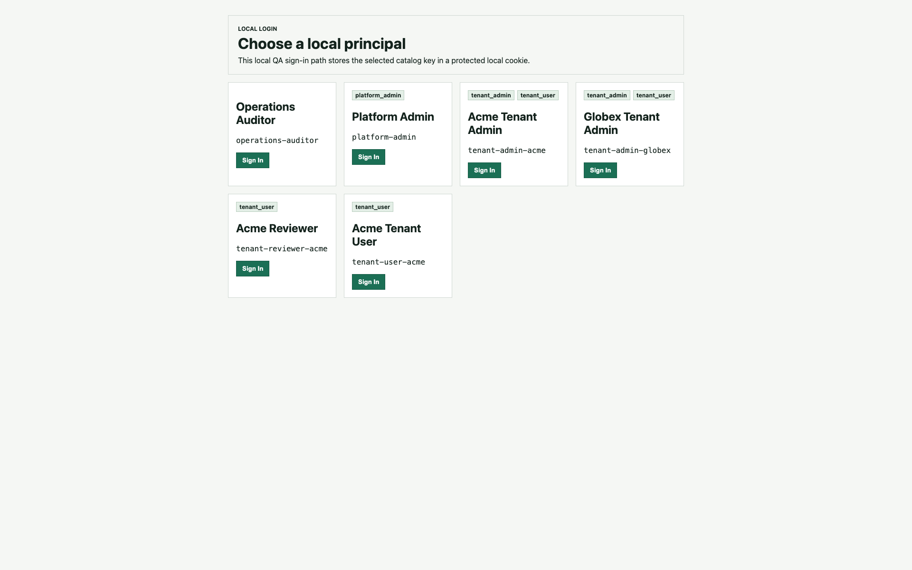
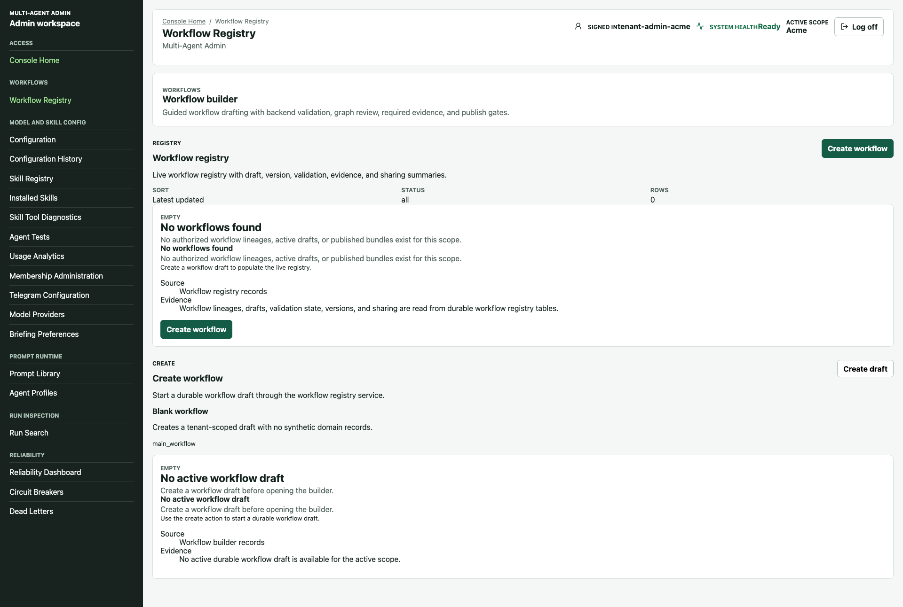

# Design Reviewer Council Browser Setup Guide

Review date: 2026-05-10

This guide shows how to configure and test the Design Reviewer Council scenario
from a clean local install using the Admin browser UI. The primary path is to
build a tenant-owned reusable `Design Reviewer Council` workflow draft in
Workflow Registry, verify its workflow structure and test evidence, publish the
workflow, use the runtime launch and Design Reviews handoff links, create a
design review session, and launch a review round.

The Design Reviews page also exposes a built-in Council template action. Treat
that action as an optional shortcut or recovery path, not as a requirement for
all workflows. Custom workflows can be created from scratch in Workflow
Registry without starting from a predefined template.

After opening the local Admin login page, do not navigate by editing the
browser address bar. Use the UI links, left navigation, command search,
buttons, row actions, and in-page links described below. Terminal commands and
API calls at the end of this document include URLs because they are not browser
navigation steps.

For browser instructions, quoted names such as `Workflow Registry`, `Open
draft`, and `Create session` are visible labels in the UI. If a section is not
visible, scroll down within the page first. If a left-navigation link is hidden
on a narrow screen, use the Admin menu or command search to find the same label.
When this guide says to confirm something, read the visible label or status on
the page; do not inspect developer tools or edit JSON.

## Scenario

Use this design request when the guide asks for a request summary:

```text
Design an admin workspace where tenant admins can create, test, and publish
multi-agent workflows without editing raw JSON.
```

The council reviews the request with five reviewer perspectives:

1. Product Fit Reviewer
2. UX And Interaction Reviewer
3. Visual And Design System Reviewer
4. Accessibility Reviewer
5. Engineering And API Reviewer

The recommended quorum policy is `Four of five, no blockers`. A review passes
when at least four reviewers approve and the aggregate blocker count is zero.
If quorum is not met, the session records a revision path or pauses for a
manual decision. When quorum passes, the session exposes a development handoff
with safe summary, approved revision, digest, and artifact references.

## What This Tutorial Configures

Starting from an empty migrated database, this tutorial creates the durable
records needed for the Design Reviewer Council scenario:

- The Acme tenant used by the local-principal Admin UI.
- A tenant-owned reusable `Design Reviewer Council` workflow draft, built in the
  browser or optionally installed from the built-in shortcut.
- A required Test Bench suite for the council workflow.
- Current publish-gate evidence for the council workflow draft.
- Browser-visible workflow setup state: full-document saves, section summaries,
  role/contract/graph controls, prompt/profile bindings, and evidence setup.
- An immutable published workflow version bundle.
- Runtime launch and Design Reviews workflow-selection handoff checks.
- A design review session, one launched review round, runtime graph evidence,
  and an approved handoff after the API completion test.

The build-first path performs the scenario-specific configuration through
Workflow Registry, workflow builder controls, and Agent Tests. You should not
create workflow JSON by hand, update the browser URL, or insert council
workflow/test records manually. The built-in template action can still create
or refresh the canonical council workflow and evidence when you want a shortcut.
The only manual database seed below is the clean-install Acme tenant row that
the local principal references.

## Step 0 - Prepare A Clean Local System

Local setup actions:

1. From the repository root, create a local environment file if one does not
   exist:

   ```bash
   test -f .env || cp .env.example .env
   ```

2. For live OpenAI-backed reviewer experiments, use the tutorial environment
   instead and fill `OPENAI_API_KEY` only in your local `.env` file:

   ```bash
   cp tutorials/env.design_reviewer .env
   ```

3. Install Python dependencies, start PostgreSQL, and apply migrations:

   ```bash
   uv sync
   docker compose up -d postgres
   uv run alembic upgrade head
   ```

4. Seed the Acme tenant referenced by `tenant-admin-acme` in
   `LOCAL_PRINCIPAL_CATALOG_JSON`:

   ```bash
   docker compose exec -T postgres psql -U postgres -d multi_agent_platform <<'SQL'
   INSERT INTO tenants (
     tenant_id,
     slug,
     display_name,
     status,
     created_at,
     updated_at
   )
   VALUES (
     '11111111-1111-1111-1111-111111111111',
     'acme',
     'Acme',
     'active',
     CURRENT_TIMESTAMP,
     CURRENT_TIMESTAMP
   )
   ON CONFLICT (slug) DO NOTHING;
   SQL
   ```

5. Build the React Admin assets:

   ```bash
   cd frontend/admin
   npm install
   npm run build
   cd ../..
   ```

6. Start the API in one terminal:

   ```bash
   uv run uvicorn multi_agent_platform.api.main:app --host 127.0.0.1 --port 8000 --reload
   ```

7. Start the worker in a second terminal when you want runtime orchestration to
   process launched workflow runs:

   ```bash
   uv run python -m multi_agent_platform.workers.main
   ```

8. Confirm `jq` is available for the API test at the end of the guide:

   ```bash
   jq --version
   ```

Explanation: This prepares the same clean local system that the browser tutorial
expects. The `.env.example` file already enables `AUTH_MODE=local_principal`
and includes the `tenant-admin-acme` principal, but a fresh database still needs
the matching Acme tenant row. Building the React Admin assets makes the browser
UI available through the FastAPI application instead of a separate frontend
server. The worker is optional for inspecting the UI flow, but it is useful when
you want launched workflow runs to move through runtime processing. The API
test uses `jq` to construct request payloads and read response fields.

Clean-system screen expectation: before Step 3 runs, `Design Reviews` should
show no user-created sessions and the council template may be `not installed`.
`Workflow Registry` may be empty or may show unrelated local drafts, but it
should not require you to edit the browser URL. `Agent Tests` will not show the
council required suite until you create evidence through the workflow builder or
use the optional template action.

## Step 1 - Sign In And Confirm Scope



On-page actions:

1. Open the local Admin login page supplied by your running API environment.
   For the default local server, this is the first and only browser address you
   should type manually: `http://127.0.0.1:8000/auth/local-login`.
2. If you opened `/admin/app` first and see an unauthenticated page, click the
   `Open local login` button. This takes you to the same local login page.
3. Find the local-principal card labeled `Acme Tenant Admin`. The card should
   show an Acme tenant/admin role, not a platform-only or Globex principal.
4. Click the `Sign In` button on that card.
5. Wait for the Admin console home screen to load. Do not use the browser Back
   button during sign-in.
6. In the top bar, read the `Signed in` value and confirm it identifies the
   Acme tenant admin principal.
7. In `Active scope`, confirm the scope is `Acme`. If another scope is selected,
   open the `Switch admin scope` dropdown in the top bar, choose `Acme`, and
   wait for the page to refresh.

Explanation: This step gives the browser a tenant-admin principal with access
to tenant-scoped workflow, test, and design review setup. The Design Reviews
workspace requires tenant scope, so the `Acme` scope must be visible before the
workflow create and optional template actions will be enabled. The local login
card writes the local principal cookie and returns to Admin automatically. The
scope dropdown is the safe UI control for changing tenant context.

Screen check:

- Principal cards show display names, catalog keys, and role badges.
- `Sign In` is the only action needed on this page.
- After sign-in, the Admin shell top bar shows signed-in user, system health,
  active scope, and log off.

## Step 2 - Use Admin Links For Navigation


On-page actions:

1. On Console Home, look at the left sidebar. It is grouped by product area.
   You will use links in this sidebar for the rest of the tutorial.
2. Under `Workflows`, locate `Workflow Registry`. Click this link when the guide
   asks you to inspect, validate, publish, or launch from the council workflow.
   Inside the registry, open workflows with row buttons such as `Open draft`.
3. Under `Workflows`, locate `Design Reviews`. Click this link when the guide
   asks you to use the optional council template shortcut, create a review
   session, launch a review round, or inspect handoff state.
4. When the workflow builder opens Design Reviews through `Select in Design
   Reviews`, use that button. It carries the selected published workflow for
   you; do not type a Design Reviews URL.
5. Use `Configuration`, `Model Providers`, `Prompt Library`, or `Agent Profiles`
   only when checking optional governance readiness. The main deterministic
   tutorial can continue even when no live provider is configured.
6. Use the workflow builder's `Open Agent Tests` link, or the left-sidebar
   `Agent Tests` link, when checking required publish evidence.
7. Use the workflow builder's `Open runtime launch` button only to verify that
   the run workspace preselects the workflow. A prefilled workflow does not
   start a run until `Start Run` is clicked.
8. Use `Run Search` or the `Open runtime graph` link from a round card when
   inspecting runtime graph evidence.

Explanation: The Admin shell exposes authorized destinations as clickable
links, and those links preserve active tenant scope for tenant pages. The same
destinations are also available through the `Command` search box on Console
Home when the left navigation is collapsed. This guide assumes every browser
move after login is made through those UI links. If a destination is not
visible, the current principal or active scope is not authorized for that
surface.

Screen check:

- The left sidebar includes `Workflow Registry` and `Design Reviews`.
- The top bar includes `Active scope` and a scope selector when multiple scopes
  are available.
- Console Home includes `Current notices`, `Start here`, and `Authorized
  destinations` panels that reflect backend navigation decisions.

## Step 3 - Build Or Install The Council Workflow


On-page actions:

1. Click `Workflow Registry` in the left navigation.
2. Click `Create workflow`. Wait for the create result to appear, then click the
   result's `Open draft` link.
3. In the draft form, change `Name` to `Design Reviewer Council`.
4. Change `Description` so it mentions council review, five reviewer
   perspectives, quorum synthesis, and development handoff.
5. Near the top of the builder, click `Apply three-agent starter` once. This
   gives the draft a safe editable baseline for roles, contracts, graph nodes,
   joins, and prompt/profile references.
6. Click `Save draft` and wait for the saved or accepted message.
7. Use the builder controls in the next steps to turn the starter into the
   council workflow: one lead/intake role, five reviewer roles, one quorum join,
   synthesis, handoff, and terminal completion. Save after each meaningful group
   of edits.
8. If you want the shortcut instead of building the draft manually, click
   `Design Reviews`, find the `Council template` panel, and click `Install
   template`. If the panel already exists and says `Refresh evidence`, click it
   only when the template is stale, evidence is pending, or you want to refresh
   the required deterministic evidence.
9. Wait for any mutation message or status text to say the workflow was saved,
   accepted, ready, or published. Do not navigate away while a button is busy.
10. If you used the shortcut, confirm the `Council template` card shows a
    workflow revision, `Publish gate`, required `Evidence`, and safe evidence
    `Modes`. If you are building first, confirm the builder shows a saved
    revision and a `Required publish evidence` section.

Explanation: The learning path builds the reusable council workflow as a normal
tenant-owned workflow draft. In the current product, that is the user-authored
template: a workflow draft and later a published version that can be selected
for many design review sessions. The `Council template` panel remains useful
for demos, clean-install recovery, and evidence refreshes, but workflows do not
need a predefined template to exist before users can create them. The UI shows
truthful states such as `not installed`, `evidence pending`, `stale`, `ready`,
or `published`; it does not invent sessions or reviewer results. If the
template shortcut button is disabled, check that the top bar still shows the
Acme tenant scope and that the Acme tenant seed from Step 0 exists.

Screen check:

- The Workflow Registry create flow exposes `Create workflow`, `Open draft`,
  `Apply three-agent starter`, and `Save draft`.
- If you use the optional shortcut, the Design Reviews page has summary cards
  for `Sessions`, `In review`, `Needs decision`, `Approved`, and `Template`.
- If you use the optional shortcut, the `Council template` panel shows `Publish
  gate`, `Evidence`, `Modes`, and `Revision`.
- The optional template action button is `Install template` before first setup
  and `Refresh evidence` after setup exists.

## Step 4 - Open The Workflow Draft And Review The Save Contract


On-page actions:

1. Click `Workflow Registry` in the left navigation.
2. Wait for the Workflows page to load. You should see a registry/list area and
   a builder area. If the page opens at an empty builder, stay on the page and
   use the registry list.
3. In the `Registry` list, find the row named `Design Reviewer Council`. If
   there are many rows, scan the visible workflow names; do not use the address
   bar to jump to a draft.
4. On the `Design Reviewer Council` row, click `Open draft`.
5. Wait until the builder title and fields change to the council draft.
6. In the draft form, confirm the `Name` field reads `Design Reviewer Council`.
7. Read the `Description` field and confirm it mentions council review,
   reviewer synthesis, and development handoff.
8. Review the section summaries or draft facts near the builder header. They
   should summarize metadata, roles, references, contracts, graph, tests, and
   publish readiness without showing raw workflow JSON.
9. Do not edit fields just to test saving. Use `Save draft` only after an
   intentional browser edit that you are allowed to keep.
10. If you do click `Save draft`, wait for the save message. A successful save
    should say the draft was saved or accepted and should not show raw payloads.
11. Use `Simulate stale save` only as a reviewer diagnostic. It should return
    safe reload guidance and must not overwrite the current council draft.
12. If a save or stale result appears, read the mutation note and validation
    links. The result should expose only safe section names, field paths, ids,
    digests, and summaries.

Explanation: Spec 069 makes the browser workflow builder a full-document
authoring surface. The durable source of truth is still the backend
`WorkflowDraftDocument`, not a browser-only copy and not hand-authored JSON.
Exact duplicate saves replay idempotently, same-key different-payload saves
return safe validation findings, and stale saves return recovery guidance. If
the registry opens a different draft first, use the `Design Reviewer Council`
row action named `Open draft`. If no council draft is visible, return to Step 3
and either build the draft from `Create workflow` or use the optional
`Install template` shortcut.

Screen check:

- The workflow form exposes `Name`, `Description`, and `Join policy`.
- The builder shows save, validation, publish, revision, and launch controls
  for the selected draft.
- Save and stale-conflict results are redaction-safe and section-oriented.
- The JSON inspector, if visible, remains read-only and redacted.

## Step 5 - Use The Checklist, Role Builder, And Graph Controls


On-page actions:

1. Stay on the `Design Reviewer Council` workflow draft.
2. Near the top of the builder, find the section titled `Custom workflow launch
   checklist`. It appears as a set of progress cards or checklist rows.
3. Read the checklist groups: `Metadata`, `Agents`, `Prompts And Profiles`,
   `Graph`, `Contracts`, `Evidence`, `Validation`, `Publish`, and `Launch`.
4. Use checklist links or cards as shortcuts to sections farther down the page.
   If a card is not clickable in your viewport, scroll manually to the matching
   section name.
5. Treat the checklist as progress guidance only. Backend validation, Test Bench
   evidence, and publish readiness remain the release source of truth.
6. If this is the build-first path and the draft is still sparse, click `Apply
   three-agent starter` once. If the draft already has Council roles from your
   earlier build or the optional installer, leave the starter unchanged.
7. Scroll to `Roles`. Use `Add role`, duplicate, move, and remove controls until
   the draft represents one lead/intake role, five reviewer roles, synthesis,
   handoff, and terminal completion. Keep the reviewer names aligned with the
   five perspectives listed in the Scenario section.
8. In each role card, set or review the role key, display name, kind, purpose,
   responsibilities, input/output contracts, prompt/profile references, skill
   bindings, and graph node references. Use expand/collapse controls if the
   card is collapsed.
9. Scroll to `Contracts`. Use `Add contract` or duplicate controls until request,
   reviewer output, quorum decision, synthesis, handoff, and final result
   boundaries are represented as contract cards.
10. Scroll to `Graph topology`. Use `Add node`, `Add join node`, and `Add edge`
    to build the entry node, role nodes, reviewer fanout, review quorum join,
    synthesis, handoff, and complete node. Use the text lists when the canvas is
    too dense.
11. Scroll to `Joins` and `Approvals`. Configure the quorum join for the council
    policy and confirm any approval controls show approver scope, decision
    contract, resume behavior, and safe reviewer instructions.
12. Click `Save draft` after each substantial group of role, contract, graph, or
    join edits. Wait for the saved/accepted message before continuing.
13. If you used the optional installed template instead of building, use this
    step as an inspection pass and leave fields unchanged unless you are making
    an intentional edit.


On-page actions:

1. In the visual graph area, confirm the canvas shows connected boxes or nodes,
   not a blank empty area.
2. If the canvas is difficult to read, use the node, edge, and join lists beside
   or below it. These lists contain the same topology in text form.
3. Click the lead/intake node in the canvas or node list. Confirm the detail
   panel describes intake or coordination.
4. Click one reviewer node. Confirm the detail panel identifies it as a role or
   reviewer-style node.
5. Click the review quorum join node or join row. Confirm the detail panel shows
   the strategy, required branches, quorum count, timeout, and failure behavior
   in readable language.
6. Click an edge from a reviewer to quorum. Confirm the edge detail is a safe
   summary and not raw JSON.

Explanation: Specs 070 and 073 add editable workflow structure controls. The
Design Reviewer Council workflow remains acyclic: one runtime workflow run
represents one review round, and the Design Review coordinator owns any
cross-round iteration. The graph should fan out from lead intake to five
reviewer nodes, join at review quorum, and continue through synthesis and
handoff. The lists beside the canvas are part of the expected UI, not fallback
debug output.

Screen check:

- The graph panel title includes `Draft communication`.
- The detail panel starts with `Select a node or edge` before selection.
- Node and edge lists are visible below or beside the canvas.
- Role, contract, graph, join, approval, and subworkflow controls are visible
  without editing raw JSON.

## Step 6 - Confirm Prompt And Runtime Profile Bindings


On-page actions:

1. From the same workflow draft, scroll to `Per-Agent Bindings`.
2. Review the `Binding Matrix`. Each row represents one council role, and each
   row should show prompt and runtime profile readiness as safe reference labels
   and badges.
3. Find `Role Binding Controls`. Use its role selector/dropdown to choose one
   council role, such as a reviewer role.
4. Review the prompt reference and runtime profile reference fields for the
   selected role. They should show reference keys, version labels, readiness,
   and safe summaries only.
5. If a role already shows ready prompt/profile references, do not change it.
   Continue to the next role.
6. If a role is incomplete and you are authorized to update it, use the visible
   prompt/profile controls to select or generate safe references. Then click
   `Save draft` and wait for the saved/accepted message.
7. If you need to author or inspect prompt/profile records directly, use the
   left navigation links `Prompt Library`, `Agent Profiles`, or `Configuration`
   rather than editing the browser URL.
8. Leave prompt editor disclosures closed for screenshots unless the review is
   explicitly about prompt authoring. The workflow setup screenshots should not
   show raw prompt template content.
9. After any binding change, reload with the browser refresh button and confirm
   the binding matrix still shows the saved state.

Explanation: Spec 071 moves prompt/profile readiness into the workflow setup
path. The matrix is meant to help reviewers see whether every role has the
references needed for publication. It must not expose raw prompts, completions,
credential values, provider headers, private channel content, tool payloads,
memory contents, local paths, or unauthorized tenant labels.

Screen check:

- `Per-Agent Bindings`, `Binding Matrix`, and `Role Binding Controls` are
  visible.
- Readiness badges distinguish ready, missing, incomplete, or blocked states.
- Graph and role summaries show safe binding counts and reference keys only.

## Step 7 - Confirm Required Evidence In The Workflow Builder


On-page actions:

1. From the council workflow draft, scroll to `Required publish evidence`.
2. Read the evidence summary at the top of the section. It should tell you
   whether evidence is current, missing, stale, failed, queued, running, or
   blocked.
3. If you built the workflow first and no suite is attached, click `Create
   suite`. Wait for the suite result, then confirm the new required evidence
   requirement appears on the draft.
4. If an authorized `Design Reviewer Council Required Evidence` suite already
   exists in the selector, click `Attach suite` only when it is not already
   attached.
5. If the suite is attached and current, do not click `Attach suite` or `Launch
   deterministic run`; continue to Step 8.
6. Click `Open Agent Tests` when you want to inspect the suite in the Test Bench
   workspace through a browser UI link.
7. Click `Add safe case` only when you need to create deterministic local
   evidence for the current draft. Wait for a safe mutation message before
   continuing.
8. Click `Launch deterministic run` only when evidence is missing or stale.
   Wait for the run result to appear; it should not show transcripts or provider
   payloads.
9. If a run result is shown and you need to re-run evidence, use `Clear run
   result` before launching another deterministic run.
10. In the publish panel, click `Review evidence setup` if the publish gate or
    validation finding points back to missing, stale, or failed evidence.
11. Confirm focus or scroll returns to `Required publish evidence`.

Explanation: Spec 072 brings required Test Bench setup into the workflow
builder. You can still inspect the suite in `Agent Tests`, but publication no
longer depends on manually copied `latest_result_status` text. Validation,
publish-gate evaluation, and final publish re-query the backend Test Bench
records for the same tenant, workflow draft, and current draft revision.

Screen check:

- The evidence section has create-suite, attach, safe-case, deterministic-run,
  and Test Bench navigation actions.
- Evidence cards use safe ids and summaries.
- Stale or failed evidence is never described as current.


On-page actions:

1. If you clicked `Open Agent Tests`, confirm the `Agent Tests` workspace opens
   from the link. The left navigation should still show the Acme scope.
2. In `Reusable suites`, find the suite for the Council workflow. If you used
   the optional installer it may be named `Design Reviewer Council Required
   Evidence`; if you built it first it may be named from the workflow display
   name.
3. Click `Open suite` on that suite card or row.
4. In `Suite and case forms`, confirm the suite is required for publish and is
   bound to the current council workflow draft revision.
5. Review the case list. A build-first suite should include at least the safe
   workflow contract smoke case you created from the builder. The optional
   installed suite may also include broader scenario coverage for quorum
   success, revision-required, blocking-issue, manual-resolution, retry, cancel,
   approved-handoff, cross-tenant-denial, redaction, Admin live-data, and
   model-safe-boundary behavior.
6. In `Run launcher`, choose a safe mode such as `Mock model` for deterministic
   local evidence. Do not choose a live provider mode for this tutorial.
7. Return to `Workflow Registry` through the left navigation when finished.

Explanation: The Test Bench UI remains the detailed evidence workspace. It
shows live suites, cases, run status, diagnostics, artifacts, gates, and audit
records for the active scope. Empty panels mean the tenant has no durable
records for that surface yet.

## Step 8 - Validate, Publish, And Use Launch Handoffs



On-page actions:

1. Click `Workflow Registry` in the left navigation.
2. In the `Registry` list, find `Design Reviewer Council` and click its `Open
   draft` action.
3. Scroll to the `Validation` or `Backend-owned findings` panel.
4. Click `Run validation`.
5. Wait for the validation result to refresh. If the result shows blockers,
   read the linked section name before doing anything else.
6. If a finding points to evidence, click its section link or the publish
   panel's `Review evidence setup` link. Resolve the issue in `Required publish
   evidence`, then return to validation.
7. In the `Publish gate` or `Evidence and decision` panel, click `Check publish
   gate`.
8. Wait for the gate decision. If it says blocked, use the visible blocker links
   to return to the relevant section and fix the issue before continuing.
9. When the gate is ready, click `Prepare publish`.
10. Read the confirmation message in the `Publish result` panel. Confirm it
    refers to the `Design Reviewer Council` workflow.
11. Click `Confirm publish`.
12. Wait for the publish result to show accepted/published.
13. Confirm a `Published version` section appears and that a published version
    communication graph is available or truthfully unavailable.
14. In the launch checklist or handoff area, click `Open runtime launch`.
15. Confirm the run workspace opens and the `Workflow` field is prefilled with
    the published council workflow.
16. Do not click `Start Run` unless you intentionally want to launch a user run;
    prefill is only a selection hint.
17. Return to the workflow draft using the browser Back button or the `Workflow
    Registry` link.
18. Click `Select in Design Reviews`.
19. Confirm the Design Reviews workspace opens and the workflow selector
    contains or selects the published council workflow.


On-page actions:

1. Confirm the page is the user-facing run workspace, not the workflow builder.
   The page should contain run-start fields rather than workflow-editing cards.
2. Confirm the `Workflow` field is already selected from the handoff. The value
   should match the published council workflow.
3. Enter a safe request summary only if you intend to run the workflow as a
   separate user-run test.
4. Leave `Start Run` untouched during the Design Reviewer setup. This tutorial
   launches review rounds from Design Reviews instead.
5. Use the left navigation or browser Back button to return to the Admin
   workflow or Design Reviews path.

Explanation: Design Review sessions can launch only against authorized
published workflow version bundles. Publishing freezes the validated draft into
an immutable version that appears in the Design Reviews `Workflow` dropdown.
Specs 072 and 073 make the browser flow more direct: evidence blockers link
back to the evidence panel, and a published workflow can hand off to runtime
launch or Design Reviews without requiring address-bar edits. The launch links
carry safe workflow ids only; they do not start runs or bypass authorization.
If the workflow was already published, use this step to verify the published
version, runtime prefill, and Design Reviews selection, then continue.

Screen check:

- `Backend-owned findings` reports validation status and blockers.
- `Evidence and decision` reports publish-gate readiness and required evidence.
- `Confirm publish` is disabled until the UI has a publish confirmation ready.
- `Open runtime launch` opens the run workspace with a prefilled workflow.
- `Select in Design Reviews` opens the Design Reviews workspace with an
  authorized workflow selection hint.

## Step 9 - Check Optional Governance Readiness


On-page actions:

1. Click `Configuration` in the left navigation to open governance. This step is
   optional for the deterministic tutorial path.
2. In `Setup`, review readiness counts for provider connections, prompt
   lineages, runtime profiles, routing, and provenance. Read the counts only;
   do not create credentials for this tutorial.
3. In `Providers`, click `Run probe` only if a safe local or fake provider
   diagnostic is already configured by policy.
4. Click `Prompt Library` in the left navigation only if you need to inspect
   prompt records. Use `Preview redaction check` and `Save summary` only for
   existing prompt records that you are authorized to update.
5. Click `Agent Profiles` in the left navigation only if you need to inspect
   profile records. Use `Resolve` and `Save profile` only for existing profile
   records that you are authorized to update.
6. Return to `Configuration` and click `Preview routing` only when you need to
   verify read-only routing behavior.
7. Return to `Design Reviews` or `Workflow Registry` through the left navigation
   when finished.

Explanation: Governance is required for model-backed execution, but the clean
deterministic tutorial path can run without live provider calls. The browser
shows credential readiness, prompt previews, profile resolution, routing
decisions, and provenance as redaction-safe summaries. Do not paste raw API
keys, provider authorization headers, raw prompts, completions, or private
payloads into visible fields. Treat empty or unavailable governance panels as
real setup state for the active tenant, then continue with deterministic
testing.

Screen check:

- Governance exposes `Setup`, `Providers`, `Prompts`, `Profiles`, `Routing`,
  and `Provenance` panels.
- Provider cards show safe credential diagnostics and `Run probe` when allowed.
- Prompt and profile panels show save and preview actions only for authorized
  records.

## Step 10 - Create A Design Review Session


On-page actions:

1. Click `Design Reviews` in the left navigation.
2. Find the `New session` or `Create request` form.
3. In `Request summary`, paste the scenario request from the top of this guide.
   Do not paste private customer data, credentials, or long raw documents.
4. In `Quorum policy`, choose `Four of five, no blockers`.
5. In `Workflow`, choose the published `Design Reviewer Council` workflow
   version. If more than one option is present, choose the one matching the
   council workflow display name or safe key shown in the selector.
6. Click `Create session`.
7. Wait for the session to appear in `History`.
8. In `History`, click `Select` for the new session.
9. Confirm the selected session detail shows the request summary and session
   status.

Explanation: This creates the tenant-scoped design review session and its first
immutable revision summary. The `Workflow` dropdown is populated from
published workflow version bundles, so it remains empty until Step 8 publishes
the council workflow. The `Quorum policy` dropdown maps directly to coordinator
policies such as `four_of_five_no_blockers` and `three_of_four_no_blockers`.
The `Select` action loads revisions, rounds, manual decisions, coordinator
state, and handoff state for that session.

Screen check:

- The `Create request` form includes `Request summary`, `Quorum policy`,
  `Workflow`, and `Create session`.
- `History` shows live tenant sessions with status and active revision.
- The selected session detail appears below the create/history panels.

## Step 11 - Launch A Review Round


On-page actions:

1. With the session selected, find the `Session actions` area. It appears below
   or near the selected session detail.
2. Confirm `Launch workflow` is set to the published council workflow. If it is
   empty, return to Step 8 and confirm publish succeeded.
3. Click `Launch round`.
4. Wait for the mutation note that says `Round launched`.
5. In `Rounds` under `Reviewer evidence`, confirm Round 1 appears with reviewer
   count and quorum count.
6. On the Round 1 card, find and click `Open runtime graph`.

Explanation: `Launch round` asks the coordinator to create exactly one live,
acyclic workflow run for the active design revision. The browser action also
records reviewer assignments and moves the session into an in-review state.
The round card links to the Operations runtime graph without requiring you to
edit the browser URL. The current browser UI launches and inspects rounds; the
API completion flow later in this guide is the explicit way to submit verdicts
for a deterministic quorum result.

Screen check:

- `Launch round` is disabled when no session or no authorized workflow is
  selected.
- Round cards show `Round`, status, reviewer count, quorum count, and a
  workflow run id when a run exists.
- `Open runtime graph` is a real link from the round card to Operations.

## Step 12 - Inspect Runtime Graph Evidence


On-page actions:

1. Use the `Open runtime graph` link from the round card. This should open the
   Operations workbench without requiring you to type a URL.
2. Confirm the Operations page opens to `Runtime run communication`.
3. In the runtime graph canvas or node list, click a node to inspect its safe
   status summary.
4. Click one edge to inspect handoff, run-step, timeline, or interaction
   evidence references.
5. Review the node and edge lists when you need a keyboard-readable graph view.
6. Do not expect raw reviewer messages or model payloads here; this page shows
   safe summaries and references only.
7. Click `Design Reviews` in the left navigation to return to the session.

Explanation: The runtime graph overlays the published workflow topology with
run-specific state and durable interaction evidence. This is the browser view
for understanding how the lead, reviewers, quorum join, synthesis, and handoff
communicated during the round. The UI intentionally shows safe summaries,
references, and partial-evidence states instead of raw runtime payloads. Use
the left navigation link to return to Design Reviews.

Screen check:

- The Operations page shows `Operations workbench`.
- The runtime graph section is titled `Runtime run communication`.
- `Redacted signals` appears below the workbench evidence.

## Step 13 - Resolve Manual Decisions Or Verify Handoff


On-page actions:

1. Return to `Design Reviews` with the left navigation.
2. Click the `Refresh` icon or button in `History` so the page reads the latest
   session state.
3. Click `Select` for the active session.
4. Look at the selected session detail. If it says manual action is required,
   find the `Manual decisions` area.
5. If a manual decision is required, choose `Revise`, `Approve exception`,
   `Retry`, or `Cancel` in the `Decision` dropdown.
6. Enter a safe, non-sensitive explanation in `Safe rationale`. Do not paste
   raw customer data, credentials, prompts, transcripts, or stack traces.
7. Enter `Next revision summary` only when the decision is `Revise`.
8. Check `Accepted risk` only for an explicit risk acceptance.
9. Click `Record decision` and wait for the decision to appear in `Manual
   decisions`.
10. If quorum has passed, inspect `Handoff` and confirm `Development reference`
    shows status, approved revision, digest, and summary.

Explanation: Manual decisions are available only when the coordinator reports
that the session is paused for human action. Recording a decision creates
append-only, tenant-scoped evidence and keeps the rationale safe for audit and
browser display. Approved sessions show a handoff instead of another manual
decision form. After API completion or worker activity, use the UI refresh
button to reload the latest session state.

Screen check:

- `Manual decisions` is empty until a decision is recorded.
- `Handoff` shows a muted state before approval and a `Development reference`
  after approval.
- `Record decision` is disabled until the required manual rationale is present.

## Clean-System Troubleshooting

Use these checks if a clean install does not match the tutorial screens:

- If `Acme Tenant Admin` is missing on the local login page, confirm `.env`
  uses `AUTH_MODE=local_principal` and includes the current
  `LOCAL_PRINCIPAL_CATALOG_JSON` value from `.env.example` or
  `tutorials/env.design_reviewer`.
- If the top bar does not show `Active scope` as `Acme`, confirm the Acme
  tenant seed in Step 0 succeeded and sign in again with `Acme Tenant Admin`.
- If `Create workflow` is disabled, use the scope dropdown to return to Acme
  tenant scope and confirm you are not signed in as a platform-only principal.
- If the optional `Install template` shortcut is disabled, use the same scope
  checks and confirm the Acme tenant seed from Step 0 exists.
- If `Workflow` is empty in `New session`, return to `Workflow Registry`, open
  the `Design Reviewer Council` draft, and complete the publish buttons in
  Step 8.
- If `Agent Tests` does not show the required suite, return to the council draft
  and use `Create suite`, `Add safe case`, and `Launch deterministic run` in
  `Required publish evidence`. You can also use the optional `Install template`
  or `Refresh evidence` shortcut from `Design Reviews`.
- If `Open runtime launch` does not prefill a workflow, return to `Workflow
  Registry`, open the council draft, and confirm the workflow is published in
  Step 8.
- If `Select in Design Reviews` opens Design Reviews without a workflow option,
  confirm the council workflow was published for the active Acme scope.
- If `Open runtime graph` does not appear, select the session from `History`
  and launch a review round first.

Explanation: These states are the common differences between a fresh database,
a partially configured database, and a tenant scope mismatch. Each recovery
uses a visible UI link, button, card, dropdown, or row action except for the
Acme seed check, which belongs to the initial clean-system setup. The guide
does not depend on manually entering internal Admin paths into the browser.
When the UI displays empty or unavailable states, treat them as current backend
truth and use the setup actions above to create the missing records.

## UI Test

Use this test to prove the browser-only path works without editing the browser
URL.

On-page actions:

1. Click `Workflow Registry` in the left navigation.
2. If no `Design Reviewer Council` row exists, click `Create workflow`, open the
   created draft, set the name and description for the Council scenario, click
   `Apply three-agent starter`, expand the draft into the five-reviewer council
   structure with the builder controls, and click `Save draft`.
3. If a `Design Reviewer Council` row already exists, click its `Open draft`
   action.
4. Confirm `Custom workflow launch checklist`, `Per-Agent Bindings`, and
   `Required publish evidence` are visible on the builder page.
5. In `Required publish evidence`, use `Create suite`, `Add safe case`, and
   `Launch deterministic run` when evidence is missing or stale. Use `Open Agent
   Tests` only for deeper inspection.
6. Scroll to validation, click `Run validation`, and wait for the result.
7. Scroll to the publish gate, click `Check publish gate`, and confirm the
   council workflow is ready or already published.
8. If publish is ready and not yet complete, click `Prepare publish`, read the
   confirmation, then click `Confirm publish`.
9. Click `Open runtime launch`.
10. Confirm the run workspace opens and the `Workflow` field is already selected.
    Do not click `Start Run`.
11. Return to the council draft with the browser Back button or the `Workflow
    Registry` link.
12. Click `Select in Design Reviews` from the workflow builder handoff area.
13. In Design Reviews, find the `Create request` form.
14. Paste the scenario request into `Request summary`.
15. Choose `Four of five, no blockers` in `Quorum policy`.
16. Select or confirm the published council workflow in `Workflow`.
17. Click `Create session`.
18. Wait for the new session to appear in `History`, then click `Select` for
    that session.
19. In `Session actions`, click `Launch round`.
20. In `Reviewer evidence`, find the new round card and click `Open runtime
    graph`.
21. Confirm Operations shows `Runtime run communication`.
22. Click `Design Reviews`, click `Refresh`, select the session, and inspect
    `Rounds`, `Manual decisions`, and `Handoff`.

Explanation: This UI test verifies the user can navigate the entire scenario
through links, buttons, dropdowns, and row actions. It covers workflow creation,
template-like reuse through a published workflow, setup panels, evidence setup,
publish-gate visibility, runtime launch prefill, Design Reviews handoff,
session creation, round launch, runtime graph navigation, and safe evidence
inspection. The optional built-in Council template shortcut can be used to
recover a known baseline, but it is not required for the UI test. The current
browser UI does not provide a form for entering reviewer verdicts directly. Use
the API test below to complete a round with deterministic verdicts, then refresh
the UI to see the approved handoff.

Expected result:

- The browser never requires address-bar edits after login.
- Workflow setup panels are reachable from `Workflow Registry` and visible on
  the council draft.
- `Open runtime launch` opens the run workspace with the workflow prefilled but
  does not start a run.
- A new design review session appears in `History`.
- `Launch round` creates a round with a workflow run id.
- `Open runtime graph` opens Operations through a UI link.
- After API completion, `Handoff` shows an approved development reference.

## API Test

Use this terminal flow after the workflow is published. It creates a session,
launches a round, completes the round with four approved verdicts and zero
blockers, and fetches the handoff. Keep the browser open on Design Reviews so
you can click `Refresh` afterward.

```bash
export BASE_URL="http://127.0.0.1:8000"
export TENANT_ID="11111111-1111-1111-1111-111111111111"
export PRINCIPAL="tenant-admin-acme"
export RUN_KEY="$(date +%s)"

export WORKFLOW_VERSION_BUNDLE_ID="$(
  curl -sS \
    -H "X-Local-Principal: ${PRINCIPAL}" \
    "${BASE_URL}/admin/app/design-reviews/bootstrap.json?tenant_id=${TENANT_ID}" \
  | jq -r '
      if ([.workflow_options[]
        | select(.workflow_key == "design-reviewer-council")] | length) > 0
      then [.workflow_options[]
        | select(.workflow_key == "design-reviewer-council")][0]
      else .workflow_options[0]
      end
      | .workflow_version_bundle_id // empty' \
)"

test -n "${WORKFLOW_VERSION_BUNDLE_ID}" || {
  echo "No published Council workflow was found. Publish it in Workflow Registry first."
  exit 1
}

export SESSION_ID="$(
  curl -sS -X POST \
    -H "X-Local-Principal: ${PRINCIPAL}" \
    -H "Content-Type: application/json" \
    "${BASE_URL}/admin/design-reviews/sessions" \
    --data "$(jq -n \
      --arg tenant_id "${TENANT_ID}" \
      --arg workflow_version_bundle_id "${WORKFLOW_VERSION_BUNDLE_ID}" \
      --arg idempotency_key "guide-session-${RUN_KEY}" \
      '{
        tenant_id: $tenant_id,
        request_summary: "Design an admin workspace where tenant admins can create, test, and publish multi-agent workflows without editing raw JSON.",
        quorum_policy_key: "four_of_five_no_blockers",
        workflow_version_bundle_id: $workflow_version_bundle_id,
        idempotency_key: $idempotency_key
      }')" \
  | jq -r '.design_review_session_id'
)"

export ROUND_ID="$(
  curl -sS -X POST \
    -H "X-Local-Principal: ${PRINCIPAL}" \
    -H "Content-Type: application/json" \
    "${BASE_URL}/admin/design-reviews/sessions/${SESSION_ID}/coordinator/launch-round" \
    --data "$(jq -n \
      --arg tenant_id "${TENANT_ID}" \
      --arg workflow_version_bundle_id "${WORKFLOW_VERSION_BUNDLE_ID}" \
      --arg idempotency_key "guide-launch-${RUN_KEY}" \
      '{
        tenant_id: $tenant_id,
        workflow_version_bundle_id: $workflow_version_bundle_id,
        execution_mode: "deterministic",
        max_rounds: 3,
        idempotency_key: $idempotency_key
      }')" \
  | jq -r '.round.design_review_round_id'
)"

curl -sS -X POST \
  -H "X-Local-Principal: ${PRINCIPAL}" \
  -H "Content-Type: application/json" \
  "${BASE_URL}/admin/design-reviews/rounds/${ROUND_ID}/coordinator/complete" \
  --data "$(jq -n \
    --arg tenant_id "${TENANT_ID}" \
    --arg idempotency_key "guide-complete-${RUN_KEY}" \
    '{
      tenant_id: $tenant_id,
      safe_synthesis_summary: "Council approves the design for development handoff.",
      idempotency_key: $idempotency_key,
      verdicts: [
        {
          reviewer_key: "product-fit",
          verdict: "approved",
          score: 5,
          blocking_issue_count: 0,
          safe_feedback_summary: "Product fit is clear and scoped.",
          output_digest: "digest-product-fit"
        },
        {
          reviewer_key: "ux-interaction",
          verdict: "approved",
          score: 5,
          blocking_issue_count: 0,
          safe_feedback_summary: "Primary interaction path is usable.",
          output_digest: "digest-ux-interaction"
        },
        {
          reviewer_key: "visual-system",
          verdict: "approved",
          score: 4,
          blocking_issue_count: 0,
          safe_feedback_summary: "Visual hierarchy fits the Admin design system.",
          output_digest: "digest-visual-system"
        },
        {
          reviewer_key: "accessibility",
          verdict: "approved",
          score: 5,
          blocking_issue_count: 0,
          safe_feedback_summary: "Keyboard and readable-list paths are covered.",
          output_digest: "digest-accessibility"
        },
        {
          reviewer_key: "engineering-api",
          verdict: "changes_requested",
          score: 3,
          blocking_issue_count: 0,
          safe_feedback_summary: "Add non-blocking implementation notes for API pagination.",
          output_digest: "digest-engineering-api"
        }
      ]
    }')" \
| jq '{session_status: .session.status, quorum_status: .quorum_decision.status, handoff_state: .handoff.state.kind}'

curl -sS \
  -H "X-Local-Principal: ${PRINCIPAL}" \
  "${BASE_URL}/admin/design-reviews/sessions/${SESSION_ID}/handoff?tenant_id=${TENANT_ID}" \
| jq '{state: .state.kind, status: .status, summary: .safe_summary}'
```

Explanation: The first call reads the same Design Reviews bootstrap data that
the browser uses and extracts the published workflow option. It prefers the
built-in `design-reviewer-council` key when present, otherwise it uses the most
recent published workflow option, which matches the build-first path in a clean
tenant. The session call creates a tenant-scoped review session for the scenario
request, and the launch call creates one coordinator-owned review round. The
complete call supplies four approved verdicts, one non-blocking
changes-requested verdict, and a safe synthesis summary, which should satisfy
the four-of-five quorum policy. After the API test finishes, return to the
browser, click `Design Reviews`, click `Refresh`, select the API-created
session, and confirm the `Handoff` panel shows the approved development
reference.

Expected API result:

```json
{
  "session_status": "approved",
  "quorum_status": "passed",
  "handoff_state": "ready"
}
```

To test a revision-required path, change the completion payload so only three
reviewers are `approved` or set one approved reviewer's `blocking_issue_count`
to `1`. To test a manual path from the browser, use `Record decision` only
after the session status reports that manual resolution is required.
