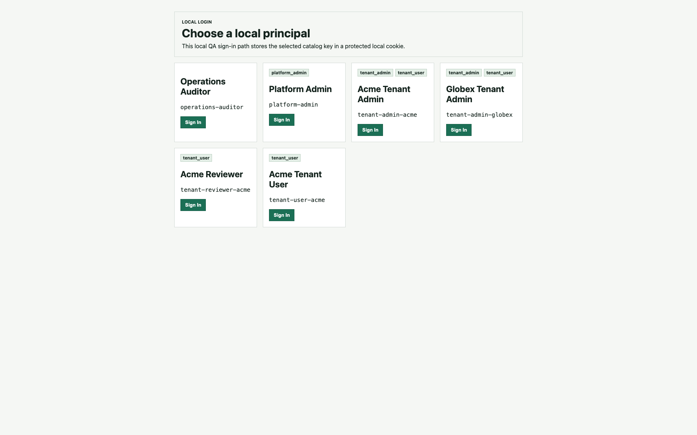
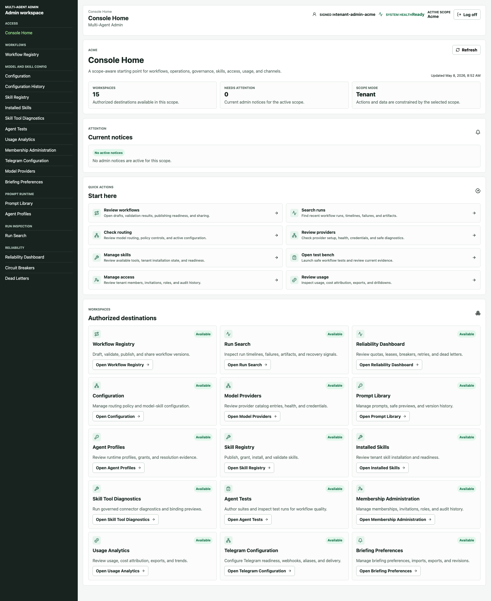
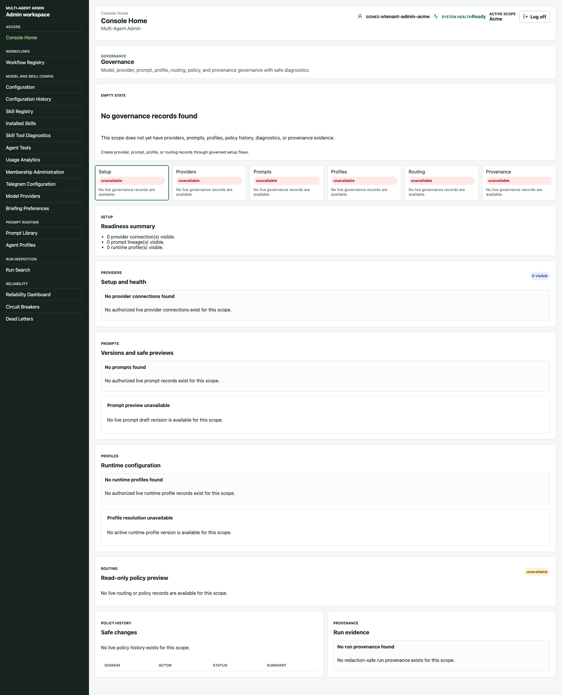
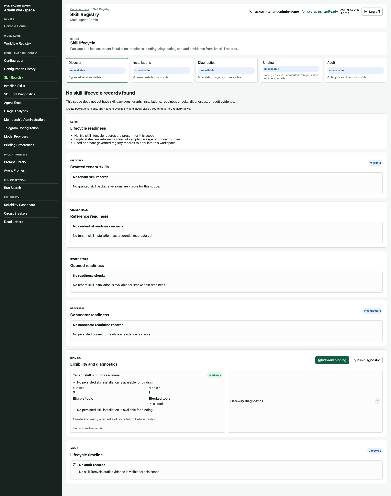
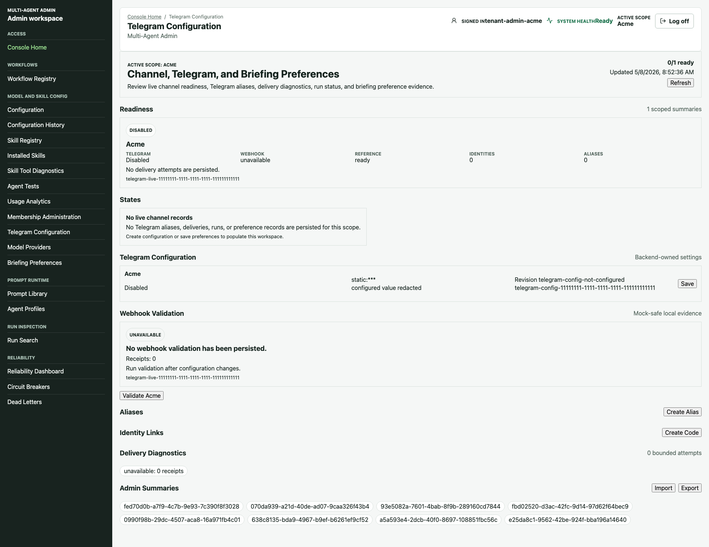
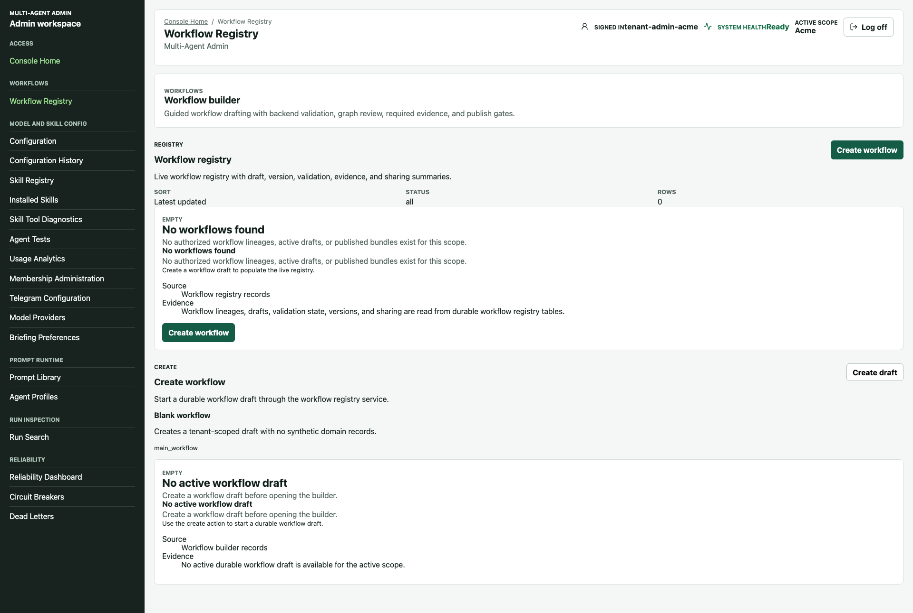
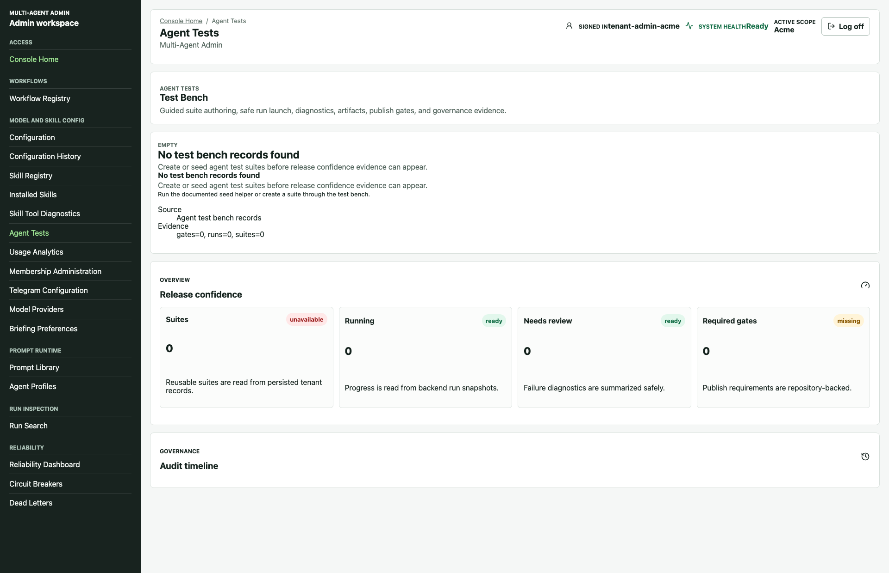
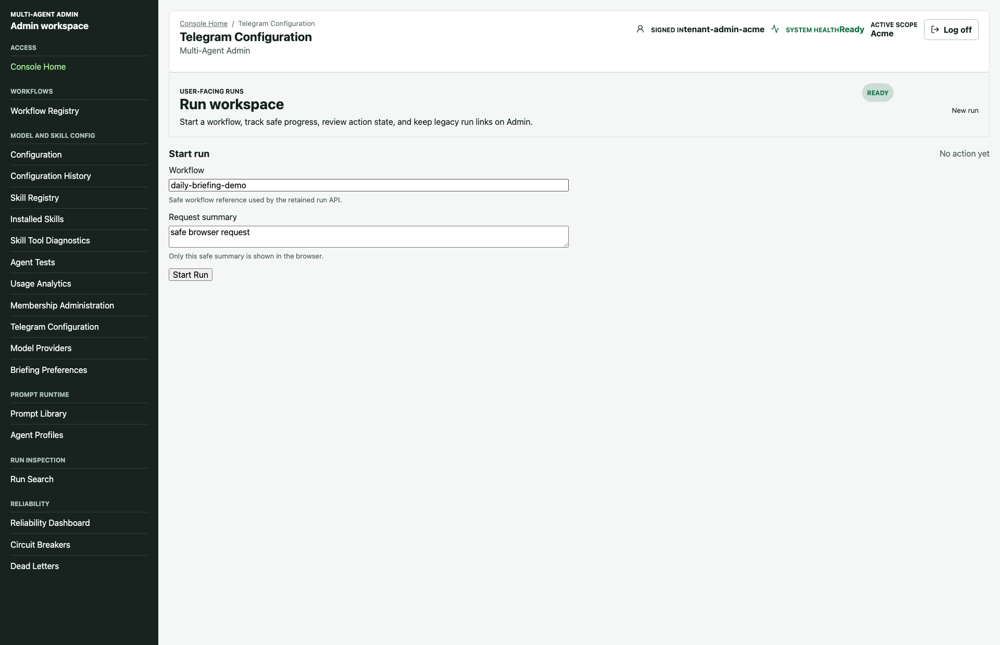
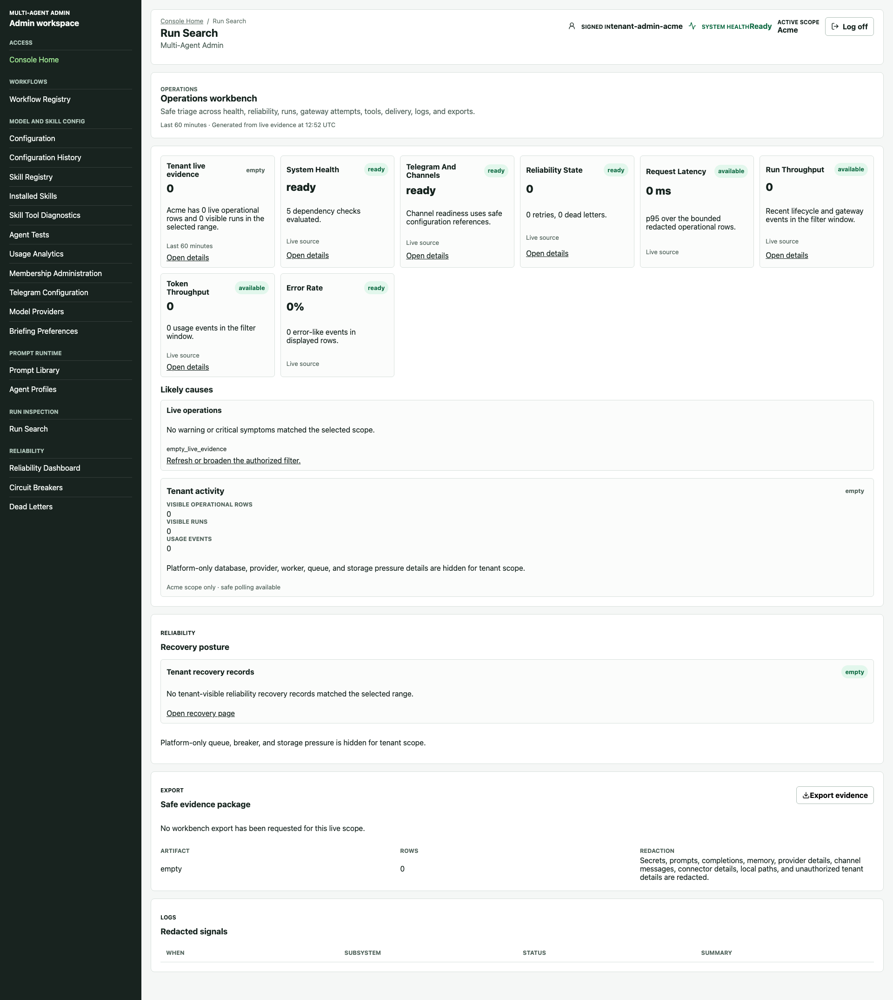
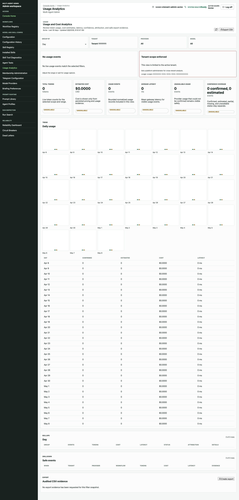

# Daily Intelligence Briefing Browser Setup Guide

Review date: 2026-05-10

This guide shows how to configure and test the Daily Intelligence Briefing
scenario from a clean local install using the Admin browser UI. The goal is to
create a tenant-owned workflow that accepts the request `Morning briefing`,
fans out to briefing agents, gathers safe local evidence, publishes the
workflow, creates a Telegram alias, links a user, and verifies the result from
the browser.

After opening the local Admin login page, do not navigate by editing the
browser address bar. Use the UI links, left navigation, command search,
buttons, row actions, and in-page links described below. Terminal commands in
the preparation step include local setup paths because they are not browser
navigation steps.

For browser instructions, quoted names such as `Workflow Registry`, `Create
workflow`, `Save draft`, and `Launch deterministic run` are visible labels in
the UI. If a section is not visible, scroll down within the page first. If the
left navigation is hidden on a narrow screen, use the Admin menu or command
search to find the same label.

## Scenario

The user sends this Telegram message:

```text
Morning briefing
```

The Daily Intelligence Briefing workflow should prepare a concise morning
briefing with these sections:

1. Today's schedule
2. Email items that need attention
3. News and context
4. Weather, commute, and location notes
5. Suggested focus items

The local setup in this guide uses deterministic evidence and safe mock
connector diagnostics. It proves the browser configuration, publish gate,
workflow graph, runtime launch, Telegram alias, and review surfaces without
requiring live Google, Gmail, news, weather, traffic, or model-provider calls.
If your environment has approved live connectors and a real Telegram bot, the
same UI path can be used with live credentials represented only as safe
references.

## What This Tutorial Configures

Starting from an empty migrated database, this tutorial creates or verifies the
durable records needed for the Daily Intelligence Briefing scenario:

- The Acme tenant used by the local Admin login.
- A tenant-scoped `Daily Intelligence Briefing` workflow draft.
- Roles for the orchestrator, calendar scout, email triage agent, news/context
  agent, logistics agent, focus recommender, and briefing synthesizer.
- A visible workflow graph with scout fan-out, a join, focus recommendation,
  final synthesis, and terminal completion.
- Prompt and runtime profile references for every role.
- Required deterministic Test Bench evidence for publishing.
- An immutable published workflow version.
- A runtime launch handoff that preselects the workflow.
- Telegram readiness, the `Morning briefing` alias, and a one-time link code.
- Operations, usage, run, and test evidence pages for final review.

Do not build the workflow outside the Admin page. Do not paste raw API keys,
OAuth tokens, private messages, email bodies, provider payloads, prompt
transcripts, or customer-sensitive data into visible fields. Use short safe
summaries and safe reference labels.

## Step 0 - Prepare A Clean Local System

Local setup actions:

1. From the repository root, create the tutorial environment file:

   ```bash
   cp tutorials/env.test_example .env
   ```

2. For a deterministic local walkthrough, leave `OPENAI_API_KEY` and
   `TELEGRAM_BOT_TOKEN` blank. For a real provider or real Telegram delivery,
   fill those values only in your local `.env` file.

3. Install dependencies, start PostgreSQL, and apply migrations:

   ```bash
   uv sync
   docker compose up -d postgres
   uv run alembic upgrade head
   ```

4. Seed the Acme tenant used by the `Acme Tenant Admin` login card:

   ```bash
   docker compose exec -T postgres psql -U postgres -d multi_agent_platform <<'SQL'
   INSERT INTO tenants (
     tenant_id,
     slug,
     display_name,
     status,
     created_at,
     updated_at
   )
   VALUES (
     '11111111-1111-1111-1111-111111111111',
     'acme',
     'Acme',
     'active',
     CURRENT_TIMESTAMP,
     CURRENT_TIMESTAMP
   )
   ON CONFLICT (slug) DO NOTHING;
   SQL
   ```

5. Build the Admin browser assets:

   ```bash
   cd frontend/admin
   npm install
   npm run build
   cd ../..
   ```

6. Start the API in one terminal:

   ```bash
   uv run uvicorn multi_agent_platform.api.main:app --host 127.0.0.1 --port 8000 --reload
   ```

7. Start the worker in a second terminal when you want workflow runs to move
   through background processing:

   ```bash
   uv run python -m multi_agent_platform.workers.main
   ```

Explanation: This prepares the local system the browser guide expects. The
Acme tenant row must exist before the Acme local-principal login can load
tenant-scoped workspaces. The worker is useful for runtime processing, but the
UI configuration and deterministic publish evidence can be reviewed without
real external services.

## Step 1 - Sign In And Confirm Scope



On-page actions:

1. Open the local Admin login page supplied by the running API environment. For
   the default local server, this is the first and only browser address you
   should type manually: `http://127.0.0.1:8000/auth/local-login`.
2. Find the local-principal card labeled `Acme Tenant Admin`.
3. Confirm the card mentions the Acme tenant or tenant administrator role.
4. Click `Sign In` on the `Acme Tenant Admin` card.
5. Wait for the Admin console home screen to load. Do not use the browser Back
   button during sign-in.
6. In the top bar, read the `Signed in` value and confirm it identifies the
   Acme tenant admin.
7. In `Active scope`, confirm the scope is `Acme`. If another scope is active,
   open the `Switch admin scope` dropdown, choose `Acme`, and wait for the page
   to refresh.

Screen check:

- Local login cards show display names and role badges.
- `Sign In` is the only action needed on this page.
- After sign-in, the Admin shell top bar shows signed-in user, health, active
  scope, and log off.

## Step 2 - Use Admin Links For Navigation



On-page actions:

1. On Console Home, look at the left sidebar. It is grouped by product area.
2. Under `Workflows`, locate `Workflow Registry`. You will use it to create,
   edit, validate, publish, and launch the Daily Briefing workflow.
3. Under `Workflows`, locate `Agent Tests`. You will use it to review the
   required deterministic evidence created from the workflow builder.
4. Under `Configuration`, locate the provider, prompt, profile, and routing
   workspace. You will use it to review readiness and optional governance
   records.
5. Locate `Skill Registry`. You will use it to check connector readiness for
   calendar, email, news, weather, and commute tools.
6. Locate `Telegram Configuration` or `Channels`. You will use it to configure
   Telegram readiness, the alias, identity link, delivery diagnostics, and
   briefing preferences.
7. Locate `Run Search` or `Run workspace`. You will use it to test a browser
   run with the published workflow.
8. Locate `Operations` and `Usage`. You will use them after setup to review
   safe runtime and cost evidence.
9. Use command search only when the left sidebar is collapsed. Search for the
   same visible labels listed above.

Screen check:

- The left sidebar includes `Workflow Registry`, `Agent Tests`, `Skill
  Registry`, `Channels`, `Operations`, and `Usage`.
- The top bar includes `Active scope`.
- Console Home includes current notices and authorized destinations.

## Step 3 - Review Optional Governance Readiness



On-page actions:

1. Click `Configuration` in the left navigation.
2. Confirm the page title or main panel says `Governance`.
3. Confirm the top bar still shows `Active scope` as `Acme`.
4. In `Readiness summary`, review provider, prompt, profile, routing, and
   provenance counts.
5. In `Providers`, read each provider card. For the deterministic local
   tutorial, provider setup may be empty or unavailable and you can continue.
6. If a safe local provider card is already present and has a `Run probe`
   button, click `Run probe`. Wait for `Probe result` and confirm it does not
   show raw credentials.
7. In `Prompts`, review existing prompt cards if present. Click `Preview safe`
   to see a redacted summary. Click `Preview redaction check` only when you are
   checking that unsafe text is withheld.
8. In `Profiles`, review existing runtime profile cards if present. Click
   `Resolve` only for a profile you are authorized to inspect.
9. In `Routing`, click `Preview routing` only if you need a read-only policy
   check for the active scope.
10. Do not paste a raw API key into any visible field. Provider secrets should
    be represented by safe reference labels only.
11. Return to the main setup path by clicking `Workflow Registry`, `Skill
    Registry`, or `Channels` in the left navigation.

Explanation: The Daily Briefing local path can be configured and tested with
safe deterministic evidence. Governance becomes important when you want
model-backed execution or live provider probes. Empty panels are truthful
setup state, not a failure.

Screen check:

- The page shows `Readiness summary`, `Providers`, `Prompts`, `Profiles`,
  `Routing`, and `Run evidence`.
- Any probe, preview, save, or resolve result is summarized safely.
- Credential values, provider headers, and raw completions are not visible.

## Step 4 - Review Skill And Connector Readiness



On-page actions:

1. Click `Skill Registry` in the left navigation.
2. Confirm the page title is `Skill lifecycle`.
3. Confirm `Active scope` is still `Acme`.
4. In `Lifecycle readiness`, review the summary cards.
5. In `Package publication`, review any available package candidate. If your
   local data includes Daily Briefing package candidates, use the visible
   `Save candidate`, `Validate`, and `Publish` buttons in that order.
6. In `Immutable package versions`, review versions for these tool families
   when present: calendar, Gmail or email, news, weather, and commute.
7. In `Granted tenant skills`, click `Install` for each granted Daily Briefing
   tool version that is not already installed.
8. In `Reference readiness`, review credential readiness. Click `Save
   reference` only for safe reference labels, never for raw credential values.
9. In `Queued readiness`, click `Refresh readiness` for installed tools that
   show pending or stale readiness.
10. In `Connector readiness`, click `Run diagnostic` for the calendar, email,
    news, weather, and commute connectors when the action is available.
11. In `Eligibility and diagnostics`, click `Preview binding`. Confirm the
    eligible tools list includes the tools needed by the Daily Briefing roles.
12. Click `Run diagnostic` in this panel if you need a gateway-level diagnostic
    summary.
13. Review `Lifecycle timeline` to confirm install, readiness, diagnostic, or
    grant activity is recorded.

Explanation: This page proves the required connector families are visible and
safe to bind. The local tutorial uses mock diagnostics and safe metadata. A
diagnostic should show status, safe attempt summary, readiness, and redaction
summary without exposing raw email bodies, tokens, secret values, or full
provider payloads.

Screen check:

- `Granted tenant skills`, `Reference readiness`, `Connector readiness`, and
  `Eligibility and diagnostics` are visible.
- Installed skills show readiness badges.
- Diagnostic results are concise and redacted.

## Step 5 - Configure Telegram And Briefing Preferences



On-page actions:

1. Click `Telegram Configuration` or `Channels` in the left navigation.
2. Confirm the page title includes `Telegram Configuration` and the inner
   header includes `Channel, Telegram, and Briefing Preferences`.
3. Confirm `Active scope` is `Acme`.
4. In `Readiness`, review Telegram status, webhook status, reference readiness,
   linked identity count, alias count, and delivery attempt count.
5. In `Telegram Configuration`, find the row for `Acme`.
6. Confirm the row shows safe labels for bot token reference and webhook
   signing reference. Do not expect raw token values.
7. Click `Save` on the Acme row if the row is disabled, stale, or has not yet
   been saved in this local database.
8. Wait for the mutation note. It should summarize the saved configuration
   without showing a bot token.
9. In `Webhook validation`, click `Validate Acme` when the action is visible.
10. Wait for the validation result and confirm it is a safe status summary.
11. In `Briefing Preferences`, click `Save Preferences`.
12. Wait for the preference result and confirm the profile shows safe summaries
    for timezone, location, topics, VIP hints, workday, commute, accounts,
    output style, and scheduled time.
13. In `Admin Summaries`, use `Export` only when you need a safe preferences
    artifact. Use `Import` only with an authorized safe artifact reference.
14. Do not click `Create Alias` yet. The alias should be created after the
    workflow is published.
15. Do not click `Create Code` yet. The identity link code should be created
    after the alias is ready.

Explanation: Telegram readiness, preferences, alias routing, identity links,
delivery diagnostics, and webhook receipt history all live on this page. The
configuration row uses safe reference labels. The local tutorial can use mock
delivery evidence; real Telegram delivery requires a real bot token and a
reachable webhook environment.

Screen check:

- `Readiness`, `Telegram Configuration`, `Webhook validation`, `Aliases`,
  `Identity links`, `Delivery diagnostics`, and `Briefing Preferences` are
  visible.
- Preference profile values are summaries, not raw private details.
- Alias and identity actions are visible but not used until later.

## Step 6 - Create The Daily Briefing Workflow Draft



On-page actions:

1. Click `Workflow Registry` in the left navigation.
2. Wait for the `Workflow Registry` page and `Create` panel to load.
3. Click `Create workflow`.
4. Wait for the create result to appear.
5. In the create result, click `Open draft`.
6. Confirm the workflow builder opens and the `Custom workflow launch
   checklist` is visible.
7. Click `Apply three-agent starter`. This gives the workflow draft a visible
   starter graph, contracts, prompt/profile references, and join policy.
8. Scroll to the top draft form.
9. In `Name`, enter `Daily Intelligence Briefing`.
10. In `Description`, enter `Telegram-triggered morning briefing with calendar,
    email, news, logistics, focus, and final synthesis roles.`
11. In `Join policy`, choose the all-success or default safe join option.
12. Click `Save draft`.
13. Wait for `Save result` to show an accepted or saved result.

Explanation: The starter is not the final Daily Briefing workflow. It creates a
safe editable base so the checklist, graph, roles, contracts, joins, and
binding controls are all present. The next steps convert the starter into the
Daily Briefing scenario.

Screen check:

- The checklist shows steps for metadata, agents, prompts/profiles, graph,
  contracts, evidence, validation, publish, and launch.
- The draft form includes `Name`, `Description`, `Join policy`, and `Save
  draft`.
- Save results are safe summaries.

## Step 7 - Configure Roles

Stay on the `Workflow Registry` page with the Daily Briefing draft open.

On-page actions:

1. Click the `Agents` checklist card, or scroll to `Roles`.
2. The starter should show three role cards. Update those first, then add the
   remaining Daily Briefing roles.
3. Type the key values exactly as shown. For `Responsibilities`, put each item
   on its own line. For `Skill refs`, separate multiple values with commas.
   Temporary warning badges are expected until contracts and graph links are
   updated in the next steps.
4. For the first starter role, update the fields to:

   | Field | Value |
   | --- | --- |
   | Key | `orchestrator` |
   | Name | `Orchestrator Agent` |
   | Kind | `agent` |
   | Purpose | `Parse the request, fan out to briefing scouts, handle partial failures, and prepare synthesis inputs.` |
   | Responsibilities | `Classify request`, `Delegate scouts`, `Check preference context`, `Prepare synthesis inputs` |

5. For the second starter role, update the fields to:

   | Field | Value |
   | --- | --- |
   | Key | `calendar-scout` |
   | Name | `Calendar Scout` |
   | Kind | `subagent` |
   | Skill refs | `daily-briefing-calendar-install` |
   | Purpose | `Summarize today's calendar, priority events, conflicts, and location needs.` |

6. For the third starter role, update the fields to:

   | Field | Value |
   | --- | --- |
   | Key | `email-triage` |
   | Name | `Email Triage Agent` |
   | Kind | `subagent` |
   | Skill refs | `daily-briefing-gmail-install` |
   | Purpose | `Summarize recent email that needs attention and elevate important senders.` |

7. Click `Add role`.
8. Fill the new role as:

   | Field | Value |
   | --- | --- |
   | Key | `news-context` |
   | Name | `News And Context Agent` |
   | Kind | `subagent` |
   | Skill refs | `daily-briefing-news-install` |
   | Purpose | `Summarize relevant news based on the user's briefing topics.` |

9. Click `Add role` again.
10. Fill the new role as:

   | Field | Value |
   | --- | --- |
   | Key | `logistics-agent` |
   | Name | `Logistics Agent` |
   | Kind | `subagent` |
   | Skill refs | `daily-briefing-weather-install, daily-briefing-commute-install` |
   | Purpose | `Summarize weather, commute, transit, and location constraints.` |

11. Click `Add role` again.
12. Fill the new role as:

    | Field | Value |
    | --- | --- |
    | Key | `focus-recommender` |
    | Name | `Focus Recommender` |
    | Kind | `subagent` |
    | Purpose | `Recommend one to three focus items from the collected briefing results.` |

13. Click `Add role` again.
14. Fill the new role as:

    | Field | Value |
    | --- | --- |
    | Key | `briefing-synthesizer` |
    | Name | `Briefing Synthesizer` |
    | Kind | `agent` |
    | Purpose | `Format the final Telegram-ready briefing with schedule, email, news, logistics, and focus sections.` |

15. For each role, choose the closest available `Input contract` and `Output
    contract`. Exact contract names are configured in the next step, so it is
    fine if a selector temporarily shows a starter contract.
16. Click `Save draft`.
17. Wait for the save result.

Screen check:

- `Roles` shows seven role cards.
- The calendar, email, news, weather, and commute role cards have safe skill
  reference labels where applicable.
- No role card contains raw credentials, private messages, or raw prompt text.

## Step 8 - Configure Contracts

Stay on the same workflow draft.

On-page actions:

1. Click the `Contracts` checklist card, or scroll to `Contracts`.
2. Type key values exactly as shown. For `Producers` and `Consumers`, separate
   multiple values with commas.
3. Update the first starter contract:

   | Field | Value |
   | --- | --- |
   | Key | `briefing-request` |
   | Name | `Briefing Request` |
   | Kind | `workflow_input` |
   | Schema type | `object` |
   | Consumers | `orchestrator, calendar-scout, email-triage, news-context, logistics-agent` |

4. Update the second starter contract:

   | Field | Value |
   | --- | --- |
   | Key | `scout-results` |
   | Name | `Scout Results` |
   | Kind | `handoff` |
   | Schema type | `object` |
   | Producers | `calendar-scout, email-triage, news-context, logistics-agent` |
   | Consumers | `focus-recommender` |

5. Update the third starter contract:

   | Field | Value |
   | --- | --- |
   | Key | `briefing-output` |
   | Name | `Briefing Output` |
   | Kind | `workflow_output` |
   | Schema type | `object` |
   | Producers | `briefing-synthesizer` |

6. Click `Add contract` and create:

   | Field | Value |
   | --- | --- |
   | Key | `calendar-result` |
   | Name | `Calendar Result` |
   | Kind | `data_contract` |
   | Producers | `calendar-scout` |
   | Consumers | `scout-join` |

7. Click `Add contract` and create:

   | Field | Value |
   | --- | --- |
   | Key | `email-result` |
   | Name | `Email Result` |
   | Kind | `data_contract` |
   | Producers | `email-triage` |
   | Consumers | `scout-join` |

8. Click `Add contract` and create:

   | Field | Value |
   | --- | --- |
   | Key | `news-result` |
   | Name | `News Result` |
   | Kind | `data_contract` |
   | Producers | `news-context` |
   | Consumers | `scout-join` |

9. Click `Add contract` and create:

   | Field | Value |
   | --- | --- |
   | Key | `logistics-result` |
   | Name | `Logistics Result` |
   | Kind | `data_contract` |
   | Producers | `logistics-agent` |
   | Consumers | `scout-join` |

10. Click `Add contract` and create:

   | Field | Value |
   | --- | --- |
   | Key | `focus-result` |
   | Name | `Focus Result` |
   | Kind | `data_contract` |
   | Producers | `focus-recommender` |
   | Consumers | `briefing-synthesizer` |

11. Return to `Roles`.
12. Set each role's `Input contract` and `Output contract` as follows:

    | Role | Input contract | Output contract |
    | --- | --- | --- |
    | Orchestrator Agent | `briefing-request` | `briefing-request` |
    | Calendar Scout | `briefing-request` | `calendar-result` |
    | Email Triage Agent | `briefing-request` | `email-result` |
    | News And Context Agent | `briefing-request` | `news-result` |
    | Logistics Agent | `briefing-request` | `logistics-result` |
    | Focus Recommender | `scout-results` | `focus-result` |
    | Briefing Synthesizer | `focus-result` | `briefing-output` |

13. Click `Save draft`.
14. Wait for the save result.

Screen check:

- `Contracts` shows request, scout result, individual scout results, focus
  result, and briefing output.
- Dependency warnings, if any, point to fields you can correct on the same
  page.

## Step 9 - Configure Prompt And Runtime Profile Bindings

Stay on the same workflow draft.

On-page actions:

1. Click the `Prompts And Profiles` checklist card, or scroll to `Per-Agent
   Bindings`.
2. In `Binding Matrix`, review every role. Roles that are missing a prompt or
   profile will show a warning or blocked badge.
3. In `Role Binding Controls`, choose `Orchestrator Agent` in the `Role`
   dropdown.
4. In `Prompt title`, enter `Daily briefing orchestrator prompt`.
5. Leave `Authorized prompt editor` closed unless your task is prompt editing.
6. Click `Publish prompt reference`.
7. In `Profile name`, enter `Daily briefing orchestrator runtime profile`.
8. In `Model routing hint`, enter `local-safe-model`.
9. Click `Activate profile reference`.
10. Repeat the same visible action pattern for each role:

    | Role | Prompt title | Profile name |
    | --- | --- | --- |
    | Calendar Scout | `Calendar scout briefing prompt` | `Calendar scout runtime profile` |
    | Email Triage Agent | `Email triage briefing prompt` | `Email triage runtime profile` |
    | News And Context Agent | `News context briefing prompt` | `News context runtime profile` |
    | Logistics Agent | `Logistics briefing prompt` | `Logistics runtime profile` |
    | Focus Recommender | `Focus recommender prompt` | `Focus recommender runtime profile` |
    | Briefing Synthesizer | `Briefing synthesizer prompt` | `Briefing synthesizer runtime profile` |

11. After each role, confirm the matching row in `Binding Matrix` changes to
    ready.
12. Click `Save draft`.
13. Wait for the save result.
14. Use the browser refresh button.
15. Confirm the `Binding Matrix` still shows the saved prompt and profile
    references for every role.

Explanation: These controls create safe prompt and runtime profile references
from the workflow setup page. Raw prompt content is allowed only inside the
authorized prompt editor and should stay closed for this tutorial. Summaries,
graphs, screenshots, and audit views should show reference keys, readiness, and
safe labels only.

Screen check:

- `Per-Agent Bindings`, `Binding Matrix`, and `Role Binding Controls` are
  visible.
- Every Daily Briefing role has one prompt reference and one runtime profile
  reference.
- Raw prompt text is not shown in role summaries or graph panels.

## Step 10 - Configure Graph Topology And Join

Stay on the same workflow draft.

On-page actions:

1. Click the `Graph` checklist card, or scroll to `Graph Topology`.
2. Type node keys, edge keys, and join keys exactly as shown. For fields such
   as `Inbound edges` and `Required branches`, separate multiple values with
   commas.
3. In the `Nodes` list, update or create these nodes:

   | Node key | Name | Type | Role or join |
   | --- | --- | --- | --- |
   | `orchestrator-intake` | `Orchestrator Intake` | `role` | `Orchestrator Agent` |
   | `calendar-scout-node` | `Calendar Scout` | `role` | `Calendar Scout` |
   | `email-triage-node` | `Email Triage` | `role` | `Email Triage Agent` |
   | `news-context-node` | `News Context` | `role` | `News And Context Agent` |
   | `logistics-node` | `Logistics` | `role` | `Logistics Agent` |
   | `scout-join` | `Join Scout Results` | `join` | `all-scouts-return` |
   | `focus-node` | `Focus Recommender` | `role` | `Focus Recommender` |
   | `synthesis-node` | `Briefing Synthesizer` | `role` | `Briefing Synthesizer` |
   | `terminal` | `Briefing Complete` | `terminal` | none |

4. Use `Add node` for missing role nodes.
5. Use `Add join node` if the join node is missing.
6. For the terminal node, choose `terminal` in the `Type` field.
7. In `Entry node`, choose `Orchestrator Intake`.
8. In the `Edges` list, update or create these edges:

   | Edge key | Source | Target | Contract |
   | --- | --- | --- | --- |
   | `orchestrator-to-calendar` | `orchestrator-intake` | `calendar-scout-node` | `briefing-request` |
   | `orchestrator-to-email` | `orchestrator-intake` | `email-triage-node` | `briefing-request` |
   | `orchestrator-to-news` | `orchestrator-intake` | `news-context-node` | `briefing-request` |
   | `orchestrator-to-logistics` | `orchestrator-intake` | `logistics-node` | `briefing-request` |
   | `calendar-to-join` | `calendar-scout-node` | `scout-join` | `calendar-result` |
   | `email-to-join` | `email-triage-node` | `scout-join` | `email-result` |
   | `news-to-join` | `news-context-node` | `scout-join` | `news-result` |
   | `logistics-to-join` | `logistics-node` | `scout-join` | `logistics-result` |
   | `join-to-focus` | `scout-join` | `focus-node` | `scout-results` |
   | `focus-to-synthesis` | `focus-node` | `synthesis-node` | `focus-result` |
   | `synthesis-to-terminal` | `synthesis-node` | `terminal` | `briefing-output` |

9. Use `Add edge` for each missing edge.
10. Scroll to `Joins, Approvals, And Subworkflows`.
11. In `Join Policies`, update the existing join or click `Add join`.
12. Set the join fields:

    | Field | Value |
    | --- | --- |
    | Key | `all-scouts-return` |
    | Strategy | `all_success` |
    | Inbound edges | `calendar-to-join, email-to-join, news-to-join, logistics-to-join` |
    | Required branches | `calendar, email, news, logistics` |
    | Failure behavior | `manual_resolution` |
    | Output contract | `scout-results` |

13. Return to `Graph Topology`.
14. On the `scout-join` node, set `Join policy` to `all-scouts-return`.
15. Click `Save draft`.
16. Wait for the save result.
17. Review the visual graph. It should show fan-out from orchestrator to four
    scout nodes, a join, focus recommender, synthesizer, and terminal.
18. Use the node and edge lists if the canvas is hard to read. They are the
    keyboard-readable version of the same graph.

Screen check:

- The graph is not blank.
- Node and edge lists match the visual graph.
- Selecting a node or edge shows safe details and reference labels.
- No raw provider payload, prompt body, email body, or credential value is
  shown.

## Step 11 - Create Required Publish Evidence

Stay on the same workflow draft.

On-page actions:

1. Click the `Evidence` checklist card, click `Evidence setup`, or scroll to
   `Required publish evidence`.
2. Read the evidence summary. It may say missing, stale, blocked, ready, or
   current.
3. If no suite is attached, click `Create suite`.
4. Wait for `Suite result` to show accepted or saved.
5. If the `Authorized suite` dropdown shows the new Daily Briefing suite,
   select it.
6. Click `Attach suite` if the suite is not already attached.
7. Click `Save draft`.
8. Wait for the save result.
9. Click `Add safe case`.
10. Wait for `Case result`.
11. Click `Launch deterministic run`.
12. Wait for `Run result`. It should report a safe run summary.
13. Confirm the page does not show raw transcript text, provider payloads,
    tool payloads, credential values, local file paths, or private messages.
14. If the run result is old or you need to rerun evidence, click `Clear run
    result`, then click `Launch deterministic run` again.
15. Click `Save draft` after a current passing run is shown.
16. Wait for the save result.

Explanation: Publication depends on current deterministic evidence for the
active workflow draft revision. If you edit the workflow after a passing run,
evidence can become stale. When that happens, return to this section and launch
a new deterministic run.

Screen check:

- `Required publish evidence` has an attached suite.
- A safe case exists.
- A deterministic run result is visible.
- Evidence cards use safe identifiers and summaries only.

## Step 12 - Review Evidence In Agent Tests



On-page actions:

1. From `Required publish evidence`, click `Open Agent Tests`.
2. Confirm the `Agent Tests` page opens.
3. In `Reusable suites`, find the suite for `Daily Intelligence Briefing`.
4. Click `Open suite` for that suite.
5. In `Suite and case forms`, confirm the suite targets the Daily Briefing
   workflow and is marked as required for publishing.
6. Confirm the case list includes a workflow contract smoke case.
7. In `Safe run launch`, keep the safe mode set to `Mock model` or the safest
   deterministic mode shown.
8. If you need to rerun from this page, click `Launch run`.
9. In `Recent runs`, click `Open run` for the latest run.
10. Review `Backend-owned status`, `Pass/fail diagnostics`, and `Traces and
    artifacts`.
11. Confirm diagnostics and artifacts are safe summaries, not raw transcripts.
12. Click `Workflow Registry` in the left navigation to return to the workflow.
13. Open the `Daily Intelligence Briefing` draft again if needed.

Screen check:

- `Release confidence`, `Reusable suites`, `Suite and case forms`, `Safe run
  launch`, `Recent runs`, `Pass/fail diagnostics`, and `Traces and artifacts`
  are visible.
- The latest run is passed or shows an actionable safe failure.
- Evidence remains tied to the current workflow draft.

## Step 13 - Validate And Publish The Workflow

Return to the `Daily Intelligence Briefing` draft in `Workflow Registry`.

On-page actions:

1. Scroll to `Backend-owned findings`.
2. Click `Run validation`.
3. Wait for `Validation result`.
4. If findings appear, read each finding and click its `Open section` link.
5. Resolve the visible field or evidence issue in the linked section.
6. Click `Run validation` again until no blocking findings remain.
7. Scroll to `Evidence and decision`.
8. Click `Check publish gate`.
9. Wait for the gate decision.
10. If the gate is blocked, click `Review evidence setup` on the blocker and
    fix the evidence section.
11. When the gate is ready, click `Prepare publish`.
12. Read the confirmation message in `Publish result`.
13. Confirm it refers to the `Daily Intelligence Briefing` workflow.
14. Click `Confirm publish`.
15. Wait for the publish result to show accepted or published.
16. Confirm the checklist now marks `Publish` as complete.
17. Confirm the launch area says the published bundle is ready for runtime
    selection.
18. If `Inspect published graph` appears, click it and confirm the published
    graph shows the same safe topology. Then return to `Workflow Registry`.

Screen check:

- `Backend-owned findings` has no blocking findings.
- `Evidence and decision` reports ready or published.
- `Confirm publish` is enabled only after the confirmation step.
- The published graph is readable through the canvas and the node/edge lists.

## Step 14 - Verify Runtime Launch Handoff



On-page actions:

1. In the workflow builder's launch area, click `Open runtime launch`.
2. Confirm the `Run workspace` page opens.
3. Confirm the `Workflow` field is already filled with the Daily Briefing
   workflow reference.
4. In `Request summary`, enter `Morning briefing`.
5. Click `Start Run` only when you intentionally want to create a browser run.
6. If you clicked `Start Run`, wait for the action state and status panels to
   update.
7. If a `Refresh` button appears, click it to reload the latest run status.
8. Review `Status and progress`, `Result`, and any safe action state shown on
   the page.
9. Use the left navigation to return to `Workflow Registry` or `Channels`.

Explanation: The runtime launch link carries a safe workflow reference into
the run workspace. It does not start a run until `Start Run` is clicked. This
is a browser-only way to check that a published workflow can be selected for a
user-facing request.

Screen check:

- The page title is `Run workspace`.
- `Workflow` is prefilled.
- The run does not start until `Start Run` is clicked.
- Run status and result summaries are safe.

## Step 15 - Create The Telegram Alias And Link Code

Return to `Channels` or `Telegram Configuration`.

On-page actions:

1. Click `Channels` or `Telegram Configuration` in the left navigation.
2. In `Readiness`, confirm Telegram configuration and webhook readiness are
   saved or available.
3. In `Aliases`, click `Create Alias`.
4. Wait for the mutation note.
5. Confirm the alias row includes `Morning briefing`.
6. Confirm the target summary refers to a configured workflow.
7. If the alias row has action buttons such as enable, disable, or refresh,
   use them only when the alias status is not enabled.
8. In `Identity links`, click `Create Code`.
9. Copy the visible one-time code into your local notes for the person linking
   Telegram. The code is shown only at creation time.
10. If your environment has a real Telegram bot and reachable webhook, open
    Telegram and send `/link <the-code>` to the bot from the user account.
11. After the user sends the link message, return to the Admin page and click
    `Refresh`.
12. Confirm `Linked identities` shows a masked identity summary.
13. If you do not have a real Telegram bot in this local environment, keep the
    link code as setup evidence and use the `Run workspace` browser test from
    Step 14 for the functional request test.
14. After a linked user exists, send `Morning briefing` to the Telegram bot
    from the linked account if your environment supports real delivery.
15. Click `Refresh` on the Admin page and review `Delivery diagnostics`.

Explanation: The `Morning briefing` alias is created after publish so it can
point at a real published workflow. The link code connects a Telegram identity
to the Acme user without exposing the full Telegram user id or chat id in the
browser.

Screen check:

- `Aliases` shows `Morning briefing`.
- `Identity links` shows a one-time code after creation and masked identity
  summaries after linking.
- `Delivery diagnostics` shows bounded safe delivery evidence.

## Step 16 - Review Operations Evidence



On-page actions:

1. Click `Operations` in the left navigation.
2. Confirm the page title is `Operations workbench`.
3. Review the summary cards near the top of the page.
4. In `Tenant activity`, look for recent workflow, run, connector, or channel
   activity from the Daily Briefing setup.
5. In `Likely causes`, review any bounded failure summaries.
6. In `Recovery posture`, review retry, breaker, queue, or dead-letter
   summaries if present.
7. If you started a browser run and an `Open runtime graph` or runtime graph
   panel is available, open it.
8. In `Runtime run communication`, select a node from the canvas or node list.
9. Select an edge from the canvas or edge list.
10. Confirm node and edge details show safe statuses, handoff references,
    replay references, or artifact references only.
11. Do not expect raw agent messages, model payloads, email bodies, or tool
    outputs on this page.
12. Use `Export evidence` only when you need a redacted support package.

Screen check:

- `Operations workbench` is visible.
- Runtime graph and replay evidence are readable when run evidence exists.
- `Redacted signals` contains summaries only.

## Step 17 - Review Usage Evidence



On-page actions:

1. Click `Usage` in the left navigation.
2. Keep the tenant filter scoped to `Acme`.
3. Choose a `Group By` dimension such as day, provider, model, workflow, agent,
   prompt, gateway operation, or governed tool.
4. Review total tokens, estimated cost, usage-event count, latency, unavailable
   usage, and confidence cards.
5. Review `Daily usage trend`.
6. Review the `Rollups` table.
7. Review `Safe events` when event rows exist.
8. Use `Export CSV` or `Create export` only when you need safe reviewer
   evidence.

Explanation: The deterministic local tutorial may show limited usage if no
live provider calls were made. Empty or low-activity usage panels are truthful
state. Provider probes, gateway calls, connector diagnostics, and runtime runs
can add usage evidence when configured.

Screen check:

- Usage cards and rollups are visible.
- Tenant administrators see only the active tenant's usage.
- Export actions create safe metadata, not raw private payloads.

## Step 18 - Use Memberships Only For Access Problems


Use this page only when setup is blocked by principal, role, or tenant-access
problems.

On-page actions:

1. Click `Membership Administration` in the left navigation.
2. Confirm `Active scope` is `Acme`.
3. In `Users`, review visible principals and tenant memberships.
4. In `Invite users`, create an invitation only when a new tenant user needs
   access.
5. In `Link identity`, associate an external identity only when policy allows.
6. In `Assign roles`, grant tenant roles only when you have permission to do
   so.
7. In `Recent decisions`, review route or permission denials.
8. In `Membership timeline`, confirm access-changing audit events.
9. Return to the blocked setup page and retry the original action.

Screen check:

- User and role summaries are masked and tenant-scoped.
- Permission denials are summarized safely.
- Access changes appear in the timeline.

## Final Browser Test

Use this checklist to prove the configuration works without editing the
browser address bar after login.

On-page actions:

1. Click `Workflow Registry`.
2. Open the `Daily Intelligence Briefing` draft.
3. Confirm `Custom workflow launch checklist` is visible.
4. Confirm the checklist shows metadata, agents, prompts/profiles, graph,
   contracts, evidence, validation, publish, and launch.
5. Confirm `Roles` shows seven Daily Briefing roles.
6. Confirm `Per-Agent Bindings` shows every role ready.
7. Confirm `Graph Topology` shows the orchestrator, four scout nodes, join,
   focus recommender, synthesizer, and terminal.
8. Confirm `Required publish evidence` shows current passing deterministic
   evidence.
9. Click `Run validation` and confirm there are no blockers.
10. Click `Check publish gate` and confirm it is ready or already published.
11. Click `Open runtime launch`.
12. Confirm the `Workflow` field is prefilled.
13. Enter `Morning briefing` in `Request summary`.
14. Click `Start Run` only if you want a browser run.
15. Click `Channels`.
16. Confirm `Aliases` includes `Morning briefing`.
17. Confirm `Identity links` has a link code or masked linked identity.
18. Confirm `Delivery diagnostics` is safe and bounded.
19. Click `Agent Tests` and open the Daily Briefing suite.
20. Confirm the latest deterministic run is visible and safe.
21. Click `Operations` and review run or connector activity.
22. Click `Usage` and review any available cost or usage evidence.

Expected result:

- The browser path uses visible links, buttons, dropdowns, and row actions.
- The workflow can be validated and published only after current evidence is
  present.
- The runtime launch page preselects the Daily Briefing workflow.
- The Telegram alias exists after publish.
- Run, delivery, operations, and usage pages show safe summaries only.

## Clean-System Troubleshooting

- If `Acme Tenant Admin` is missing on the login page, confirm the local
  environment uses local-principal authentication and restart the API.
- If the top bar does not show `Active scope` as `Acme`, confirm the Acme
  tenant seed in Step 0 succeeded, then sign in again.
- If `Create workflow` is disabled, confirm you are signed in as `Acme Tenant
  Admin` and the active scope is `Acme`.
- If a role, contract, node, edge, or join selector does not show a newly
  created value, click `Save draft`, wait for the result, then refresh the
  browser.
- If validation reports missing prompt or profile references, return to
  `Per-Agent Bindings`, choose the affected role, click `Publish prompt
  reference`, click `Activate profile reference`, and save again.
- If validation reports graph blockers, return to `Graph Topology` and confirm
  every edge source and target matches a visible node.
- If publish is blocked by missing or stale evidence, return to `Required
  publish evidence`, click `Launch deterministic run`, then save and check the
  gate again.
- If `Open runtime launch` does not prefill a workflow, return to the workflow
  builder and confirm the publish result succeeded.
- If `Create Alias` does not create `Morning briefing`, confirm the workflow is
  published and Telegram configuration was saved for Acme.
- If the Telegram link code cannot be used locally, verify the browser run path
  with `Run workspace` and use a deployed webhook environment for real
  Telegram delivery.
- If Operations or Usage appears empty, create a browser run, run connector
  diagnostics, or launch deterministic evidence, then refresh those pages.

## Sensitive Data Rules

Follow these rules throughout the setup:

- Use safe summaries instead of raw emails, calendar descriptions, prompt
  bodies, provider payloads, or private messages.
- Use credential reference labels instead of raw API keys, OAuth tokens, bot
  tokens, passwords, or authorization headers.
- Use the authorized prompt editor only when you intentionally need to edit
  prompt content.
- Keep screenshots focused on summaries, readiness badges, graph labels,
  evidence status, and safe diagnostics.
- Treat empty, denied, unavailable, stale, or blocked states as real setup
  state and follow the visible recovery links.
